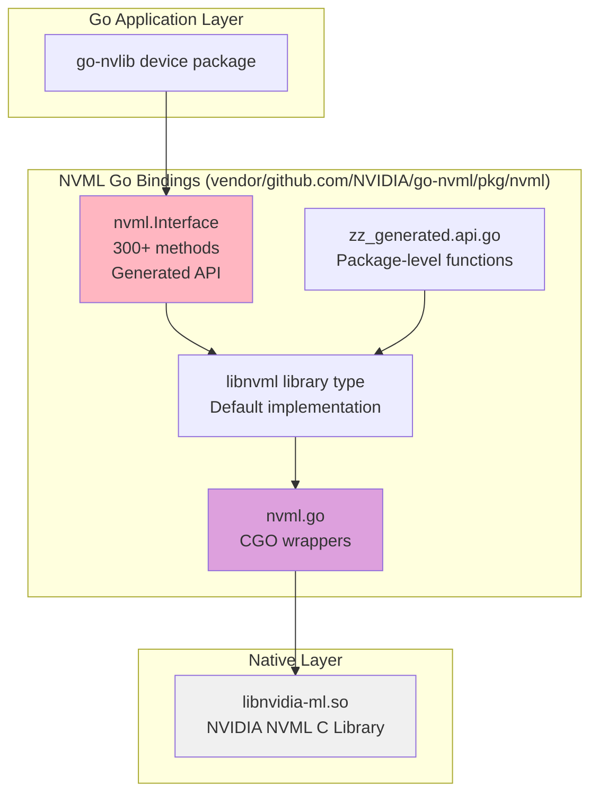
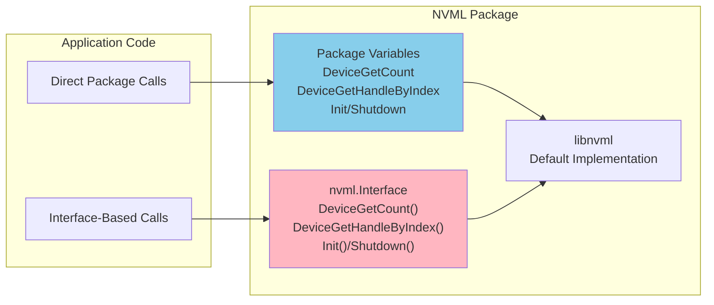
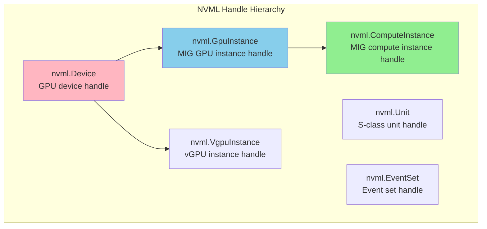
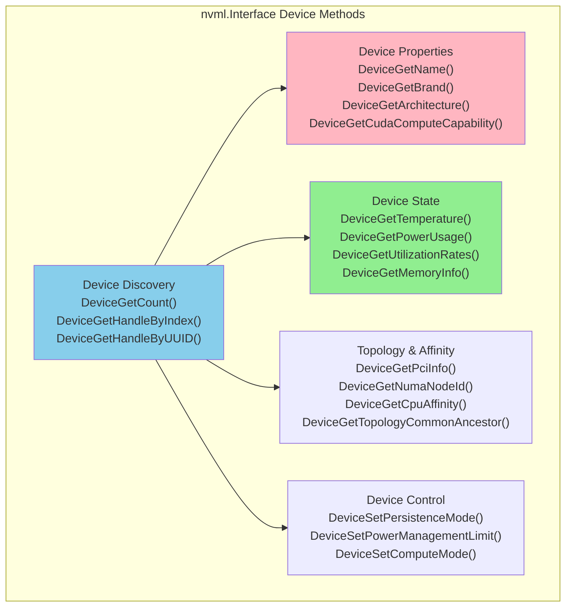
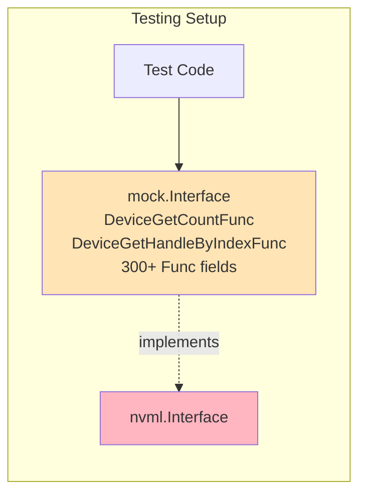

<!-- source: DeepWiki mcp.deepwiki.com · repo NVIDIA/go-nvlib · page 6 NVML Bindings Reference · fetched 2026-10-26 -->

# NVML Bindings Reference

<details>
<summary>Relevant source files</summary>

The following files were used as context for generating this wiki page:

- [vendor/github.com/NVIDIA/go-nvml/pkg/nvml/const.go](vendor/github.com/NVIDIA/go-nvml/pkg/nvml/const.go)
- [vendor/github.com/NVIDIA/go-nvml/pkg/nvml/mock/interface.go](vendor/github.com/NVIDIA/go-nvml/pkg/nvml/mock/interface.go)
- [vendor/github.com/NVIDIA/go-nvml/pkg/nvml/nvml.go](vendor/github.com/NVIDIA/go-nvml/pkg/nvml/nvml.go)
- [vendor/github.com/NVIDIA/go-nvml/pkg/nvml/zz_generated.api.go](vendor/github.com/NVIDIA/go-nvml/pkg/nvml/zz_generated.api.go)

</details>


This document provides reference documentation for the vendored `go-nvml` package located at `vendor/github.com/NVIDIA/go-nvml/pkg/nvml`. This package provides low-level Go bindings to the NVIDIA Management Library (NVML) C API through CGO. These bindings serve as the foundation for GPU management operations in go-nvlib.

For high-level device management abstractions that wrap these bindings, see [GPU Device Management](#3). For vGPU-specific functionality built on top of NVML, see [NVML vGPU Operations](#6.3). For system-level information gathering, see [System Information Package](#7).

## Package Overview

The `nvml` package is a vendored dependency that provides direct access to NVIDIA's Management Library. It exposes the complete NVML API surface through both package-level functions and an `Interface` type for dependency injection and testing.

### Architecture Layers



**Sources:**
- [vendor/github.com/NVIDIA/go-nvml/pkg/nvml/zz_generated.api.go:1-397]()
- [vendor/github.com/NVIDIA/go-nvml/pkg/nvml/nvml.go:1-50]()

### Package Structure

The NVML bindings package is organized into several generated and hand-written components:

| Component | File | Purpose |
|-----------|------|---------|
| Generated API | `zz_generated.api.go` | Defines `Interface` type with all NVML methods and package-level function variables |
| CGO Bindings | `nvml.go` | Low-level C function wrappers using CGO |
| Type Definitions | Various `.go` files | NVML data structures and constants |
| Mock Interface | `mock/interface.go` | Generated mock implementation for testing |
| Extended Interface | `extensions.go` | Additional helper methods |

**Sources:**
- [vendor/github.com/NVIDIA/go-nvml/pkg/nvml/zz_generated.api.go:17-19]()
- [vendor/github.com/NVIDIA/go-nvml/pkg/nvml/nvml.go:15-28]()

## Interface Design Pattern

The package exposes NVML functionality through two parallel access patterns:

### Dual Access Pattern



**Package-Level Functions** (Direct Access):
```go
// Package variables expose methods directly
var (
    Init                  = libnvml.Init
    Shutdown             = libnvml.Shutdown
    DeviceGetCount       = libnvml.DeviceGetCount
    DeviceGetHandleByIndex = libnvml.DeviceGetHandleByIndex
    // ... 300+ more functions
)
```

**Interface Type** (Dependency Injection):
```go
type Interface interface {
    Init() Return
    Shutdown() Return
    DeviceGetCount() (int, Return)
    DeviceGetHandleByIndex(int) (Device, Return)
    // ... 300+ more methods
}
```

This dual pattern allows applications to use simple package-level function calls for direct access, or inject an `Interface` implementation for testing with mocks.

**Sources:**
- [vendor/github.com/NVIDIA/go-nvml/pkg/nvml/zz_generated.api.go:22-397]()
- [vendor/github.com/NVIDIA/go-nvml/pkg/nvml/zz_generated.api.go:399-664]()

## Core Types and Handles

### NVML Handle Types

The package defines opaque handle types that represent NVML resources:



These are opaque C types wrapped in Go, used to reference specific NVML objects across API calls.

**Sources:**
- [vendor/github.com/NVIDIA/go-nvml/pkg/nvml/nvml.go:32-50]()
- [vendor/github.com/NVIDIA/go-nvml/pkg/nvml/zz_generated.api.go:403-664]()

### Return Code Type

All NVML operations return a `Return` type that indicates success or specific error conditions:

```go
type Return int

// Return codes (constants defined in package)
const (
    SUCCESS                   Return = 0
    ERROR_UNINITIALIZED      Return = 1
    ERROR_INVALID_ARGUMENT   Return = 2
    ERROR_NOT_SUPPORTED      Return = 3
    ERROR_NO_PERMISSION      Return = 4
    ERROR_ALREADY_INITIALIZED Return = 5
    ERROR_NOT_FOUND          Return = 6
    // ... many more error codes
)
```

The package provides `ErrorString(Return) string` to convert error codes to human-readable messages.

**Sources:**
- [vendor/github.com/NVIDIA/go-nvml/pkg/nvml/nvml.go:53-59]()
- [vendor/github.com/NVIDIA/go-nvml/pkg/nvml/zz_generated.api.go:287]()

## Key Method Categories

The `Interface` type exposes over 300 methods organized into functional categories:

### Method Category Breakdown

| Category | Example Methods | Count | Purpose |
|----------|----------------|-------|---------|
| **Initialization** | `Init`, `InitWithFlags`, `Shutdown` | 3 | Library lifecycle management |
| **Device Discovery** | `DeviceGetCount`, `DeviceGetHandleByIndex`, `DeviceGetHandleByUUID` | 5+ | Enumerate and reference devices |
| **Device Properties** | `DeviceGetName`, `DeviceGetBrand`, `DeviceGetArchitecture`, `DeviceGetPciInfo` | 50+ | Query device characteristics |
| **Device State** | `DeviceGetTemperature`, `DeviceGetPowerUsage`, `DeviceGetUtilizationRates` | 40+ | Monitor device status |
| **Device Control** | `DeviceSetPersistenceMode`, `DeviceSetPowerManagementLimit` | 30+ | Configure device settings |
| **MIG Operations** | `DeviceGetMigMode`, `DeviceCreateGpuInstance`, `GpuInstanceCreateComputeInstance` | 40+ | Manage Multi-Instance GPU partitions |
| **vGPU Operations** | `DeviceGetSupportedVgpus`, `VgpuInstanceGetMetadata`, `VgpuTypeGetName` | 50+ | Virtual GPU management |
| **System Queries** | `SystemGetDriverVersion`, `SystemGetNVMLVersion`, `SystemGetCudaDriverVersion` | 10+ | System-level information |
| **Error Handling** | `ErrorString` | 1 | Convert error codes to strings |

**Sources:**
- [vendor/github.com/NVIDIA/go-nvml/pkg/nvml/zz_generated.api.go:22-397]()
- [vendor/github.com/NVIDIA/go-nvml/pkg/nvml/zz_generated.api.go:402-664]()

### Device Query Methods



**Sources:**
- [vendor/github.com/NVIDIA/go-nvml/pkg/nvml/zz_generated.api.go:445-531]()
- [vendor/github.com/NVIDIA/go-nvml/pkg/nvml/nvml.go:206-275]()

## CGO Integration

The package uses CGO to call native NVML C functions. The C library is linked with special flags to allow dynamic symbol resolution:

```go
/*
#cgo linux LDFLAGS: -Wl,--export-dynamic -Wl,--unresolved-symbols=ignore-in-object-files
#cgo darwin LDFLAGS: -Wl,-undefined,dynamic_lookup
#cgo CFLAGS: -DNVML_NO_UNVERSIONED_FUNC_DEFS=1
#include "nvml.h"
#include <stdlib.h>
#include "cgo_helpers.h"
*/
import "C"
```

### CGO Function Wrapper Pattern

Each NVML C function is wrapped in a Go function that handles type conversions:

```go
// nvmlDeviceGetCount_v2 function as declared in nvml/nvml.h
func nvmlDeviceGetCount_v2(DeviceCount *uint32) Return {
    cDeviceCount, _ := (*C.uint)(unsafe.Pointer(DeviceCount)), cgoAllocsUnknown
    __ret := C.nvmlDeviceGetCount_v2(cDeviceCount)
    __v := (Return)(__ret)
    return __v
}
```

The pattern involves:
1. Convert Go pointers to C pointers using `unsafe.Pointer`
2. Call the C function through the `C` namespace
3. Convert the C return value back to Go `Return` type

**Sources:**
- [vendor/github.com/NVIDIA/go-nvml/pkg/nvml/nvml.go:20-28]()
- [vendor/github.com/NVIDIA/go-nvml/pkg/nvml/nvml.go:206-212]()

## Mock Implementation for Testing

The package includes a generated mock implementation at `mock/interface.go`:



The mock provides function fields for each interface method, allowing tests to inject custom behavior:

```go
type Interface struct {
    DeviceGetCountFunc func() (int, nvml.Return)
    DeviceGetHandleByIndexFunc func(int) (nvml.Device, nvml.Return)
    // ... 300+ more Func fields
}

func (m *Interface) DeviceGetCount() (int, nvml.Return) {
    return m.DeviceGetCountFunc()
}
```

Tests can configure mocks by setting these function fields.

**Sources:**
- [vendor/github.com/NVIDIA/go-nvml/pkg/nvml/mock/interface.go:1-13]()
- [vendor/github.com/NVIDIA/go-nvml/pkg/nvml/mock/interface.go:147-149]()
- [vendor/github.com/NVIDIA/go-nvml/pkg/nvml/zz_generated.api.go:401]()

## Usage Patterns

### Basic Initialization and Device Enumeration

```go
// Direct package-level function usage
ret := nvml.Init()
if ret != nvml.SUCCESS {
    log.Fatal("Failed to initialize NVML")
}
defer nvml.Shutdown()

count, ret := nvml.DeviceGetCount()
if ret != nvml.SUCCESS {
    log.Fatal("Failed to get device count")
}

for i := 0; i < count; i++ {
    device, ret := nvml.DeviceGetHandleByIndex(i)
    if ret != nvml.SUCCESS {
        continue
    }
    
    name, ret := nvml.DeviceGetName(device)
    // ... use device
}
```

### Interface-Based Usage with Dependency Injection

```go
type DeviceManager struct {
    nvml nvml.Interface
}

func (m *DeviceManager) GetDeviceCount() (int, error) {
    count, ret := m.nvml.DeviceGetCount()
    if ret != nvml.SUCCESS {
        return 0, fmt.Errorf("NVML error: %s", m.nvml.ErrorString(ret))
    }
    return count, nil
}

// Production code
manager := &DeviceManager{nvml: nvml.New()}

// Test code with mock
mockNVML := &mock.Interface{
    DeviceGetCountFunc: func() (int, nvml.Return) {
        return 4, nvml.SUCCESS
    },
}
manager := &DeviceManager{nvml: mockNVML}
```

**Sources:**
- [vendor/github.com/NVIDIA/go-nvml/pkg/nvml/zz_generated.api.go:325-328]()
- [vendor/github.com/NVIDIA/go-nvml/pkg/nvml/zz_generated.api.go:445-497]()

## API Versioning

NVML C API functions may have multiple versions (e.g., `_v2`, `_v3` suffixes). The bindings expose both the original and versioned functions:

- `DeviceGetCount()` → calls `nvmlDeviceGetCount_v2`
- `DeviceGetHandleByIndex()` → calls `nvmlDeviceGetHandleByIndex_v2`
- `DeviceGetPciInfo()` → calls `nvmlDeviceGetPciInfo_v3`

The package-level variables and interface methods are mapped to the recommended version of each function.

**Sources:**
- [vendor/github.com/NVIDIA/go-nvml/pkg/nvml/nvml.go:206-230]()
- [vendor/github.com/NVIDIA/go-nvml/pkg/nvml/nvml.go:544-551]()
- [vendor/github.com/NVIDIA/go-nvml/pkg/nvml/zz_generated.api.go:65]()

## Code Generation

The `zz_generated.api.go` file is automatically generated, as indicated by the header comment:

```go
// Generated Code; DO NOT EDIT.
```

The generation directive for the mock interface is also present:

```go
//go:generate moq -out mock/interface.go -pkg mock . Interface:Interface
```

This allows the mock implementation to be regenerated when the interface changes.

**Sources:**
- [vendor/github.com/NVIDIA/go-nvml/pkg/nvml/zz_generated.api.go:17]()
- [vendor/github.com/NVIDIA/go-nvml/pkg/nvml/zz_generated.api.go:401]()

## Summary

The NVML bindings package provides comprehensive Go access to NVIDIA's Management Library through:

1. **Dual Access Pattern**: Package-level functions for direct use and `Interface` type for dependency injection
2. **Complete API Coverage**: 300+ methods covering devices, MIG, vGPU, system queries, and control operations
3. **CGO Integration**: Low-level C function wrappers with type-safe Go interfaces
4. **Mock Support**: Generated mock implementation for testing without GPU hardware
5. **Type Safety**: Go types wrap opaque C handles and return codes

For detailed information on specific operation categories, see:
- [NVML Initialization and Core Operations](#6.1)
- [NVML Device Interface](#6.2)
- [NVML vGPU Operations](#6.3)
- [NVML Return Codes and Error Handling](#6.4)

---

