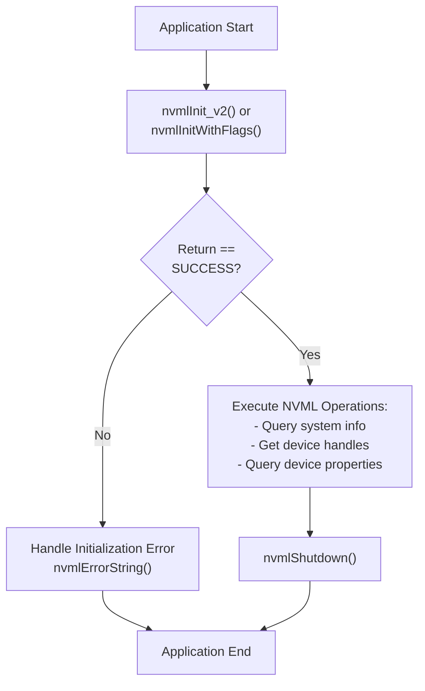
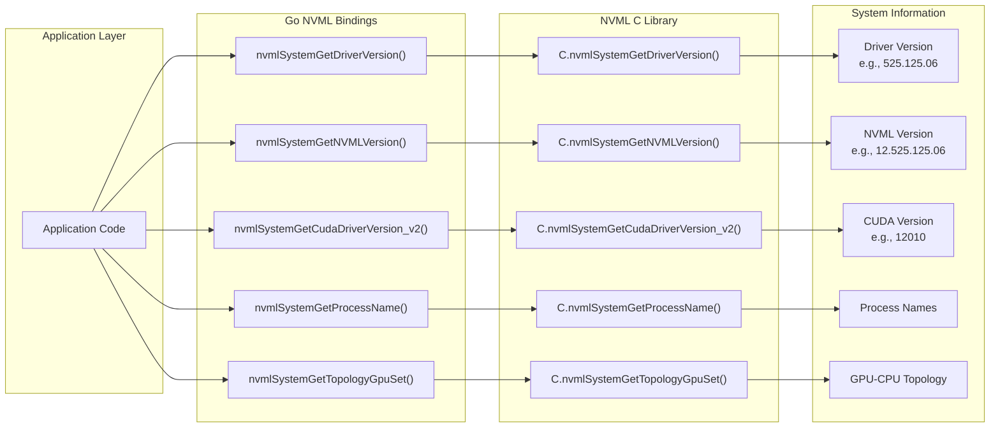
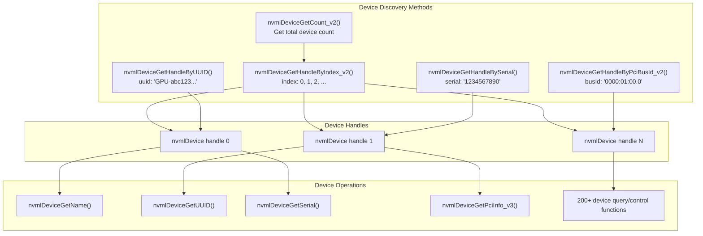
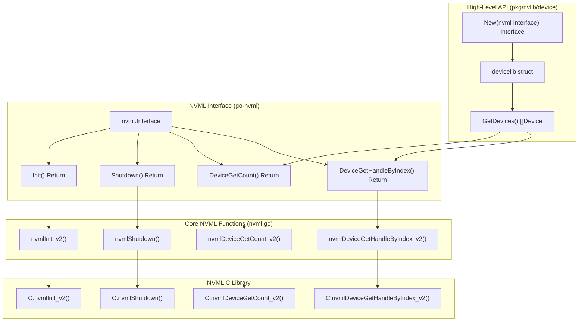

<!-- source: DeepWiki mcp.deepwiki.com · repo NVIDIA/go-nvlib · page 6.1 NVML Initialization and Core Operations · fetched 2026-10-26 -->

# NVML Initialization and Core Operations

<details>
<summary>Relevant source files</summary>

The following files were used as context for generating this wiki page:

- [vendor/github.com/NVIDIA/go-nvml/pkg/nvml/const.go](vendor/github.com/NVIDIA/go-nvml/pkg/nvml/const.go)
- [vendor/github.com/NVIDIA/go-nvml/pkg/nvml/nvml.go](vendor/github.com/NVIDIA/go-nvml/pkg/nvml/nvml.go)

</details>


## Purpose and Scope

This page documents the fundamental NVML operations required to initialize the library, query system-level information, and obtain device handles. These operations form the foundation for all GPU management tasks in go-nvlib.

The NVML bindings in go-nvlib are vendored from the `go-nvml` package and provide direct access to the NVIDIA Management Library (NVML) C API through CGO. This page covers the core initialization, shutdown, and system-level query operations.

For device-specific queries and operations, see [NVML Device Interface](#6.2). For vGPU-specific operations, see [NVML vGPU Operations](#6.3). For high-level device management abstractions, see [GPU Device Management](#3).

---

## NVML Lifecycle Management

### Initialization

NVML must be initialized before any other NVML functions can be called. The library provides two initialization functions:

| Function | Purpose | Flags Support |
|----------|---------|---------------|
| `nvmlInit_v2()` | Standard initialization | No |
| `nvmlInitWithFlags(flags uint32)` | Initialization with custom flags | Yes |

**Standard Initialization Pattern:**

```go
ret := nvml.Init()
if ret != nvml.SUCCESS {
    log.Fatalf("Failed to initialize NVML: %v", nvml.ErrorString(ret))
}
defer nvml.Shutdown()
```

The `nvmlInitWithFlags()` function allows passing initialization flags to customize NVML behavior. Common use cases include initializing with restricted permissions or specific driver modes.

**Sources:** [vendor/github.com/NVIDIA/go-nvml/pkg/nvml/nvml.go:32-44]()

### Shutdown

The `nvmlShutdown()` function releases NVML resources and must be called when NVML operations are complete:

```go
ret := nvml.Shutdown()
if ret != nvml.SUCCESS {
    log.Printf("Failed to shutdown NVML: %v", nvml.ErrorString(ret))
}
```

Failure to call shutdown may result in resource leaks. Always use `defer` to ensure cleanup occurs even if errors happen during processing.

**Sources:** [vendor/github.com/NVIDIA/go-nvml/pkg/nvml/nvml.go:46-51]()

### Initialization Flow



**Sources:** [vendor/github.com/NVIDIA/go-nvml/pkg/nvml/nvml.go:32-51]()

---

## System-Level Queries

After initialization, NVML provides several functions to query system-wide information about the GPU environment.

### Version Information

| Function | Returns | Buffer Size |
|----------|---------|-------------|
| `nvmlSystemGetDriverVersion(version *byte, length uint32)` | NVIDIA driver version string | Typically 80 bytes |
| `nvmlSystemGetNVMLVersion(version *byte, length uint32)` | NVML library version string | Typically 80 bytes |
| `nvmlSystemGetCudaDriverVersion(version *int32)` | CUDA driver version as integer | N/A |
| `nvmlSystemGetCudaDriverVersion_v2(version *int32)` | CUDA driver version (v2) | N/A |

**Usage Pattern:**

```go
const bufferSize = 80
version := make([]byte, bufferSize)
ret := nvml.SystemGetDriverVersion(&version[0], bufferSize)
if ret == nvml.SUCCESS {
    // Convert byte slice to string
    driverVersion := string(bytes.TrimRight(version, "\x00"))
}
```

The version functions require pre-allocated byte buffers. The CUDA driver version functions return an integer encoding the version (e.g., 12010 represents version 12.1).

**Sources:** [vendor/github.com/NVIDIA/go-nvml/pkg/nvml/nvml.go:61-93]()

### Process and System Queries

Additional system-level queries include:

- `nvmlSystemGetProcessName(pid uint32, name *byte, length uint32)` - Get process name from PID
- `nvmlSystemGetHicVersion(hwbcCount *uint32, hwbcEntries *HwbcEntry)` - Query hardware BC version
- `nvmlSystemGetTopologyGpuSet(cpuNumber uint32, count *uint32, deviceArray *nvmlDevice)` - Get GPUs associated with a CPU
- `nvmlSystemGetDriverBranch(branchInfo *SystemDriverBranchInfo, length uint32)` - Get driver branch information

**Sources:** [vendor/github.com/NVIDIA/go-nvml/pkg/nvml/nvml.go:95-131]()

### System Query Architecture



**Sources:** [vendor/github.com/NVIDIA/go-nvml/pkg/nvml/nvml.go:61-131]()

---

## Device Discovery and Handle Retrieval

Device discovery is the process of enumerating available GPUs and obtaining handles for subsequent operations.

### Device Count

The first step in device discovery is determining how many devices are available:

```go
var deviceCount uint32
ret := nvml.DeviceGetCount_v2(&deviceCount)
if ret != nvml.SUCCESS {
    return fmt.Errorf("failed to get device count: %v", nvml.ErrorString(ret))
}
```

The `_v2` suffix indicates this is the versioned API (recommended over the deprecated unversioned function).

**Sources:** [vendor/github.com/NVIDIA/go-nvml/pkg/nvml/nvml.go:206-212]()

### Handle Retrieval Methods

NVML provides multiple methods to obtain device handles, each suited for different scenarios:

| Method | Function | Use Case |
|--------|----------|----------|
| **By Index** | `nvmlDeviceGetHandleByIndex_v2(index uint32, device *nvmlDevice)` | Enumerate all devices in order |
| **By UUID** | `nvmlDeviceGetHandleByUUID(uuid string, device *nvmlDevice)` | Target specific device by UUID string |
| **By UUID Struct** | `nvmlDeviceGetHandleByUUIDV(uuid *UUID, device *nvmlDevice)` | Target device using UUID structure |
| **By Serial** | `nvmlDeviceGetHandleBySerial(serial string, device *nvmlDevice)` | Target device by serial number |
| **By PCI Bus ID** | `nvmlDeviceGetHandleByPciBusId_v2(pciBusId string, device *nvmlDevice)` | Target device by PCI address |

**Typical Enumeration Pattern:**

```go
var deviceCount uint32
nvml.DeviceGetCount_v2(&deviceCount)

devices := make([]nvml.Device, deviceCount)
for i := uint32(0); i < deviceCount; i++ {
    var device nvmlDevice
    ret := nvml.DeviceGetHandleByIndex_v2(i, &device)
    if ret == nvml.SUCCESS {
        devices[i] = device
    }
}
```

**Sources:** [vendor/github.com/NVIDIA/go-nvml/pkg/nvml/nvml.go:223-266]()

### Device Handle Retrieval Flow



**Sources:** [vendor/github.com/NVIDIA/go-nvml/pkg/nvml/nvml.go:206-294]()

### Unit Operations

NVML also supports "Unit" operations for S-class systems (deprecated for most use cases):

- `nvmlUnitGetCount(unitCount *uint32)` - Get number of units
- `nvmlUnitGetHandleByIndex(index uint32, unit *nvmlUnit)` - Get unit handle
- `nvmlUnitGetUnitInfo(unit nvmlUnit, info *UnitInfo)` - Query unit information
- `nvmlUnitGetDevices(unit nvmlUnit, deviceCount *uint32, devices *nvmlDevice)` - Get devices in unit

Units represent collections of GPUs in specialized configurations (e.g., Tesla S-class systems).

**Sources:** [vendor/github.com/NVIDIA/go-nvml/pkg/nvml/nvml.go:133-204]()

---

## Error Handling Fundamentals

All NVML functions return a `Return` type, which is an enumeration of status codes.

### Return Code Pattern

```go
ret := nvml.DeviceGetCount_v2(&count)
if ret != nvml.SUCCESS {
    errStr := nvml.ErrorString(ret)
    return fmt.Errorf("NVML operation failed: %s", errStr)
}
```

### Error String Conversion

The `nvmlErrorString(result Return)` function converts return codes to human-readable strings:

```go
// Example error handling
ret := nvml.Init()
if ret != nvml.SUCCESS {
    // Convert error code to string
    errMsg := nvml.ErrorString(ret)
    log.Fatalf("NVML initialization failed: %s", errMsg)
}
```

Common return codes include:
- `SUCCESS` - Operation completed successfully
- `ERROR_UNINITIALIZED` - NVML not initialized
- `ERROR_INVALID_ARGUMENT` - Invalid function argument
- `ERROR_NOT_SUPPORTED` - Operation not supported on this device
- `ERROR_NO_PERMISSION` - Insufficient permissions
- `ERROR_NOT_FOUND` - Device or resource not found
- `ERROR_INSUFFICIENT_SIZE` - Buffer too small

For detailed error handling patterns, see [NVML Return Codes and Error Handling](#6.4).

**Sources:** [vendor/github.com/NVIDIA/go-nvml/pkg/nvml/nvml.go:53-59]()

---

## Integration with Higher-Level Abstractions

The low-level NVML initialization and query functions are wrapped by higher-level abstractions in go-nvlib:

### Device Library Integration



**Sources:** [vendor/github.com/NVIDIA/go-nvml/pkg/nvml/nvml.go:32-230]()

The `pkg/nvlib/device` package provides the primary high-level interface used by applications:

1. **Initialization**: The device library handles NVML initialization internally
2. **Device Discovery**: `GetDevices()` wraps the device enumeration logic
3. **Error Handling**: Returns Go errors instead of NVML return codes
4. **Type Safety**: Provides strongly-typed Go interfaces

For application development, use the high-level device library (see [Device Discovery and Enumeration](#3.1)) rather than calling these low-level NVML functions directly. The low-level functions are exposed for advanced use cases and testing.

### Typical Application Pattern

```go
// High-level usage (recommended)
import "github.com/NVIDIA/go-nvlib/pkg/nvlib/device"

nvmlLib := nvml.New()
deviceLib := device.New(nvmlLib)

// Initialization happens internally
devices, err := deviceLib.GetDevices()
if err != nil {
    log.Fatalf("Failed to get devices: %v", err)
}
defer deviceLib.Shutdown()

// Work with devices...
```

**Sources:** [vendor/github.com/NVIDIA/go-nvml/pkg/nvml/nvml.go:32-266]()

---

## CGO Bindings and C Interoperation

The NVML Go bindings use CGO to interface with the native NVML C library.

### CGO Configuration

The package uses specific CGO flags to enable proper linking:

```c
#cgo linux LDFLAGS: -Wl,--export-dynamic -Wl,--unresolved-symbols=ignore-in-object-files
#cgo darwin LDFLAGS: -Wl,-undefined,dynamic_lookup
#cgo CFLAGS: -DNVML_NO_UNVERSIONED_FUNC_DEFS=1
```

Key configuration aspects:
- **Linux**: Uses dynamic symbol export and ignores unresolved symbols (allows late binding to `libnvidia-ml.so`)
- **Darwin**: Uses dynamic symbol lookup
- **CFLAGS**: Disables unversioned function definitions (forces use of `_v2` APIs)

### Type Marshaling

Go types are converted to C types for each function call:

```go
func nvmlDeviceGetCount_v2(DeviceCount *uint32) Return {
    cDeviceCount, _ := (*C.uint)(unsafe.Pointer(DeviceCount)), cgoAllocsUnknown
    __ret := C.nvmlDeviceGetCount_v2(cDeviceCount)
    __v := (Return)(__ret)
    return __v
}
```

The pattern involves:
1. Converting Go pointers to C pointers using `unsafe.Pointer`
2. Calling the C function
3. Converting the C return value back to Go types

**Sources:** [vendor/github.com/NVIDIA/go-nvml/pkg/nvml/nvml.go:20-29](), [vendor/github.com/NVIDIA/go-nvml/pkg/nvml/nvml.go:206-212]()

---

## Summary

The NVML initialization and core operations provide the foundation for all GPU management in go-nvlib:

| Operation Category | Key Functions | Purpose |
|-------------------|---------------|---------|
| **Lifecycle** | `nvmlInit_v2()`, `nvmlInitWithFlags()`, `nvmlShutdown()` | Initialize and cleanup NVML |
| **System Queries** | `nvmlSystemGetDriverVersion()`, `nvmlSystemGetNVMLVersion()`, `nvmlSystemGetCudaDriverVersion_v2()` | Query system-level information |
| **Device Discovery** | `nvmlDeviceGetCount_v2()`, `nvmlDeviceGetHandleByIndex_v2()`, `nvmlDeviceGetHandleByUUID()` | Enumerate and identify GPUs |
| **Error Handling** | `nvmlErrorString()` | Convert error codes to strings |

Most applications should use the high-level device library (see [GPU Device Management](#3)) rather than calling these low-level NVML functions directly. The low-level functions are documented here for completeness and for advanced use cases requiring direct NVML access.

**Sources:** [vendor/github.com/NVIDIA/go-nvml/pkg/nvml/nvml.go:1-266]()

---

