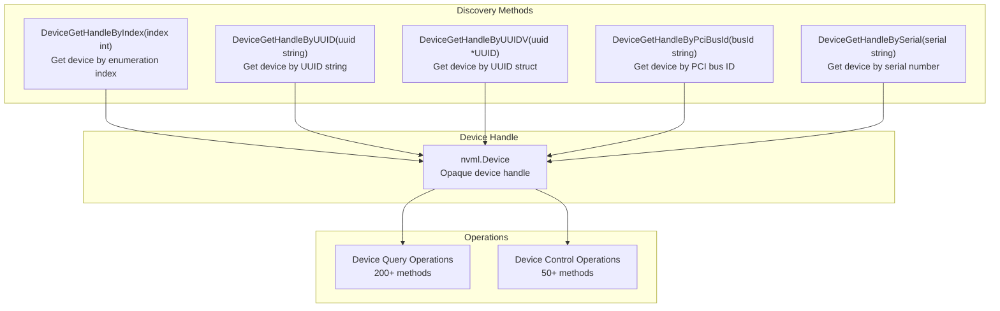
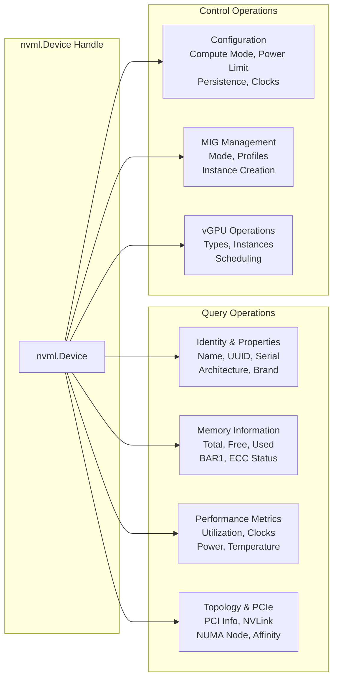
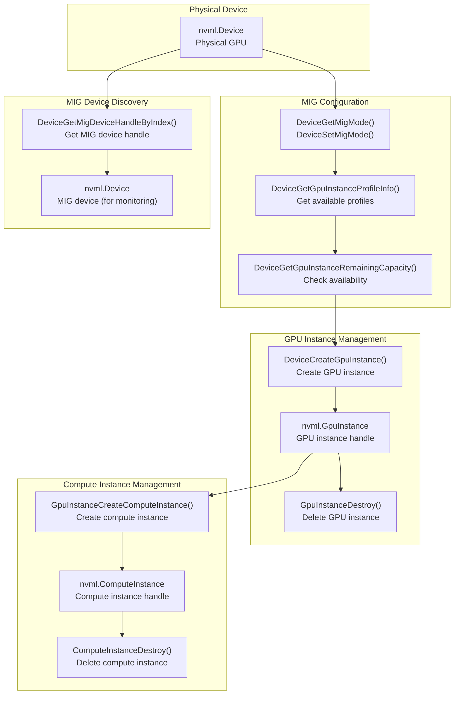
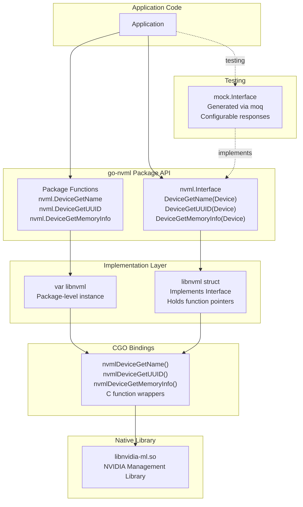

<!-- source: DeepWiki mcp.deepwiki.com · repo NVIDIA/go-nvlib · page 6.2 NVML Device Interface · fetched 2026-10-26 -->

# NVML Device Interface

<details>
<summary>Relevant source files</summary>

The following files were used as context for generating this wiki page:

- [vendor/github.com/NVIDIA/go-nvml/pkg/nvml/const.go](vendor/github.com/NVIDIA/go-nvml/pkg/nvml/const.go)
- [vendor/github.com/NVIDIA/go-nvml/pkg/nvml/mock/interface.go](vendor/github.com/NVIDIA/go-nvml/pkg/nvml/mock/interface.go)
- [vendor/github.com/NVIDIA/go-nvml/pkg/nvml/nvml.go](vendor/github.com/NVIDIA/go-nvml/pkg/nvml/nvml.go)
- [vendor/github.com/NVIDIA/go-nvml/pkg/nvml/zz_generated.api.go](vendor/github.com/NVIDIA/go-nvml/pkg/nvml/zz_generated.api.go)

</details>


This page documents the `nvml.Device` interface and device-level query/control operations provided by the vendored go-nvml package. The Device interface provides access to over 200 operations for querying and controlling individual NVIDIA GPU devices, including properties, performance metrics, configuration, and MIG/vGPU management.

For NVML initialization and system-level operations, see [NVML Initialization and Core Operations](#6.1). For vGPU-specific type and instance management, see [NVML vGPU Operations](#6.3). For error handling patterns, see [NVML Return Codes and Error Handling](#6.4).

## Overview

The `nvml.Device` type represents an opaque handle to a physical or MIG GPU device. All device-specific operations in NVML require a valid Device handle. The go-nvml package exposes these operations through both package-level functions and the `nvml.Interface` type, allowing for dependency injection and mocking in tests.

**Key Concepts:**
- **Device Handle**: An opaque reference to a GPU obtained through discovery functions
- **Package-Level Functions**: Direct bindings to NVML (e.g., `nvml.DeviceGetName`)
- **Interface Methods**: Same operations accessed via `nvml.Interface` for testability
- **CGO Bindings**: Low-level C function wrappers that interact with `libnvidia-ml.so`

Sources: [vendor/github.com/NVIDIA/go-nvml/pkg/nvml/zz_generated.api.go:1-664](), [vendor/github.com/NVIDIA/go-nvml/pkg/nvml/nvml.go:1-100]()

## Device Handle Acquisition

Before performing any device operations, you must obtain a valid `nvml.Device` handle. The NVML library provides multiple methods for device discovery.

### Device Discovery Methods



**Sources:** [vendor/github.com/NVIDIA/go-nvml/pkg/nvml/zz_generated.api.go:117-121](), [vendor/github.com/NVIDIA/go-nvml/pkg/nvml/nvml.go:223-265]()

### Device Handle Functions

| Function | Purpose | Return |
|----------|---------|--------|
| `DeviceGetCount()` | Get total number of devices | `(int, Return)` |
| `DeviceGetHandleByIndex(index int)` | Get device by enumeration order (0-based) | `(Device, Return)` |
| `DeviceGetHandleByUUID(uuid string)` | Get device by UUID string (e.g., "GPU-...") | `(Device, Return)` |
| `DeviceGetHandleByPciBusId(busId string)` | Get device by PCI bus ID (e.g., "0000:00:05.0") | `(Device, Return)` |
| `DeviceGetHandleBySerial(serial string)` | Get device by serial number | `(Device, Return)` |

**Sources:** [vendor/github.com/NVIDIA/go-nvml/pkg/nvml/zz_generated.api.go:65-121](), [vendor/github.com/NVIDIA/go-nvml/pkg/nvml/nvml.go:206-265]()

## Device Operation Categories

The Device interface provides over 250 methods organized into functional categories. Each category addresses a specific aspect of GPU management.



**Sources:** [vendor/github.com/NVIDIA/go-nvml/pkg/nvml/zz_generated.api.go:403-664]()

### Identity and Properties Operations

Operations for identifying and characterizing devices.

| Method | Purpose | Input | Output |
|--------|---------|-------|--------|
| `DeviceGetName(Device)` | Get device name | `Device` | `(string, Return)` |
| `DeviceGetUUID(Device)` | Get device UUID | `Device` | `(string, Return)` |
| `DeviceGetSerial(Device)` | Get serial number | `Device` | `(string, Return)` |
| `DeviceGetIndex(Device)` | Get device index | `Device` | `(int, Return)` |
| `DeviceGetBrand(Device)` | Get brand type (Tesla, Quadro, etc.) | `Device` | `(BrandType, Return)` |
| `DeviceGetArchitecture(Device)` | Get GPU architecture | `Device` | `(DeviceArchitecture, Return)` |
| `DeviceGetCudaComputeCapability(Device)` | Get CUDA compute capability | `Device` | `(int, int, Return)` |
| `DeviceGetBoardPartNumber(Device)` | Get board part number | `Device` | `(string, Return)` |
| `DeviceGetMinorNumber(Device)` | Get device minor number | `Device` | `(int, Return)` |

**Sources:** [vendor/github.com/NVIDIA/go-nvml/pkg/nvml/zz_generated.api.go:151-198, 422-428, 449, 503, 531, 578, 597](), [vendor/github.com/NVIDIA/go-nvml/pkg/nvml/nvml.go:268-303, 432-457]()

### Memory Information Operations

Operations for querying device memory status and configuration.

| Method | Purpose | Output |
|--------|---------|--------|
| `DeviceGetMemoryInfo(Device)` | Get memory usage (v1) | `(Memory, Return)` |
| `DeviceGetMemoryInfo_v2(Device)` | Get memory usage with reserved info | `(Memory_v2, Return)` |
| `DeviceGetBAR1MemoryInfo(Device)` | Get BAR1 memory info | `(BAR1Memory, Return)` |
| `DeviceGetMemoryBusWidth(Device)` | Get memory bus width in bits | `(uint32, Return)` |
| `DeviceGetMemoryErrorCounter(...)` | Get ECC error count for location | `(uint64, Return)` |
| `DeviceGetMemoryAffinity(...)` | Get memory affinity bitmask | `([]uint, Return)` |

**Sources:** [vendor/github.com/NVIDIA/go-nvml/pkg/nvml/zz_generated.api.go:425, 519-523](), [vendor/github.com/NVIDIA/go-nvml/pkg/nvml/nvml.go:324-333, 1084-1100]()

### Performance and Utilization Operations

Operations for monitoring device performance, utilization, and running processes.

| Method | Purpose | Output |
|--------|---------|--------|
| `DeviceGetUtilizationRates(Device)` | Get GPU and memory utilization | `(Utilization, Return)` |
| `DeviceGetPowerUsage(Device)` | Get current power draw in milliwatts | `(uint32, Return)` |
| `DeviceGetTemperature(Device, sensor)` | Get temperature for sensor | `(uint32, Return)` |
| `DeviceGetClockInfo(Device, clockType)` | Get current clock speed | `(uint32, Return)` |
| `DeviceGetPerformanceState(Device)` | Get current P-state | `(Pstates, Return)` |
| `DeviceGetComputeRunningProcesses(Device)` | Get compute processes | `([]ProcessInfo, Return)` |
| `DeviceGetGraphicsRunningProcesses(Device)` | Get graphics processes | `([]ProcessInfo, Return)` |
| `DeviceGetEncoderUtilization(Device)` | Get encoder utilization | `(uint32, uint32, Return)` |
| `DeviceGetDecoderUtilization(Device)` | Get decoder utilization | `(uint32, uint32, Return)` |

**Sources:** [vendor/github.com/NVIDIA/go-nvml/pkg/nvml/zz_generated.api.go:435-439, 455, 467-470, 556, 567, 589, 598](), [vendor/github.com/NVIDIA/go-nvml/pkg/nvml/nvml.go:617-624, 785-793, 842-848, 1029-1036]()

### Temperature and Power Management Operations

Operations for thermal and power monitoring and control.

| Method | Purpose | Category |
|--------|---------|----------|
| `DeviceGetTemperature(Device, sensor)` | Get temperature reading | Query |
| `DeviceGetTemperatureThreshold(Device, threshold)` | Get temperature threshold | Query |
| `DeviceGetFanSpeed(Device)` | Get fan speed percentage | Query |
| `DeviceGetFanSpeed_v2(Device, fan)` | Get specific fan speed | Query |
| `DeviceGetPowerUsage(Device)` | Get current power draw | Query |
| `DeviceGetPowerManagementLimit(Device)` | Get power limit | Query |
| `DeviceGetPowerManagementLimitConstraints(Device)` | Get min/max power limits | Query |
| `DeviceGetEnforcedPowerLimit(Device)` | Get enforced power limit | Query |
| `DeviceSetPowerManagementLimit(Device, limit)` | Set power limit | Control |
| `DeviceSetTemperatureThreshold(Device, threshold, temp)` | Set temperature threshold | Control |

**Sources:** [vendor/github.com/NVIDIA/go-nvml/pkg/nvml/zz_generated.api.go:471, 560-562, 589-590, 655-657](), [vendor/github.com/NVIDIA/go-nvml/pkg/nvml/nvml.go:785-820, 992-1036, 1065-1072]()

### Clock Speed Operations

Operations for querying and controlling GPU clock speeds.

| Method | Purpose | Category |
|--------|---------|----------|
| `DeviceGetClockInfo(Device, clockType)` | Get current clock speed | Query |
| `DeviceGetMaxClockInfo(Device, clockType)` | Get maximum clock speed | Query |
| `DeviceGetApplicationsClock(Device, clockType)` | Get applications clock | Query |
| `DeviceGetDefaultApplicationsClock(Device, clockType)` | Get default applications clock | Query |
| `DeviceGetSupportedMemoryClocks(Device)` | Get supported memory clocks | Query |
| `DeviceGetSupportedGraphicsClocks(Device, memClock)` | Get supported graphics clocks | Query |
| `DeviceSetApplicationsClocks(Device, memClock, graphicsClock)` | Set applications clocks | Control |
| `DeviceResetApplicationsClocks(Device)` | Reset to default clocks | Control |
| `DeviceSetGpuLockedClocks(Device, minClock, maxClock)` | Lock GPU clocks | Control |
| `DeviceResetGpuLockedClocks(Device)` | Reset GPU locked clocks | Control |

**Sources:** [vendor/github.com/NVIDIA/go-nvml/pkg/nvml/zz_generated.api.go:421, 434-436, 456, 512-513, 584-585, 625-626, 632, 646](), [vendor/github.com/NVIDIA/go-nvml/pkg/nvml/nvml.go:617-635, 646-706]()

### PCIe and Topology Operations

Operations for PCIe configuration and device topology.

| Method | Purpose | Output |
|--------|---------|--------|
| `DeviceGetPciInfo(Device)` | Get PCI info (bus ID, domain, etc.) | `(PciInfo, Return)` |
| `DeviceGetPciInfoExt(Device)` | Get extended PCI info | `(PciInfoExt, Return)` |
| `DeviceGetMaxPcieLinkGeneration(Device)` | Get max PCIe generation | `(int, Return)` |
| `DeviceGetMaxPcieLinkWidth(Device)` | Get max PCIe width | `(int, Return)` |
| `DeviceGetCurrPcieLinkGeneration(Device)` | Get current PCIe generation | `(int, Return)` |
| `DeviceGetCurrPcieLinkWidth(Device)` | Get current PCIe width | `(int, Return)` |
| `DeviceGetPcieThroughput(Device, counter)` | Get PCIe throughput | `(uint32, Return)` |
| `DeviceGetTopologyCommonAncestor(dev1, dev2)` | Get common ancestor | `(GpuTopologyLevel, Return)` |
| `DeviceGetTopologyNearestGpus(Device, level)` | Get nearest GPUs | `([]Device, Return)` |
| `DeviceGetNumaNodeId(Device)` | Get NUMA node ID | `(int, Return)` |

**Sources:** [vendor/github.com/NVIDIA/go-nvml/pkg/nvml/zz_generated.api.go:450-451, 515-516, 534, 548-553, 593-594](), [vendor/github.com/NVIDIA/go-nvml/pkg/nvml/nvml.go:372-378, 399-417, 535-614]()

### NVLink Operations

Operations for NVLink connectivity and utilization monitoring.

| Method | Purpose | Output |
|--------|---------|--------|
| `DeviceGetNvLinkState(Device, link)` | Get NVLink state | `(EnableState, Return)` |
| `DeviceGetNvLinkVersion(Device, link)` | Get NVLink version | `(uint32, Return)` |
| `DeviceGetNvLinkCapability(Device, link, cap)` | Get NVLink capability | `(uint32, Return)` |
| `DeviceGetNvLinkRemoteDeviceType(Device, link)` | Get remote device type | `(IntNvLinkDeviceType, Return)` |
| `DeviceGetNvLinkRemotePciInfo(Device, link)` | Get remote PCI info | `(PciInfo, Return)` |
| `DeviceGetNvLinkUtilizationCounter(Device, link, counter)` | Get utilization counter | `(uint64, uint64, Return)` |
| `DeviceGetNvLinkErrorCounter(Device, link, counter)` | Get error counter | `(uint64, Return)` |
| `DeviceResetNvLinkErrorCounters(Device, link)` | Reset error counters | `Return` |

**Sources:** [vendor/github.com/NVIDIA/go-nvml/pkg/nvml/zz_generated.api.go:535-543, 628]()

## MIG Device Operations

Multi-Instance GPU (MIG) operations for partitioning GPUs into isolated instances.



**Sources:** [vendor/github.com/NVIDIA/go-nvml/pkg/nvml/zz_generated.api.go:29-30, 103-110, 134, 144-145, 409-410, 483-490, 524-525]()

### MIG Configuration Methods

| Method | Purpose | Output |
|--------|---------|--------|
| `DeviceGetMigMode(Device)` | Get MIG mode state (current, pending) | `(int, int, Return)` |
| `DeviceSetMigMode(Device, mode)` | Set MIG mode (requires reboot) | `(Return, Return)` |
| `DeviceGetMaxMigDeviceCount(Device)` | Get max MIG device count | `(int, Return)` |
| `DeviceIsMigDeviceHandle(Device)` | Check if handle is MIG device | `(bool, Return)` |
| `DeviceGetDeviceHandleFromMigDeviceHandle(Device)` | Get parent from MIG device | `(Device, Return)` |

**Sources:** [vendor/github.com/NVIDIA/go-nvml/pkg/nvml/zz_generated.api.go:145, 270, 354, 459, 514, 525, 614, 650]()

### GPU Instance Profile Methods

| Method | Purpose | Output |
|--------|---------|--------|
| `DeviceGetGpuInstanceProfileInfo(Device, profile)` | Get profile info by ID | `(GpuInstanceProfileInfo, Return)` |
| `DeviceGetGpuInstancePossiblePlacements(Device, profileInfo)` | Get possible placements | `([]GpuInstancePlacement, Return)` |
| `DeviceGetGpuInstanceRemainingCapacity(Device, profileInfo)` | Get remaining capacity | `(int, Return)` |
| `DeviceCreateGpuInstance(Device, profileInfo)` | Create GPU instance | `(GpuInstance, Return)` |
| `DeviceCreateGpuInstanceWithPlacement(Device, profileInfo, placement)` | Create with placement | `(GpuInstance, Return)` |
| `DeviceGetGpuInstances(Device, profileInfo)` | Get existing instances | `([]GpuInstance, Return)` |
| `DeviceGetGpuInstanceById(Device, id)` | Get instance by ID | `(GpuInstance, Return)` |

**Sources:** [vendor/github.com/NVIDIA/go-nvml/pkg/nvml/zz_generated.api.go:29-30, 103-110, 409-410, 483-490]()

### Compute Instance Profile Methods

| Method | Purpose | Output |
|--------|---------|--------|
| `GpuInstanceGetComputeInstanceProfileInfo(gi, profile, engProfile)` | Get compute profile info | `(ComputeInstanceProfileInfo, Return)` |
| `GpuInstanceGetComputeInstancePossiblePlacements(gi, profileInfo)` | Get possible placements | `([]ComputeInstancePlacement, Return)` |
| `GpuInstanceGetComputeInstanceRemainingCapacity(gi, profileInfo)` | Get remaining capacity | `(int, Return)` |
| `GpuInstanceCreateComputeInstance(gi, profileInfo)` | Create compute instance | `(ComputeInstance, Return)` |
| `GpuInstanceGetComputeInstances(gi, profileInfo)` | Get existing instances | `([]ComputeInstance, Return)` |
| `GpuInstanceGetComputeInstanceById(gi, id)` | Get instance by ID | `(ComputeInstance, Return)` |
| `ComputeInstanceDestroy(ci)` | Destroy compute instance | `Return` |

**Sources:** [vendor/github.com/NVIDIA/go-nvml/pkg/nvml/zz_generated.api.go:23-24, 307-309, 403-404, 873-901]()

## Configuration and Control Operations

Operations for modifying device configuration and behavior.

### Compute Mode Operations

| Method | Purpose | Values |
|--------|---------|--------|
| `DeviceGetComputeMode(Device)` | Get compute mode | `(ComputeMode, Return)` |
| `DeviceSetComputeMode(Device, mode)` | Set compute mode | `Return` |

**Compute Modes:**
- `COMPUTE_MODE_DEFAULT`: Multiple contexts allowed
- `COMPUTE_MODE_EXCLUSIVE_THREAD`: One context per thread (deprecated)
- `COMPUTE_MODE_PROHIBITED`: Compute prohibited
- `COMPUTE_MODE_EXCLUSIVE_PROCESS`: One context per process

**Sources:** [vendor/github.com/NVIDIA/go-nvml/pkg/nvml/zz_generated.api.go:438, 635](), [vendor/github.com/NVIDIA/go-nvml/pkg/nvml/nvml.go:1102-1109]()

### Persistence Mode Operations

| Method | Purpose | Output |
|--------|---------|--------|
| `DeviceGetPersistenceMode(Device)` | Get persistence mode | `(EnableState, Return)` |
| `DeviceSetPersistenceMode(Device, mode)` | Set persistence mode | `Return` |

Persistence mode keeps the NVIDIA driver loaded when no clients are connected, reducing initialization overhead.

**Sources:** [vendor/github.com/NVIDIA/go-nvml/pkg/nvml/zz_generated.api.go:557, 654](), [vendor/github.com/NVIDIA/go-nvml/pkg/nvml/nvml.go:526-533]()

### ECC Mode Operations

| Method | Purpose | Output |
|--------|---------|--------|
| `DeviceGetEccMode(Device)` | Get ECC mode (current, pending) | `(EnableState, EnableState, Return)` |
| `DeviceGetDefaultEccMode(Device)` | Get default ECC mode | `(EnableState, Return)` |
| `DeviceSetEccMode(Device, mode)` | Set ECC mode (requires reboot) | `Return` |
| `DeviceGetTotalEccErrors(Device, errorType, counterType)` | Get total ECC errors | `(uint64, Return)` |
| `DeviceGetDetailedEccErrors(Device, errorType, counterType)` | Get detailed ECC errors | `(EccErrorCounts, Return)` |
| `DeviceClearEccErrorCounts(Device, counterType)` | Clear ECC error counters | `Return` |

**Sources:** [vendor/github.com/NVIDIA/go-nvml/pkg/nvml/zz_generated.api.go:27, 77-78, 407, 457-458, 466, 595, 642]()

### CPU Affinity Operations

| Method | Purpose | Output |
|--------|---------|--------|
| `DeviceGetCpuAffinity(Device, cpuSetSize)` | Get CPU affinity mask | `([]uint, Return)` |
| `DeviceGetCpuAffinityWithinScope(Device, cpuSetSize, scope)` | Get CPU affinity with scope | `([]uint, Return)` |
| `DeviceSetCpuAffinity(Device)` | Set CPU affinity for calling thread | `Return` |
| `DeviceClearCpuAffinity(Device)` | Clear CPU affinity | `Return` |

**Sources:** [vendor/github.com/NVIDIA/go-nvml/pkg/nvml/zz_generated.api.go:26, 406, 446-447, 637](), [vendor/github.com/NVIDIA/go-nvml/pkg/nvml/nvml.go:335-370]()

## Interface Architecture

The go-nvml package provides two ways to access device operations: package-level functions and the `nvml.Interface` type.



**Sources:** [vendor/github.com/NVIDIA/go-nvml/pkg/nvml/zz_generated.api.go:22-397, 399-664](), [vendor/github.com/NVIDIA/go-nvml/pkg/nvml/mock/interface.go:11-14]()

### Package-Level Functions vs Interface

**Package-Level Functions:**
- Direct access: `nvml.DeviceGetName(device)`
- Stored as variables pointing to `libnvml` methods: [vendor/github.com/NVIDIA/go-nvml/pkg/nvml/zz_generated.api.go:22-397]()
- Simpler syntax for one-off operations
- Not mockable without replacing global variables

**Interface Methods:**
- Access via interface: `nvmlInterface.DeviceGetName(device)`
- Enables dependency injection: [vendor/github.com/NVIDIA/go-nvml/pkg/nvml/zz_generated.api.go:399-664]()
- Testable with generated mocks: [vendor/github.com/NVIDIA/go-nvml/pkg/nvml/mock/interface.go:1-100]()
- Recommended for production code

**Sources:** [vendor/github.com/NVIDIA/go-nvml/pkg/nvml/zz_generated.api.go:22-664]()

### Mock Implementation

The mock implementation is generated using `moq` and provides configurable function fields for all Interface methods.

```
// Example mock usage
mockedInterface := &mock.Interface{
    DeviceGetNameFunc: func(device nvml.Device) (string, nvml.Return) {
        return "Tesla V100", nvml.SUCCESS
    },
    DeviceGetMemoryInfoFunc: func(device nvml.Device) (nvml.Memory, nvml.Return) {
        return nvml.Memory{Total: 16 * 1024 * 1024 * 1024}, nvml.SUCCESS
    },
}
```

The mock tracks call counts and arguments for all methods, enabling comprehensive test assertions.

**Sources:** [vendor/github.com/NVIDIA/go-nvml/pkg/nvml/mock/interface.go:11-100](), [vendor/github.com/NVIDIA/go-nvml/pkg/nvml/zz_generated.api.go:401]()

## Return Values and Error Handling

All Device operations return an `nvml.Return` value indicating success or failure. Common return codes include:

| Return Code | Meaning |
|-------------|---------|
| `SUCCESS` | Operation completed successfully |
| `ERROR_UNINITIALIZED` | NVML not initialized |
| `ERROR_INVALID_ARGUMENT` | Invalid device handle or parameter |
| `ERROR_NOT_SUPPORTED` | Operation not supported on this device |
| `ERROR_NO_PERMISSION` | Insufficient permissions |
| `ERROR_GPU_IS_LOST` | GPU is no longer accessible |
| `ERROR_NOT_FOUND` | Requested item not found |

For detailed error handling patterns and a complete list of return codes, see [NVML Return Codes and Error Handling](#6.4).

**Sources:** [vendor/github.com/NVIDIA/go-nvml/pkg/nvml/zz_generated.api.go:287](), [vendor/github.com/NVIDIA/go-nvml/pkg/nvml/nvml.go:53-59]()

## Usage Patterns

### Basic Device Query Pattern

```go
// Initialize NVML
ret := nvml.Init()
if ret != nvml.SUCCESS {
    return fmt.Errorf("failed to initialize NVML: %v", nvml.ErrorString(ret))
}
defer nvml.Shutdown()

// Get device count
count, ret := nvml.DeviceGetCount()
if ret != nvml.SUCCESS {
    return fmt.Errorf("failed to get device count: %v", nvml.ErrorString(ret))
}

// Get device handle
device, ret := nvml.DeviceGetHandleByIndex(0)
if ret != nvml.SUCCESS {
    return fmt.Errorf("failed to get device: %v", nvml.ErrorString(ret))
}

// Query device properties
name, ret := nvml.DeviceGetName(device)
uuid, ret := nvml.DeviceGetUUID(device)
memory, ret := nvml.DeviceGetMemoryInfo(device)
```

### Interface-Based Pattern (Recommended)

```go
type DeviceManager struct {
    nvml nvml.Interface
}

func NewDeviceManager(nvmlInterface nvml.Interface) *DeviceManager {
    return &DeviceManager{nvml: nvmlInterface}
}

func (dm *DeviceManager) GetDeviceInfo(index int) (*DeviceInfo, error) {
    device, ret := dm.nvml.DeviceGetHandleByIndex(index)
    if ret != nvml.SUCCESS {
        return nil, fmt.Errorf("device not found: %v", dm.nvml.ErrorString(ret))
    }
    
    name, _ := dm.nvml.DeviceGetName(device)
    uuid, _ := dm.nvml.DeviceGetUUID(device)
    memory, _ := dm.nvml.DeviceGetMemoryInfo(device)
    
    return &DeviceInfo{Name: name, UUID: uuid, Memory: memory}, nil
}
```

This pattern enables easy testing with mock implementations.

**Sources:** [vendor/github.com/NVIDIA/go-nvml/pkg/nvml/zz_generated.api.go:399-664]()

## Device Operation Reference Summary

| Category | Query Methods | Control Methods | Key Types |
|----------|---------------|-----------------|-----------|
| **Identity** | ~15 methods (Name, UUID, Serial, Index, etc.) | 0 | `Device`, `DeviceAttributes` |
| **Memory** | ~10 methods (MemoryInfo, BAR1, ErrorCounter) | 0 | `Memory`, `Memory_v2`, `BAR1Memory` |
| **Performance** | ~30 methods (Utilization, Processes, Encoders) | 0 | `Utilization`, `ProcessInfo` |
| **Temperature** | ~8 methods (Temperature, Threshold, Fan) | ~5 methods (SetTemperatureThreshold) | `TemperatureSensors`, `FanSpeedInfo` |
| **Power** | ~10 methods (PowerUsage, Limit, State) | ~3 methods (SetPowerManagementLimit) | `PowerSource`, `Pstates` |
| **Clocks** | ~15 methods (ClockInfo, SupportedClocks) | ~8 methods (SetApplicationsClocks, SetGpuLockedClocks) | `ClockType`, `ClockOffset` |
| **PCIe/Topology** | ~15 methods (PciInfo, Topology, NUMA) | ~3 methods (SetCpuAffinity) | `PciInfo`, `PciInfoExt`, `GpuTopologyLevel` |
| **NVLink** | ~10 methods (State, Version, Utilization) | ~5 methods (ResetCounters, SetUtilization) | `NvLinkCapability`, `NvLinkUtilizationControl` |
| **MIG** | ~15 methods (MigMode, Profiles, Instances) | ~5 methods (SetMigMode, CreateInstance) | `GpuInstance`, `ComputeInstance` |
| **vGPU** | ~20 methods (Types, Instances, Metadata) | ~10 methods (SetVgpuSchedulerState) | `VgpuTypeId`, `VgpuInstance` |
| **Configuration** | ~15 methods (ComputeMode, ECC, Persistence) | ~15 methods (SetComputeMode, SetEccMode) | `ComputeMode`, `EnableState` |
| **ECC/Errors** | ~12 methods (EccErrors, RemappedRows) | ~3 methods (ClearEccErrorCounts) | `EccErrorCounts`, `MemoryErrorType` |

**Total Operations:** 200+ query methods, 50+ control methods

**Sources:** [vendor/github.com/NVIDIA/go-nvml/pkg/nvml/zz_generated.api.go:403-664]()

---

