<!-- source: DeepWiki mcp.deepwiki.com · repo NVIDIA/go-nvlib · page 6.3 NVML vGPU Operations · fetched 2026-10-26 -->

# NVML vGPU Operations

<details>
<summary>Relevant source files</summary>

The following files were used as context for generating this wiki page:

- [vendor/github.com/NVIDIA/go-nvml/pkg/nvml/nvml.h](vendor/github.com/NVIDIA/go-nvml/pkg/nvml/nvml.h)
- [vendor/github.com/NVIDIA/go-nvml/pkg/nvml/types_gen.go](vendor/github.com/NVIDIA/go-nvml/pkg/nvml/types_gen.go)
- [vendor/github.com/NVIDIA/go-nvml/pkg/nvml/vgpu.go](vendor/github.com/NVIDIA/go-nvml/pkg/nvml/vgpu.go)

</details>


This document describes the NVML vGPU (Virtual GPU) operations available in the vendored go-nvml package. These operations enable querying vGPU types, managing vGPU instances, checking compatibility, monitoring utilization, and handling licensing for GPU virtualization scenarios.

**Scope**: This page covers vGPU-specific NVML APIs. For general NVML device operations, see [NVML Device Interface](#6.2). For NVML initialization, see [NVML Initialization and Core Operations](#6.1). For host-side vGPU device creation via MDEV, see [MDEV and vGPU Management](#5.2).

## Overview

NVML provides comprehensive APIs for managing virtual GPUs in virtualized environments. The vGPU operations fall into two main categories:

1. **vGPU Type Operations** - Query available vGPU profiles (types) that can be instantiated on a physical GPU
2. **vGPU Instance Operations** - Manage and monitor active vGPU instances running in virtual machines

The vGPU subsystem supports multiple virtualization modes including GPU passthrough, vGPU (time-sliced), and both SR-IOV and non-SR-IOV configurations.

## vGPU Architecture

```mermaid
graph TB
    subgraph "Physical GPU (pGPU)"
        PGPU["Physical GPU Device<br/>nvml.Device"]
        VGPU_TYPES["vGPU Type IDs<br/>nvmlVgpuTypeId (uint32)"]
        ACTIVE_INSTANCES["Active vGPU Instances<br/>nvmlVgpuInstance (uint32)"]
    end
    
    subgraph "vGPU Type Properties"
        TYPE_CLASS["Type Class<br/>VgpuTypeGetClass()"]
        TYPE_NAME["Type Name<br/>VgpuTypeGetName()"]
        TYPE_FB["Framebuffer Size<br/>VgpuTypeGetFramebufferSize()"]
        TYPE_DISPLAYS["Display Heads<br/>VgpuTypeGetNumDisplayHeads()"]
        TYPE_MAX["Max Instances<br/>VgpuTypeGetMaxInstances()"]
        TYPE_LICENSE["License String<br/>VgpuTypeGetLicense()"]
        TYPE_CAPS["Capabilities<br/>VgpuTypeGetCapabilities()"]
    end
    
    subgraph "vGPU Instance Properties"
        INST_VM["VM ID<br/>VgpuInstanceGetVmID()"]
        INST_UUID["UUID<br/>VgpuInstanceGetUUID()"]
        INST_FB["FB Usage<br/>VgpuInstanceGetFbUsage()"]
        INST_TYPE["Type ID<br/>VgpuInstanceGetType()"]
        INST_LICENSE["License Info<br/>VgpuInstanceGetLicenseInfo()"]
        INST_UTIL["Utilization<br/>nvmlVgpuInstanceUtilizationInfo_v1_t"]
    end
    
    PGPU --> VGPU_TYPES
    PGPU --> ACTIVE_INSTANCES
    
    VGPU_TYPES --> TYPE_CLASS
    VGPU_TYPES --> TYPE_NAME
    VGPU_TYPES --> TYPE_FB
    VGPU_TYPES --> TYPE_DISPLAYS
    VGPU_TYPES --> TYPE_MAX
    VGPU_TYPES --> TYPE_LICENSE
    VGPU_TYPES --> TYPE_CAPS
    
    ACTIVE_INSTANCES --> INST_VM
    ACTIVE_INSTANCES --> INST_UUID
    ACTIVE_INSTANCES --> INST_FB
    ACTIVE_INSTANCES --> INST_TYPE
    ACTIVE_INSTANCES --> INST_LICENSE
    ACTIVE_INSTANCES --> INST_UTIL
```

**Sources:** [vendor/github.com/NVIDIA/go-nvml/pkg/nvml/vgpu.go:1-512](), [vendor/github.com/NVIDIA/go-nvml/pkg/nvml/types_gen.go:480-482]()

## vGPU Types and Type IDs

A **vGPU Type** represents a vGPU profile configuration that defines the resources allocated to a virtual GPU. Each type is identified by a `nvmlVgpuTypeId` (uint32).

### vGPU Type Query Operations

The library interface provides methods on both `library` and `VgpuTypeId`:

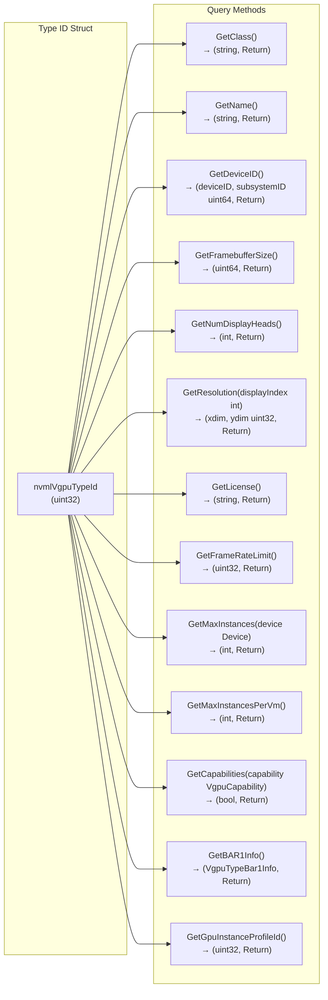

**Sources:** [vendor/github.com/NVIDIA/go-nvml/pkg/nvml/vgpu.go:33-147](), [vendor/github.com/NVIDIA/go-nvml/pkg/nvml/vgpu.go:466-494]()

### Key vGPU Type Properties

| Property | Method | Return Type | Description |
|----------|--------|-------------|-------------|
| Class | `GetClass()` | string | vGPU class (e.g., "NVS", "Quadro") |
| Name | `GetName()` | string | Human-readable profile name |
| Framebuffer Size | `GetFramebufferSize()` | uint64 | FB memory in bytes |
| Device ID | `GetDeviceID()` | uint64, uint64 | PCI device ID and subsystem ID |
| Display Heads | `GetNumDisplayHeads()` | int | Number of display outputs |
| Resolution | `GetResolution(idx)` | uint32, uint32 | X and Y dimensions for display |
| License | `GetLicense()` | string | License string requirement |
| Frame Rate Limit | `GetFrameRateLimit()` | uint32 | Maximum frame rate |
| Max Instances | `GetMaxInstances(device)` | int | Maximum instances on device |
| Max Per VM | `GetMaxInstancesPerVm()` | int | Maximum per virtual machine |
| GPU Instance Profile | `GetGpuInstanceProfileId()` | uint32 | Associated MIG profile ID |
| BAR1 Info | `GetBAR1Info()` | VgpuTypeBar1Info | BAR1 memory information |

**Sources:** [vendor/github.com/NVIDIA/go-nvml/pkg/nvml/vgpu.go:33-158]()

### vGPU Capabilities

The `GetCapabilities()` method checks for specific vGPU capabilities:

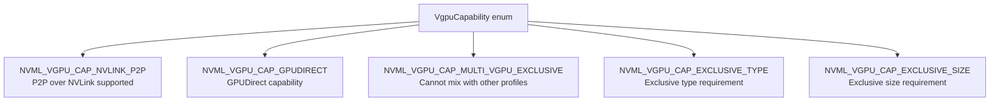

**Sources:** [vendor/github.com/NVIDIA/go-nvml/pkg/nvml/vgpu.go:466-475](), [vendor/github.com/NVIDIA/go-nvml/pkg/nvml/nvml.h:1683-1692]()

### vGPU Type BAR1 Information

The `VgpuTypeBar1Info` structure provides BAR1 memory region information:

```go
// Structure from types_gen.go
type VgpuTypeBar1Info struct {
    Version  uint32         // Struct version
    Bar1Size uint64         // BAR1 size in bytes
}
```

**Sources:** [vendor/github.com/NVIDIA/go-nvml/pkg/nvml/types_gen.go:534-537](), [vendor/github.com/NVIDIA/go-nvml/pkg/nvml/vgpu.go:484-494]()

## vGPU Instances

A **vGPU Instance** represents an active virtual GPU running in a VM. Each instance is identified by a `nvmlVgpuInstance` (uint32).

### vGPU Instance Query Operations

```mermaid
graph TB
    subgraph "Instance Handle"
        INST["nvmlVgpuInstance<br/>(uint32)"]
    end
    
    subgraph "Identity & Configuration"
        VMID["GetVmID()<br/>→ (vmId string, vmIdType, Return)"]
        UUID["GetUUID()<br/>→ (string, Return)"]
        TYPE["GetType()<br/>→ (VgpuTypeId, Return)"]
        MDEV["GetMdevUUID()<br/>→ (string, Return)"]
        GIID["GetGpuInstanceId()<br/>→ (int, Return)"]
        PCIID["GetGpuPciId()<br/>→ (string, Return)"]
    end
    
    subgraph "Guest VM Information"
        DRIVER["GetVmDriverVersion()<br/>→ (string, Return)"]
        METADATA["GetMetadata()<br/>→ (VgpuMetadata, Return)"]
    end
    
    subgraph "Resource Usage"
        FBUSAGE["GetFbUsage()<br/>→ (uint64, Return)"]
        FRAMERATE["GetFrameRateLimit()<br/>→ (uint32, Return)"]
        ECC["GetEccMode()<br/>→ (EnableState, Return)"]
    end
    
    subgraph "Encoder/Decoder"
        ENCCAP["GetEncoderCapacity()<br/>→ (int, Return)"]
        SETENC["SetEncoderCapacity(cap int)<br/>→ Return"]
        ENCSTATS["GetEncoderStats()<br/>→ (sessionCount, fps, latency, Return)"]
        ENCSESS["GetEncoderSessions()<br/>→ (count, sessionInfo, Return)"]
        FBCSTATS["GetFBCStats()<br/>→ (FBCStats, Return)"]
        FBCSESS["GetFBCSessions()<br/>→ (count, sessionInfo, Return)"]
    end
    
    subgraph "Licensing"
        LICENSE["GetLicenseInfo()<br/>→ (VgpuLicenseInfo, Return)"]
        LICSTAT["GetLicenseStatus() [Deprecated]<br/>→ (int, Return)"]
    end
    
    subgraph "Accounting"
        ACCMODE["GetAccountingMode()<br/>→ (EnableState, Return)"]
        ACCPIDS["GetAccountingPids()<br/>→ ([]int, Return)"]
        ACCSTATS["GetAccountingStats(pid int)<br/>→ (AccountingStats, Return)"]
        ACCCLEAR["ClearAccountingPids()<br/>→ Return"]
    end
    
    subgraph "Runtime State"
        RTSTATE["GetRuntimeStateSize()<br/>→ (VgpuRuntimeState, Return)"]
    end
    
    INST --> VMID
    INST --> UUID
    INST --> TYPE
    INST --> MDEV
    INST --> GIID
    INST --> PCIID
    INST --> DRIVER
    INST --> METADATA
    INST --> FBUSAGE
    INST --> FRAMERATE
    INST --> ECC
    INST --> ENCCAP
    INST --> SETENC
    INST --> ENCSTATS
    INST --> ENCSESS
    INST --> FBCSTATS
    INST --> FBCSESS
    INST --> LICENSE
    INST --> LICSTAT
    INST --> ACCMODE
    INST --> ACCPIDS
    INST --> ACCSTATS
    INST --> ACCCLEAR
    INST --> RTSTATE
```

**Sources:** [vendor/github.com/NVIDIA/go-nvml/pkg/nvml/vgpu.go:160-507]()

### VM Identification

The `GetVmID()` method returns VM identification information with a type indicator:

```go
// VM ID types (from nvml.h)
NVML_VGPU_VM_ID_DOMAIN_ID = 0  // VM ID represents DOMAIN ID
NVML_VGPU_VM_ID_UUID = 1       // VM ID represents UUID
```

The VM ID string format depends on the `VgpuVmIdType` returned.

**Sources:** [vendor/github.com/NVIDIA/go-nvml/pkg/nvml/vgpu.go:160-170](), [vendor/github.com/NVIDIA/go-nvml/pkg/nvml/nvml.h:1645-1648]()

### vGPU Metadata Structures

The library defines two metadata structures for compatibility checking:

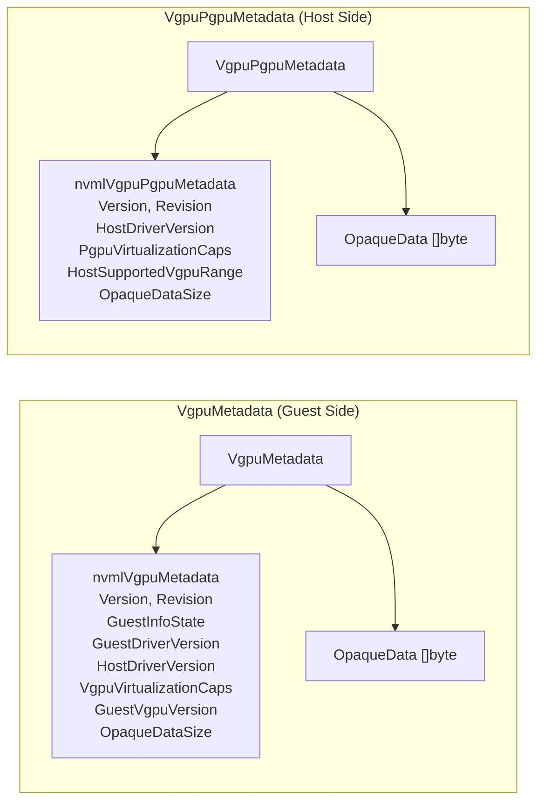

**Sources:** [vendor/github.com/NVIDIA/go-nvml/pkg/nvml/vgpu.go:21-31](), [vendor/github.com/NVIDIA/go-nvml/pkg/nvml/types_gen.go:1195-1217]()

### Getting vGPU Instance Metadata

The `GetMetadata()` method dynamically allocates buffer space for the opaque data:

**Implementation Details:**
- Starts with initial buffer size based on `sizeof(nvmlVgpuMetadata)`
- If buffer is insufficient (`ERROR_INSUFFICIENT_SIZE`), doubles the opaque data size and retries
- Returns structured metadata with separated opaque data slice

**Sources:** [vendor/github.com/NVIDIA/go-nvml/pkg/nvml/vgpu.go:359-383]()

## vGPU Compatibility Checking

The `GetVgpuCompatibility()` function validates whether a vGPU can migrate from one physical GPU to another:

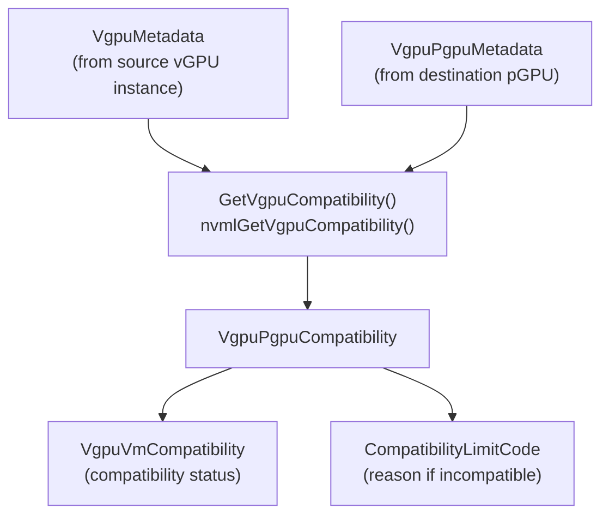

**Usage:**
```go
compatibility, ret := nvmlLib.GetVgpuCompatibility(&vgpuMetadata, &pgpuMetadata)
if ret != nvml.SUCCESS {
    // Handle error
}
// Check compatibility.VgpuVmCompatibility and compatibility.CompatibilityLimitCode
```

**Sources:** [vendor/github.com/NVIDIA/go-nvml/pkg/nvml/vgpu.go:427-432](), [vendor/github.com/NVIDIA/go-nvml/pkg/nvml/types_gen.go:1219-1222]()

## vGPU Licensing

NVML provides comprehensive vGPU licensing information and management:

### License Information Structure

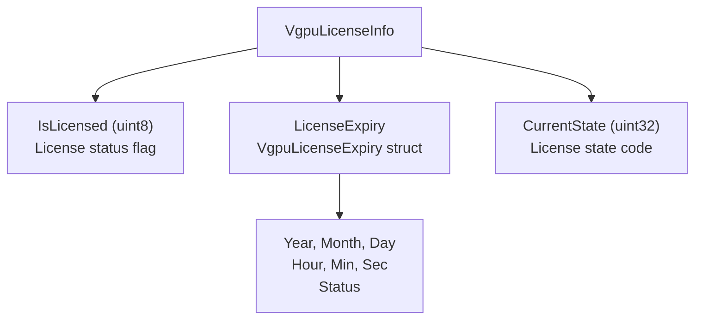

**License State Constants:**
```
NVML_GRID_LICENSE_STATE_UNKNOWN                 = 0
NVML_GRID_LICENSE_STATE_UNINITIALIZED           = 1
NVML_GRID_LICENSE_STATE_UNLICENSED_UNRESTRICTED = 2
NVML_GRID_LICENSE_STATE_UNLICENSED_RESTRICTED   = 3
NVML_GRID_LICENSE_STATE_UNLICENSED              = 4
NVML_GRID_LICENSE_STATE_LICENSED                = 5
```

**Sources:** [vendor/github.com/NVIDIA/go-nvml/pkg/nvml/vgpu.go:205-214](), [vendor/github.com/NVIDIA/go-nvml/pkg/nvml/types_gen.go:683-688](), [vendor/github.com/NVIDIA/go-nvml/pkg/nvml/nvml.h:2074-2079]()

### vGPU Version Management

The library provides version negotiation for vGPU software:

```go
// Get supported and current vGPU versions
supported, current, ret := nvmlLib.GetVgpuVersion()

// Set vGPU version
vgpuVersion := &VgpuVersion{
    MinVersion: minVer,
    MaxVersion: maxVer,
}
ret := nvmlLib.SetVgpuVersion(vgpuVersion)
```

**Sources:** [vendor/github.com/NVIDIA/go-nvml/pkg/nvml/vgpu.go:434-444](), [vendor/github.com/NVIDIA/go-nvml/pkg/nvml/types_gen.go:1190-1193]()

### vGPU Driver Capabilities

Query driver-level vGPU capabilities:

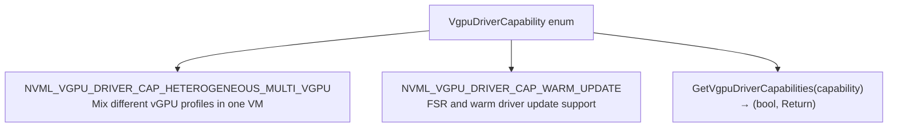

**Sources:** [vendor/github.com/NVIDIA/go-nvml/pkg/nvml/vgpu.go:477-482](), [vendor/github.com/NVIDIA/go-nvml/pkg/nvml/nvml.h:1697-1703]()

## vGPU Utilization Monitoring

NVML provides detailed utilization tracking for vGPU instances and processes:

### vGPU Instance Utilization

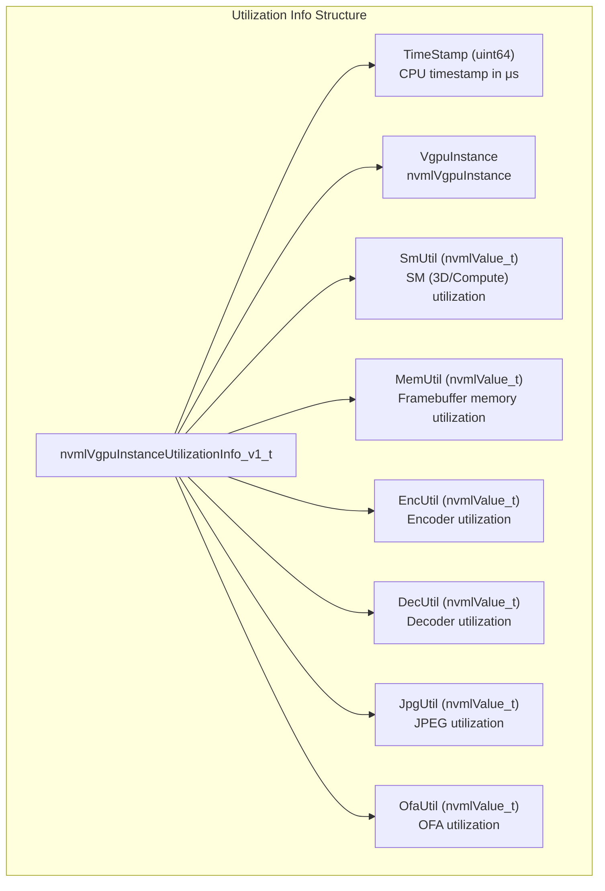

**Sources:** [vendor/github.com/NVIDIA/go-nvml/pkg/nvml/types_gen.go:548-558](), [vendor/github.com/NVIDIA/go-nvml/pkg/nvml/types_gen.go:560-574]()

### vGPU Process Utilization

For per-process monitoring within vGPU instances:

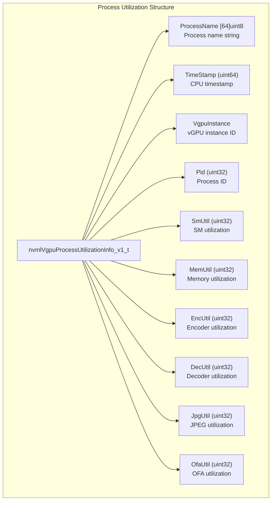

**Sources:** [vendor/github.com/NVIDIA/go-nvml/pkg/nvml/types_gen.go:587-598](), [vendor/github.com/NVIDIA/go-nvml/pkg/nvml/types_gen.go:600-612]()

## vGPU Encoder and Frame Buffer Capture

NVML provides monitoring for video encoding and frame buffer capture (FBC) sessions:

### Encoder Operations

| Method | Return Values | Description |
|--------|---------------|-------------|
| `GetEncoderCapacity()` | int, Return | Current encoder capacity percentage |
| `SetEncoderCapacity(cap)` | Return | Set encoder capacity limit |
| `GetEncoderStats()` | sessionCount, avgFps, avgLatency, Return | Aggregate encoder statistics |
| `GetEncoderSessions()` | count, EncoderSessionInfo, Return | Detailed session information |

**Sources:** [vendor/github.com/NVIDIA/go-nvml/pkg/nvml/vgpu.go:262-303]()

### Frame Buffer Capture (FBC)

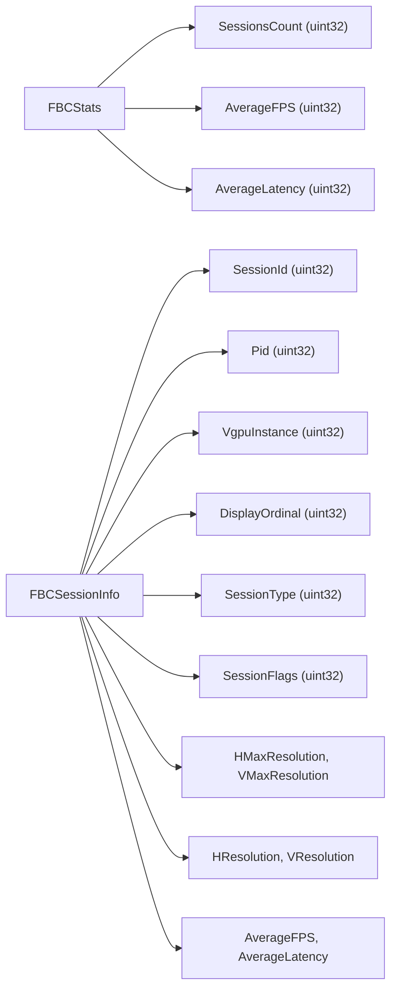

**Sources:** [vendor/github.com/NVIDIA/go-nvml/pkg/nvml/vgpu.go:305-326](), [vendor/github.com/NVIDIA/go-nvml/pkg/nvml/types_gen.go:967-986]()

## vGPU Accounting

The accounting subsystem tracks resource usage per process within vGPU instances:

### Accounting Operations Flow

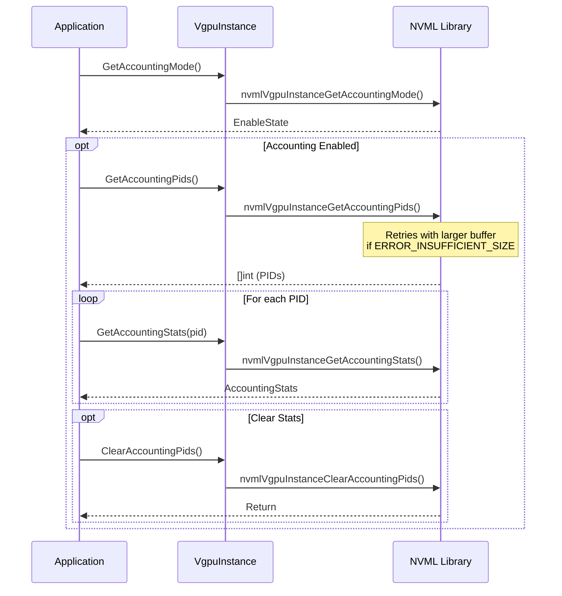

**Sources:** [vendor/github.com/NVIDIA/go-nvml/pkg/nvml/vgpu.go:385-453]()

### Accounting Statistics

The `AccountingStats` structure contains:

```go
type AccountingStats struct {
    GpuUtilization    uint32  // GPU utilization percentage
    MemoryUtilization uint32  // Memory utilization percentage
    MaxMemoryUsage    uint64  // Maximum memory usage in bytes
    Time              uint64  // Total time in microseconds
    StartTime         uint64  // Start time timestamp
    IsRunning         uint32  // 1 if process is currently running
    Reserved          [5]uint32
}
```

**Sources:** [vendor/github.com/NVIDIA/go-nvml/pkg/nvml/types_gen.go:946-954]()

### Accounting PIDs Retrieval

The `GetAccountingPids()` method handles dynamic buffer sizing:

**Implementation pattern:**
1. Start with count = 1
2. Call `nvmlVgpuInstanceGetAccountingPids()`
3. If `ERROR_INSUFFICIENT_SIZE`, double count and retry
4. Return slice of actual count

**Sources:** [vendor/github.com/NVIDIA/go-nvml/pkg/nvml/vgpu.go:396-414]()

## vGPU Scheduler Support

NVML provides access to vGPU scheduler state and configuration (primarily for internal use):

### Scheduler Structures

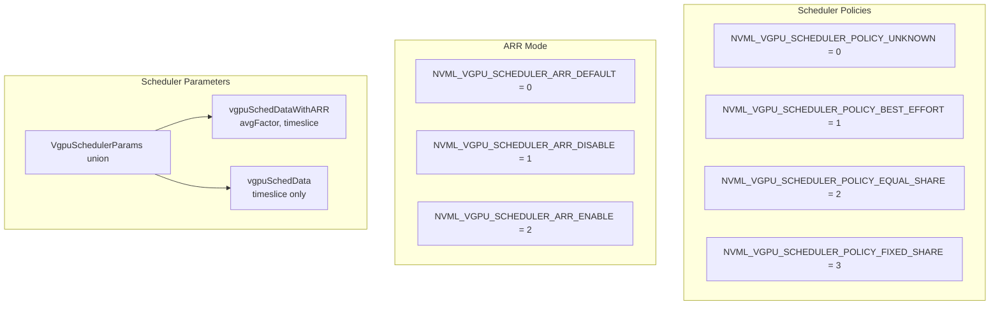

**Sources:** [vendor/github.com/NVIDIA/go-nvml/pkg/nvml/types_gen.go:624-660](), [vendor/github.com/NVIDIA/go-nvml/pkg/nvml/nvml.h:1942-1954]()

### Scheduler Capabilities

The `VgpuSchedulerCapabilities` structure describes scheduler limits:

```go
type VgpuSchedulerCapabilities struct {
    SupportedSchedulers [3]uint32  // List of supported scheduler policies
    MaxTimeslice        uint32     // Maximum timeslice in ns
    MinTimeslice        uint32     // Minimum timeslice in ns
    IsArrModeSupported  uint32     // ARR mode flag
    MaxFrequencyForARR  uint32     // Max frequency for ARR
    MinFrequencyForARR  uint32     // Min frequency for ARR
    MaxAvgFactorForARR  uint32     // Max averaging factor for ARR
    MinAvgFactorForARR  uint32     // Min averaging factor for ARR
}
```

**Sources:** [vendor/github.com/NVIDIA/go-nvml/pkg/nvml/types_gen.go:662-671](), [vendor/github.com/NVIDIA/go-nvml/pkg/nvml/nvml.h:2045-2055]()

## vGPU Placement and Heterogeneous Mode

### vGPU Placement

vGPU placement refers to the logical slots occupied by vGPU instances on a physical GPU:

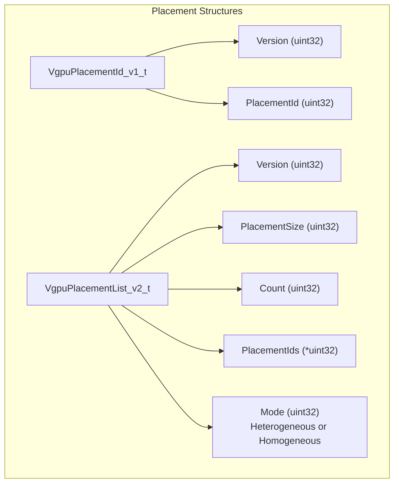

**Placement Modes:**
- `NVML_VGPU_PGPU_HETEROGENEOUS_MODE = 0` - Different vGPU types can coexist
- `NVML_VGPU_PGPU_HOMOGENEOUS_MODE = 1` - Only same vGPU type allowed

**Sources:** [vendor/github.com/NVIDIA/go-nvml/pkg/nvml/types_gen.go:494-527](), [vendor/github.com/NVIDIA/go-nvml/pkg/nvml/nvml.h:1767-1768]()

### Invalid Placement ID

The constant `NVML_INVALID_VGPU_PLACEMENT_ID = 0xFFFF` indicates an invalid or unset placement ID.

**Sources:** [vendor/github.com/NVIDIA/go-nvml/pkg/nvml/nvml.h:1748]()

## MIG and vGPU Integration

For GPUs with MIG (Multi-Instance GPU) enabled, vGPU types can be associated with GPU Instance profiles:

### GPU Instance Profile ID

```go
// Get the GPU Instance Profile ID associated with a vGPU type
gpuInstanceProfileId, ret := vgpuTypeId.GetGpuInstanceProfileId()
```

The returned profile ID corresponds to MIG GPU Instance profiles. The constant `INVALID_GPU_INSTANCE_PROFILE_ID = 0xFFFFFFFF` indicates no association.

**Sources:** [vendor/github.com/NVIDIA/go-nvml/pkg/nvml/vgpu.go:57-66](), [vendor/github.com/NVIDIA/go-nvml/pkg/nvml/nvml.h:1744]()

### Max Instances Per GPU Instance

For MIG-enabled GPUs, query maximum vGPU instances per GPU Instance:

```go
maxInstance := &VgpuTypeMaxInstance{
    Version:    nvml.STRUCT_VERSION(VgpuTypeMaxInstance, 1),
    VgpuTypeId: typeId,
}
ret := nvmlLib.VgpuTypeGetMaxInstancesPerGpuInstance(maxInstance)
// maxInstance.MaxInstancePerGI now contains the count
```

**Sources:** [vendor/github.com/NVIDIA/go-nvml/pkg/nvml/vgpu.go:508-512](), [vendor/github.com/NVIDIA/go-nvml/pkg/nvml/types_gen.go:728-738]()

## vGPU Runtime State

The runtime state operations allow querying the size of vGPU instance state data:

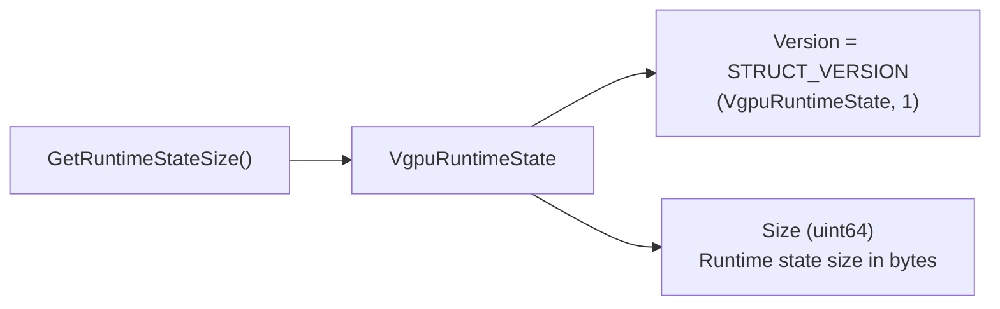

This is typically used for vGPU migration or checkpoint operations.

**Sources:** [vendor/github.com/NVIDIA/go-nvml/pkg/nvml/vgpu.go:496-506](), [vendor/github.com/NVIDIA/go-nvml/pkg/nvml/types_gen.go:614-622]()

## Virtualization Modes and Constants

### GPU Virtualization Modes

```go
const (
    NVML_GPU_VIRTUALIZATION_MODE_NONE = 0        // Bare Metal GPU
    NVML_GPU_VIRTUALIZATION_MODE_PASSTHROUGH = 1 // GPU-Passthrough
    NVML_GPU_VIRTUALIZATION_MODE_VGPU = 2        // vGPU inside VM
    NVML_GPU_VIRTUALIZATION_MODE_HOST_VGPU = 3   // VGX hypervisor in vGPU mode
    NVML_GPU_VIRTUALIZATION_MODE_HOST_VSGA = 4   // VGX hypervisor in vSGA mode
)
```

**Sources:** [vendor/github.com/NVIDIA/go-nvml/pkg/nvml/nvml.h:1625-1631]()

### Host vGPU Modes

```go
const (
    NVML_HOST_VGPU_MODE_NON_SRIOV = 0  // Non SR-IOV mode
    NVML_HOST_VGPU_MODE_SRIOV = 1      // SR-IOV mode
)
```

**Sources:** [vendor/github.com/NVIDIA/go-nvml/pkg/nvml/nvml.h:1636-1640]()

## Buffer Size Constants

Key buffer size constants for vGPU operations:

| Constant | Value | Usage |
|----------|-------|-------|
| `NVML_GRID_LICENSE_BUFFER_SIZE` | 128 | License string buffer |
| `NVML_VGPU_NAME_BUFFER_SIZE` | 64 | vGPU name/process name |
| `NVML_DEVICE_UUID_BUFFER_SIZE` | 80 | UUID strings |
| `DEVICE_NAME_BUFFER_SIZE` | - | Device name queries |
| `SYSTEM_DRIVER_VERSION_BUFFER_SIZE` | - | Driver version strings |

**Sources:** [vendor/github.com/NVIDIA/go-nvml/pkg/nvml/nvml.h:1738-1740](), [vendor/github.com/NVIDIA/go-nvml/pkg/nvml/vgpu.go:39-42]()

## Error Handling

All vGPU operations return `nvml.Return` status codes. Common patterns:

```go
// Type operations
class, ret := vgpuTypeId.GetClass()
if ret != nvml.SUCCESS {
    // Handle error - check ret value
}

// Instance operations with dynamic sizing
pids, ret := vgpuInstance.GetAccountingPids()
if ret != nvml.SUCCESS {
    // ERROR_INSUFFICIENT_SIZE handled internally with retries
    // Other errors indicate real failures
}
```

For complete error code documentation, see [NVML Return Codes and Error Handling](#6.4).

**Sources:** [vendor/github.com/NVIDIA/go-nvml/pkg/nvml/vgpu.go:1-512]()

## Integration with MDEV Management

For host-side vGPU creation using the Linux MDEV framework:

- vGPU Type IDs from NVML correspond to MDEV types in sysfs
- MDEV device UUIDs can be retrieved via `GetMdevUUID()` on vGPU instances
- Physical device discovery uses the nvpci and nvmdev packages

See [MDEV and vGPU Management](#5.2) for host-side vGPU lifecycle operations.

**Sources:** [vendor/github.com/NVIDIA/go-nvml/pkg/nvml/vgpu.go:455-464]()

---

