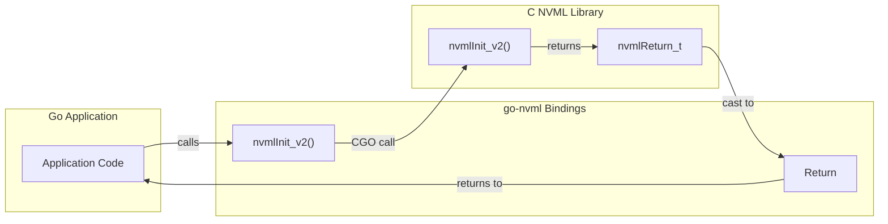
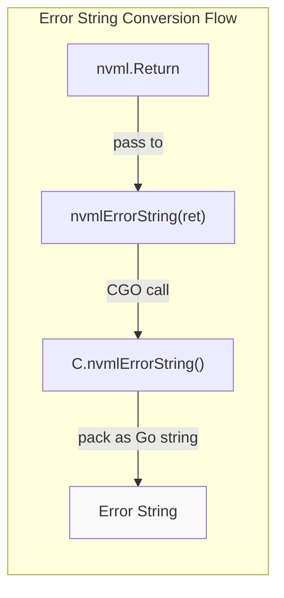
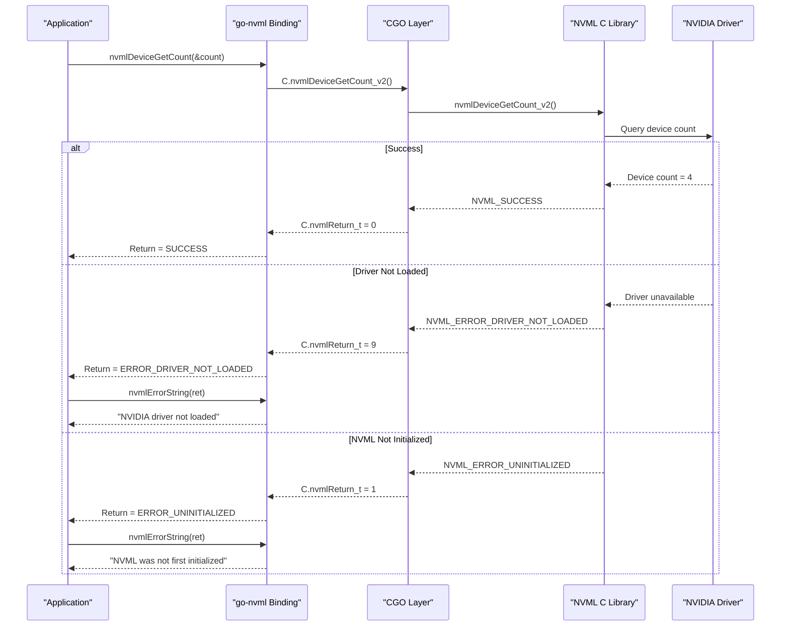
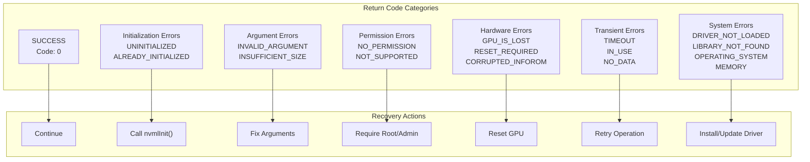
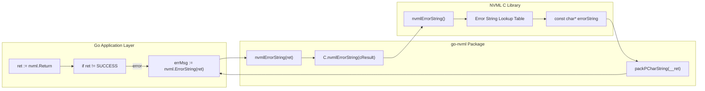

<!-- source: DeepWiki mcp.deepwiki.com · repo NVIDIA/go-nvlib · page 6.4 NVML Return Codes and Error Handling · fetched 2026-10-26 -->

# NVML Return Codes and Error Handling

<details>
<summary>Relevant source files</summary>

The following files were used as context for generating this wiki page:

- [vendor/github.com/NVIDIA/go-nvml/pkg/nvml/const.go](vendor/github.com/NVIDIA/go-nvml/pkg/nvml/const.go)
- [vendor/github.com/NVIDIA/go-nvml/pkg/nvml/nvml.go](vendor/github.com/NVIDIA/go-nvml/pkg/nvml/nvml.go)

</details>


## Purpose and Scope

This page documents the NVML return code system and error handling patterns in the vendored go-nvml package. It covers the `nvml.Return` type, common error codes, error string conversion, and best practices for handling NVML errors.

For information about NVML initialization and basic operations that use these return codes, see [NVML Initialization and Core Operations](#6.1). For device-specific operations and their error handling, see [NVML Device Interface](#6.2).

**Sources:** [vendor/github.com/NVIDIA/go-nvml/pkg/nvml/nvml.go:1-100]()

---

## The Return Type

All NVML functions in the go-nvml bindings return a `nvml.Return` type. This type represents the status code returned by the underlying NVML C library function. The `Return` type is a Go wrapper around the C `nvmlReturn_t` enumeration.

Every NVML operation follows this pattern:

```go
func nvmlFunctionName(parameters...) Return {
    // CGO call to C NVML library
    __ret := C.nvmlFunctionName(cParameters...)
    __v := (Return)(__ret)
    return __v
}
```

### Return Type Usage Pattern



**Sources:** [vendor/github.com/NVIDIA/go-nvml/pkg/nvml/nvml.go:32-36](), [vendor/github.com/NVIDIA/go-nvml/pkg/nvml/nvml.go:207-211]()

---

## Common Return Codes

NVML return codes indicate the success or failure of an operation. The most frequently encountered codes are:

| Return Code | Meaning | Common Causes |
|------------|---------|---------------|
| `SUCCESS` | Operation completed successfully | Normal operation |
| `ERROR_UNINITIALIZED` | NVML not initialized | Calling NVML functions before `Init()` |
| `ERROR_INVALID_ARGUMENT` | Invalid function argument | Null pointers, invalid enum values |
| `ERROR_NOT_SUPPORTED` | Operation not supported | Feature unavailable on device/driver |
| `ERROR_NO_PERMISSION` | Insufficient permissions | Root/admin privileges required |
| `ERROR_ALREADY_INITIALIZED` | NVML already initialized | Multiple `Init()` calls |
| `ERROR_NOT_FOUND` | Requested entity not found | Invalid device index, missing resource |
| `ERROR_INSUFFICIENT_SIZE` | Buffer too small | Output buffer needs more space |
| `ERROR_INSUFFICIENT_POWER` | Power limit exceeded | Device power constraints |
| `ERROR_DRIVER_NOT_LOADED` | NVIDIA driver not loaded | Driver installation issue |
| `ERROR_TIMEOUT` | Operation timeout | Device not responding |
| `ERROR_IRQ_ISSUE` | Interrupt request issue | Hardware/driver problem |
| `ERROR_LIBRARY_NOT_FOUND` | NVML library not found | Missing libnvidia-ml.so |
| `ERROR_FUNCTION_NOT_FOUND` | Function not in library | Version mismatch |
| `ERROR_CORRUPTED_INFOROM` | InfoROM corrupted | Hardware issue |
| `ERROR_GPU_IS_LOST` | GPU has fallen off the bus | Hardware failure, needs reset |
| `ERROR_RESET_REQUIRED` | GPU requires reset | Recoverable error state |
| `ERROR_OPERATING_SYSTEM` | OS-level error | System call failure |
| `ERROR_LIB_RM_VERSION_MISMATCH` | RM version mismatch | Driver component version conflict |
| `ERROR_IN_USE` | Resource in use | Device busy with another operation |
| `ERROR_MEMORY` | Memory allocation failure | Out of memory |
| `ERROR_NO_DATA` | No data available | Metric not collected yet |
| `ERROR_VGPU_ECC_NOT_SUPPORTED` | vGPU ECC not supported | Feature limitation |
| `ERROR_INSUFFICIENT_RESOURCES` | Insufficient resources | System resource exhaustion |
| `ERROR_UNKNOWN` | Unknown error | Unexpected condition |

**Sources:** [vendor/github.com/NVIDIA/go-nvml/pkg/nvml/nvml.go:32-2500]()

---

## Error String Conversion

The `nvmlErrorString` function converts a `Return` code to a human-readable string description:

### nvmlErrorString Function

```go
func nvmlErrorString(Result Return) string
```

This function wraps the C `nvmlErrorString` function and provides descriptive error messages for any return code.



**Implementation Details:**

The function performs these steps:
1. Casts the Go `Return` type to C `nvmlReturn_t`
2. Calls the C `nvmlErrorString` function
3. Converts the returned C string pointer to a Go string using `packPCharString`
4. Returns the Go string

**Sources:** [vendor/github.com/NVIDIA/go-nvml/pkg/nvml/nvml.go:53-59]()

---

## Error Handling Patterns

### Pattern 1: Check for Success

The most common pattern is to check if the return code equals `SUCCESS`:

```go
ret := nvml.Init()
if ret != nvml.SUCCESS {
    errStr := nvml.ErrorString(ret)
    return fmt.Errorf("NVML initialization failed: %s", errStr)
}
```

### Pattern 2: Handle Specific Errors

Different error codes may require different handling:

```go
ret := nvml.DeviceGetHandleByIndex(index, &device)
switch ret {
case nvml.SUCCESS:
    // Continue with device
case nvml.ERROR_NOT_FOUND:
    // Invalid index, skip this device
case nvml.ERROR_UNINITIALIZED:
    // Need to initialize NVML first
    return fmt.Errorf("NVML not initialized")
default:
    // Unexpected error
    return fmt.Errorf("failed to get device: %s", nvml.ErrorString(ret))
}
```

### Pattern 3: Retry on Transient Errors

Some errors are transient and may succeed on retry:

```go
func getDeviceWithRetry(index uint32) (nvml.Device, error) {
    for attempts := 0; attempts < maxRetries; attempts++ {
        var device nvml.Device
        ret := nvml.DeviceGetHandleByIndex(index, &device)
        
        if ret == nvml.SUCCESS {
            return device, nil
        }
        
        if ret == nvml.ERROR_TIMEOUT || ret == nvml.ERROR_IN_USE {
            time.Sleep(retryDelay)
            continue
        }
        
        return nil, fmt.Errorf("failed to get device: %s", nvml.ErrorString(ret))
    }
    return nil, fmt.Errorf("max retries exceeded")
}
```

### Pattern 4: Graceful Degradation

Handle unsupported features gracefully:

```go
ret := nvml.DeviceGetMigMode(device, &current, &pending)
if ret == nvml.ERROR_NOT_SUPPORTED {
    // MIG not supported on this device, continue without it
    return nil
}
if ret != nvml.SUCCESS {
    return fmt.Errorf("failed to get MIG mode: %s", nvml.ErrorString(ret))
}
```

**Sources:** [vendor/github.com/NVIDIA/go-nvml/pkg/nvml/nvml.go:32-100]()

---

## Return Code Flow in NVML Operations



**Sources:** [vendor/github.com/NVIDIA/go-nvml/pkg/nvml/nvml.go:206-212](), [vendor/github.com/NVIDIA/go-nvml/pkg/nvml/nvml.go:53-59]()

---

## Error Categories and Recovery Actions



**Sources:** [vendor/github.com/NVIDIA/go-nvml/pkg/nvml/nvml.go:32-2500]()

---

## Best Practices

### 1. Always Check Return Codes

Never ignore return codes from NVML functions:

```go
// BAD: Ignoring return code
nvml.Init()

// GOOD: Checking return code
if ret := nvml.Init(); ret != nvml.SUCCESS {
    return fmt.Errorf("NVML init failed: %s", nvml.ErrorString(ret))
}
```

### 2. Use ErrorString for User-Facing Messages

Always convert return codes to strings for logs and error messages:

```go
ret := nvml.DeviceGetName(device, name, length)
if ret != nvml.SUCCESS {
    // Provides clear error message
    log.Errorf("Failed to get device name: %s", nvml.ErrorString(ret))
}
```

### 3. Handle Unsupported Features Gracefully

Not all features are available on all devices:

```go
ret := nvml.DeviceGetMigMode(device, &current, &pending)
if ret == nvml.ERROR_NOT_SUPPORTED {
    // MIG not available, use non-MIG path
    return handleNonMigDevice(device)
}
```

### 4. Initialize Before Use

Ensure NVML is initialized before calling other functions:

```go
if ret := nvml.Init(); ret != nvml.SUCCESS {
    return fmt.Errorf("NVML initialization failed: %s", nvml.ErrorString(ret))
}
defer nvml.Shutdown()
```

### 5. Cleanup on Shutdown

Always call `Shutdown()` to clean up resources:

```go
func main() {
    if ret := nvml.Init(); ret != nvml.SUCCESS {
        log.Fatal(nvml.ErrorString(ret))
    }
    defer func() {
        if ret := nvml.Shutdown(); ret != nvml.SUCCESS {
            log.Errorf("NVML shutdown failed: %s", nvml.ErrorString(ret))
        }
    }()
    
    // Use NVML functions...
}
```

### 6. Context-Specific Error Handling

Add context to errors for better debugging:

```go
ret := nvml.DeviceGetHandleByIndex(index, &device)
if ret != nvml.SUCCESS {
    return fmt.Errorf("failed to get handle for device %d: %s", 
        index, nvml.ErrorString(ret))
}
```

**Sources:** [vendor/github.com/NVIDIA/go-nvml/pkg/nvml/nvml.go:32-51](), [vendor/github.com/NVIDIA/go-nvml/pkg/nvml/nvml.go:53-59]()

---

## Function Return Code Table

The following table shows representative NVML functions and their return patterns:

| Function | Return Type | Common Error Codes |
|----------|-------------|-------------------|
| `nvmlInit_v2()` | `Return` | `SUCCESS`, `ERROR_ALREADY_INITIALIZED`, `ERROR_DRIVER_NOT_LOADED` |
| `nvmlShutdown()` | `Return` | `SUCCESS`, `ERROR_UNINITIALIZED` |
| `nvmlDeviceGetCount_v2()` | `Return` | `SUCCESS`, `ERROR_UNINITIALIZED`, `ERROR_INVALID_ARGUMENT` |
| `nvmlDeviceGetHandleByIndex_v2()` | `Return` | `SUCCESS`, `ERROR_UNINITIALIZED`, `ERROR_INVALID_ARGUMENT`, `ERROR_NOT_FOUND` |
| `nvmlDeviceGetName()` | `Return` | `SUCCESS`, `ERROR_UNINITIALIZED`, `ERROR_INVALID_ARGUMENT`, `ERROR_INSUFFICIENT_SIZE` |
| `nvmlDeviceGetPciInfo_v3()` | `Return` | `SUCCESS`, `ERROR_UNINITIALIZED`, `ERROR_INVALID_ARGUMENT`, `ERROR_NOT_SUPPORTED` |
| `nvmlDeviceGetMemoryInfo()` | `Return` | `SUCCESS`, `ERROR_UNINITIALIZED`, `ERROR_INVALID_ARGUMENT`, `ERROR_NOT_SUPPORTED`, `ERROR_GPU_IS_LOST` |
| `nvmlDeviceSetPersistenceMode()` | `Return` | `SUCCESS`, `ERROR_UNINITIALIZED`, `ERROR_INVALID_ARGUMENT`, `ERROR_NO_PERMISSION`, `ERROR_NOT_SUPPORTED` |
| `nvmlErrorString()` | `string` | N/A (always returns string, never fails) |

**Sources:** [vendor/github.com/NVIDIA/go-nvml/pkg/nvml/nvml.go:32-36](), [vendor/github.com/NVIDIA/go-nvml/pkg/nvml/nvml.go:46-51](), [vendor/github.com/NVIDIA/go-nvml/pkg/nvml/nvml.go:53-59](), [vendor/github.com/NVIDIA/go-nvml/pkg/nvml/nvml.go:206-211](), [vendor/github.com/NVIDIA/go-nvml/pkg/nvml/nvml.go:223-230](), [vendor/github.com/NVIDIA/go-nvml/pkg/nvml/nvml.go:268-276](), [vendor/github.com/NVIDIA/go-nvml/pkg/nvml/nvml.go:544-551](), [vendor/github.com/NVIDIA/go-nvml/pkg/nvml/nvml.go:1084-1091](), [vendor/github.com/NVIDIA/go-nvml/pkg/nvml/nvml.go:1814-1821]()

---

## Error Code to String Mapping



**Sources:** [vendor/github.com/NVIDIA/go-nvml/pkg/nvml/nvml.go:53-59]()

---

## Summary

The NVML return code system provides a comprehensive error reporting mechanism:

1. **Consistent Interface**: All NVML functions return `nvml.Return` type
2. **Rich Error Information**: Specific error codes for different failure modes
3. **Human-Readable Messages**: `nvmlErrorString()` converts codes to descriptive text
4. **Error Categories**: Initialization, argument, permission, hardware, transient, and system errors
5. **Recovery Guidance**: Different error types suggest different recovery actions

Always check return codes, use `ErrorString()` for messages, and handle errors appropriately based on their category and your application's requirements.

**Sources:** [vendor/github.com/NVIDIA/go-nvml/pkg/nvml/nvml.go:1-2500]()

---

