<!-- source: DeepWiki mcp.deepwiki.com · repo NVIDIA/go-nvlib · page 7 System Information Package · fetched 2026-10-26 -->

# System Information Package

Relevant source files

The following files were used as context for generating this wiki page:

- [pkg/nvlib/device/api.go](pkg/nvlib/device/api.go)
- [pkg/nvlib/device/device.go](pkg/nvlib/device/device.go)
- [pkg/nvlib/info/options.go](pkg/nvlib/info/options.go)

## Purpose and Scope

The `pkg/nvlib/info` package provides a high-level interface for gathering comprehensive GPU system information. It aggregates data from multiple sources including NVML, the device management layer, and platform-specific property extractors to deliver a unified view of the GPU environment.

This package is distinct from the lower-level components it depends on:
- For GPU device discovery and management, see [GPU Device Management](#3)
- For NVML bindings reference, see [NVML Bindings Reference](#6)
- For hardware topology discovery, see [Hardware Topology Discovery](#5)

The info package sits at the highest abstraction layer, orchestrating these components to provide system-wide GPU information suitable for configuration generation, system validation, and runtime environment discovery.

---

## Package Architecture

The info package implements a modular architecture that separates concerns between configuration, property extraction, and platform detection.

### Component Structure

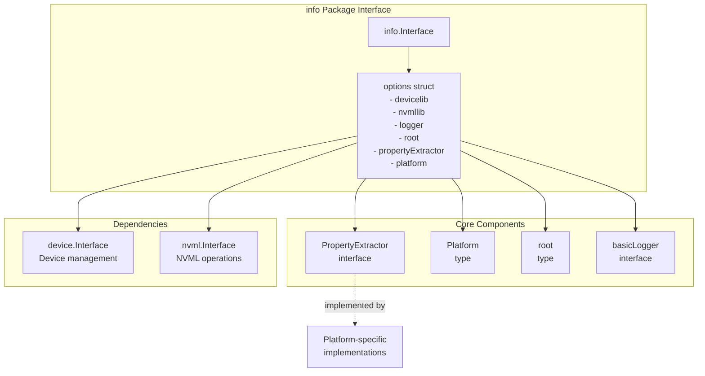

**Sources:** [pkg/nvlib/info/options.go:1-71]()

### Interface Design

The info package follows the same interface-driven design pattern used throughout go-nvlib, allowing for dependency injection and testing with mock implementations.

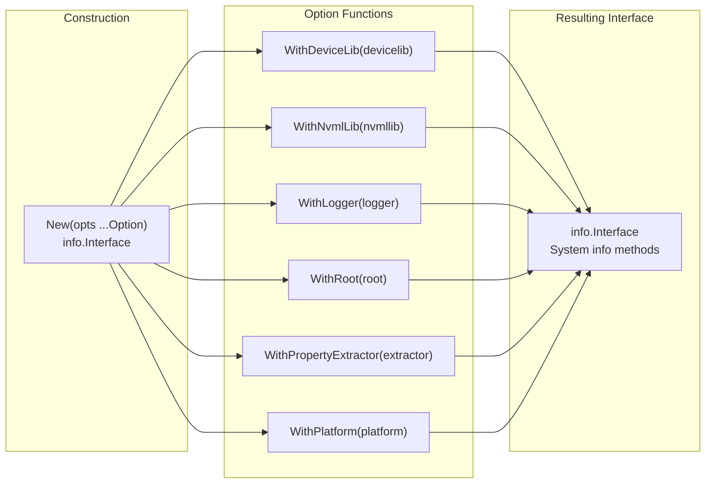

**Sources:** [pkg/nvlib/info/options.go:25-71]()

---

## Configuration Options

The info package provides several configuration options through functional option pattern. Each option is defined as a function that modifies the internal `options` struct.

### Available Options

| Option Function | Purpose | Parameter Type |
|----------------|---------|----------------|
| `WithDeviceLib` | Sets the device library for GPU enumeration | `device.Interface` |
| `WithNvmlLib` | Sets the NVML library for low-level operations | `nvml.Interface` |
| `WithLogger` | Configures logging output | `basicLogger` |
| `WithRoot` | Sets filesystem root for property extraction | `string` |
| `WithPropertyExtractor` | Sets custom property extraction implementation | `PropertyExtractor` |
| `WithPlatform` | Explicitly sets the platform type | `Platform` |

**Sources:** [pkg/nvlib/info/options.go:28-70]()

### Option Implementation Pattern

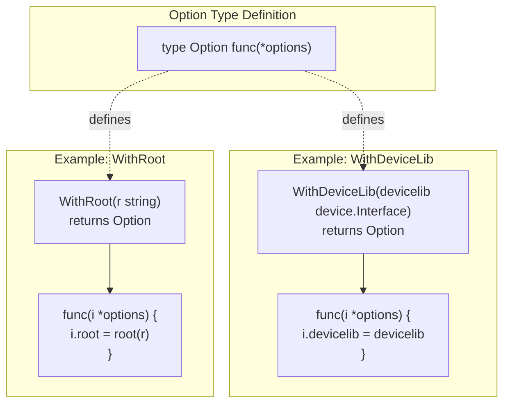

**Sources:** [pkg/nvlib/info/options.go:26-54]()

---

## Property Extraction System

The `PropertyExtractor` interface provides an abstraction for retrieving system properties that may vary by platform or deployment environment. This design allows the info package to adapt to different GPU platforms (e.g., bare metal, containerized, virtualized) without changing its core logic.

### PropertyExtractor Interface

The `PropertyExtractor` interface is referenced in the options as a pluggable component that can be swapped for testing or to support different environments.

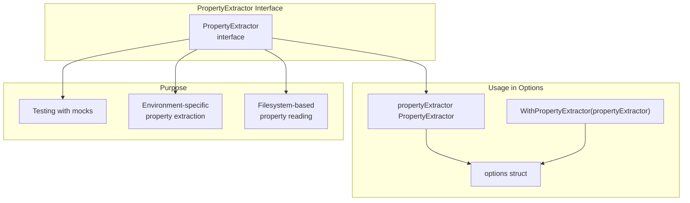

**Sources:** [pkg/nvlib/info/options.go:56-63]()

### Root Filesystem Configuration

The `root` type represents the filesystem root for property extraction, allowing the info package to read system properties from non-standard locations (useful in containerized environments or for testing).

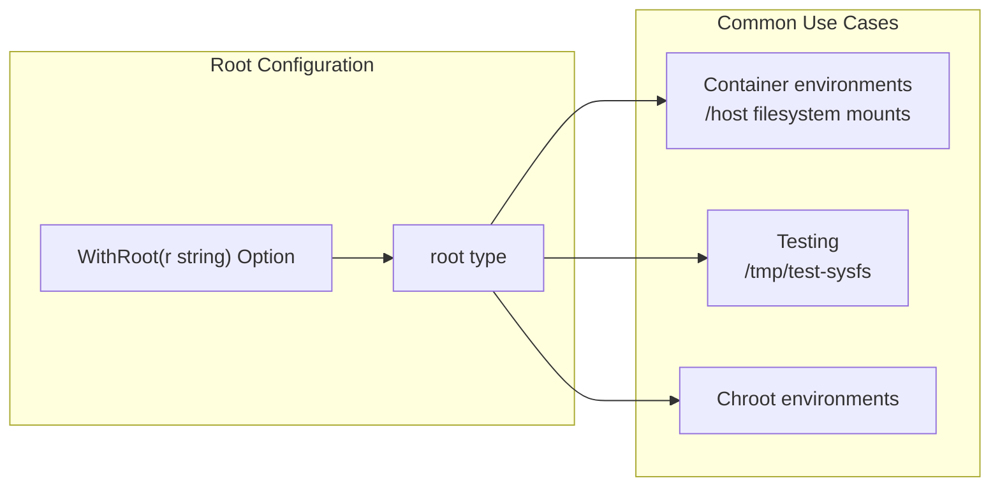

**Sources:** [pkg/nvlib/info/options.go:49-54]()

---

## Platform Detection

The `Platform` type allows the info package to adapt its behavior based on the deployment platform. This is particularly important for distinguishing between different GPU virtualization technologies and bare-metal deployments.

### Platform Types

The `Platform` type can be explicitly set via `WithPlatform` option, allowing applications to override automatic detection or specify platform-specific behavior.

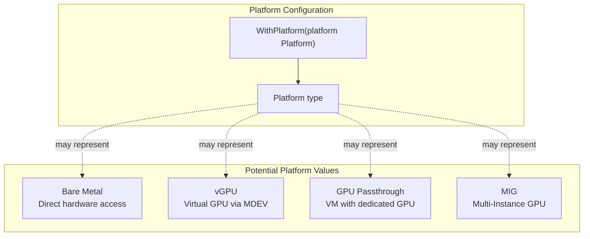

**Sources:** [pkg/nvlib/info/options.go:65-70]()

---

## Integration with Device Library

The info package heavily relies on the device library to enumerate and query GPUs. This integration provides access to high-level device abstractions while maintaining separation of concerns.

### Device Library Integration Flow

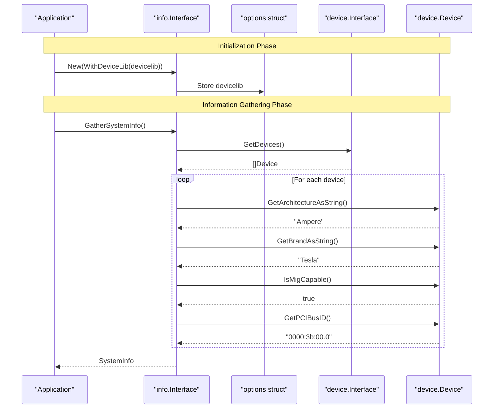

**Sources:** [pkg/nvlib/info/options.go:28-32](), [pkg/nvlib/device/device.go:26-41]()

### Device Properties Accessible via Info Package

The info package can access all device properties through the `device.Interface`:

| Property Method | Return Type | Description |
|----------------|-------------|-------------|
| `GetArchitectureAsString()` | `string` | GPU architecture (Ampere, Hopper, etc.) |
| `GetBrandAsString()` | `string` | GPU brand (Tesla, Quadro, GeForce, etc.) |
| `GetCudaComputeCapabilityAsString()` | `string` | CUDA compute capability version |
| `GetMigDevices()` | `[]MigDevice` | MIG devices on this GPU |
| `GetMigProfiles()` | `[]MigProfile` | Available MIG profiles |
| `GetPCIBusID()` | `string` | PCI bus identifier |
| `IsCoherent()` | `bool` | Coherent memory access capability |
| `IsFabricAttached()` | `bool` | GPU fabric attachment status |
| `IsMigCapable()` | `bool` | MIG capability |
| `IsMigEnabled()` | `bool` | MIG enabled status |

**Sources:** [pkg/nvlib/device/device.go:26-41]()

---

## Integration with NVML

The info package can optionally use NVML directly for system-level queries that don't require device-specific context. This is configured through the `WithNvmlLib` option.

### NVML Integration Pattern

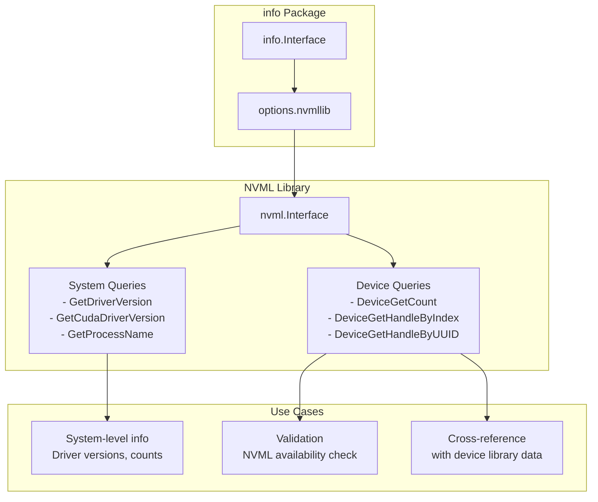

**Sources:** [pkg/nvlib/info/options.go:42-47]()

---

## Logging Integration

The info package supports logging through the `basicLogger` interface, allowing applications to track information gathering operations and debug issues.

### Logger Interface Pattern

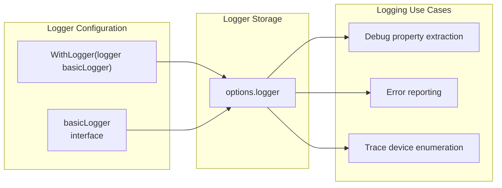

**Sources:** [pkg/nvlib/info/options.go:35-40]()

---

## Typical Usage Pattern

The info package is typically initialized with both device library and NVML library instances, allowing it to gather comprehensive system information from both sources.

### Complete Initialization Example

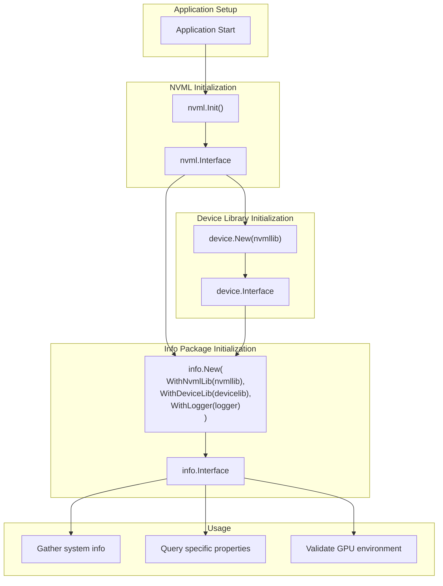

**Sources:** [pkg/nvlib/info/options.go:1-71](), [pkg/nvlib/device/api.go:49-68]()

---

## Testing Support

The info package's design supports comprehensive testing through dependency injection. All major dependencies can be replaced with mock implementations.

### Testing Configuration

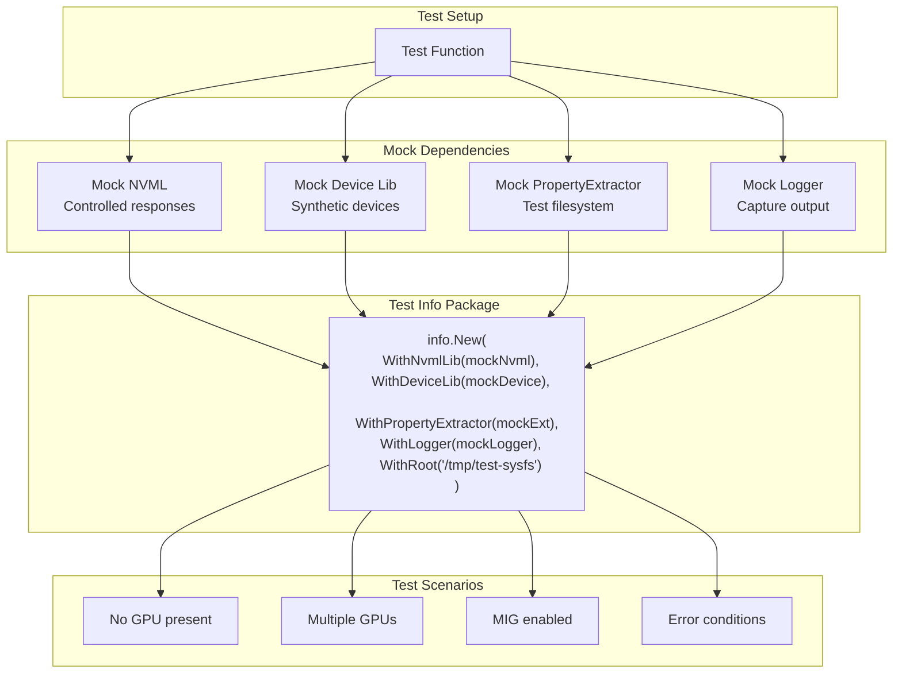

**Sources:** [pkg/nvlib/info/options.go:56-70]()

For more details on mock implementations, see [Mock Implementations](#8.2).

---

## Relationship to Other Packages

The info package serves as a high-level orchestrator that brings together multiple lower-level components.

### Package Dependency Graph

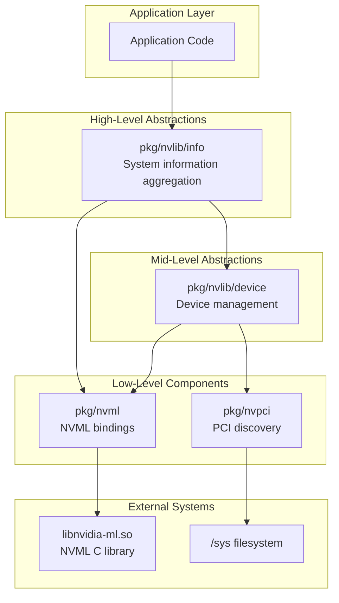

**Sources:** [pkg/nvlib/info/options.go:19-23](), [pkg/nvlib/device/api.go:19-21]()

---

## Summary

The `pkg/nvlib/info` package provides:

1. **Unified System Information**: Aggregates data from NVML, device library, and platform-specific sources
2. **Flexible Configuration**: Functional options pattern for customizing behavior
3. **Platform Awareness**: Supports different deployment scenarios through platform detection
4. **Testability**: All dependencies injectable via options, enabling comprehensive testing
5. **Logging Support**: Integrated logging for debugging and monitoring
6. **Property Extraction**: Pluggable property extraction system for environment-specific needs

The package sits at the highest abstraction layer in go-nvlib, making it ideal for applications that need comprehensive GPU system information without managing the complexity of multiple APIs directly.

---

