<!-- source: DeepWiki mcp.deepwiki.com · repo NVIDIA/go-nvlib · page 8 Testing · fetched 2026-10-26 -->

# Testing

<details>
<summary>Relevant source files</summary>

The following files were used as context for generating this wiki page:

- [pkg/nvmdev/mock.go](pkg/nvmdev/mock.go)
- [pkg/nvmdev/nvmdev.go](pkg/nvmdev/nvmdev.go)
- [pkg/nvmdev/nvmdev_test.go](pkg/nvmdev/nvmdev_test.go)
- [pkg/nvpci/mock.go](pkg/nvpci/mock.go)
- [pkg/nvpci/nvpci.go](pkg/nvpci/nvpci.go)
- [pkg/nvpci/nvpci_mock.go](pkg/nvpci/nvpci_mock.go)
- [pkg/nvpci/nvpci_test.go](pkg/nvpci/nvpci_test.go)
- [vendor/github.com/stretchr/testify/assert/assertion_compare.go](vendor/github.com/stretchr/testify/assert/assertion_compare.go)
- [vendor/github.com/stretchr/testify/assert/assertion_format.go](vendor/github.com/stretchr/testify/assert/assertion_format.go)
- [vendor/github.com/stretchr/testify/assert/assertion_forward.go](vendor/github.com/stretchr/testify/assert/assertion_forward.go)
- [vendor/github.com/stretchr/testify/assert/assertion_order.go](vendor/github.com/stretchr/testify/assert/assertion_order.go)
- [vendor/github.com/stretchr/testify/assert/assertions.go](vendor/github.com/stretchr/testify/assert/assertions.go)
- [vendor/github.com/stretchr/testify/require/require.go](vendor/github.com/stretchr/testify/require/require.go)
- [vendor/github.com/stretchr/testify/require/require_forward.go](vendor/github.com/stretchr/testify/require/require_forward.go)

</details>


This document describes the testing infrastructure in go-nvlib, including the mock implementations that enable testing without GPU hardware, the testify assertion framework, and common testing patterns used throughout the codebase.

For information about building and running tests via the CI/CD pipeline, see [CI/CD Pipeline](#9.2). For code generation of mocks, see [Build System](#9.1).

## Testing Architecture

The go-nvlib testing infrastructure is designed to enable comprehensive unit testing without requiring physical GPU hardware or elevated system privileges. The testing architecture mirrors the production component hierarchy with mock implementations for each major interface.

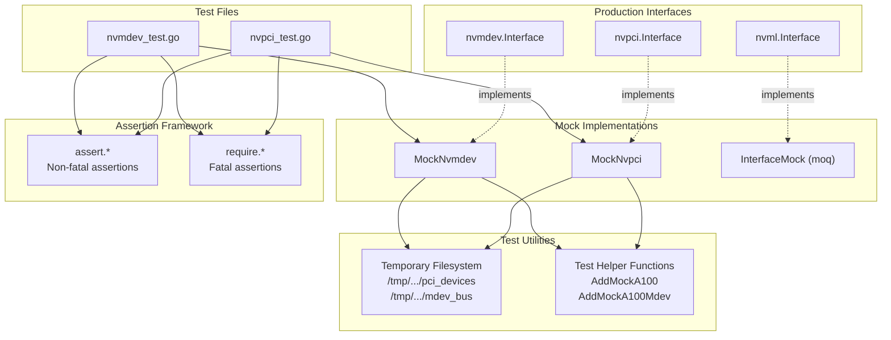

**Sources:** [pkg/nvpci/nvpci.go:48-62](), [pkg/nvmdev/nvmdev.go:36-40](), [pkg/nvpci/mock.go:29-34](), [pkg/nvmdev/mock.go:28-34]()

## Testify Framework

The go-nvlib codebase uses the [stretchr/testify](https://github.com/stretchr/testify) framework for assertions. The framework provides two packages with different failure behaviors:

| Package | Behavior on Failure | Use Case |
|---------|---------------------|----------|
| `assert` | Logs error, continues test execution | Multiple independent checks in a test |
| `require` | Logs error, stops test execution immediately | Critical preconditions that invalidate subsequent checks |

### Common Assertion Functions

The following table lists commonly used assertion functions in the codebase:

| Function | Purpose | Example |
|----------|---------|---------|
| `Nil(t, obj)` | Assert object is nil | Checking error is nil |
| `Equal(t, expected, actual)` | Assert deep equality | Comparing values |
| `Len(t, obj, length)` | Assert collection length | Verifying slice size |
| `True(t, condition)` | Assert boolean is true | Checking flags |
| `Error(t, err)` | Assert error is not nil | Validating error cases |
| `NoError(t, err)` | Assert error is nil | Validating success cases |

**Sources:** [vendor/github.com/stretchr/testify/assert/assertions.go:488-513](), [vendor/github.com/stretchr/testify/require/require.go:166-181]()

### Assert vs Require Pattern

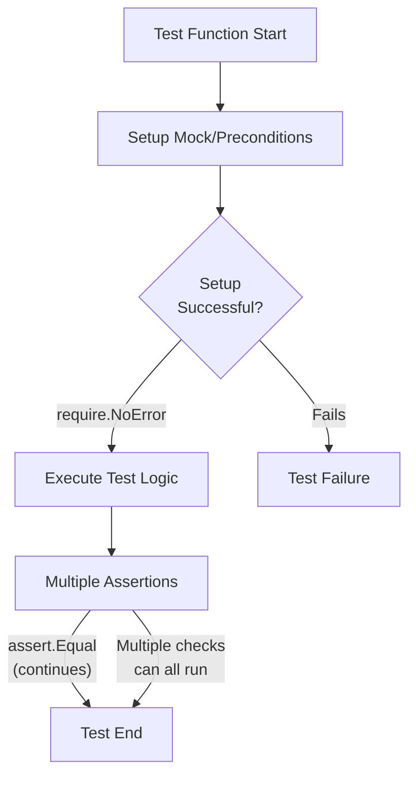

**Sources:** [pkg/nvpci/nvpci_test.go:29-76](), [pkg/nvmdev/nvmdev_test.go:25-63]()

## Mock Implementations

### MockNvpci

The `MockNvpci` type provides a mock implementation of the `nvpci.Interface` that simulates PCI device discovery by creating a temporary sysfs-like filesystem structure.

#### Key Components

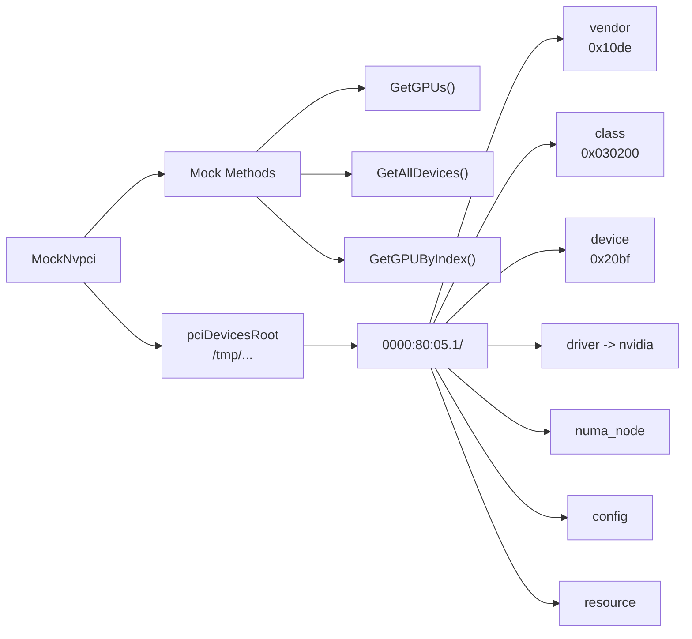

**Sources:** [pkg/nvpci/mock.go:29-58]()

#### Creating Mock PCI Devices

The `AddMockA100` method creates a complete mock GPU device with all required sysfs files:

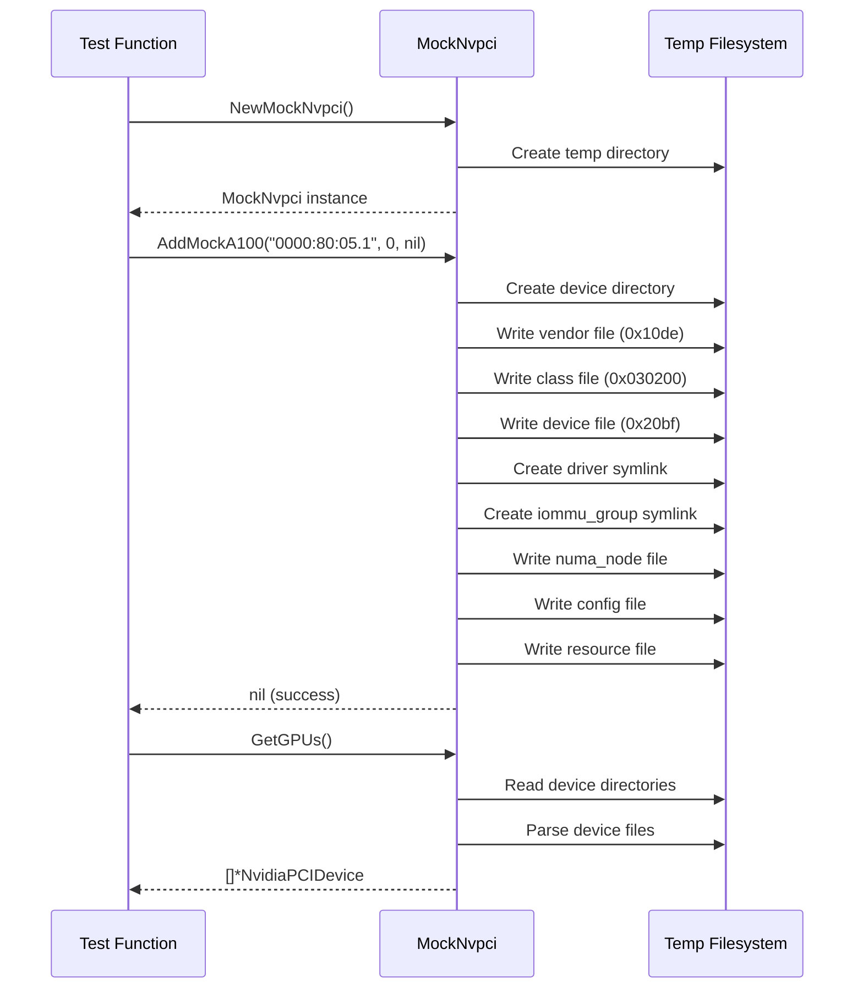

**Sources:** [pkg/nvpci/mock.go:69-133](), [pkg/nvpci/mock.go:135-210]()

#### SR-IOV Support in MockNvpci

When creating mock devices with SR-IOV support, the mock creates both physical function (PF) and virtual function (VF) devices:

| Parameter | Type | Description |
|-----------|------|-------------|
| `address` | `string` | PCI bus address (e.g., "0000:80:05.1") |
| `numaNode` | `int` | NUMA node number |
| `sriov` | `*SriovInfo` | SR-IOV configuration (nil if not SR-IOV capable) |

When `sriov.PhysicalFunction` is non-nil:
1. Creates `sriov_totalvfs` file with total VF count
2. Creates `sriov_numvfs` file with enabled VF count
3. Creates VF device directories for each enabled VF
4. Creates `physfn` symlink in VF directories pointing to PF

**Sources:** [pkg/nvpci/mock.go:106-130](), [pkg/nvpci/mock.go:212-260]()

### MockNvmdev

The `MockNvmdev` type provides a mock implementation of the `nvmdev.Interface` for testing mediated device (vGPU) creation and management.

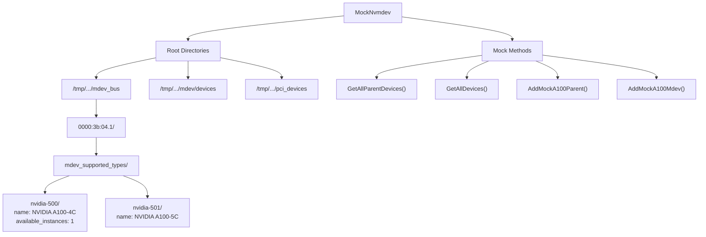

**Sources:** [pkg/nvmdev/mock.go:28-78]()

#### Creating Mock MDEV Devices

The mock MDEV creation process involves two steps:

**Step 1: Create Parent Device**

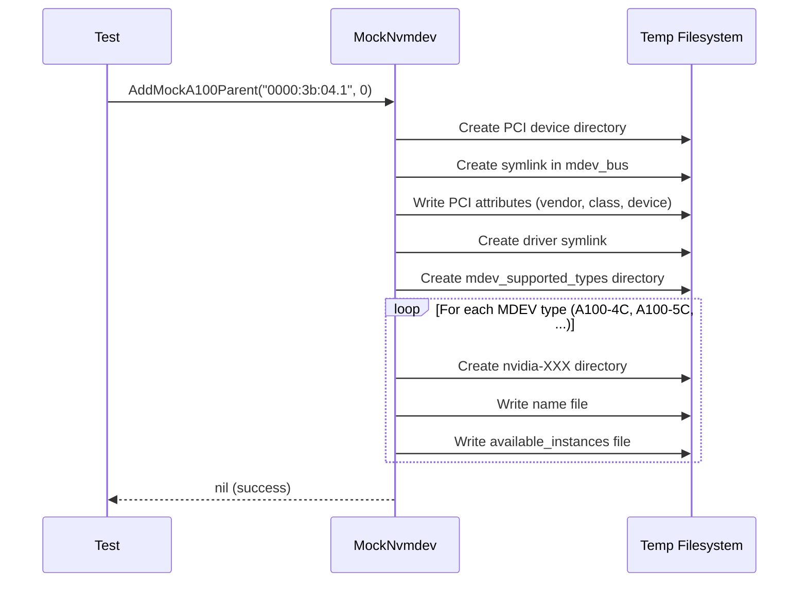

**Step 2: Create MDEV Instance**

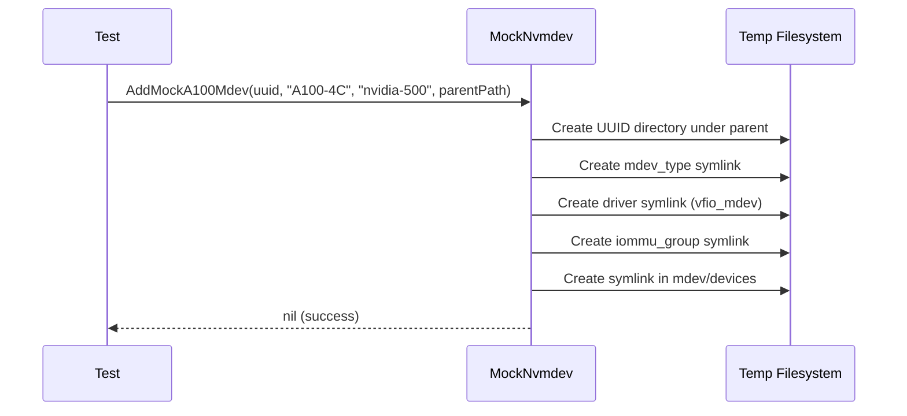

**Sources:** [pkg/nvmdev/mock.go:87-226](), [pkg/nvmdev/mock.go:228-267]()

### Generated NVML Mocks

The NVML interface mocks are generated using the [moq](https://github.com/matryer/moq) tool. The generated `InterfaceMock` provides function fields for each interface method, enabling fine-grained control over mock behavior.

#### Mock Structure

The generated mock has the following pattern for each interface method:

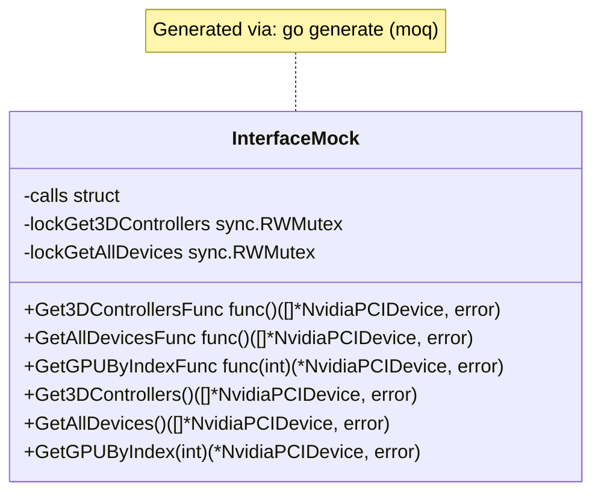

**Sources:** [pkg/nvpci/nvpci_mock.go:1-415](), [pkg/nvpci/nvpci.go:50]()

#### Call Tracking

The generated mock tracks all method calls, enabling verification in tests:

| Feature | Purpose | Access Pattern |
|---------|---------|----------------|
| `calls` struct | Stores all method invocations | Per-method slice of call structs |
| `lock*` mutexes | Thread-safe call tracking | Read/write locks per method |
| `*Calls()` methods | Retrieve call history | Returns slice of call information |

**Sources:** [pkg/nvpci/nvpci_mock.go:87-134]()

## Common Testing Patterns

### Test Structure

Tests in go-nvlib follow a consistent structure:

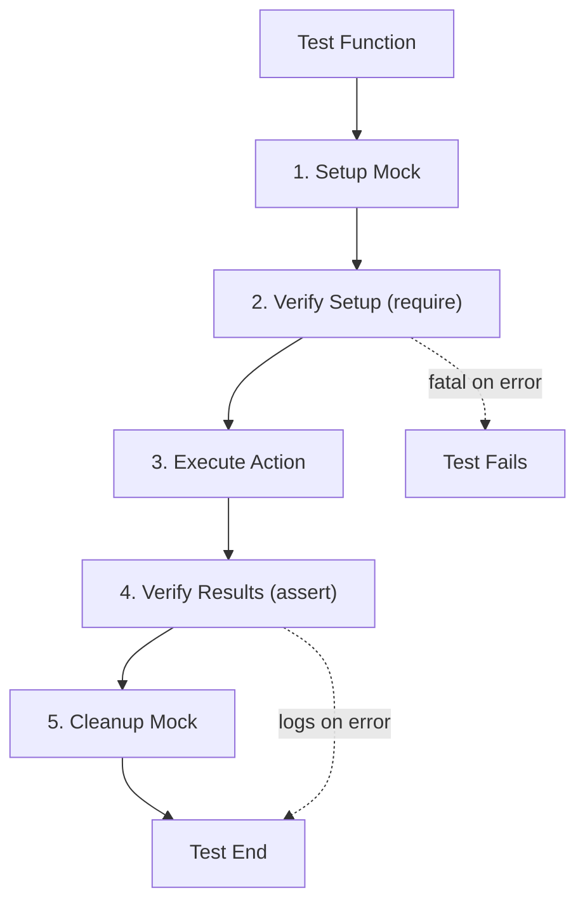

#### Example: Basic PCI Device Test

The test structure from [pkg/nvpci/nvpci_test.go:29-76]():

1. **Setup**: Create `MockNvpci` and add mock device
2. **Verify Setup**: Use `require.Nil` to ensure setup succeeded
3. **Execute**: Call `GetGPUs()` to retrieve devices
4. **Assert Results**: Use `require.Equal` for device count, assert device properties
5. **Cleanup**: Defer `Cleanup()` to remove temp filesystem

**Sources:** [pkg/nvpci/nvpci_test.go:29-76]()

### Table-Driven Tests

The codebase uses table-driven tests for testing multiple scenarios:

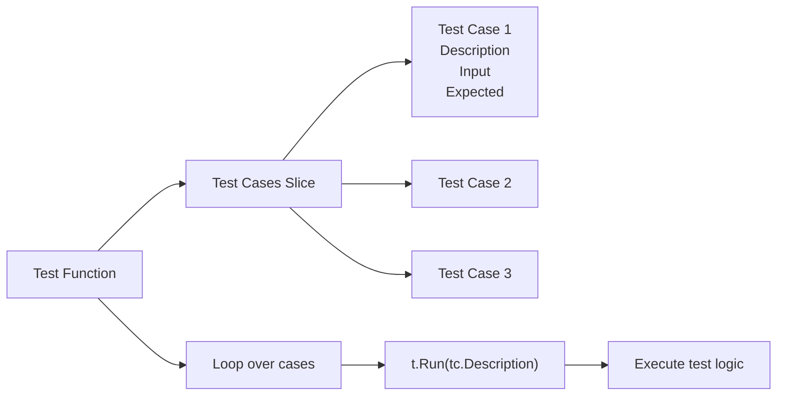

Example from [pkg/nvmdev/nvmdev_test.go:65-126]():

The `TestParseMdevTypeName` function tests multiple input formats:
- NVIDIA prefix format: "NVIDIA A100-4C" → "A100-4C"
- GRID prefix format: "GRID V100-8Q" → "V100-8Q"  
- Multi-word prefix: "NVIDIA RTX Pro 6000 Blackwell A100-4C" → "A100-4C"
- Single word: "A100-4C" → "A100-4C"
- Error cases: empty string, only spaces

**Sources:** [pkg/nvmdev/nvmdev_test.go:65-126](), [pkg/nvpci/nvpci_test.go:78-112](), [pkg/nvpci/nvpci_test.go:114-173]()

### Testing SR-IOV Devices

SR-IOV testing validates both physical functions (PF) and virtual functions (VF):

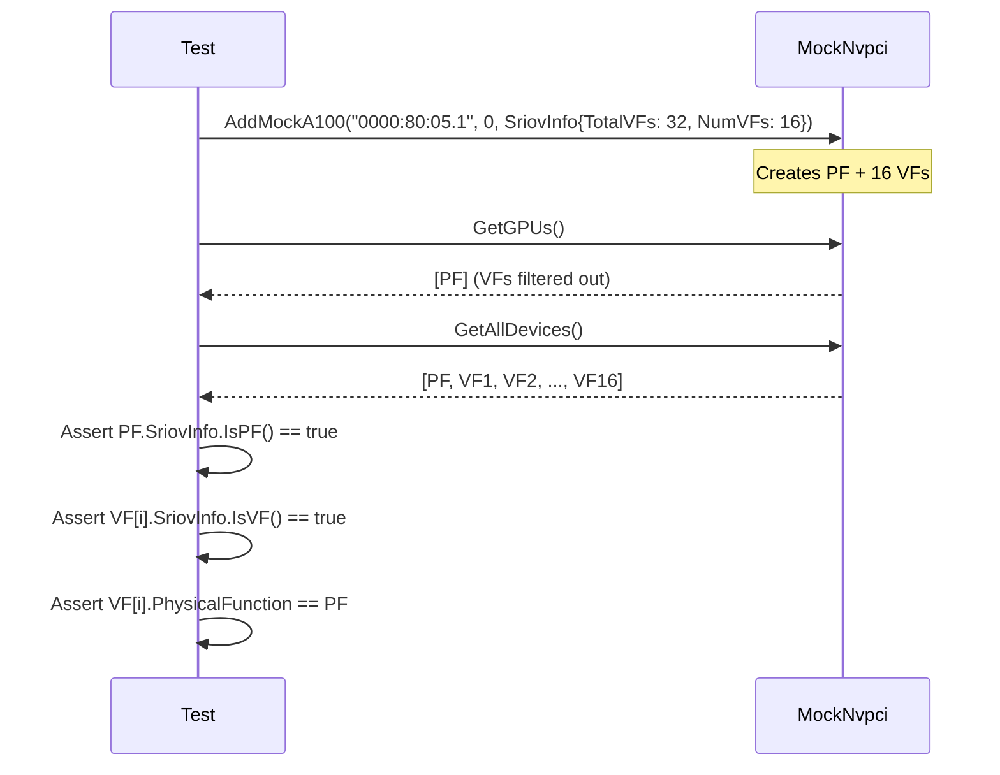

**Sources:** [pkg/nvpci/nvpci_test.go:114-173]()

## Test Execution

### Running Tests Locally

Tests can be run using standard Go testing commands:

```bash
# Run all tests
go test ./...

# Run tests for specific package
go test ./pkg/nvpci

# Run with coverage
go test -cover ./...

# Run specific test
go test -run TestNvpci ./pkg/nvpci
```

### Build System Integration

The Makefile provides test targets:

| Target | Command | Purpose |
|--------|---------|---------|
| `make test` | `go test -v -coverprofile=coverage.out ./...` | Run all tests with coverage |
| `make docker-test` | Runs tests in Docker container | Consistent test environment |

**Sources:** Inferred from build system patterns

### Cleanup Patterns

Mock implementations provide `Cleanup()` methods that should be called via `defer`:

```go
mock, err := nvpci.NewMockNvpci()
require.Nil(t, err)
defer mock.Cleanup()  // Ensures temp filesystem is removed
```

The `Cleanup()` method removes the temporary directory structure created during mock initialization.

**Sources:** [pkg/nvpci/mock.go:55-58](), [pkg/nvmdev/mock.go:80-85]()

## Summary

The go-nvlib testing infrastructure provides:

1. **Mock Implementations**: Full mock implementations for PCI device discovery (`MockNvpci`), MDEV management (`MockNvmdev`), and NVML operations (generated mocks)

2. **Temporary Filesystem**: Mocks create temporary sysfs-like structures that simulate real hardware without requiring root privileges

3. **Testify Framework**: Consistent use of `assert` for non-fatal checks and `require` for critical preconditions

4. **Table-Driven Tests**: Systematic testing of multiple scenarios using structured test case definitions

5. **SR-IOV Testing**: Complete support for testing physical and virtual function hierarchies

This architecture enables comprehensive testing of GPU management functionality without requiring physical hardware or elevated privileges.

---

