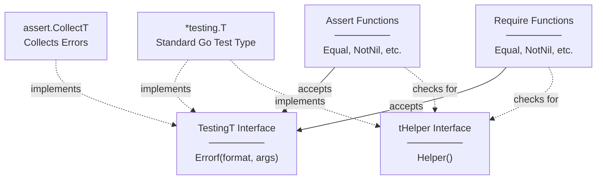
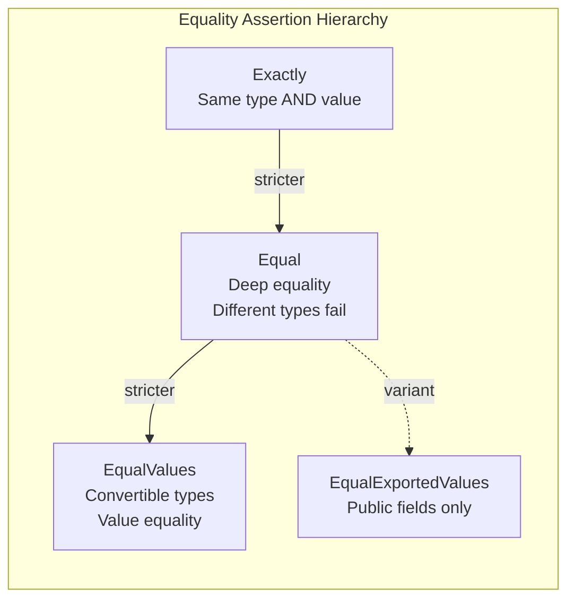
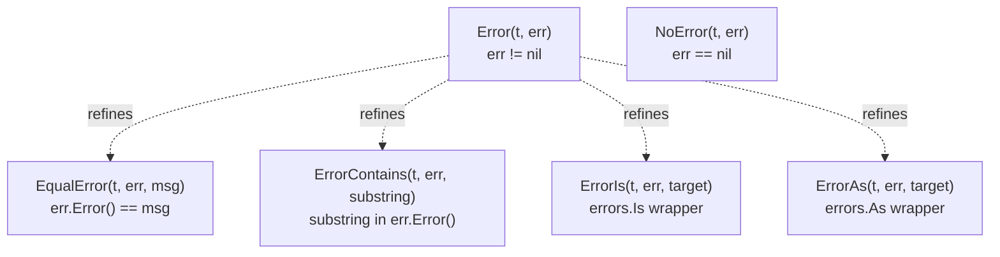
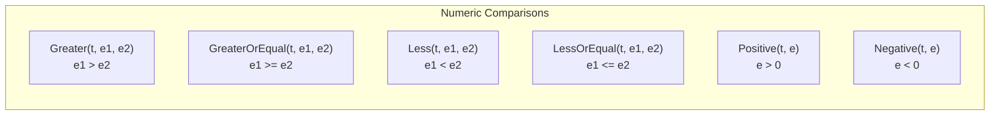
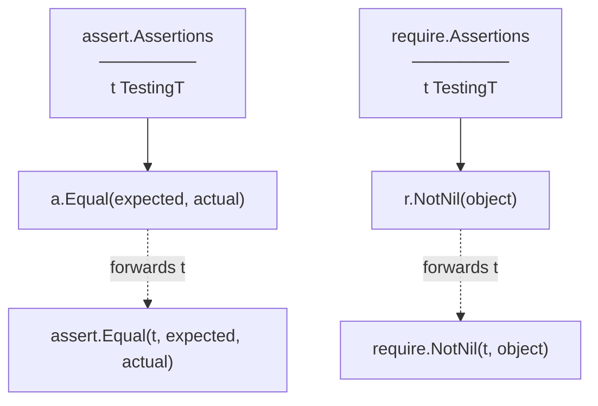
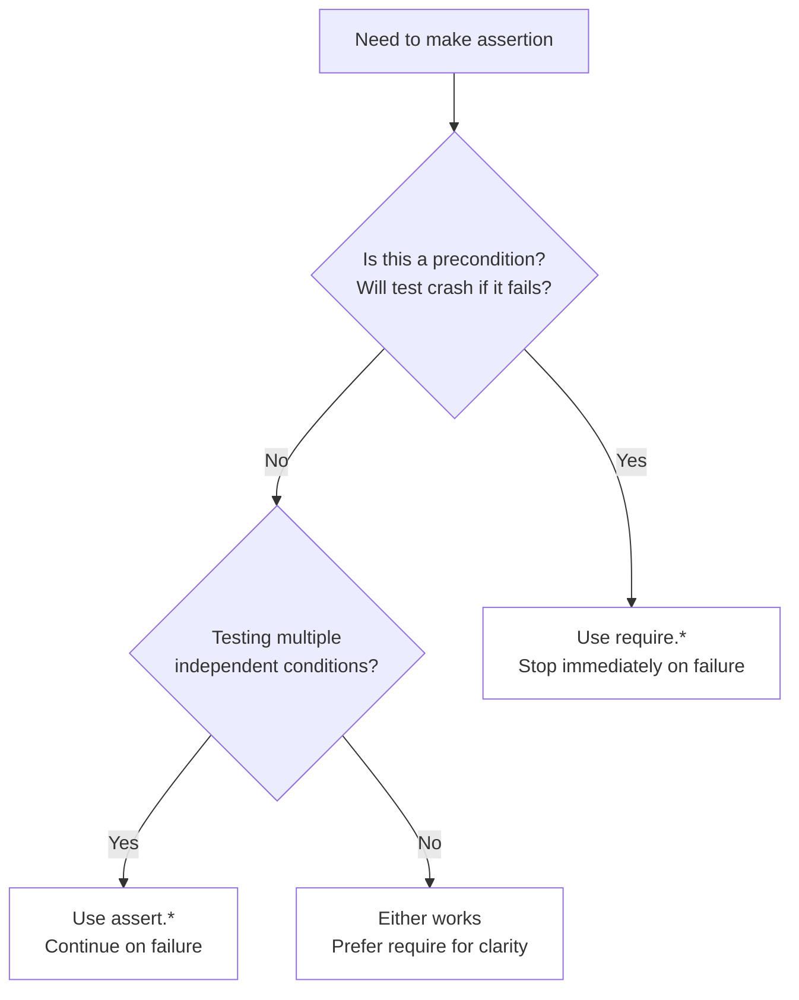

<!-- source: DeepWiki mcp.deepwiki.com · repo NVIDIA/go-nvlib · page 8.1 Testing Framework · fetched 2026-10-26 -->

# Testing Framework

<details>
<summary>Relevant source files</summary>

The following files were used as context for generating this wiki page:

- [vendor/github.com/stretchr/testify/assert/assertion_compare.go](vendor/github.com/stretchr/testify/assert/assertion_compare.go)
- [vendor/github.com/stretchr/testify/assert/assertion_format.go](vendor/github.com/stretchr/testify/assert/assertion_format.go)
- [vendor/github.com/stretchr/testify/assert/assertion_forward.go](vendor/github.com/stretchr/testify/assert/assertion_forward.go)
- [vendor/github.com/stretchr/testify/assert/assertion_order.go](vendor/github.com/stretchr/testify/assert/assertion_order.go)
- [vendor/github.com/stretchr/testify/assert/assertions.go](vendor/github.com/stretchr/testify/assert/assertions.go)
- [vendor/github.com/stretchr/testify/require/require.go](vendor/github.com/stretchr/testify/require/require.go)
- [vendor/github.com/stretchr/testify/require/require_forward.go](vendor/github.com/stretchr/testify/require/require_forward.go)

</details>


## Purpose and Scope

This document describes the testify testing framework used throughout the go-nvlib codebase for writing unit tests. The testify library provides a comprehensive set of assertion functions that make tests more readable and maintainable compared to standard Go testing practices.

For information about mock implementations used in testing (such as `MockNvpci` and `MockNvmdev`), see [Mock Implementations](#8.2).

**Sources:** [vendor/github.com/stretchr/testify/assert/assertions.go:1-30](), [vendor/github.com/stretchr/testify/require/require.go:1-11]()

---

## Assert vs Require: Test Control Flow

The testify framework provides two primary packages with distinct behaviors for handling test failures:

| Package | Behavior on Failure | Use Case |
|---------|-------------------|----------|
| `assert` | Logs failure and continues test execution | Checking multiple conditions in a single test |
| `require` | Logs failure and stops test execution immediately | Preconditions that must pass for test to continue |

### Assert Package

The `assert` package logs failures using `t.Errorf()` and returns a boolean indicating success. The test continues executing after a failure, allowing multiple assertions to be checked in a single test run.

```go
// Example: Multiple assertions in one test
func TestDevice(t *testing.T) {
    device := getDevice()
    assert.NotNil(t, device)        // Test continues even if this fails
    assert.Equal(t, "GPU", device.Type)  // This will still execute
    assert.Greater(t, device.Memory, 0)  // And this too
}
```

**Sources:** [vendor/github.com/stretchr/testify/assert/assertions.go:366-390](), [vendor/github.com/stretchr/testify/assert/assertions.go:488-513]()

### Require Package

The `require` package wraps `assert` functions but calls `t.FailNow()` on failure, immediately stopping the test. This is essential for preconditions where subsequent assertions would be meaningless or cause panics.

```go
// Example: Require for preconditions
func TestDeviceProperties(t *testing.T) {
    device := getDevice()
    require.NotNil(t, device)  // Stop immediately if device is nil
    // Only execute following code if device is not nil
    assert.Equal(t, "GPU", device.Type)
}
```

**Sources:** [vendor/github.com/stretchr/testify/require/require.go:13-21](), [vendor/github.com/stretchr/testify/require/require.go:173-181]()

---

## Core Testing Interfaces

### TestingT Interface

The `TestingT` interface defines the minimal contract for test objects, allowing testify to work with Go's `*testing.T` and custom test implementations:



**Sources:** [vendor/github.com/stretchr/testify/assert/assertions.go:29-32]()

### Helper Function Support

Assertion functions check if the test object implements `tHelper` and call `Helper()` to mark themselves as helper functions. This improves error reporting by showing the actual test location rather than the assertion library location:

```go
// Pattern used in all assertion functions
if h, ok := t.(tHelper); ok {
    h.Helper()
}
```

**Sources:** [vendor/github.com/stretchr/testify/assert/assertions.go:346-348](), [vendor/github.com/stretchr/testify/require/require.go:14-16]()

---

## Assertion Function Categories

### Equality Assertions

Equality assertions compare values with different levels of strictness:



| Function | Behavior | Example |
|----------|----------|---------|
| `Equal(t, expected, actual)` | Deep equality check | `assert.Equal(t, 123, 123)` |
| `EqualValues(t, expected, actual)` | Allows type conversion | `assert.EqualValues(t, uint32(123), int32(123))` |
| `Exactly(t, expected, actual)` | Type and value must match exactly | `assert.Exactly(t, int32(123), int64(123))` fails |
| `EqualExportedValues(t, expected, actual)` | Compares only public fields | Useful for structs with private fields |
| `NotEqual(t, expected, actual)` | Inverse equality check | `assert.NotEqual(t, 1, 2)` |

**Sources:** [vendor/github.com/stretchr/testify/assert/assertions.go:488-513](), [vendor/github.com/stretchr/testify/assert/assertions.go:630-648](), [vendor/github.com/stretchr/testify/assert/assertions.go:686-702](), [vendor/github.com/stretchr/testify/assert/assertions.go:650-684]()

### Nil and Emptiness Assertions

| Function | Purpose | Example |
|----------|---------|---------|
| `Nil(t, object)` | Assert object is nil | `assert.Nil(t, err)` |
| `NotNil(t, object)` | Assert object is not nil | `assert.NotNil(t, device)` |
| `Empty(t, object)` | Assert zero value, empty slice/map/channel, or nil | `assert.Empty(t, list)` |
| `NotEmpty(t, object)` | Assert non-empty | `assert.NotEmpty(t, devices)` |

**Sources:** [vendor/github.com/stretchr/testify/assert/assertions.go:704-747](), [vendor/github.com/stretchr/testify/assert/assertions.go:777-800](), [vendor/github.com/stretchr/testify/assert/assertions.go:802-817]()

### Boolean Assertions

```go
assert.True(t, condition)          // Assert condition is true
assert.False(t, condition)         // Assert condition is false
```

**Sources:** [vendor/github.com/stretchr/testify/assert/assertions.go:1291-1313]()

### Error Assertions

Error assertions provide comprehensive error checking capabilities:



| Function | Purpose | Example |
|----------|---------|---------|
| `NoError(t, err)` | Assert no error occurred | `assert.NoError(t, err)` |
| `Error(t, err)` | Assert error occurred | `assert.Error(t, err)` |
| `EqualError(t, err, expected)` | Assert specific error message | `assert.EqualError(t, err, "device not found")` |
| `ErrorContains(t, err, substring)` | Assert error message contains substring | `assert.ErrorContains(t, err, "not found")` |
| `ErrorIs(t, err, target)` | Assert error matches target via `errors.Is` | `assert.ErrorIs(t, err, ErrNotSupported)` |
| `ErrorAs(t, err, target)` | Assert error matches type via `errors.As` | `assert.ErrorAs(t, err, &myErr)` |

**Sources:** [vendor/github.com/stretchr/testify/assert/assertions.go:1238-1289](), [vendor/github.com/stretchr/testify/assert/assertions.go:1169-1189](), [vendor/github.com/stretchr/testify/assert/assertions.go:1191-1204](), [vendor/github.com/stretchr/testify/assert/assertions.go:1206-1218](), [vendor/github.com/stretchr/testify/assert/assertions.go:1220-1236]()

### Collection Assertions

| Function | Purpose | Example |
|----------|---------|---------|
| `Contains(t, collection, element)` | Assert collection contains element | `assert.Contains(t, list, item)` |
| `NotContains(t, collection, element)` | Assert collection doesn't contain element | `assert.NotContains(t, list, item)` |
| `ElementsMatch(t, listA, listB)` | Assert lists contain same elements (any order) | `assert.ElementsMatch(t, [1,2,3], [3,1,2])` |
| `Len(t, object, length)` | Assert specific length | `assert.Len(t, slice, 5)` |
| `Subset(t, list, subset)` | Assert subset relationship | `assert.Subset(t, [1,2,3], [1,2])` |

**Sources:** [vendor/github.com/stretchr/testify/assert/assertions.go:1395-1421](), [vendor/github.com/stretchr/testify/assert/assertions.go:863-899](), [vendor/github.com/stretchr/testify/assert/assertions.go:948-981]()

### Comparison Assertions

Comparison assertions verify ordering relationships between values:



Supported types include: `int`, `int8`, `int16`, `int32`, `int64`, `uint`, `uint8`, `uint16`, `uint32`, `uint64`, `float32`, `float64`, `string`, `time.Time`, `[]byte`, and `uintptr`.

**Sources:** [vendor/github.com/stretchr/testify/assert/assertion_compare.go:384-395](), [vendor/github.com/stretchr/testify/assert/assertion_compare.go:397-409](), [vendor/github.com/stretchr/testify/assert/assertion_compare.go:411-422](), [vendor/github.com/stretchr/testify/assert/assertion_compare.go:424-436](), [vendor/github.com/stretchr/testify/assert/assertion_compare.go:438-449](), [vendor/github.com/stretchr/testify/assert/assertion_compare.go:451-462]()

### Type Assertions

| Function | Purpose | Example |
|----------|---------|---------|
| `IsType(t, expectedType, object)` | Assert object has expected type | `assert.IsType(t, &MyStruct{}, obj)` |
| `IsNotType(t, theType, object)` | Assert object doesn't have type | `assert.IsNotType(t, &OtherStruct{}, obj)` |
| `Implements(t, interface, object)` | Assert object implements interface | `assert.Implements(t, (*Interface)(nil), obj)` |
| `NotImplements(t, interface, object)` | Assert object doesn't implement interface | `assert.NotImplements(t, (*Interface)(nil), obj)` |

**Sources:** [vendor/github.com/stretchr/testify/assert/assertions.go:462-473](), [vendor/github.com/stretchr/testify/assert/assertions.go:475-486](), [vendor/github.com/stretchr/testify/assert/assertions.go:420-437](), [vendor/github.com/stretchr/testify/assert/assertions.go:439-456]()

### Collection Ordering Assertions

These assertions verify that collection elements are in a specific order:

| Function | Purpose | Example |
|----------|---------|---------|
| `IsIncreasing(t, collection)` | Assert strictly increasing order | `assert.IsIncreasing(t, []int{1, 2, 3})` |
| `IsDecreasing(t, collection)` | Assert strictly decreasing order | `assert.IsDecreasing(t, []int{3, 2, 1})` |
| `IsNonIncreasing(t, collection)` | Assert non-increasing (allows equal) | `assert.IsNonIncreasing(t, []int{3, 2, 2, 1})` |
| `IsNonDecreasing(t, collection)` | Assert non-decreasing (allows equal) | `assert.IsNonDecreasing(t, []int{1, 2, 2, 3})` |

**Sources:** [vendor/github.com/stretchr/testify/assert/assertion_order.go:47-54](), [vendor/github.com/stretchr/testify/assert/assertion_order.go:65-72](), [vendor/github.com/stretchr/testify/assert/assertion_order.go:56-63](), [vendor/github.com/stretchr/testify/assert/assertion_order.go:74-81]()

---

## Formatted Assertions

Every assertion function has a formatted variant with an `f` suffix that accepts a format string and arguments for custom error messages:

```go
// Standard assertion
assert.Equal(t, expected, actual)

// Formatted assertion with custom message
assert.Equalf(t, expected, actual, "expected device %s to have name %s", deviceID, name)
```

The formatted variants follow the same pattern:
- Append `f` to function name
- Add `msg string, args ...interface{}` as final parameters
- Use `fmt.Sprintf(msg, args...)` for error message formatting

**Sources:** [vendor/github.com/stretchr/testify/assert/assertion_format.go:73-85](), [vendor/github.com/stretchr/testify/assert/assertion_format.go:127-136]()

---

## Assertion Forwarding Pattern

The testify framework provides two methods for calling assertions:

### Package-Level Functions

Direct function calls passing `t` as the first parameter:

```go
assert.Equal(t, expected, actual)
require.NotNil(t, device)
```

### Assertions Object

Creating an `Assertions` object that automatically passes `t`:

```go
func TestExample(t *testing.T) {
    a := assert.New(t)
    r := require.New(t)
    
    device := getDevice()
    r.NotNil(device)        // Equivalent to require.NotNil(t, device)
    a.Equal("GPU", device.Type)  // Equivalent to assert.Equal(t, "GPU", device.Type)
}
```

The `Assertions` struct stores the test object and forwards it to the underlying assertion functions:



**Sources:** [vendor/github.com/stretchr/testify/assert/assertion_forward.go:135-147](), [vendor/github.com/stretchr/testify/require/require_forward.go:143-148]()

---

## Test Structure Best Practices

### Basic Test Structure

```go
func TestFunctionName(t *testing.T) {
    // Setup: Prepare test data and dependencies
    device := setupTestDevice()
    
    // Exercise: Call the function under test
    result, err := device.GetProperty()
    
    // Verify: Use assertions to check results
    require.NoError(t, err)
    assert.Equal(t, expectedValue, result)
    
    // Cleanup: Defer cleanup if needed
}
```

### Table-Driven Tests

Table-driven tests are a common Go pattern that works well with testify assertions:

```go
func TestDeviceValidation(t *testing.T) {
    testCases := []struct {
        name     string
        input    string
        expected bool
        errMsg   string
    }{
        {name: "valid GPU", input: "GPU-0", expected: true},
        {name: "invalid format", input: "invalid", expected: false, errMsg: "invalid format"},
    }
    
    for _, tc := range testCases {
        t.Run(tc.name, func(t *testing.T) {
            result, err := ValidateDevice(tc.input)
            if tc.expected {
                assert.NoError(t, err)
                assert.True(t, result)
            } else {
                assert.Error(t, err)
                assert.ErrorContains(t, err, tc.errMsg)
            }
        })
    }
}
```

### Assertion Selection Guidelines



### When to Use Require

Use `require` for preconditions that must be satisfied:

```go
func TestDeviceOperations(t *testing.T) {
    device := getDevice()
    require.NotNil(t, device)  // Must have device to continue
    require.NoError(t, device.Init())  // Must initialize successfully
    
    // Now safe to use device
    assert.Equal(t, "active", device.Status())
}
```

### When to Use Assert

Use `assert` when checking multiple independent conditions:

```go
func TestDeviceProperties(t *testing.T) {
    device := getDevice()
    require.NotNil(t, device)
    
    // Check all properties even if some fail
    assert.Equal(t, "GPU", device.Type)
    assert.Greater(t, device.Memory, 0)
    assert.NotEmpty(t, device.Name)
    assert.True(t, device.IsAvailable())
}
```

**Sources:** [vendor/github.com/stretchr/testify/assert/assertions.go:488-513](), [vendor/github.com/stretchr/testify/require/require.go:173-181]()

---

## Error Reporting and Caller Information

### Automatic Stack Trace Generation

The testify framework automatically generates caller information to help locate test failures. The `CallerInfo()` function walks the stack to find the actual test location:

```go
// Error output includes file and line information
// Error Trace:    device_test.go:42
//                 device_test.go:15
```

The framework filters out testify's own frames to show only relevant test code locations.

**Sources:** [vendor/github.com/stretchr/testify/assert/assertions.go:212-287]()

### Custom Error Messages

All assertion functions accept optional message arguments:

```go
// Simple message
assert.Equal(t, expected, actual, "values should match")

// Formatted message
assert.Equal(t, expected, actual, "device %s should have value %v", deviceID, expected)

// Multiple arguments
assert.NotNil(t, device, "failed to create device", deviceID, config)
```

**Sources:** [vendor/github.com/stretchr/testify/assert/assertions.go:304-319](), [vendor/github.com/stretchr/testify/assert/assertions.go:370-387]()

---

## Summary

The testify framework provides a comprehensive testing toolkit for go-nvlib:

| Component | Purpose | Key Functions |
|-----------|---------|---------------|
| `assert` package | Non-fatal assertions | `Equal`, `NotNil`, `NoError`, `Contains` |
| `require` package | Fatal assertions | Same as assert but stops on failure |
| Formatted variants | Custom error messages | All functions with `f` suffix |
| Type assertions | Verify types and interfaces | `IsType`, `Implements` |
| Error assertions | Comprehensive error checking | `Error`, `ErrorIs`, `ErrorAs`, `ErrorContains` |
| Collection assertions | Verify collections | `Contains`, `ElementsMatch`, `Len` |
| Comparison assertions | Ordering and magnitude | `Greater`, `Less`, `Positive`, `Negative` |

**Best Practices:**
- Use `require` for preconditions that must pass
- Use `assert` for independent checks
- Leverage formatted assertions for clear error messages
- Structure tests with setup, exercise, verify, cleanup phases
- Use table-driven tests for multiple scenarios
- The `Helper()` pattern ensures accurate error locations

**Sources:** [vendor/github.com/stretchr/testify/assert/assertions.go:1-867](), [vendor/github.com/stretchr/testify/require/require.go:1-534]()

---

