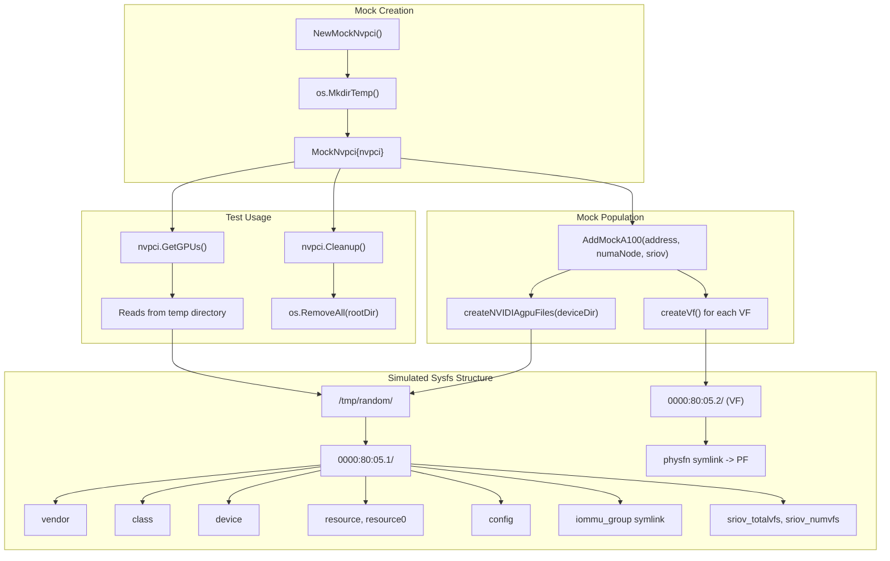
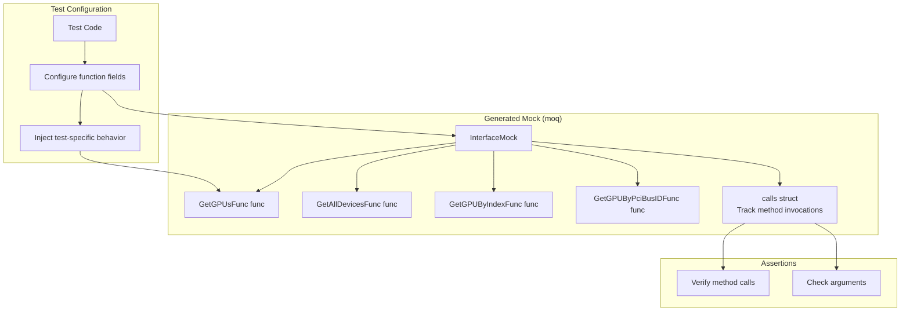
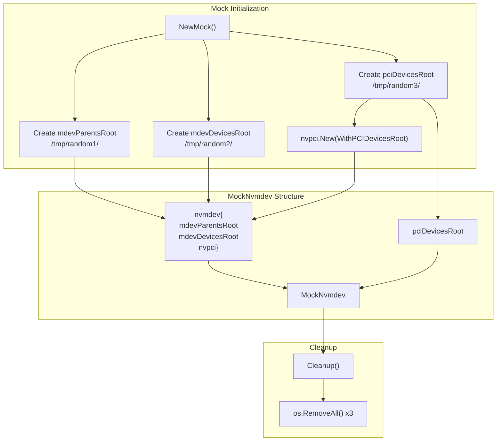
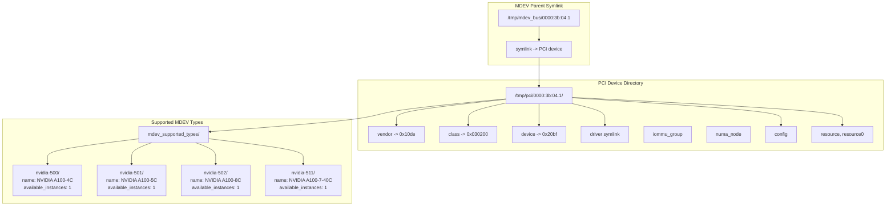
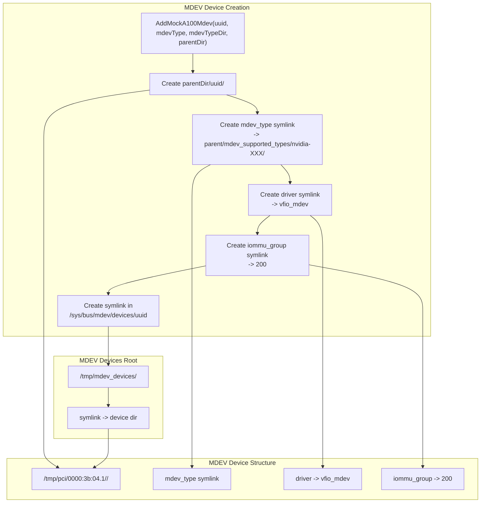
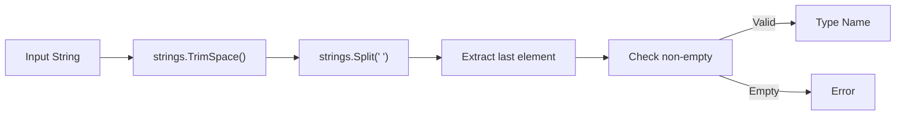
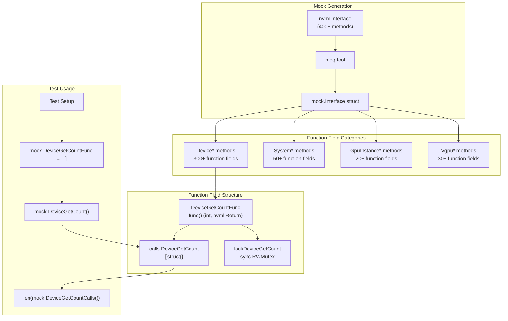
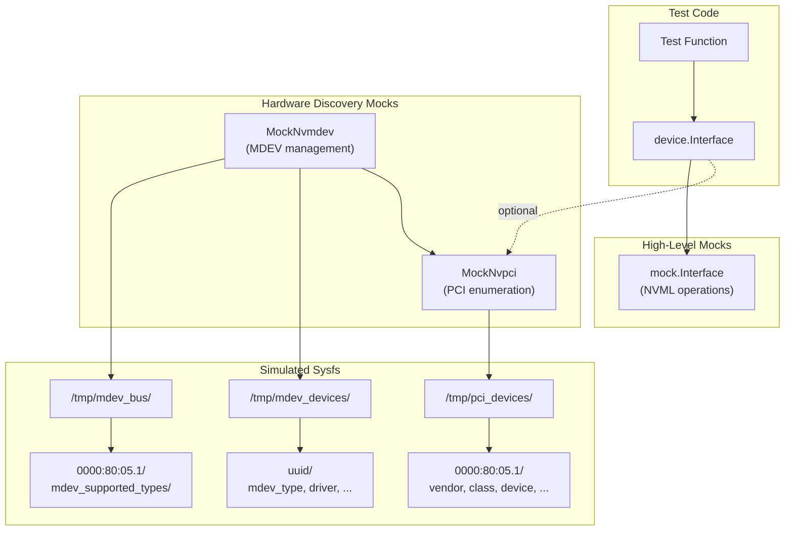
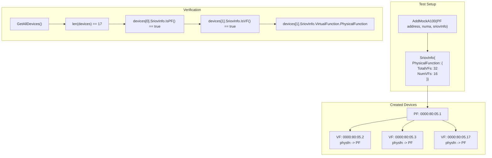
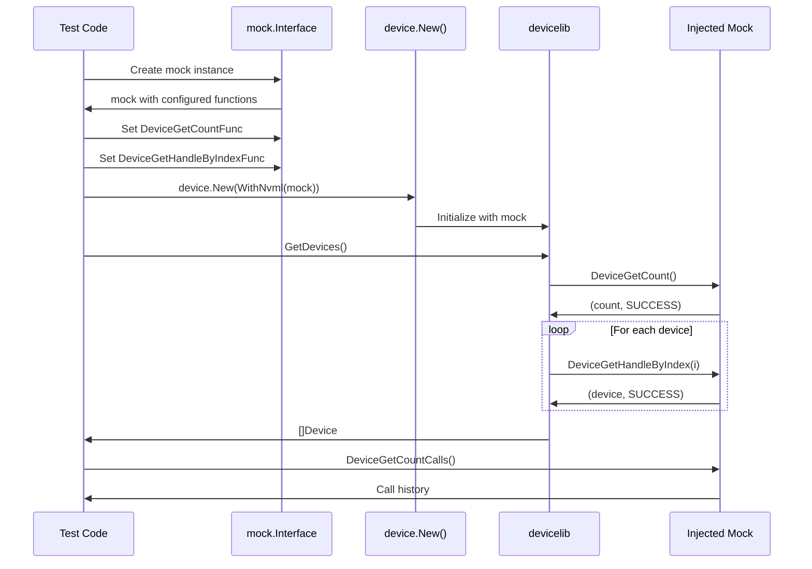

<!-- source: DeepWiki mcp.deepwiki.com · repo NVIDIA/go-nvlib · page 8.2 Mock Implementations · fetched 2026-10-26 -->

# Mock Implementations

<details>
<summary>Relevant source files</summary>

The following files were used as context for generating this wiki page:

- [pkg/nvmdev/mock.go](pkg/nvmdev/mock.go)
- [pkg/nvmdev/nvmdev.go](pkg/nvmdev/nvmdev.go)
- [pkg/nvmdev/nvmdev_test.go](pkg/nvmdev/nvmdev_test.go)
- [pkg/nvpci/mock.go](pkg/nvpci/mock.go)
- [pkg/nvpci/nvpci.go](pkg/nvpci/nvpci.go)
- [pkg/nvpci/nvpci_mock.go](pkg/nvpci/nvpci_mock.go)
- [pkg/nvpci/nvpci_test.go](pkg/nvpci/nvpci_test.go)
- [vendor/github.com/NVIDIA/go-nvml/pkg/nvml/mock/interface.go](vendor/github.com/NVIDIA/go-nvml/pkg/nvml/mock/interface.go)
- [vendor/github.com/NVIDIA/go-nvml/pkg/nvml/zz_generated.api.go](vendor/github.com/NVIDIA/go-nvml/pkg/nvml/zz_generated.api.go)

</details>


This page documents the mock implementations provided by go-nvlib for testing without physical GPU hardware. These mocks enable unit testing of GPU discovery, PCI enumeration, MDEV management, and NVML operations by simulating system state through temporary filesystem structures and injectable function stubs.

For information about the testing framework and assertion patterns, see [Testing Framework](#8.1). For information about the production interfaces these mocks implement, see [PCI Device Discovery](#5.1) and [MDEV and vGPU Management](#5.2).

## Mock Architecture Overview

The go-nvlib testing infrastructure provides three categories of mock implementations:

| Mock Type | Package | Implementation Strategy | Primary Use Case |
|-----------|---------|------------------------|------------------|
| `MockNvpci` | `pkg/nvpci` | Temporary sysfs filesystem | Testing PCI device enumeration and SR-IOV |
| `MockNvmdev` | `pkg/nvmdev` | Temporary sysfs filesystem | Testing MDEV creation and parent device discovery |
| NVML Interface Mocks | `vendor/github.com/NVIDIA/go-nvml/pkg/nvml/mock` | Generated function fields via moq | Testing NVML API interactions |

All mock implementations satisfy their respective production interfaces, enabling dependency injection in tests.

Sources: [pkg/nvpci/mock.go:29-58](), [pkg/nvmdev/mock.go:28-85](), [vendor/github.com/NVIDIA/go-nvml/pkg/nvml/mock/interface.go:11-13]()

## MockNvpci: PCI Device Mocking

### Structure and Lifecycle

The `MockNvpci` type embeds the production `nvpci` struct but redirects filesystem operations to a temporary directory, creating a simulated sysfs hierarchy.



**Mock Lifecycle Pattern**

Sources: [pkg/nvpci/mock.go:36-58](), [pkg/nvpci/mock.go:69-133]()

### Creating Mock PCI Devices

The `AddMockA100` method creates a complete A100-like GPU device with all necessary sysfs attributes:

**Mock A100 Device Structure**

```mermaid
graph LR
    subgraph "Sysfs Files Created"
        vendor["vendor<br/>0x10de"]
        class["class<br/>0x030200"]
        device["device<br/>0x20bf"]
        driver["driver symlink<br/>-> nvidia"]
        iommu["iommu_group<br/>symlink"]
        numa["numa_node<br/>0 or -1"]
        config["config<br/>PCICfgSpaceStandardSize"]
        resource["resource<br/>BAR0 address ranges"]
        resource0["resource0<br/>PMC ID: 0x170000a1"]
    end
    
    subgraph "SR-IOV Support (Optional)"
        sriov_total["sriov_totalvfs"]
        sriov_num["sriov_numvfs"]
        vf1["VF 0000:80:05.2"]
        vf2["VF 0000:80:05.3"]
        physfn["physfn symlink<br/>-> PF device"]
    end
    
    vendor --> device
    device --> class
    class --> driver
    driver --> iommu
    iommu --> numa
    numa --> config
    config --> resource
    resource --> resource0
    
    resource0 -.SR-IOV enabled.-> sriov_total
    sriov_total --> sriov_num
    sriov_num --> vf1
    sriov_num --> vf2
    vf1 --> physfn
    vf2 --> physfn
```

**Example: Creating Mock PCI Devices**

```go
// Create mock without SR-IOV
nvpci, err := nvpci.NewMockNvpci()
defer nvpci.Cleanup()

err = nvpci.AddMockA100("0000:80:05.1", 0, nil)

// Create mock with SR-IOV enabled
sriov := &nvpci.SriovInfo{
    PhysicalFunction: &nvpci.SriovPhysicalFunction{
        TotalVFs: 32,
        NumVFs:   16,
    },
}
err = nvpci.AddMockA100("0000:80:05.1", 0, sriov)
```

Sources: [pkg/nvpci/mock.go:69-133](), [pkg/nvpci/mock.go:135-210](), [pkg/nvpci/nvpci_test.go:29-76]()

### Mock PCI Device Properties

The following table summarizes the properties set by `AddMockA100`:

| Property | Value | File Path | Notes |
|----------|-------|-----------|-------|
| Vendor ID | `0x10de` | `vendor` | NVIDIA vendor identifier |
| Device ID | `0x20bf` | `device` | A100 device identifier |
| Class | `0x030200` | `class` | 3D controller class |
| Driver | `nvidia` | `driver` symlink | Bound driver name |
| IOMMU Group | `20 + offset` | `iommu_group` symlink | Unique per device/VF |
| NUMA Node | Configurable | `numa_node` | Can be -1, 0, 1, etc. |
| BAR0 Start | `0xc2000000` | `resource` | Memory-mapped region |
| BAR0 End | `0xc2ffffff` | `resource` | 16MB region |
| PMC ID | `0x170000a1` | `resource0` | Architecture identifier |

Sources: [pkg/nvpci/mock.go:136-210]()

### Generated nvpci.Interface Mock

In addition to `MockNvpci`, a generated mock `InterfaceMock` is available via moq:



The generated mock provides function fields for each interface method, allowing test code to inject custom behavior and track invocations.

Sources: [pkg/nvpci/nvpci_mock.go:11-134]()

## MockNvmdev: MDEV and vGPU Mocking

### Structure and Initialization

`MockNvmdev` simulates both the MDEV parent device hierarchy (`/sys/class/mdev_bus`) and MDEV device instances (`/sys/bus/mdev/devices`) using three temporary directories:



Sources: [pkg/nvmdev/mock.go:36-78](), [pkg/nvmdev/mock.go:80-85]()

### Creating Mock Parent Devices

The `AddMockA100Parent` method creates a parent GPU device with supported MDEV types:

**Parent Device Sysfs Structure**



**Supported MDEV Types Table**

The mock A100 parent supports the following vGPU types:

| MDEV Type Directory | Type Name | Full Name in `name` File |
|---------------------|-----------|--------------------------|
| `nvidia-500` | `A100-4C` | `NVIDIA A100-4C` |
| `nvidia-501` | `A100-5C` | `NVIDIA A100-5C` |
| `nvidia-502` | `A100-8C` | `NVIDIA A100-8C` |
| `nvidia-503` | `A100-10C` | `NVIDIA A100-10C` |
| `nvidia-504` | `A100-20C` | `NVIDIA A100-20C` |
| `nvidia-505` | `A100-40C` | `NVIDIA A100-40C` |
| `nvidia-506` | `A100-1-5CME` | `NVIDIA A100-1-5CME` |
| `nvidia-507` | `A100-1-5C` | `NVIDIA A100-1-5C` |
| `nvidia-508` | `A100-2-10C` | `NVIDIA A100-2-10C` |
| `nvidia-509` | `A100-3-20C` | `NVIDIA A100-3-20C` |
| `nvidia-510` | `A100-4-20C` | `NVIDIA A100-4-20C` |
| `nvidia-511` | `A100-7-40C` | `NVIDIA A100-7-40C` |

Sources: [pkg/nvmdev/mock.go:88-226]()

### Creating Mock MDEV Devices

The `AddMockA100Mdev` method creates a mediated device instance:



**Example: Creating Mock MDEV Hierarchy**

```go
// Create mock nvmdev
nvmdev, err := nvmdev.NewMock()
defer nvmdev.Cleanup()

// Add parent device
err = nvmdev.AddMockA100Parent("0000:3b:04.1", 0)

// Get parent devices to obtain path
parents, err := nvmdev.GetAllParentDevices()
parentPath := parents[0].Path

// Add MDEV instance
uuid := "b1914f0a-15cf-416e-8967-55fc7cb68e20"
err = nvmdev.AddMockA100Mdev(uuid, "A100-4C", "nvidia-500", parentPath)

// Query MDEV devices
mdevs, err := nvmdev.GetAllDevices()
// mdevs[0].UUID == uuid
// mdevs[0].MDEVType == "A100-4C"
// mdevs[0].Driver == "vfio_mdev"
```

Sources: [pkg/nvmdev/mock.go:228-268](), [pkg/nvmdev/nvmdev_test.go:25-63]()

### MDEV Type Name Parsing

The mock implements the `parseMdevTypeName` function to extract vGPU type names from various formats:

**Parsing Logic**



**Supported Input Formats**

| Input Format | Extracted Type |
|--------------|----------------|
| `"NVIDIA A100-4C"` | `"A100-4C"` |
| `"GRID V100-8Q"` | `"V100-8Q"` |
| `"NVIDIA RTX Pro 6000 Blackwell A100-4C"` | `"A100-4C"` |
| `"NVIDIA RTX A6000 Ada Generation H100-8C"` | `"H100-8C"` |
| `"A100-4C"` | `"A100-4C"` |

Sources: [pkg/nvmdev/nvmdev.go:237-250](), [pkg/nvmdev/nvmdev_test.go:65-126]()

## NVML Interface Mocks

### Generated Mock Structure

The NVML mock interface is generated using the moq tool and provides function fields for all NVML operations:



Sources: [vendor/github.com/NVIDIA/go-nvml/pkg/nvml/mock/interface.go:11-13](), [vendor/github.com/NVIDIA/go-nvml/pkg/nvml/zz_generated.api.go:399-401]()

### NVML Mock Function Categories

The NVML interface mock provides function fields organized by functional area:

| Category | Example Methods | Count | Purpose |
|----------|----------------|-------|---------|
| Device Enumeration | `DeviceGetCount`, `DeviceGetHandleByIndex`, `DeviceGetHandleByUUID` | ~10 | Device discovery |
| Device Properties | `DeviceGetName`, `DeviceGetBrand`, `DeviceGetArchitecture`, `DeviceGetMemoryInfo` | ~50 | Device information queries |
| MIG Operations | `DeviceGetMigMode`, `DeviceGetMaxMigDeviceCount`, `DeviceCreateGpuInstance` | ~15 | Multi-Instance GPU management |
| vGPU Operations | `DeviceGetActiveVgpus`, `VgpuInstanceGetType`, `VgpuTypeGetName` | ~30 | Virtual GPU management |
| Compute Instances | `GpuInstanceCreateComputeInstance`, `ComputeInstanceGetInfo` | ~10 | MIG compute instance operations |
| System Queries | `SystemGetDriverVersion`, `SystemGetCudaDriverVersion`, `SystemGetNVMLVersion` | ~15 | System-level information |

Sources: [vendor/github.com/NVIDIA/go-nvml/pkg/nvml/zz_generated.api.go:22-397]()

### NVML Mock Usage Pattern

**Typical Test Setup**

```go
// Create mock
nvmlMock := &mock.Interface{
    DeviceGetCountFunc: func() (int, nvml.Return) {
        return 2, nvml.SUCCESS
    },
    DeviceGetHandleByIndexFunc: func(index int) (nvml.Device, nvml.Return) {
        return mockDevice(index), nvml.SUCCESS
    },
    DeviceGetNameFunc: func(device nvml.Device) (string, nvml.Return) {
        return "NVIDIA A100-SXM4-40GB", nvml.SUCCESS
    },
}

// Use in code under test
deviceLib := device.New(
    device.WithNvml(nvmlMock),
)

// Verify calls
require.Len(t, nvmlMock.DeviceGetCountCalls(), 1)
require.Len(t, nvmlMock.DeviceGetHandleByIndexCalls(), 2)
```

**Call Tracking Structure**

Each method has a corresponding `Calls()` function that returns a slice of structs containing the arguments passed to each invocation:

```go
// Example for DeviceGetHandleByIndex
calls := mock.DeviceGetHandleByIndexCalls()
// calls[0].N == 0 (first call with index 0)
// calls[1].N == 1 (second call with index 1)
```

Sources: [vendor/github.com/NVIDIA/go-nvml/pkg/nvml/mock/interface.go:14-1136]()

## Testing Patterns and Integration

### Layered Mock Strategy

The mock implementations work together to simulate a complete GPU system:



Sources: [pkg/nvpci/nvpci_test.go:29-76](), [pkg/nvmdev/nvmdev_test.go:25-63]()

### Mock Lifecycle Best Practices

**Resource Cleanup Pattern**

All mocks that create temporary resources provide a `Cleanup()` method that should be deferred:

```go
// MockNvpci cleanup
nvpci, err := nvpci.NewMockNvpci()
require.NoError(t, err)
defer nvpci.Cleanup() // Removes temporary sysfs directory

// MockNvmdev cleanup
nvmdev, err := nvmdev.NewMock()
require.NoError(t, err)
defer nvmdev.Cleanup() // Removes three temporary directories
```

**Error Handling During Initialization**

Both `NewMockNvpci` and `NewMock` use deferred cleanup during initialization to prevent resource leaks on error:

```go
func NewMockNvpci() (mock *MockNvpci, rerr error) {
    rootDir, err := os.MkdirTemp(os.TempDir(), "")
    if err != nil {
        return nil, err
    }
    defer func() {
        if rerr != nil {
            os.RemoveAll(rootDir) // Clean up on error
        }
    }()
    // ... initialization
}
```

Sources: [pkg/nvpci/mock.go:37-53](), [pkg/nvmdev/mock.go:36-78]()

### Testing SR-IOV Configurations

The `MockNvpci` supports testing SR-IOV Physical Functions and Virtual Functions:

**SR-IOV Test Structure**



Sources: [pkg/nvpci/nvpci_test.go:114-173](), [pkg/nvpci/mock.go:106-133]()

### NVML Mock Injection

The device library accepts NVML interface mocks through dependency injection:



Sources: [vendor/github.com/NVIDIA/go-nvml/pkg/nvml/mock/interface.go:18-1136]()

## Mock Comparison Table

| Feature | MockNvpci | MockNvmdev | NVML mock.Interface |
|---------|-----------|------------|---------------------|
| **Implementation** | Temporary sysfs filesystem | Temporary sysfs filesystem | Generated function fields |
| **Generation** | Manual | Manual | Automatic via moq |
| **State Management** | Filesystem state | Filesystem state | In-memory function state |
| **Cleanup Required** | Yes (`Cleanup()`) | Yes (`Cleanup()`) | No |
| **Thread Safety** | OS filesystem locks | OS filesystem locks | Explicit mutex per method |
| **Call Tracking** | No | No | Yes (automatic) |
| **Realistic Simulation** | High (actual sysfs read) | High (actual sysfs read) | Medium (function stubs) |
| **Setup Complexity** | Medium (create devices) | High (create hierarchy) | Low (assign functions) |
| **Testing Scope** | PCI enumeration | MDEV lifecycle | NVML API interactions |

Sources: [pkg/nvpci/mock.go:29-58](), [pkg/nvmdev/mock.go:28-85](), [vendor/github.com/NVIDIA/go-nvml/pkg/nvml/mock/interface.go:11-1136]()

---

