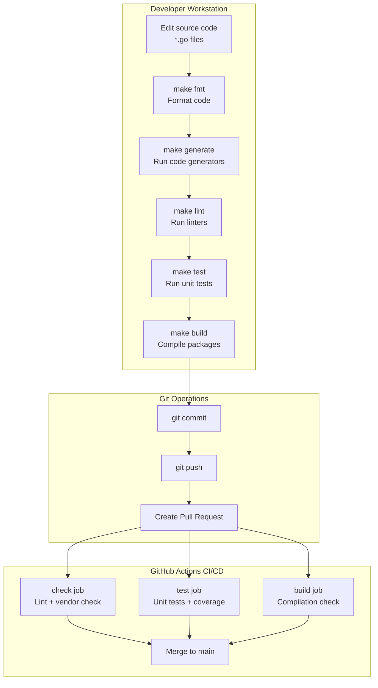
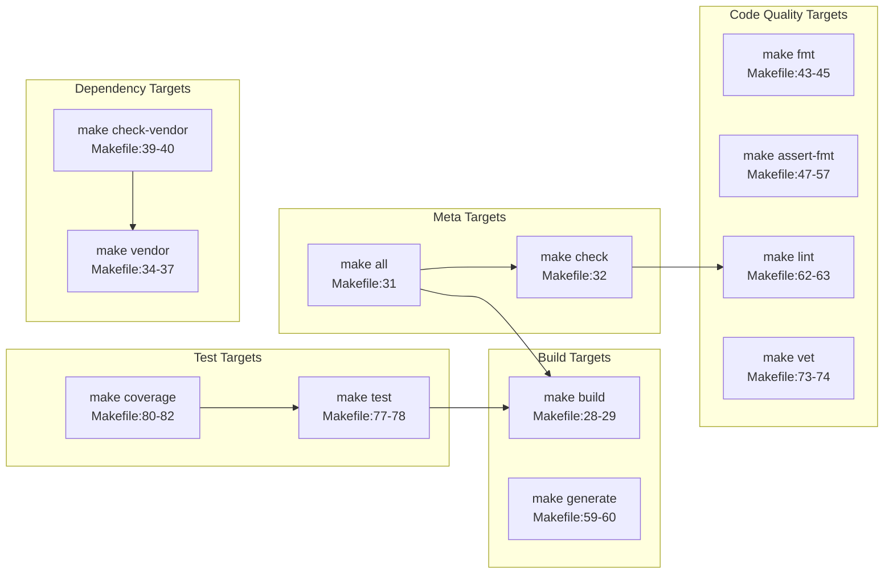
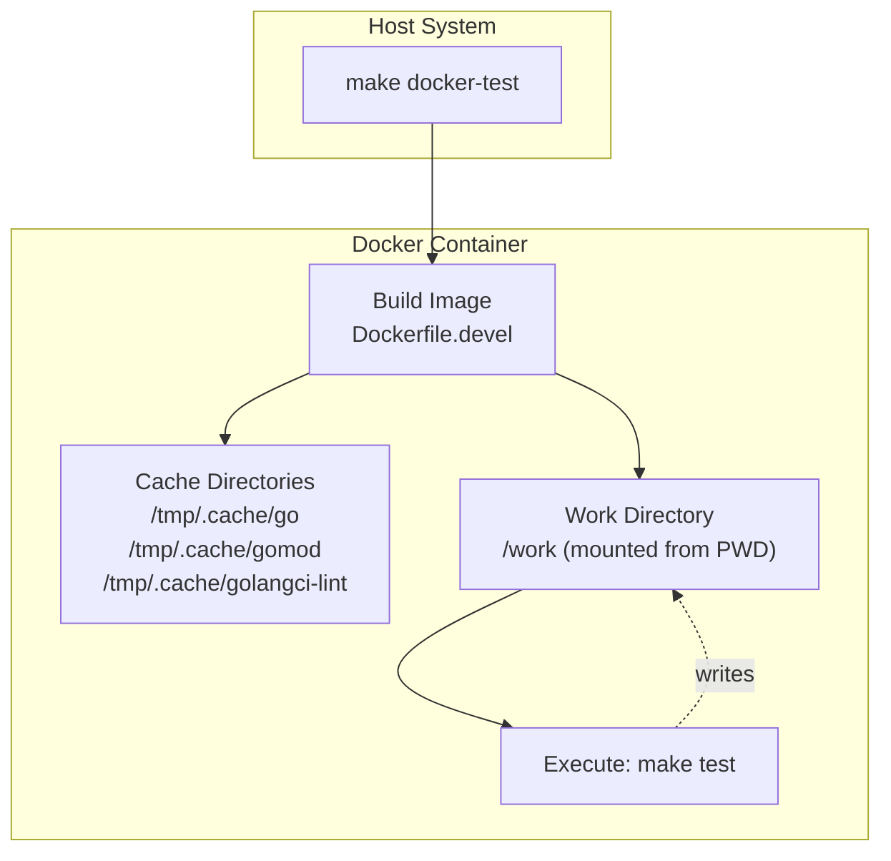
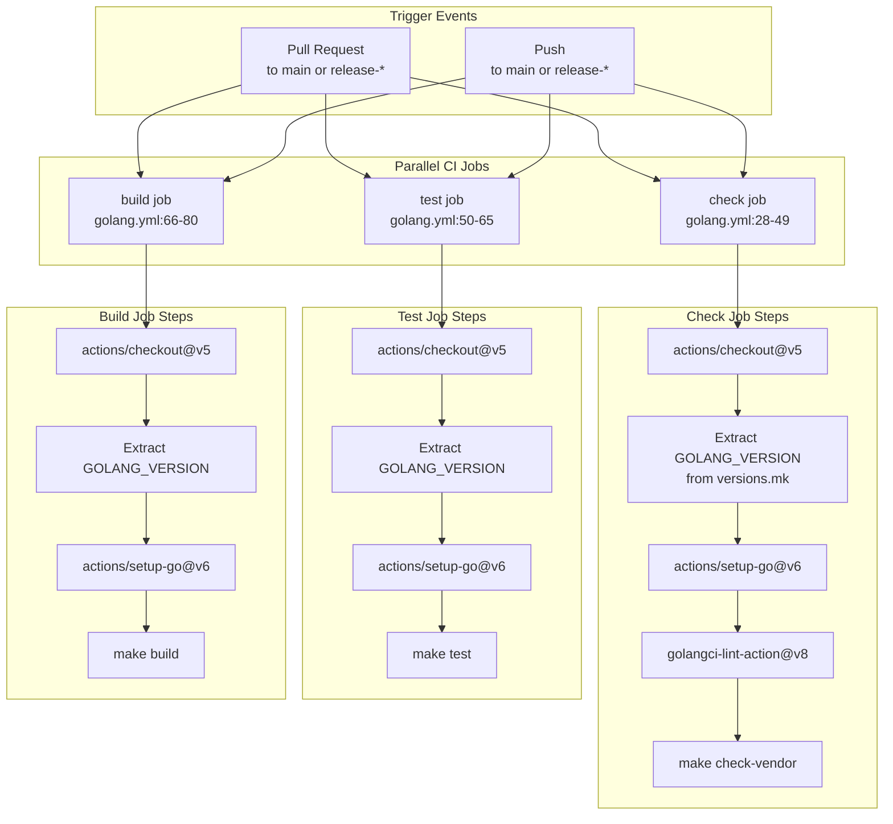
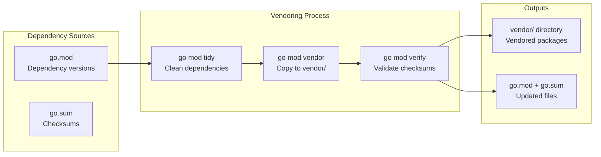

<!-- source: DeepWiki mcp.deepwiki.com · repo NVIDIA/go-nvlib · page 9 Building and Development · fetched 2026-10-26 -->

# Building and Development

<details>
<summary>Relevant source files</summary>

The following files were used as context for generating this wiki page:

- [.github/workflows/golang.yml](.github/workflows/golang.yml)
- [.golangci.yml](.golangci.yml)
- [Makefile](Makefile)
- [pkg/nvlib/device/identifier.go](pkg/nvlib/device/identifier.go)

</details>


This document provides a comprehensive guide to building, testing, and developing the go-nvlib library. It covers the local development workflow, build system, CI/CD pipeline, and code quality tools. For detailed information about specific aspects of the development process, see [Build System](#9.1), [CI/CD Pipeline](#9.2), and [Code Quality Tools](#9.3).

## Overview

The go-nvlib project uses a Makefile-based build system with Docker containerization for reproducible builds. The development workflow emphasizes code quality through automated linting, formatting, and testing at both local and CI/CD levels. All build operations can be executed either directly on the host machine or within standardized Docker containers to ensure consistent tool versions across development environments.

## Development Workflow

The typical development workflow follows this pattern:



**Development Workflow Diagram**: Shows the progression from code editing through local validation to CI/CD verification.

Sources: [Makefile:22-82](), [.github/workflows/golang.yml:17-80]()

## Prerequisites

To develop go-nvlib, you need:

| Requirement | Purpose | Configuration |
|-------------|---------|---------------|
| Go compiler | Build and test Go code | Version specified in `versions.mk` (GOLANG_VERSION) |
| golangci-lint | Code linting | Version specified in `versions.mk` (GOLANGCI_LINT_VERSION) |
| Docker (optional) | Containerized builds | Used by `make docker-*` targets |
| make | Build orchestration | Standard GNU Make |
| git | Version control | For vendoring and CI checks |

Sources: [Makefile:15](), [.github/workflows/golang.yml:33-41]()

## Core Build Targets

The Makefile provides several targets for common development tasks:



**Build Targets Dependency Graph**: Maps Makefile targets to their file locations and dependencies.

Sources: [Makefile:22-82]()

### Essential Targets

#### `make build`
Compiles all packages in the repository with `GOOS=linux`. This ensures Linux-specific code paths are validated even on non-Linux development machines.

```bash
GOOS=linux go build ./...
```

Sources: [Makefile:26-29]()

#### `make test`
Executes all unit tests with coverage reporting. Tests are run with verbose output and generate a `coverage.out` file.

```bash
make test
```

Sources: [Makefile:76-78]()

#### `make lint`
Runs `golangci-lint` with the configuration from `.golangci.yml`. This checks for code quality issues, formatting problems, and potential bugs.

```bash
golangci-lint run ./...
```

Sources: [Makefile:62-63](), [.golangci.yml:1-39]()

#### `make fmt`
Applies Go formatting (`gofmt -s -l -w`) to all Go source files in the module. The `-s` flag simplifies code, `-l` lists files, and `-w` writes changes.

```bash
make fmt
```

Sources: [Makefile:43-45]()

#### `make generate`
Runs `go generate` across all packages. This is used to generate mock implementations and other code-generated files.

```bash
go generate ./...
```

Sources: [Makefile:59-60]()

#### `make vendor`
Updates vendored dependencies by running `go mod tidy`, `go mod vendor`, and `go mod verify` in sequence. This ensures the `vendor/` directory is synchronized with `go.mod`.

```bash
make vendor
```

Sources: [Makefile:34-37]()

#### `make check-vendor`
Verifies that vendored dependencies are up-to-date by running `make vendor` and checking for git differences in `go.mod`, `go.sum`, and `vendor/`.

```bash
make check-vendor
```

Sources: [Makefile:39-40]()

## Docker-Based Development

For consistent builds across different development environments, all Makefile targets can be executed inside Docker containers using the `docker-*` prefix:



**Docker Development Flow**: Shows how `docker-*` targets execute inside containers with mounted volumes.

Sources: [Makefile:99-110]()

### Docker Target Pattern

Docker targets follow the pattern `docker-<target>`, where `<target>` is any standard Makefile target:

```bash
make docker-build    # Runs 'make build' in container
make docker-test     # Runs 'make test' in container
make docker-lint     # Runs 'make lint' in container
```

The Docker targets automatically:
- Use the build image defined by `BUILDIMAGE` variable
- Mount the current directory to `/work`
- Execute as the current user (`--user $(id -u):$(id -g)`)
- Configure cache directories for Go, Go modules, and golangci-lint

Sources: [Makefile:99-110]()

### Building the Development Image

The development image is built using `Dockerfile.devel` and includes all necessary build tools at pinned versions:

```bash
make build-image
```

This image includes:
- Go compiler (version from `versions.mk`)
- golangci-lint (version from `versions.mk`)
- moq (mock generator, version from `versions.mk`)
- Code generation tools (client-gen, controller-gen)

Sources: [Makefile:87-97]()

### Interactive Development Shell

To start an interactive shell in the development container:

```bash
make .shell
```

This provides access to the containerized environment with all tools pre-installed, useful for debugging build issues or exploring the codebase.

Sources: [Makefile:113-122]()

## CI/CD Integration

GitHub Actions automatically validates pull requests and pushes to protected branches. The CI pipeline consists of three parallel jobs:



**CI/CD Pipeline Structure**: Maps GitHub Actions workflow structure to actual file locations.

Sources: [.github/workflows/golang.yml:17-80]()

### Version Consistency

All CI jobs extract the Go version from `versions.mk` to ensure consistency between local development and CI environments:

```bash
GOLANG_VERSION=$( grep "GOLANG_VERSION ?=" versions.mk )
echo "GOLANG_VERSION=${GOLANG_VERSION##GOLANG_VERSION ?= }" >> $GITHUB_ENV
```

This pattern ensures that the same Go version is used across:
- Local development with `make build-image`
- CI/CD jobs via `actions/setup-go`
- Docker-based builds

Sources: [.github/workflows/golang.yml:33-37](), [.github/workflows/golang.yml:56-60](), [.github/workflows/golang.yml:72-75]()

## Code Quality Standards

### Linting Configuration

The `.golangci.yml` file configures code quality checks:

| Configuration | Purpose |
|---------------|---------|
| **Enabled Linters** | asciicheck, contextcheck, gocritic, godot, misspell |
| **Disabled Linters** | forcetypeassert, unused |
| **Formatters** | gofmt, goimports |
| **Exclusions** | Generated code, vendor/, third_party/, examples/ |
| **Local Prefix** | github.com/NVIDIA/go-nvlib (for import ordering) |

The linter runs in two modes:
1. **Local**: `make lint` runs golangci-lint directly
2. **CI**: GitHub Actions uses `golangci-lint-action@v8` with 5-minute timeout

Sources: [.golangci.yml:1-39](), [.github/workflows/golang.yml:42-47]()

### Format Checking

Two format-related targets are available:

1. **`make fmt`**: Automatically fixes formatting issues
2. **`make assert-fmt`**: Fails if formatting issues exist (used in CI)

The `assert-fmt` target is designed for CI pipelines where formatting should be enforced rather than automatically fixed:

```bash
go list -f '{{.Dir}}' $(MODULE)/... \
    | xargs gofmt -s -l > fmt.out
# Fails if fmt.out is non-empty
```

Sources: [Makefile:43-57]()

## Code Generation

The repository uses `go generate` for creating mock implementations. Generated files are identified by:
- Naming pattern: `*_mock.go`
- Build tag: `// Code generated by moq; DO NOT EDIT.`

To regenerate mocks after interface changes:

```bash
make generate
```

Generated mocks are excluded from:
- Linting: [.golangci.yml:14-15]()
- Coverage reports: [Makefile:81]()

Sources: [Makefile:59-60](), [.golangci.yml:14-15](), [Makefile:80-82]()

## Dependency Management

### Vendoring Strategy

The project vendors all dependencies in the `vendor/` directory for reproducible builds:



**Vendoring Process Flow**: Shows how `make vendor` synchronizes dependencies.

Sources: [Makefile:34-40]()

### Vendor Verification in CI

The CI pipeline enforces that vendored dependencies are up-to-date:

```yaml
- name: Check golang modules
  run: make check-vendor
```

This check:
1. Runs `make vendor`
2. Uses `git diff` to detect any changes to `go.mod`, `go.sum`, or `vendor/`
3. Fails if differences exist, indicating vendored dependencies need updating

Sources: [.github/workflows/golang.yml:48-49](), [Makefile:39-40]()

## Special Utilities

### PCI Database Updates

The repository includes a vendored PCI ID database at `pkg/pciids/default_pci.ids`. To update it:

```bash
make update-pcidb
```

This downloads the latest PCI ID database from `https://pci-ids.ucw.cz/v2.2/pci.ids`.

Sources: [Makefile:19](), [Makefile:84-85]()

## Coverage Reporting

Test coverage is measured with mock exclusion:

```bash
make coverage
```

This target:
1. Runs `make test` to generate `coverage.out`
2. Filters out lines from `*_mock.go` files
3. Generates a coverage report using `go tool cover -func`

The exclusion of mocks provides a more accurate measure of production code coverage.

Sources: [Makefile:76-82]()

## Development Best Practices

### Before Committing

Run the following sequence locally:

```bash
make fmt        # Fix formatting
make generate   # Update generated code
make lint       # Check for issues
make test       # Run unit tests
make build      # Ensure compilation succeeds
```

Or use the meta-target:

```bash
make all        # Runs check + build
```

Sources: [Makefile:22-32]()

### Module Path Reference

The `MODULE` variable is set in `versions.mk` and referenced throughout the Makefile:

- `make fmt`: Formats files in `$(MODULE)/...`
- `make generate`: Runs generators for `$(MODULE)/...`
- `make test`: Tests packages in `$(MODULE)/...`
- `make vet`: Vets packages in `$(MODULE)/...`

Sources: [Makefile:15](), [Makefile:44](), [Makefile:60](), [Makefile:74](), [Makefile:78]()

### Working with GOOS

The build target explicitly sets `GOOS=linux`:

```bash
GOOS=$(GOOS) go build ./...
```

This ensures that Linux-specific code paths are validated during builds, which is important since go-nvlib interacts with Linux sysfs and is primarily used on Linux systems.

Sources: [Makefile:26-29]()

## Summary

The go-nvlib development workflow emphasizes:

1. **Reproducibility**: Docker-based builds with pinned tool versions
2. **Quality**: Automated linting, formatting, and testing
3. **Consistency**: CI/CD enforces the same checks as local development
4. **Transparency**: All build logic is in version-controlled Makefiles and workflows

For detailed information about specific components, see:
- [Build System](#9.1) - Detailed Makefile target reference
- [CI/CD Pipeline](#9.2) - GitHub Actions workflow details
- [Code Quality Tools](#9.3) - Linter and formatter configuration

Sources: [Makefile:1-123](), [.github/workflows/golang.yml:1-81](), [.golangci.yml:1-39]()

---

