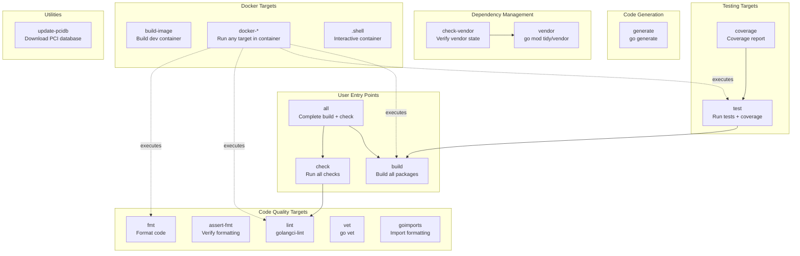
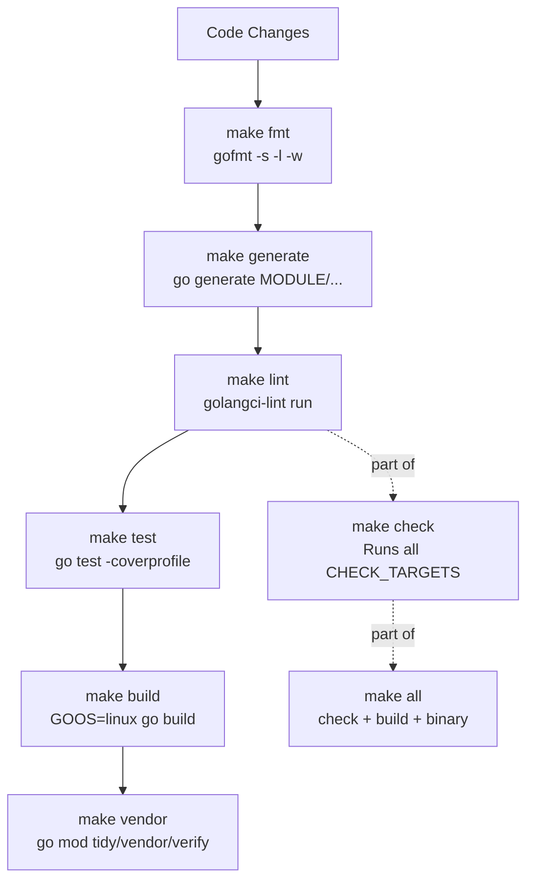
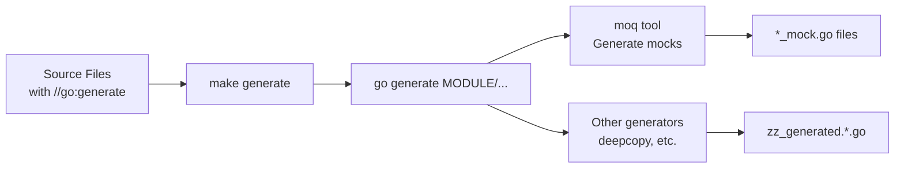
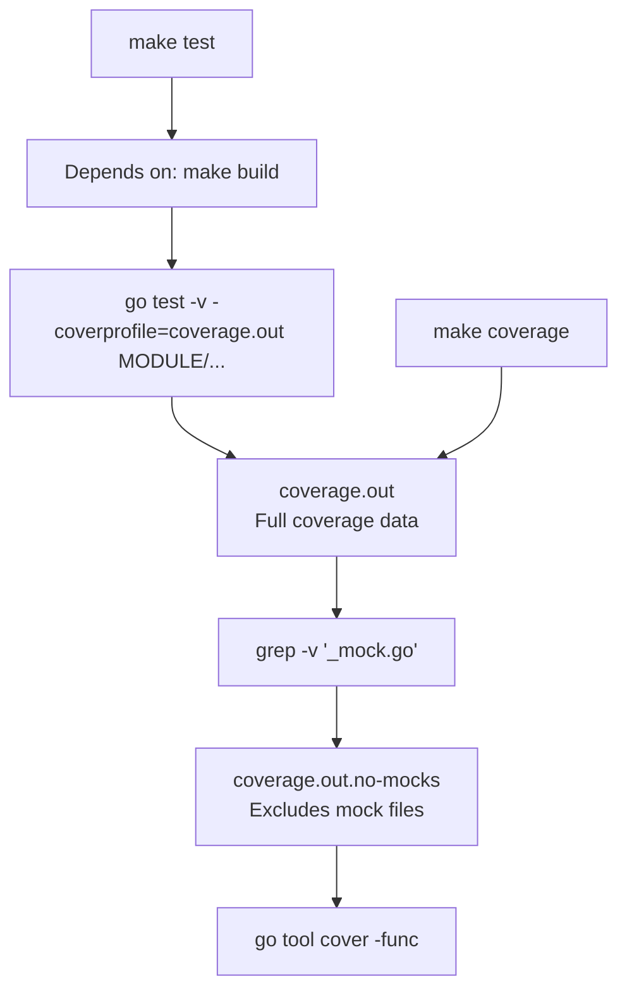
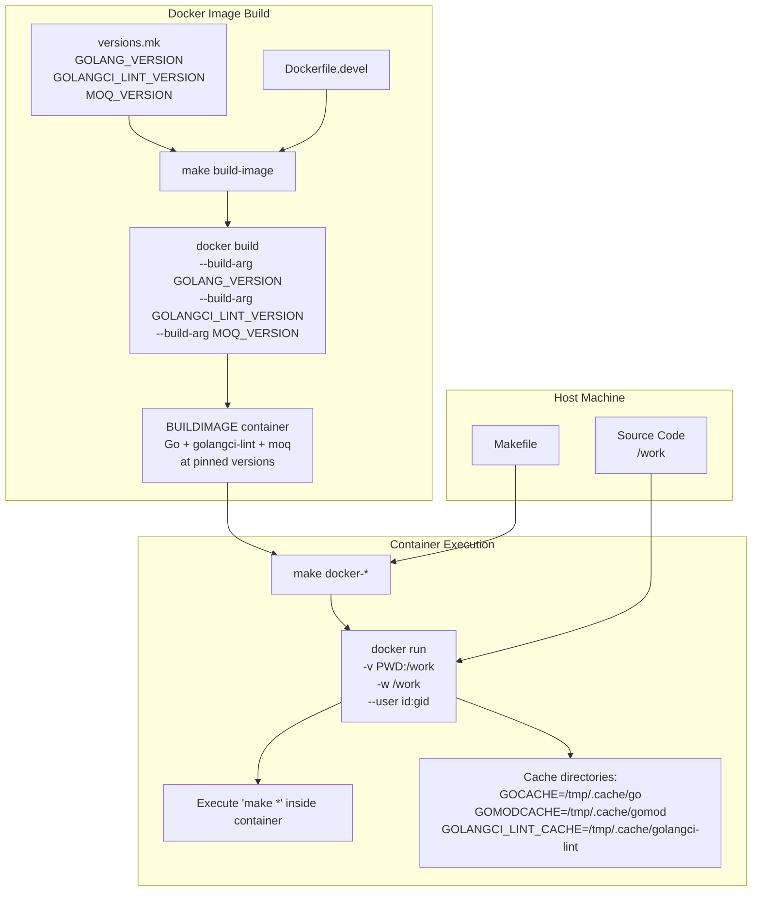
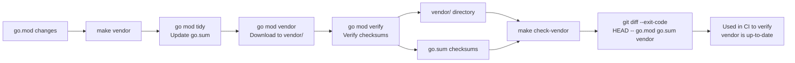
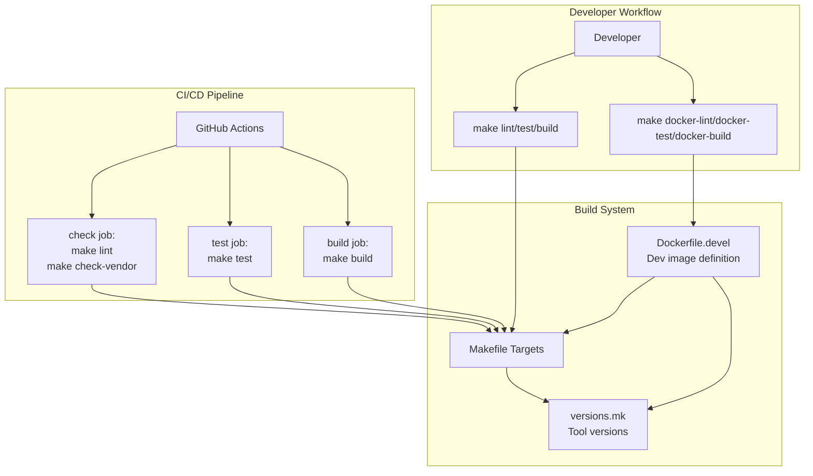

<!-- source: DeepWiki mcp.deepwiki.com · repo NVIDIA/go-nvlib · page 9.1 Build System · fetched 2026-10-26 -->

# Build System

<details>
<summary>Relevant source files</summary>

The following files were used as context for generating this wiki page:

- [Makefile](Makefile)
- [pkg/nvlib/device/identifier.go](pkg/nvlib/device/identifier.go)

</details>


This page documents the build system for go-nvlib, including Makefile targets, Docker-based development workflows, and code generation processes. The build system provides both local and containerized build environments to ensure consistent builds across different developer machines and CI/CD pipelines.

For information about the CI/CD pipeline that uses these build targets, see [CI/CD Pipeline](#9.2). For code quality tools configuration, see [Code Quality Tools](#9.3).

## Overview

The build system is centered around a comprehensive Makefile that provides targets for building, testing, linting, formatting, and code generation. The system supports two development modes:

1. **Local development**: Direct execution of build targets using locally installed tools
2. **Docker-based development**: Execution of build targets in a containerized environment with pinned tool versions

All builds target Linux (`GOOS=linux`) as go-nvlib is designed for NVIDIA GPU management on Linux systems.

**Sources**: [Makefile:1-123]()

## Makefile Target Categories



**Makefile Target Organization**

The Makefile defines three main target categories:

| Category | Targets | Purpose |
|----------|---------|---------|
| `TARGETS` | `binary`, `build`, `all`, `check`, `fmt`, `assert-fmt`, `generate`, `lint`, `vet`, `test`, `coverage` | Core build and quality targets |
| `CHECK_TARGETS` | `lint` | Targets run by `check` command |
| `DOCKER_TARGETS` | `docker-binary`, `docker-build`, `docker-all`, etc. | Containerized versions of all `TARGETS` |

**Sources**: [Makefile:21-24]()

## Build Configuration

Build Target Specification

The primary `build` target compiles all Go packages for Linux:

```makefile
GOOS := linux

build:
	GOOS=$(GOOS) go build ./...
```

This ensures all builds target the Linux operating system, as go-nvlib interfaces with Linux-specific subsystems (sysfs, NVML library).

**Sources**: [Makefile:26-29]()

### Version Management

The build system includes `versions.mk` which centralizes tool version definitions:

```makefile
include versions.mk
```

This file (referenced in [Makefile:15]()) defines variables like:
- `GOLANG_VERSION` - Go compiler version
- `GOLANGCI_LINT_VERSION` - Linter version
- `MOQ_VERSION` - Mock generator version
- `CLIENT_GEN_VERSION` - Kubernetes client generator version
- `CONTROLLER_GEN_VERSION` - Controller generator version

These versions are used when building the Docker development image and ensure consistent tooling across environments.

**Sources**: [Makefile:15](), [Makefile:90-94]()

## Local Development Workflow



### Code Formatting

The `fmt` target applies standard Go formatting:

```makefile
fmt:
	go list -f '{{.Dir}}' $(MODULE)/... \
		| xargs gofmt -s -l -w
```

The `-s` flag simplifies code, `-l` lists files, and `-w` writes changes back to files. The `assert-fmt` target verifies formatting without modification, useful in CI/CD.

**Sources**: [Makefile:43-57]()

### Import Management

The `goimports` target ensures import statements are properly formatted with local module preferences:

```makefile
goimports:
	find . -name \*.go \
			-not -name "zz_generated.deepcopy.go" \
			-not -path "./vendor/*" \
			-not -path "./pkg/nvidia.com/resource/clientset/versioned/*" \
		-exec goimports -local $(MODULE) -w {} \;
```

This excludes generated files and vendored code, focusing on project-owned source files.

**Sources**: [Makefile:66-71]()

### Code Generation



The `generate` target invokes all `//go:generate` directives in the codebase:

```makefile
generate:
	go generate $(MODULE)/...
```

This is used to generate mock implementations (via `moq`), deep copy methods, and other code generation tasks. Generated files typically have names like `*_mock.go` or `zz_generated.*.go`.

**Sources**: [Makefile:59-60]()

### Linting

The `lint` target runs `golangci-lint` across all packages:

```makefile
lint:
	golangci-lint run ./...
```

The linter configuration is defined in `.golangci.yml` (documented in [Code Quality Tools](#9.3)).

**Sources**: [Makefile:62-63]()

### Testing and Coverage



The `test` target runs all tests with coverage:

```makefile
test: build
	go test -v -coverprofile=$(COVERAGE_FILE) $(MODULE)/...
```

The `coverage` target filters out mock files and displays coverage statistics:

```makefile
coverage: test
	cat $(COVERAGE_FILE) | grep -v "_mock.go" > $(COVERAGE_FILE).no-mocks
	go tool cover -func=$(COVERAGE_FILE).no-mocks
```

This approach provides meaningful coverage metrics by excluding generated mock implementations.

**Sources**: [Makefile:76-82]()

## Docker-Based Development



### Building the Development Image

The `build-image` target creates a Docker image with all development tools at specified versions:

```makefile
build-image: $(DOCKERFILE_DEVEL)
	$(DOCKER) build \
		--progress=plain \
		--build-arg GOLANG_VERSION="$(GOLANG_VERSION)" \
		--build-arg CLIENT_GEN_VERSION="$(CLIENT_GEN_VERSION)" \
		--build-arg CONTROLLER_GEN_VERSION="$(CONTROLLER_GEN_VERSION)" \
		--build-arg GOLANGCI_LINT_VERSION="$(GOLANGCI_LINT_VERSION)" \
		--build-arg MOQ_VERSION="$(MOQ_VERSION)" \
		--tag $(BUILDIMAGE) \
		-f $(DOCKERFILE_DEVEL) \
		.
```

This image includes:
- Go compiler at `GOLANG_VERSION`
- `golangci-lint` at `GOLANGCI_LINT_VERSION`
- `moq` mock generator at `MOQ_VERSION`
- Kubernetes code generators (if applicable)

**Sources**: [Makefile:87-97]()

### Docker Target Pattern

All standard targets have Docker equivalents via pattern rules:

```makefile
$(DOCKER_TARGETS): docker-%:
	@echo "Running 'make $(*)' in container image $(BUILDIMAGE)"
	$(DOCKER) run \
		--rm \
		-e GOCACHE=/tmp/.cache/go \
		-e GOMODCACHE=/tmp/.cache/gomod \
		-e GOLANGCI_LINT_CACHE=/tmp/.cache/golangci-lint \
		-v $(PWD):/work \
		-w /work \
		--user $$(id -u):$$(id -g) \
		$(BUILDIMAGE) \
			make $(*)
```

This pattern:
- Mounts the current directory as `/work` in the container
- Sets cache directories to `/tmp/.cache` to improve performance
- Runs as the current user to avoid permission issues
- Executes the corresponding non-Docker target inside the container

Examples:
- `make docker-build` → runs `make build` in container
- `make docker-lint` → runs `make lint` in container
- `make docker-test` → runs `make test` in container

**Sources**: [Makefile:99-110]()

### Interactive Development Shell

The `.shell` target starts an interactive shell in the development container:

```makefile
.shell:
	$(DOCKER) run \
		--rm \
		-ti \
		-e GOCACHE=/tmp/.cache \
		-v $(PWD):$(PWD) \
		-w $(PWD) \
		--user $$(id -u):$$(id -g) \
		$(BUILDIMAGE)
```

This is useful for debugging build issues or running ad-hoc commands in the controlled environment.

**Sources**: [Makefile:113-122]()

## Dependency Management

### Vendoring Workflow



The `vendor` target updates the vendored dependencies:

```makefile
vendor:
	go mod tidy
	go mod vendor
	go mod verify
```

Steps:
1. `go mod tidy` - Removes unused dependencies and adds missing ones
2. `go mod vendor` - Copies dependencies to `vendor/` directory
3. `go mod verify` - Verifies checksums in `go.sum`

**Sources**: [Makefile:34-37]()

### Vendor Verification

The `check-vendor` target verifies that the vendor directory is synchronized:

```makefile
check-vendor: vendor
	git diff --exit-code HEAD -- go.mod go.sum vendor
```

This target:
1. Runs `make vendor` to update vendored dependencies
2. Checks if any files changed using `git diff`
3. Exits with error code if changes detected

This is used in CI/CD to ensure developers commit vendored dependencies after dependency updates.

**Sources**: [Makefile:39-40]()

## Utility Targets

### PCI Database Updates

The `update-pcidb` target downloads the latest PCI ID database:

```makefile
PCI_IDS_URL ?= https://pci-ids.ucw.cz/v2.2/pci.ids

update-pcidb:
	wget $(PCI_IDS_URL) -O $(CURDIR)/pkg/pciids/default_pci.ids
```

This updates the embedded PCI ID database used by the `pciids` package (see [PCI ID Database](#5.3)) to resolve vendor and device names. The database is downloaded from the authoritative PCI ID repository maintained by Martin Mares.

**Sources**: [Makefile:19](), [Makefile:84-85]()

## Target Dependencies

The following table shows which targets depend on other targets:

| Target | Dependencies | Description |
|--------|--------------|-------------|
| `all` | `check`, `build`, `binary` | Complete build pipeline |
| `check` | `$(CHECK_TARGETS)` | Currently: `lint` |
| `test` | `build` | Tests require successful build |
| `coverage` | `test` | Coverage requires test output |
| `check-vendor` | `vendor` | Verification requires vendor update |
| `docker-*` | (none) | Pattern targets are independent |

**Sources**: [Makefile:21-32]()

## Build System Integration



The build system serves as the foundation for both local development and CI/CD:

- **Local developers** use `make` targets directly or via Docker for reproducible builds
- **CI/CD pipeline** (see [CI/CD Pipeline](#9.2)) invokes the same Makefile targets to ensure consistency
- **Version control** via `versions.mk` ensures all environments use compatible tool versions
- **Docker isolation** provides reproducible builds independent of host system configuration

**Sources**: [Makefile:1-123]()

---

