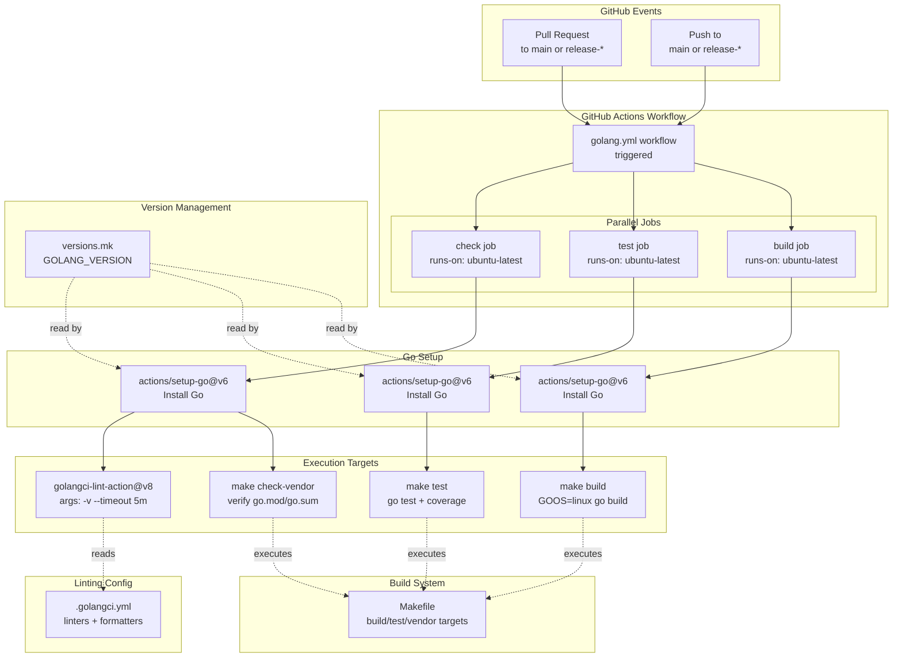
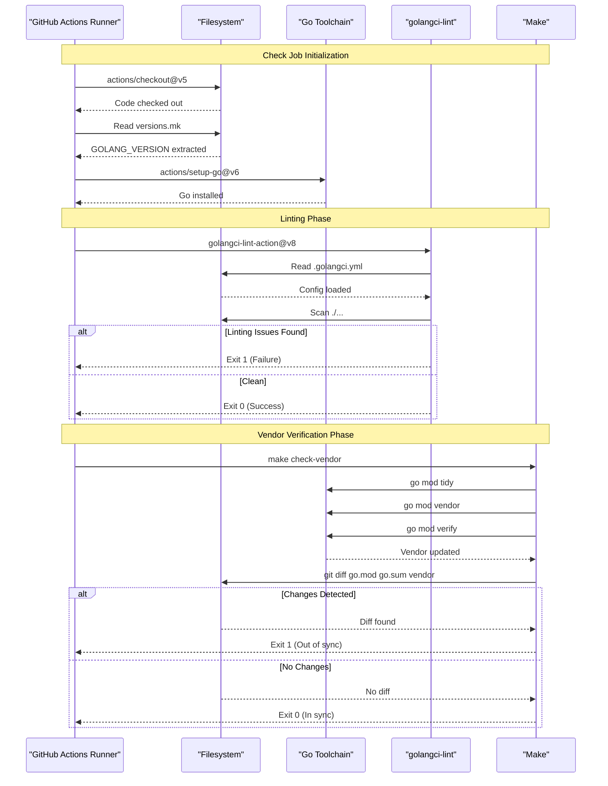
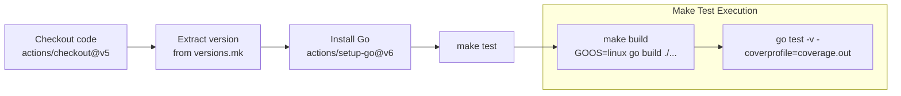
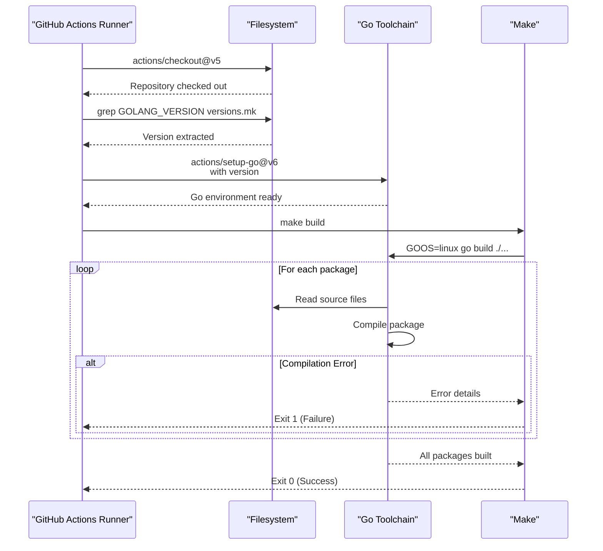

<!-- source: DeepWiki mcp.deepwiki.com · repo NVIDIA/go-nvlib · page 9.2 CI/CD Pipeline · fetched 2026-10-26 -->

# CI/CD Pipeline

<details>
<summary>Relevant source files</summary>

The following files were used as context for generating this wiki page:

- [.github/workflows/golang.yml](.github/workflows/golang.yml)
- [.golangci.yml](.golangci.yml)
- [Makefile](Makefile)
- [pkg/nvlib/device/identifier.go](pkg/nvlib/device/identifier.go)

</details>


## Purpose and Scope

This document describes the Continuous Integration and Continuous Deployment (CI/CD) infrastructure for the go-nvlib project. The CI/CD pipeline ensures code quality through automated linting, testing, and building on every pull request and push to protected branches. It utilizes GitHub Actions for orchestration and integrates with a Makefile-based build system.

For information about the build system and local development targets, see [Build System](#9.1). For details on code quality tools and linting configuration, see [Code Quality Tools](#9.3).

## CI/CD Architecture Overview

The CI/CD pipeline consists of GitHub Actions workflows that execute Makefile targets. The workflow is defined in `.github/workflows/golang.yml` and runs three parallel jobs on every pull request or push to `main` or `release-*` branches.

**CI/CD Architecture and Job Flow**



Sources: [.github/workflows/golang.yml:1-81](), [Makefile:1-123](), [.golangci.yml:1-39]()

## GitHub Actions Workflow Structure

### Workflow Definition

The workflow is defined in `.github/workflows/golang.yml` and consists of the following structure:

| Component | Configuration |
|-----------|--------------|
| Workflow Name | `Golang` |
| Trigger Events | `pull_request`, `push` |
| Target Branches | `main`, `release-*` |
| Runner OS | `ubuntu-latest` |
| Go Setup Action | `actions/setup-go@v6` |
| Checkout Action | `actions/checkout@v5` |

Sources: [.github/workflows/golang.yml:15-26]()

### Workflow Triggers

The workflow activates on two types of events:

```yaml
on:
  pull_request:
    branches:
      - main
      - release-*
  push:
    branches:
      - main
      - release-*
```

This ensures that all changes undergo CI validation before merging and that commits to protected branches are verified.

Sources: [.github/workflows/golang.yml:17-26]()

### Go Version Management

All three jobs dynamically extract the Go version from `versions.mk` to ensure consistency:

```bash
GOLANG_VERSION=$( grep "GOLANG_VERSION ?=" versions.mk )
echo "GOLANG_VERSION=${GOLANG_VERSION##GOLANG_VERSION ?= }" >> $GITHUB_ENV
```

This pattern is repeated in each job at lines 34-37, 56-60, and 72-75, ensuring that the CI environment matches the development environment specifications.

Sources: [.github/workflows/golang.yml:34-41](), [.github/workflows/golang.yml:56-64](), [.github/workflows/golang.yml:72-79]()

## Job 1: Check

The `check` job performs code quality verification through linting and dependency validation.

**Check Job Execution Flow**



### Linting with golangci-lint

The check job uses the `golangci-lint-action@v8` action with the following configuration:

| Parameter | Value | Purpose |
|-----------|-------|---------|
| `version` | `latest` | Use latest golangci-lint release |
| `args` | `-v --timeout 5m` | Verbose output, 5-minute timeout |
| `skip-cache` | `true` | Disable caching for fresh runs |

The linter configuration is defined in `.golangci.yml` with enabled linters including `asciicheck`, `contextcheck`, `gocritic`, `godot`, and `misspell`. Disabled linters include `forcetypeassert` and `unused`.

Sources: [.github/workflows/golang.yml:42-47](), [.golangci.yml:4-13]()

### Vendor Verification

The check job executes `make check-vendor` to ensure that vendored dependencies match `go.mod` and `go.sum`. This target performs:

1. `go mod tidy` - Ensures `go.mod` matches source code imports
2. `go mod vendor` - Updates the `vendor/` directory
3. `go mod verify` - Verifies downloaded dependencies match checksums
4. `git diff --exit-code HEAD -- go.mod go.sum vendor` - Fails if any changes detected

Sources: [.github/workflows/golang.yml:48-49](), [Makefile:34-40]()

## Job 2: Test

The `test` job executes the test suite and generates coverage reports.

**Test Job Steps**



The test job performs the following steps:

1. **Checkout**: Uses `actions/checkout@v5` to retrieve the codebase
2. **Version Extraction**: Reads `GOLANG_VERSION` from `versions.mk`
3. **Go Installation**: Installs Go using `actions/setup-go@v6`
4. **Test Execution**: Runs `make test`

The `make test` target performs:

```makefile
test: build
	go test -v -coverprofile=$(COVERAGE_FILE) $(MODULE)/...
```

This ensures that the code builds successfully before running tests and generates a coverage report in `coverage.out`.

Sources: [.github/workflows/golang.yml:50-65](), [Makefile:77-78]()

### Coverage Reporting

The Makefile includes a `coverage` target that filters out mock files and generates a coverage summary:

```makefile
coverage: test
	cat $(COVERAGE_FILE) | grep -v "_mock.go" > $(COVERAGE_FILE).no-mocks
	go tool cover -func=$(COVERAGE_FILE).no-mocks
```

This target is not currently executed in the CI pipeline but is available for local development.

Sources: [Makefile:80-82]()

## Job 3: Build

The `build` job verifies that the codebase compiles successfully for the target platform.

**Build Job Execution**



The build job consists of:

1. **Checkout**: Retrieves code using `actions/checkout@v5`
2. **Go Setup**: Installs Go version from `versions.mk`
3. **Build Execution**: Runs `make build`

The `make build` target compiles all packages:

```makefile
build:
	GOOS=$(GOOS) go build ./...
```

The `GOOS` variable is set to `linux` by default, ensuring cross-platform consistency.

Sources: [.github/workflows/golang.yml:66-80](), [Makefile:26-29]()

## Makefile Integration

The CI/CD pipeline heavily relies on Makefile targets for consistency between local development and CI environments.

### Core CI/CD Targets

| Target | Purpose | CI Usage |
|--------|---------|----------|
| `check-vendor` | Verify vendored dependencies are in sync | check job |
| `test` | Run unit tests with coverage | test job |
| `build` | Compile all packages for Linux | build job |
| `lint` | Run golangci-lint locally | Not used (direct action call) |
| `fmt` | Format code with gofmt | Not used in CI |

### Check Targets

The Makefile defines a `CHECK_TARGETS` variable that lists all verification targets:

```makefile
CHECK_TARGETS := lint
```

The `check` target depends on these:

```makefile
check: $(CHECK_TARGETS)
```

Currently, only `lint` is included, but additional checks can be added to this list.

Sources: [Makefile:21-32]()

### Docker-Based Targets

The Makefile provides Docker-wrapped versions of all targets for consistent development environments:

```makefile
DOCKER_TARGETS := $(patsubst %,docker-%, $(TARGETS))
```

These targets execute in a containerized environment with cached Go modules and build artifacts:

```makefile
$(DOCKER_TARGETS): docker-%:
	@echo "Running 'make $(*)' in container image $(BUILDIMAGE)"
	$(DOCKER) run \
		--rm \
		-e GOCACHE=/tmp/.cache/go \
		-e GOMODCACHE=/tmp/.cache/gomod \
		-e GOLANGCI_LINT_CACHE=/tmp/.cache/golangci-lint \
		-v $(PWD):/work \
		-w /work \
		--user $$(id -u):$$(id -g) \
		$(BUILDIMAGE) \
			make $(*)
```

This allows developers to run `make docker-test` or `make docker-lint` to execute targets in the same environment as CI, though the CI pipeline uses native execution for performance.

Sources: [Makefile:23-110]()

## Tool Version Centralization

All tool versions are centralized in `versions.mk`, which is included by the Makefile and read by GitHub Actions workflows. This file defines:

- `GOLANG_VERSION` - Go compiler version
- `CLIENT_GEN_VERSION` - Kubernetes client generator version
- `CONTROLLER_GEN_VERSION` - Kubernetes controller generator version
- `GOLANGCI_LINT_VERSION` - golangci-lint version
- `MOQ_VERSION` - Mock generator version

The GitHub Actions workflow extracts the Go version using shell commands:

```bash
GOLANG_VERSION=$( grep "GOLANG_VERSION ?=" versions.mk )
echo "GOLANG_VERSION=${GOLANG_VERSION##GOLANG_VERSION ?= }" >> $GITHUB_ENV
```

This pattern is used identically in all three jobs, ensuring version consistency.

Sources: [Makefile:15](), [.github/workflows/golang.yml:34-37]()

## Linting Configuration

The `.golangci.yml` file configures the linting behavior for both local development and CI.

### Enabled Linters

The following linters are enabled:

- `asciicheck` - Detects non-ASCII identifiers
- `contextcheck` - Validates context.Context usage
- `gocritic` - Comprehensive Go code analysis
- `godot` - Checks for proper comment punctuation
- `misspell` - Identifies misspelled words

Sources: [.golangci.yml:5-10]()

### Disabled Linters

Two linters are explicitly disabled:

- `forcetypeassert` - Allows type assertions without checks (intentional)
- `unused` - Disabled (may produce false positives with vendored code)

Sources: [.golangci.yml:11-13]()

### Formatter Configuration

The configuration enables two formatters:

```yaml
formatters:
  enable:
    - gofmt
    - goimports
  settings:
    goimports:
      local-prefixes:
        - github.com/NVIDIA/go-nvlib
```

The `goimports` formatter is configured to treat `github.com/NVIDIA/go-nvlib` as local, ensuring proper import grouping.

Sources: [.golangci.yml:25-32]()

### Exclusions

Both linters and formatters exclude:

- Generated code (via `generated: lax`)
- `third_party$` directories
- `builtin$` directories
- `examples$` directories

Additionally, linters use exclusion presets for comments, common false positives, legacy code, and standard error handling patterns.

Sources: [.golangci.yml:14-38]()

## CI/CD Pipeline Matrix

The following table summarizes the complete CI/CD pipeline structure:

| Aspect | Configuration |
|--------|--------------|
| **Workflow File** | `.github/workflows/golang.yml` |
| **Trigger Events** | Pull requests and pushes to `main` and `release-*` branches |
| **Parallel Jobs** | 3 (check, test, build) |
| **Runner OS** | `ubuntu-latest` for all jobs |
| **Go Version Source** | `versions.mk` file |
| **Linting Tool** | `golangci-lint` via GitHub Action |
| **Linting Timeout** | 5 minutes |
| **Test Command** | `make test` (includes build as prerequisite) |
| **Build Target OS** | Linux (`GOOS=linux`) |
| **Vendor Verification** | `make check-vendor` with git diff check |
| **Coverage File** | `coverage.out` |
| **Docker Support** | Available via `make docker-*` targets (not used in CI) |

Sources: [.github/workflows/golang.yml:1-81](), [Makefile:1-123](), [.golangci.yml:1-39]()

## Local vs CI Execution

### Local Development Workflow

Developers can replicate CI checks locally using Makefile targets:

```bash
# Format code
make fmt

# Run linting
make lint

# Run tests with coverage
make test
make coverage

# Build for Linux
make build

# Verify vendor dependencies
make check-vendor

# Run all checks
make check
```

### Docker-Based Local Execution

For environment consistency with CI, developers can use Docker-wrapped targets:

```bash
# Build development image with exact tool versions
make build-image

# Run any target in Docker
make docker-lint
make docker-test
make docker-build

# Start interactive shell in development container
make .shell
```

The Docker-based execution uses the same tool versions defined in `versions.mk` and passes through the current user's UID/GID to maintain file ownership.

Sources: [Makefile:87-122]()

## Failure Scenarios and Error Handling

### Check Job Failures

The check job can fail in two scenarios:

1. **Linting Failures**: If `golangci-lint` detects issues, the job exits with code 1. The `-v` flag provides verbose output for debugging.
2. **Vendor Out-of-Sync**: If `git diff` detects changes after running `make check-vendor`, the vendored dependencies are not synchronized with `go.mod`/`go.sum`.

### Test Job Failures

The test job fails if:

1. **Build Errors**: The `test` target depends on `build`, so compilation errors cause immediate failure.
2. **Test Failures**: Any failing test case causes `go test` to exit with a non-zero code.
3. **Coverage Generation**: If coverage profile generation fails, the job fails.

### Build Job Failures

The build job fails if any package in `./...` fails to compile for `GOOS=linux`.

Sources: [.github/workflows/golang.yml:27-81](), [Makefile:28-40](), [Makefile:77-78]()

---

