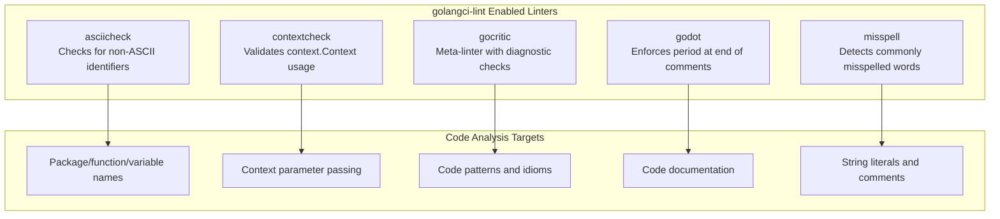
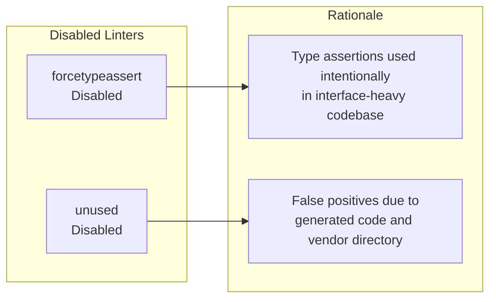
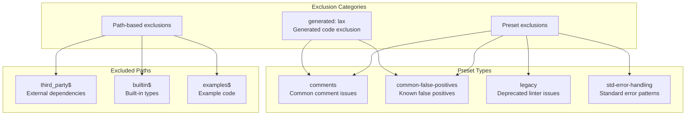
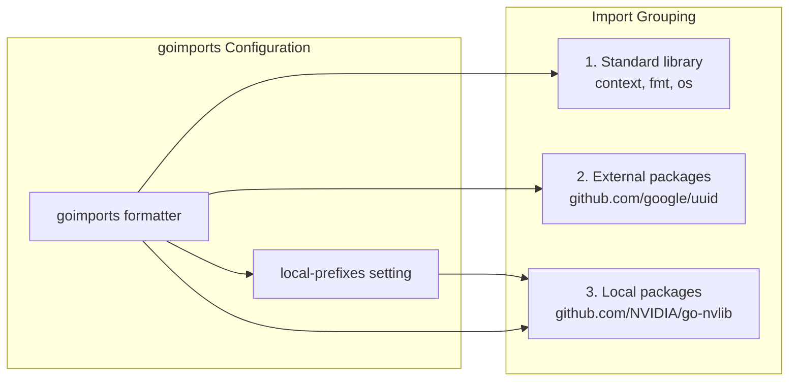
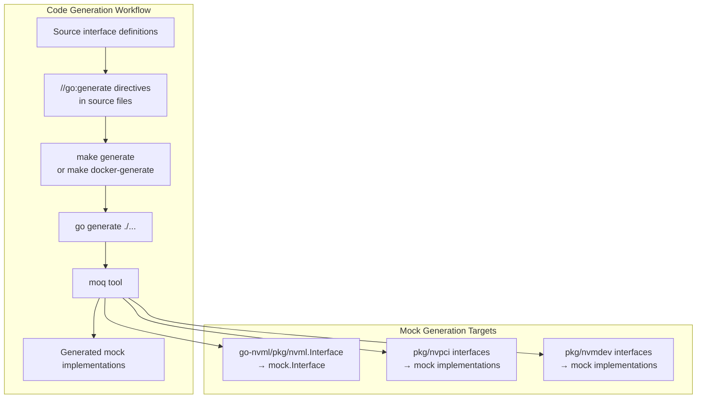
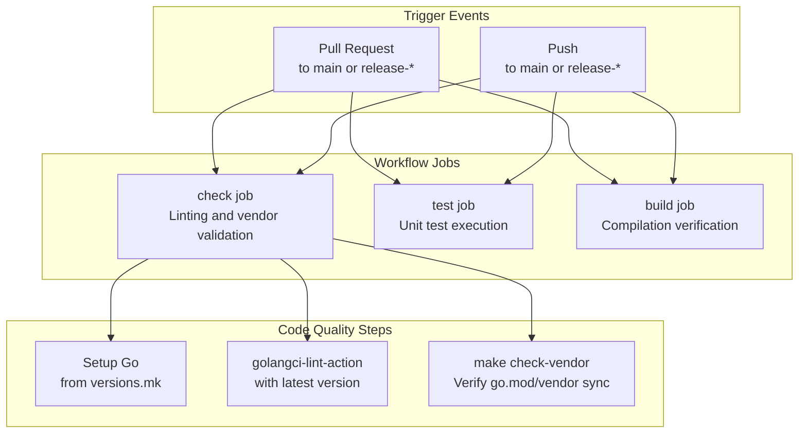
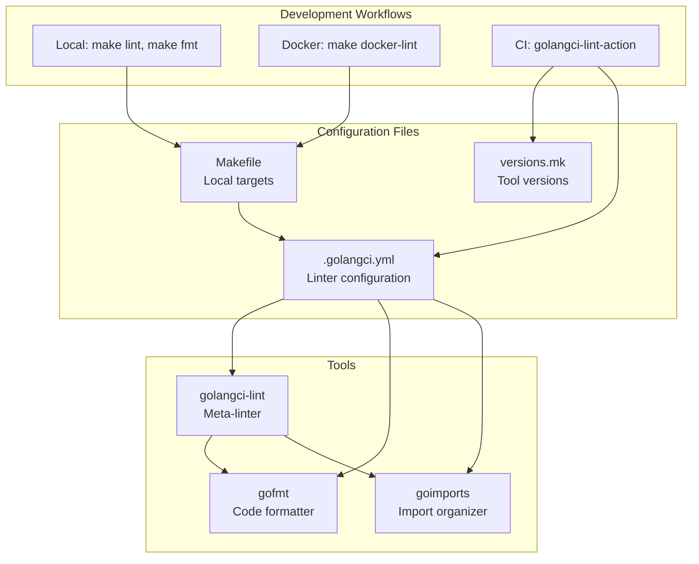

<!-- source: DeepWiki mcp.deepwiki.com · repo NVIDIA/go-nvlib · page 9.3 Code Quality Tools · fetched 2026-10-26 -->

# Code Quality Tools

<details>
<summary>Relevant source files</summary>

The following files were used as context for generating this wiki page:

- [.github/workflows/golang.yml](.github/workflows/golang.yml)
- [.golangci.yml](.golangci.yml)

</details>


## Purpose and Scope

This document describes the code quality tools used in go-nvlib to maintain consistent formatting, catch potential issues, and generate code artifacts. The tooling includes linting with `golangci-lint`, code formatting with `gofmt` and `goimports`, and code generation with `go generate` and `moq`. For information about the build system that invokes these tools, see [Build System](#9.1). For information about the CI/CD pipeline that enforces code quality, see [CI/CD Pipeline](#9.2).

---

## Linting with golangci-lint

The repository uses `golangci-lint` as the primary static analysis tool. The configuration is defined in [.golangci.yml:1-39]() and enforced during the `check` job in the CI/CD pipeline at [.github/workflows/golang.yml:28-49]().

### Configuration Overview

The golangci-lint configuration uses version 2 of the configuration format and is configured to analyze both production code and test files:

| Setting | Value | Purpose |
|---------|-------|---------|
| `version` | `"2"` | Configuration format version |
| `run.tests` | `true` | Include test files in analysis |
| CI timeout | `5m` | Maximum lint duration in CI |
| CI arguments | `-v --timeout 5m` | Verbose output with timeout |

**Sources:** [.golangci.yml:1-3](), [.github/workflows/golang.yml:46]()

### Enabled Linters

The configuration explicitly enables five linters that provide specific code quality checks:



**Linter Details:**

| Linter | Purpose | Example Issues Caught |
|--------|---------|----------------------|
| `asciicheck` | Ensures all Go identifiers use only ASCII characters | Non-ASCII characters in variable names |
| `contextcheck` | Validates correct usage of `context.Context` | Context not passed through function call chain |
| `gocritic` | Provides opinionated checks from go-critic | Inefficient string concatenation, unnecessary type conversions |
| `godot` | Enforces that comments end with a period | Missing punctuation in documentation comments |
| `misspell` | Catches common spelling errors | Typos in comments and string literals |

**Sources:** [.golangci.yml:4-10]()

### Disabled Linters

Two linters are explicitly disabled in the configuration:



- **`forcetypeassert`**: Disabled because the codebase intentionally uses type assertions without explicit error checks in contexts where the type is guaranteed by the surrounding logic
- **`unused`**: Disabled to avoid false positives from generated code and vendored dependencies

**Sources:** [.golangci.yml:11-13]()

### Exclusions and Path Filtering

The configuration defines exclusion rules to prevent false positives and reduce noise:



**Exclusion Rules:**

| Rule Type | Value | Applied To |
|-----------|-------|------------|
| Generated code | `lax` | Linters and formatters |
| Preset exclusions | `comments`, `common-false-positives`, `legacy`, `std-error-handling` | Linters only |
| Path exclusions | `third_party$`, `builtin$`, `examples$` | Linters and formatters |

**Sources:** [.golangci.yml:14-38]()

---

## Code Formatting

The repository uses two complementary formatters to maintain consistent code style.

### gofmt Formatter

The standard Go formatter `gofmt` is enabled through golangci-lint's formatter integration. It enforces:

- Standard Go indentation (tabs)
- Consistent spacing around operators
- Aligned struct field declarations
- Canonical import grouping

The formatter is invoked via:
- **Makefile target**: `make fmt` (executes `gofmt -s -l -w`)
- **CI/CD**: Implicitly through golangci-lint action
- **Docker**: `make docker-fmt` for containerized formatting

**Sources:** [.golangci.yml:26-28]()

### goimports Formatter

The `goimports` formatter extends `gofmt` with automatic import management:



The configuration at [.golangci.yml:30-32]() sets the local package prefix:

```yaml
goimports:
  local-prefixes:
    - github.com/NVIDIA/go-nvlib
```

This ensures imports are grouped and sorted as:
1. Standard library packages
2. External third-party packages
3. Local `github.com/NVIDIA/go-nvlib` packages

**Sources:** [.golangci.yml:28-32]()

---

## Code Generation

The repository uses code generation for creating mock implementations and maintaining generated bindings.

### go generate Integration

The `go generate` command is used to execute code generators defined in source files via `//go:generate` directives. The primary use case is generating mock implementations for testing:



**Sources:** Referenced in build system (see [Build System](#9.1))

### moq Mock Generator

The `moq` tool generates mock implementations from interface definitions. It creates structs with function fields for each interface method, along with call tracking capabilities.

**Mock Generation Pattern:**

For an interface like:
```go
type Interface interface {
    GetDevices() ([]Device, error)
    GetMigProfiles() ([]MigProfile, error)
}
```

The `moq` tool generates a mock struct with:
- Function fields for each method (e.g., `GetDevicesFunc`)
- Call counting arrays (e.g., `GetDevicesCalls`)
- Thread-safe call recording via mutex

This pattern is used extensively for testing:
- **NVML mocks**: 300+ function fields for the comprehensive nvml.Interface
- **nvpci mocks**: Device discovery and classification mocks
- **nvmdev mocks**: MDEV lifecycle operation mocks

**Sources:** Referenced in testing infrastructure (see [Mock Implementations](#8.2))

---

## CI/CD Integration

Code quality tools are enforced through the GitHub Actions workflow defined at [.github/workflows/golang.yml:1-81]().

### Workflow Trigger Conditions



**Sources:** [.github/workflows/golang.yml:17-49]()

### Lint Job Configuration

The `check` job executes linting with the following configuration:

| Step | Implementation | Purpose |
|------|----------------|---------|
| Checkout | `actions/checkout@v5` | Clone repository code |
| Get Go version | Parse `versions.mk` | Extract `GOLANG_VERSION` variable |
| Install Go | `actions/setup-go@v6` | Install Go toolchain |
| Lint | `golangci/golangci-lint-action@v8` | Run golangci-lint with latest version |
| Check vendor | `make check-vendor` | Verify vendored dependencies are synchronized |

**Lint Action Parameters:**

```yaml
with:
  version: latest
  args: -v --timeout 5m
  skip-cache: true
```

- **`version: latest`**: Always use the most recent golangci-lint release
- **`args: -v --timeout 5m`**: Verbose output with 5-minute timeout
- **`skip-cache: true`**: Force fresh analysis (no cached results)

**Sources:** [.github/workflows/golang.yml:28-49]()

### Version Management

The workflow dynamically determines the Go version from `versions.mk`:

```bash
GOLANG_VERSION=$( grep "GOLANG_VERSION ?=" versions.mk )
echo "GOLANG_VERSION=${GOLANG_VERSION##GOLANG_VERSION ?= }" >> $GITHUB_ENV
```

This pattern at [.github/workflows/golang.yml:34-37]() ensures consistency between local development (using Makefile) and CI/CD environments.

**Sources:** [.github/workflows/golang.yml:33-41]()

---

## Tool Invocation Summary

The following table summarizes how code quality tools are invoked across different contexts:

| Tool | Local Development | Docker Development | CI/CD | Configuration |
|------|-------------------|-------------------|-------|---------------|
| `gofmt` | `make fmt` | `make docker-fmt` | Implicit (via golangci-lint) | Built-in Go tool |
| `goimports` | Implicit (via golangci-lint) | Implicit | Implicit (via golangci-lint) | [.golangci.yml:28-32]() |
| `golangci-lint` | `make lint` | `make docker-lint` | [golang.yml:42-47]() | [.golangci.yml:1-39]() |
| `go generate` | `make generate` | `make docker-generate` | Not in CI | `//go:generate` directives |
| `moq` | Via `go generate` | Via `go generate` | Not in CI | Invoked by generate directives |

**Key Integration Points:**



This architecture ensures consistent code quality enforcement across all development and CI/CD contexts, with centralized configuration in [.golangci.yml]() and version management in `versions.mk`.

**Sources:** [.golangci.yml:1-39](), [.github/workflows/golang.yml:28-49]()

---

