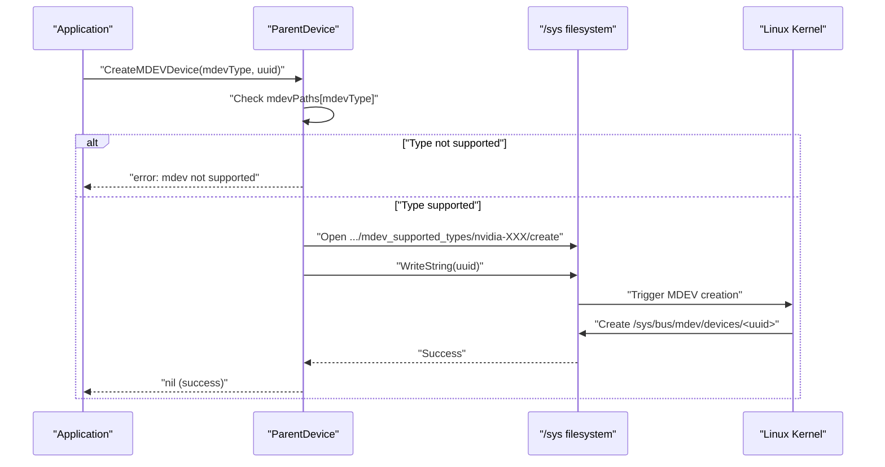
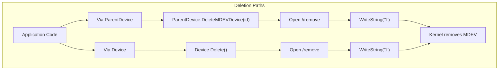
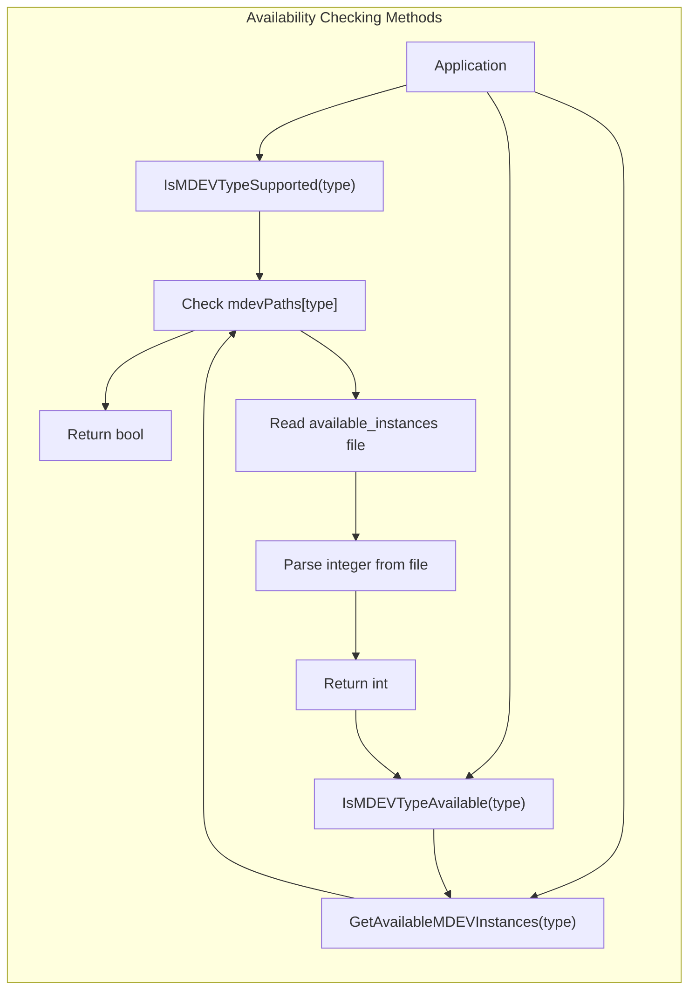
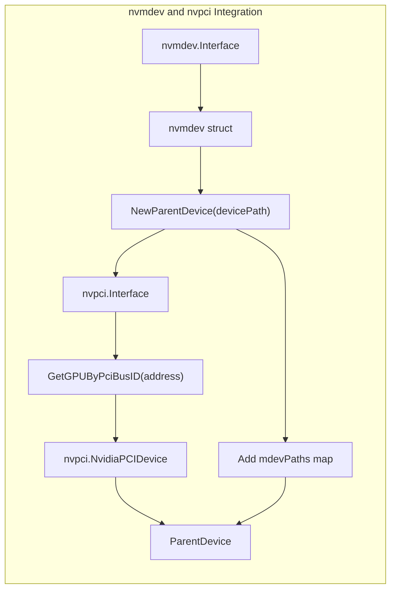

<!-- source: DeepWiki mcp.deepwiki.com · repo NVIDIA/go-nvlib · extra page MDEV Lifecycle Management · fetched 2026-10-26 -->

# MDEV Lifecycle Management

<details>
<summary>Relevant source files</summary>

The following files were used as context for generating this wiki page:

- [pkg/nvmdev/mock.go](pkg/nvmdev/mock.go)
- [pkg/nvmdev/nvmdev.go](pkg/nvmdev/nvmdev.go)
- [pkg/nvmdev/nvmdev_test.go](pkg/nvmdev/nvmdev_test.go)

</details>


## Purpose and Scope

This document describes the lifecycle operations for mediated devices (vGPUs) in the `nvmdev` package, including creation, deletion, and availability checking. For information about discovering parent devices and MDEV types, see [Parent Device Discovery](#5.2.1). For the underlying PCI device discovery, see [PCI Device Discovery](#5.1).

The `nvmdev` package provides methods on `ParentDevice` and `Device` types to manage the lifecycle of MDEV instances through sysfs filesystem interactions. These operations require root privileges and interact directly with the Linux kernel's mediated device framework.

## MDEV Device Types

The lifecycle operations revolve around two primary types:

| Type | Description | Key Methods |
|------|-------------|-------------|
| `ParentDevice` | Physical GPU that hosts vGPUs | `CreateMDEVDevice()`, `DeleteMDEVDevice()`, `IsMDEVTypeSupported()`, `IsMDEVTypeAvailable()`, `GetAvailableMDEVInstances()` |
| `Device` | Instantiated MDEV (vGPU) | `Delete()`, property accessors for `UUID`, `MDEVType`, `Driver`, `IommuGroup`, `Parent` |

**Sources:** [pkg/nvmdev/nvmdev.go:50-64]()

## MDEV Creation

### Creation Process Flow



**Sources:** [pkg/nvmdev/nvmdev.go:307-322]()

### CreateMDEVDevice Method

The `CreateMDEVDevice` method on `ParentDevice` creates a new mediated device instance:

```go
func (p *ParentDevice) CreateMDEVDevice(mdevType string, id string) error
```

**Parameters:**
- `mdevType`: The MDEV type name (e.g., "A100-4C", "A100-8C")
- `id`: UUID string for the new MDEV instance

**Process:**
1. Lookup `mdevType` in the `mdevPaths` map populated during parent device discovery
2. Open the `create` file at path `<mdevPath>/create`
3. Write the UUID string to the file with `O_WRONLY|O_SYNC` flags and mode `0200`
4. The kernel creates the MDEV device at `/sys/bus/mdev/devices/<uuid>`

**Error Conditions:**
- Returns error if `mdevType` is not in `mdevPaths` (unsupported type)
- Returns error if `create` file cannot be opened (permissions, device state)
- Returns error if UUID write fails (invalid UUID, insufficient resources)

**Sources:** [pkg/nvmdev/nvmdev.go:307-322]()

### Creation Example from Tests

The test suite demonstrates the creation workflow:

```go
// Check if type is supported
supported := parentA100.IsMDEVTypeSupported("A100-4C")

// Check if instances are available
available, err := parentA100.IsMDEVTypeAvailable("A100-4C")

// Create the MDEV device
err = parentA100.CreateMDEVDevice("A100-4C", "b1914f0a-15cf-416e-8967-55fc7cb68e20")
```

**Sources:** [pkg/nvmdev/nvmdev_test.go:41-48]()

## MDEV Deletion

### Deletion Process Flow



**Sources:** [pkg/nvmdev/nvmdev.go:324-350]()

### Deletion Methods

There are two methods for deleting MDEV devices:

#### ParentDevice.DeleteMDEVDevice

```go
func (p *ParentDevice) DeleteMDEVDevice(id string) error
```

Deletes an MDEV device by UUID from the parent device perspective. Opens the `remove` file at path `<parent.Path>/<id>/remove` and writes "1" to trigger deletion.

**Sources:** [pkg/nvmdev/nvmdev.go:324-336]()

#### Device.Delete

```go
func (m *Device) Delete() error
```

Deletes the MDEV device from the device's own perspective. Opens the `remove` file at path `<device.Path>/remove` and writes "1" to trigger deletion.

**Sources:** [pkg/nvmdev/nvmdev.go:338-350]()

### Deletion Implementation Details

Both deletion methods follow the same pattern:

1. Open the `remove` file with flags `O_WRONLY|O_SYNC` and mode `0200`
2. Write the string "1" to the file
3. The kernel destroys the MDEV device and removes the sysfs entries

**Error Conditions:**
- Cannot open `remove` file (device doesn't exist, permissions)
- Cannot write to file (device busy, in use by VM)

**Sources:** [pkg/nvmdev/nvmdev.go:324-350]()

## Availability Checking

### Availability Check Flow



**Sources:** [pkg/nvmdev/nvmdev.go:366-401]()

### IsMDEVTypeSupported

```go
func (p *ParentDevice) IsMDEVTypeSupported(mdevType string) bool
```

Checks if an MDEV type is supported by the parent GPU by looking up the type name in the `mdevPaths` map. This is a simple map lookup operation that returns `true` if the key exists, `false` otherwise.

**Use Case:** Determine if a GPU model supports a specific vGPU profile before attempting creation.

**Sources:** [pkg/nvmdev/nvmdev.go:366-370]()

### IsMDEVTypeAvailable

```go
func (p *ParentDevice) IsMDEVTypeAvailable(mdevType string) (bool, error)
```

Checks if at least one instance of the MDEV type can be created. Internally calls `GetAvailableMDEVInstances()` and returns `true` if the count is greater than zero.

**Return Values:**
- `(true, nil)`: At least one instance can be created
- `(false, nil)`: Type is supported but no instances available (resources exhausted)
- `(false, error)`: Error reading availability information

**Sources:** [pkg/nvmdev/nvmdev.go:372-380]()

### GetAvailableMDEVInstances

```go
func (p *ParentDevice) GetAvailableMDEVInstances(mdevType string) (int, error)
```

Returns the number of MDEV instances that can be created for the specified type.

**Process:**
1. Lookup `mdevType` in `mdevPaths` map
2. If not found, return `-1` to indicate unsupported type
3. Read the `available_instances` file from the MDEV type directory
4. Parse the string content as an integer
5. Return the count

**Path Structure:**
```
<parent>/mdev_supported_types/nvidia-XXX/available_instances
```

**Return Values:**
- `-1`: MDEV type not supported
- `0`: Type supported but no instances available
- `> 0`: Number of instances that can be created
- `error`: Error reading or parsing the file

**Sources:** [pkg/nvmdev/nvmdev.go:382-401]()

## Filesystem Interaction Details

### Sysfs File Operations

The lifecycle management operations interact with the Linux sysfs filesystem at specific paths:

| Operation | File Path | Access Mode | Write Content | Effect |
|-----------|-----------|-------------|---------------|--------|
| Create MDEV | `<mdevPath>/create` | `O_WRONLY\|O_SYNC`, `0200` | UUID string | Kernel creates MDEV device |
| Delete MDEV (parent) | `<parent.Path>/<uuid>/remove` | `O_WRONLY\|O_SYNC`, `0200` | "1" | Kernel removes MDEV device |
| Delete MDEV (device) | `<device.Path>/remove` | `O_WRONLY\|O_SYNC`, `0200` | "1" | Kernel removes MDEV device |
| Check availability | `<mdevPath>/available_instances` | Read | N/A | Get available instance count |

**Sources:** [pkg/nvmdev/nvmdev.go:307-401]()

### mdevPaths Map Structure

The `ParentDevice.mdevPaths` map is populated during parent device discovery and maps MDEV type names to their filesystem paths:

```go
type ParentDevice struct {
    *nvpci.NvidiaPCIDevice
    mdevPaths map[string]string  // e.g., "A100-4C" -> "/sys/class/mdev_bus/.../nvidia-500"
}
```

**Example Map Contents:**
```
"A100-4C"    -> "/sys/class/mdev_bus/0000:3b:04.1/mdev_supported_types/nvidia-500"
"A100-8C"    -> "/sys/class/mdev_bus/0000:3b:04.1/mdev_supported_types/nvidia-502"
"A100-1-5C"  -> "/sys/class/mdev_bus/0000:3b:04.1/mdev_supported_types/nvidia-506"
```

**Sources:** [pkg/nvmdev/nvmdev.go:50-54](), [pkg/nvmdev/nvmdev.go:286-304]()

## Testing Infrastructure

### Mock Implementation

The `MockNvmdev` type provides a testing implementation that simulates the sysfs filesystem structure in temporary directories:

```mermaid
graph TB
    subgraph "Mock MDEV Testing"
        NewMock["NewMock()"]
        
        TempDirs["Create temp directories:<br/>- mdevParentsRoot<br/>- mdevDevicesRoot<br/>- pciDevicesRoot"]
        
        AddParent["AddMockA100Parent(address, numaNode)"]
        AddMdev["AddMockA100Mdev(uuid, type, typeDir, parentDir)"]
        
        CreateStructure["Create sysfs structure:<br/>- vendor, class, device files<br/>- mdev_supported_types/<br/>- available_instances files"]
        
        CreateLinks["Create symlinks:<br/>- parent → mdev device<br/>- mdev_type symlink<br/>- driver, iommu_group"]
        
        TestCode["Test Code Uses Mock"]
        
        Cleanup["Cleanup() removes temp dirs"]
    end
    
    NewMock --> TempDirs
    TempDirs --> AddParent
    AddParent --> CreateStructure
    CreateStructure --> AddMdev
    AddMdev --> CreateLinks
    CreateLinks --> TestCode
    TestCode --> Cleanup
```



**Sources:** [pkg/nvmdev/mock.go:28-267]()

### AddMockA100Parent

Creates a complete mock parent device structure including:
- PCI configuration files (vendor, class, device, config)
- MDEV supported types with 12 different profiles (A100-4C, A100-8C, etc.)
- Available instances files (set to 1 per type)
- Resource files and BAR0 mappings
- NUMA node information

**Sources:** [pkg/nvmdev/mock.go:87-226]()

### AddMockA100Mdev

Creates a mock MDEV device structure:
- Device directory under parent
- Symlink to mdev_type
- Driver symlink (vfio_mdev)
- IOMMU group symlink
- Entry in mdevDevicesRoot

**Sources:** [pkg/nvmdev/mock.go:228-267]()

### Test Example

The test suite demonstrates the complete lifecycle:

```go
func TestNvmdev(t *testing.T) {
    // Create mock environment
    nvmdev, err := NewMock()
    defer nvmdev.Cleanup()
    
    // Add parent device
    err = nvmdev.AddMockA100Parent("0000:3b:04.1", 0)
    
    // Get parent devices
    parentDevs, err := nvmdev.GetAllParentDevices()
    
    // Check support and availability
    supported := parentA100.IsMDEVTypeSupported("A100-4C")
    available, err := parentA100.IsMDEVTypeAvailable("A100-4C")
    
    // Create MDEV
    err = nvmdev.AddMockA100Mdev("b1914f0a-15cf-416e-8967-55fc7cb68e20", 
                                  "A100-4C", "nvidia-500", parentDevs[0].Path)
    
    // Retrieve created devices
    mdevs, err := nvmdev.GetAllDevices()
}
```

**Sources:** [pkg/nvmdev/nvmdev_test.go:25-63]()

## Error Handling Patterns

### Common Error Scenarios

| Scenario | Method | Error Type | Handling |
|----------|--------|------------|----------|
| Unsupported MDEV type | `CreateMDEVDevice` | Type not in `mdevPaths` | Return error message with type and parent address |
| Cannot open create file | `CreateMDEVDevice` | File open failure | Return formatted error with context |
| UUID write fails | `CreateMDEVDevice` | Write failure | Return formatted error (likely resource exhaustion) |
| Device not found | `DeleteMDEVDevice`, `Device.Delete` | File open failure | Return error (device may already be deleted) |
| Device in use | `DeleteMDEVDevice`, `Device.Delete` | Write failure | Return error (VM using device) |
| Cannot read availability | `GetAvailableMDEVInstances` | File read error | Return error with context |
| Invalid instance count | `GetAvailableMDEVInstances` | Parse error | Return error with string value |

**Sources:** [pkg/nvmdev/nvmdev.go:307-401]()

## Physical Function Retrieval

Both `ParentDevice` and `Device` provide methods to retrieve the underlying physical GPU:

### ParentDevice.GetPhysicalFunction

```go
func (p *ParentDevice) GetPhysicalFunction() *nvpci.NvidiaPCIDevice
```

Returns the physical function backing the parent device. If the parent is a virtual function (VF) in an SR-IOV configuration, returns the corresponding physical function (PF). Otherwise, returns the parent device itself.

**Sources:** [pkg/nvmdev/nvmdev.go:352-359]()

### Device.GetPhysicalFunction

```go
func (m *Device) GetPhysicalFunction() *nvpci.NvidiaPCIDevice
```

Convenience method that delegates to `m.Parent.GetPhysicalFunction()` to get the physical GPU backing the MDEV device.

**Sources:** [pkg/nvmdev/nvmdev.go:361-364]()

## Integration with nvpci

The `nvmdev` package depends on `nvpci.Interface` for parent device discovery:



The `nvmdev` implementation:
1. Embeds an `nvpci.Interface` instance
2. Uses it to retrieve `NvidiaPCIDevice` for parent device construction
3. Extends the PCI device with MDEV-specific functionality (mdevPaths map)
4. Provides lifecycle management methods on top of the PCI device

**Sources:** [pkg/nvmdev/nvmdev.go:42-46](), [pkg/nvmdev/nvmdev.go:274-305]()

---

