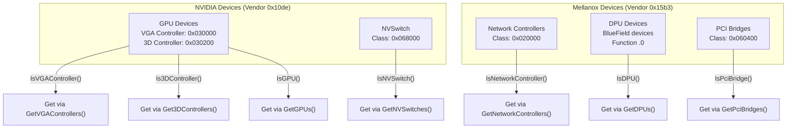
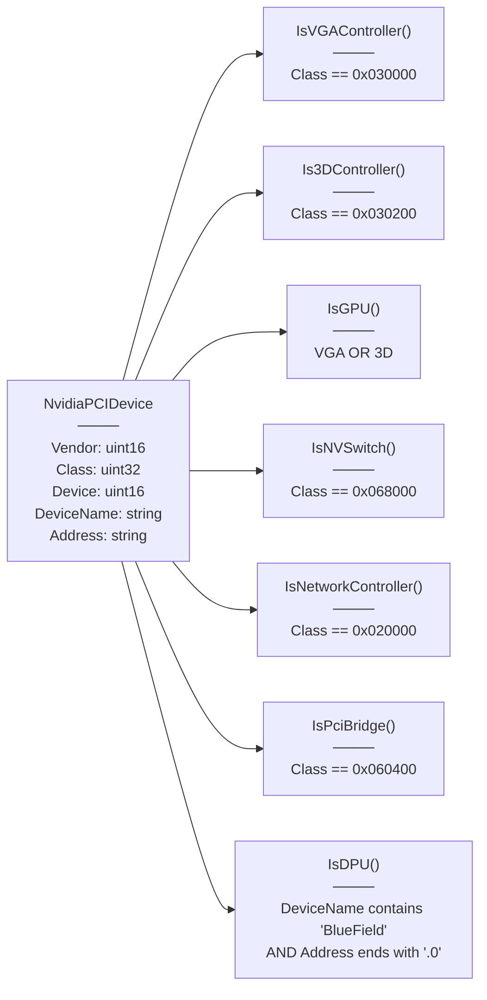
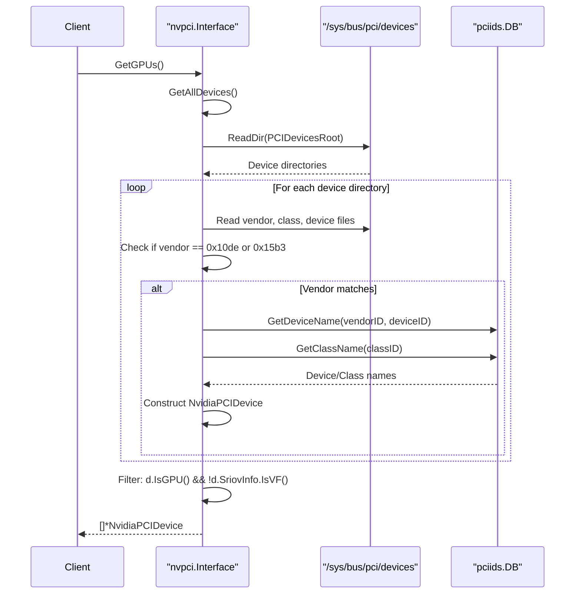
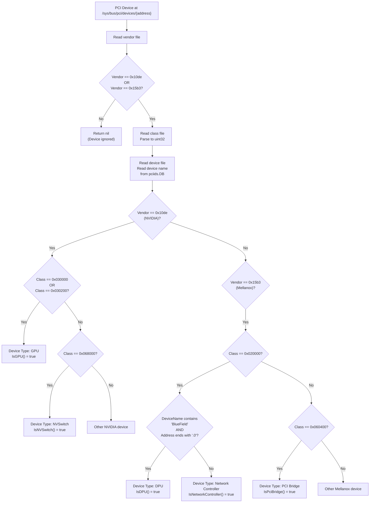

<!-- source: DeepWiki mcp.deepwiki.com · repo NVIDIA/go-nvlib · extra page PCI Device Classification · fetched 2026-10-26 -->

# PCI Device Classification

<details>
<summary>Relevant source files</summary>

The following files were used as context for generating this wiki page:

- [NOTICE](NOTICE)
- [pkg/nvpci/mlxpci.go](pkg/nvpci/mlxpci.go)
- [pkg/nvpci/mock.go](pkg/nvpci/mock.go)
- [pkg/nvpci/nvpci.go](pkg/nvpci/nvpci.go)
- [pkg/nvpci/nvpci_mock.go](pkg/nvpci/nvpci_mock.go)
- [pkg/nvpci/nvpci_test.go](pkg/nvpci/nvpci_test.go)
- [pkg/pciids/default_pci.ids](pkg/pciids/default_pci.ids)
- [pkg/pciids/pciids.go](pkg/pciids/pciids.go)

</details>


## Purpose and Scope

This page documents the device classification system in the `nvpci` package, which categorizes NVIDIA and Mellanox PCI devices into distinct types based on their PCI class codes and device properties. The classification system enables applications to filter and retrieve specific device types such as GPUs, NVSwitches, DPUs, and network controllers.

For information about SR-IOV device hierarchies and virtual function detection, see [SR-IOV Support](#5.1.2). For details on memory resources and BAR regions, see [PCI Resource Information](#5.1.3).

## Device Types and PCI Classes

The `nvpci` package classifies devices into six primary categories, each identified by specific PCI class codes and vendor IDs. The classification logic is implemented through predicate methods on the `NvidiaPCIDevice` struct and corresponding retrieval methods on the `Interface`.

### Supported Device Types



**Sources:** [pkg/nvpci/nvpci.go:31-46](), [pkg/nvpci/mlxpci.go:24-31]()

### PCI Class Code Constants

The following table lists the PCI class codes used for device classification:

| Device Type | Constant Name | Hex Value | Vendor | Description |
|-------------|---------------|-----------|--------|-------------|
| VGA Controller | `PCIVgaControllerClass` | `0x030000` | NVIDIA | Older GPU devices with VGA compatibility |
| 3D Controller | `PCI3dControllerClass` | `0x030200` | NVIDIA | Modern GPU devices (compute accelerators) |
| NVSwitch | `PCINvSwitchClass` | `0x068000` | NVIDIA | High-speed interconnect fabric switches |
| Network Controller | `PCINetworkControllerClass` | `0x020000` | Mellanox | Network interface cards |
| PCI Bridge | `PCIBridgeClass` | `0x060400` | Mellanox | PCI-to-PCI bridge devices |

**Vendor ID Constants:**
- `PCINvidiaVendorID` = `0x10de`
- `PCIMellanoxVendorID` = `0x15b3`

**Sources:** [pkg/nvpci/nvpci.go:31-46](), [pkg/nvpci/mlxpci.go:24-31]()

## Device Type Detection Methods

The `NvidiaPCIDevice` struct provides predicate methods for determining device types based on their PCI class codes. These methods enable type-specific filtering and retrieval operations.

### Classification Methods on NvidiaPCIDevice



**Sources:** [pkg/nvpci/nvpci.go:124-142](), [pkg/nvpci/mlxpci.go:67-88]()

### GPU Classification Logic

The `IsGPU()` method identifies devices as GPUs if they are either VGA controllers (older cards) or 3D controllers (newer cards). This dual-class approach ensures compatibility with both legacy and modern NVIDIA GPU architectures.

**Implementation:**
```go
// IsGPU either VGA for older cards or 3D for newer.
func (d *NvidiaPCIDevice) IsGPU() bool {
    return d.IsVGAController() || d.Is3DController()
}
```

Additionally, the `GetGPUs()` method filters out SR-IOV virtual functions to return only physical GPUs and non-VF devices:

```go
func (p *nvpci) GetGPUs() ([]*NvidiaPCIDevice, error) {
    // ... filters devices where d.IsGPU() && !d.SriovInfo.IsVF()
}
```

**Sources:** [pkg/nvpci/nvpci.go:124-142](), [pkg/nvpci/nvpci.go:446-461]()

### DPU Detection Logic

DPU (Data Processing Unit) detection uses a combination of device class and naming convention. DPUs are BlueField devices with the network controller class, and the detection logic specifically filters for function `.0` to avoid counting multifunction subfunctions.

**Implementation:**
```go
func (d *NvidiaPCIDevice) IsDPU() bool {
    if !strings.Contains(d.DeviceName, "BlueField") {
        return false
    }
    // DPU is a multifunction device hence look only for the .0 function
    // and ignore subfunctions like .1, .2, etc.
    if strings.HasSuffix(d.Address, ".0") {
        return true
    }
    return false
}
```

**Sources:** [pkg/nvpci/mlxpci.go:77-88]()

## Interface Methods for Device Retrieval

The `nvpci.Interface` provides methods for retrieving devices filtered by type. Each method follows a consistent pattern: retrieve all devices via `GetAllDevices()`, then filter using the appropriate classification predicate.

### Device Retrieval Flow



**Sources:** [pkg/nvpci/nvpci.go:201-235](), [pkg/nvpci/nvpci.go:243-393](), [pkg/nvpci/nvpci.go:446-461]()

### Interface Methods Summary

| Method | Device Type | Filter Logic | Excludes VFs |
|--------|-------------|--------------|--------------|
| `GetAllDevices()` | All NVIDIA/Mellanox | Vendor ID match | No |
| `Get3DControllers()` | 3D Controllers | `Is3DController()` | No |
| `GetVGAControllers()` | VGA Controllers | `IsVGAController()` | No |
| `GetGPUs()` | GPUs | `IsGPU() && !IsVF()` | **Yes** |
| `GetNVSwitches()` | NVSwitches | `IsNVSwitch()` | No |
| `GetNetworkControllers()` | Network Controllers | `IsNetworkController()` | No |
| `GetPciBridges()` | PCI Bridges | `IsPciBridge()` | No |
| `GetDPUs()` | DPUs | `IsDPU()` | No |

**Key Distinction:** The `GetGPUs()` method explicitly filters out SR-IOV virtual functions by checking `!d.SriovInfo.IsVF()`. This ensures that only physical GPUs (and potentially non-SR-IOV capable devices) are returned, while `Get3DControllers()` and `GetVGAControllers()` return all matching devices regardless of SR-IOV status.

**Sources:** [pkg/nvpci/nvpci.go:48-62](), [pkg/nvpci/nvpci.go:395-475](), [pkg/nvpci/mlxpci.go:33-105]()

## Vendor-Specific Classification

Device classification handles devices from two vendors: NVIDIA (vendor ID `0x10de`) and Mellanox (vendor ID `0x15b3`, acquired by NVIDIA). The vendor check occurs early in the device construction pipeline.

### Vendor Filtering in Device Construction

The `getGPUByPciBusID()` method reads the vendor ID from sysfs and returns `nil` for devices that don't match either NVIDIA or Mellanox vendor IDs:

```go
vendorID, err := strconv.ParseUint(vendorStr, 0, 16)
// ...
if uint16(vendorID) != PCINvidiaVendorID && uint16(vendorID) != PCIMellanoxVendorID {
    return nil, nil
}
```

This two-vendor approach allows the package to handle both GPU devices (NVIDIA) and networking/DPU devices (Mellanox) under a unified interface.

**Sources:** [pkg/nvpci/nvpci.go:243-263]()

## Classification Decision Tree

The following diagram illustrates the complete classification logic flow from raw PCI device to typed categorization:



**Sources:** [pkg/nvpci/nvpci.go:243-393](), [pkg/nvpci/mlxpci.go:33-105]()

## Device Name Resolution

Device names are resolved using the PCI ID database through the `pciids` package. If a device name cannot be found in the database, the `UnknownDeviceString` constant (`"UNKNOWN_DEVICE"`) is used. Similarly, unknown class names default to `UnknownClassString` (`"UNKNOWN_CLASS"`).

The name resolution occurs during device construction in `getGPUByPciBusID()`:

```go
pciDB := pciids.NewDB()

deviceName, err := pciDB.GetDeviceName(uint16(vendorID), uint16(deviceID))
if err != nil {
    p.logger.Warningf("unable to get device name: %v\n", err)
    deviceName = UnknownDeviceString
}
className, err := pciDB.GetClassName(uint32(classID))
if err != nil {
    p.logger.Warningf("unable to get class name for device: %v\n", err)
    className = UnknownClassString
}
```

The PCI database lookup is non-fatal, allowing device construction to proceed even when name resolution fails.

**Sources:** [pkg/nvpci/nvpci.go:42-45](), [pkg/nvpci/nvpci.go:335-346](), [pkg/pciids/pciids.go:256-283]()

## Testing Classification

The mock implementation (`MockNvpci`) creates test devices with specific PCI class codes to enable classification testing without physical hardware. The `AddMockA100()` method creates devices with the 3D controller class (`0x030200`):

```go
class, err := os.Create(filepath.Join(deviceDir, "class"))
// ...
_, err = fmt.Fprintf(class, "0x%x", PCI3dControllerClass)
```

This allows tests to verify classification logic by asserting on the results of predicate methods like `IsGPU()`, `Is3DController()`, etc.

**Sources:** [pkg/nvpci/mock.go:69-133](), [pkg/nvpci/mock.go:135-210](), [pkg/nvpci/nvpci_test.go:29-76]()

---

