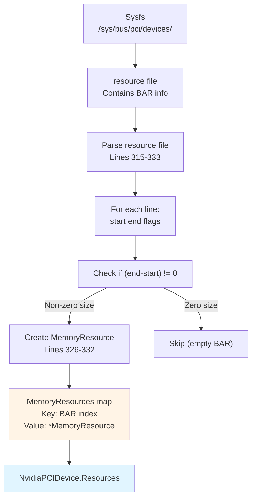
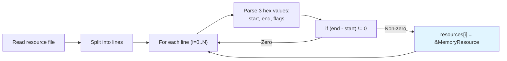
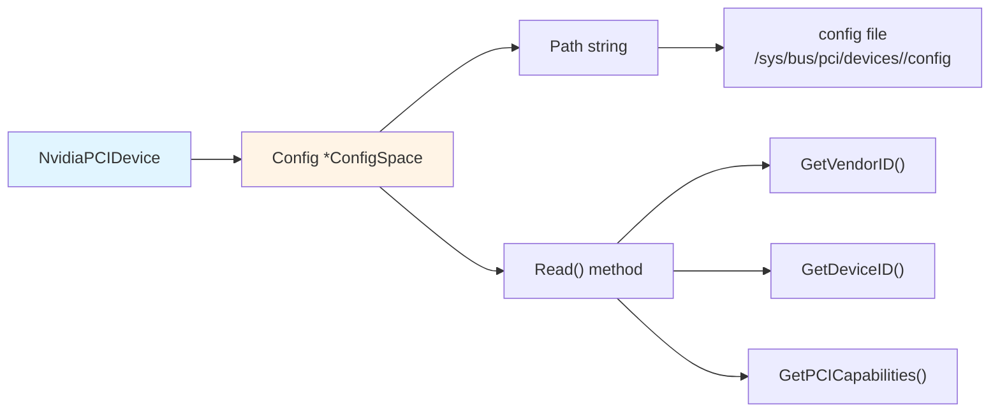
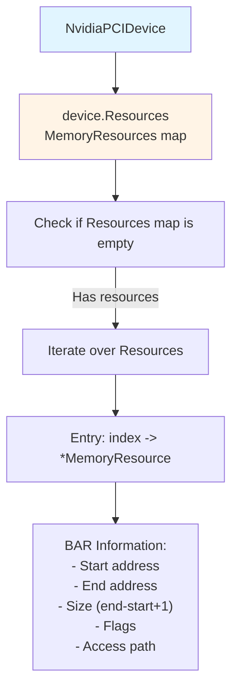
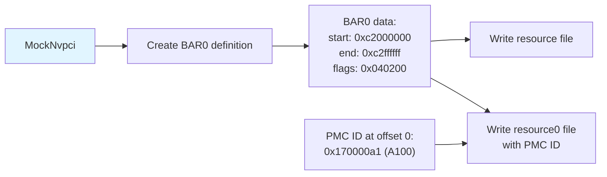
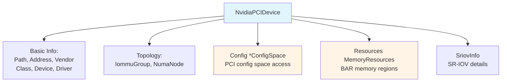

<!-- source: DeepWiki mcp.deepwiki.com · repo NVIDIA/go-nvlib · extra page PCI Resource Information · fetched 2026-10-26 -->

# PCI Resource Information

<details>
<summary>Relevant source files</summary>

The following files were used as context for generating this wiki page:

- [pkg/nvpci/mock.go](pkg/nvpci/mock.go)
- [pkg/nvpci/nvpci.go](pkg/nvpci/nvpci.go)
- [pkg/nvpci/nvpci_mock.go](pkg/nvpci/nvpci_mock.go)
- [pkg/nvpci/nvpci_test.go](pkg/nvpci/nvpci_test.go)

</details>


## Purpose and Scope

This document describes PCI resource management in the `nvpci` package, covering memory-mapped Base Address Registers (BARs) and PCI configuration space access. For information about PCI device discovery and classification, see [PCI Device Discovery](#5.1). For SR-IOV virtual function management, see [SR-IOV Support](#5.1.2).

PCI resources provide low-level hardware access to device memory regions and configuration registers. The `nvpci` package exposes these resources through the `MemoryResources` type attached to each `NvidiaPCIDevice`, enabling direct hardware interaction when needed.

## Memory Resources Overview

### MemoryResources Type

The `MemoryResources` type is a map that stores information about PCI Base Address Registers (BARs):

```
type MemoryResources map[int]*MemoryResource
```

Each key in the map corresponds to a BAR index (0-5 for standard PCI devices), and the value is a pointer to a `MemoryResource` structure containing the address range and access path for that BAR.

**Sources:** [pkg/nvpci/nvpci.go:64-65]()

### MemoryResource Structure

Each `MemoryResource` represents a single BAR region with the following properties:

| Field | Type | Description |
|-------|------|-------------|
| Start | `uintptr` | Physical start address of the memory region |
| End | `uintptr` | Physical end address of the memory region |
| Flags | `uint64` | PCI resource flags (prefetchable, 64-bit, etc.) |
| Path | `string` | Sysfs path to the resource file (e.g., `/sys/bus/pci/devices/0000:00:00.0/resource0`) |

The structure supports operations like:
- **OpenRW()**: Opens the resource for read/write access via memory mapping
- **Len()**: Returns the size of the memory region
- **Read32()**: Reads 32-bit values at specific offsets

**Sources:** [pkg/nvpci/nvpci.go:326-332](), [pkg/nvpci/nvpci_test.go:56-66]()

### ResourceInterface

The `ResourceInterface` provides higher-level operations on memory resources:

```go
type ResourceInterface interface {
    GetTotalAddressableMemory(bool) (uint64, uint64)
}
```

This interface is implemented by the `MemoryResources` type to calculate aggregate memory statistics across all BAR regions.

**Sources:** [pkg/nvpci/nvpci.go:67-70]()

## Resource Discovery from Sysfs

### Discovery Flow

The following diagram shows how PCI resources are discovered and populated:



**Sources:** [pkg/nvpci/nvpci.go:309-333]()

### Resource File Format

The resource file at `/sys/bus/pci/devices/<address>/resource` contains one line per BAR (typically 13 lines total for standard + extended resources). Each line has three hexadecimal values:

| Position | Value | Description |
|----------|-------|-------------|
| 0 | Start Address | Physical start address of the BAR region |
| 1 | End Address | Physical end address (inclusive) of the BAR region |
| 2 | Flags | Resource type flags (memory/IO, prefetchable, width) |

**Example resource file entry:**
```
0x00000000c2000000 0x00000000c2ffffff 0x0000000000040200
```

This represents:
- Start: `0xc2000000`
- End: `0xc2ffffff` 
- Size: 16 MB (end - start + 1)
- Flags: `0x040200` (indicates memory resource, prefetchable, 32-bit)

**Sources:** [pkg/nvpci/nvpci.go:309-333](), [pkg/nvpci/mock.go:186-194]()

### Resource Parsing Implementation



The parsing code at [pkg/nvpci/nvpci.go:315-333]() performs the following steps:

1. **Read**: Reads the entire resource file as bytes
2. **Split**: Splits content by newlines to get individual BAR entries
3. **Parse**: For each line, splits by space to extract start, end, and flags
4. **Validate**: Checks if the BAR has non-zero size (end - start != 0)
5. **Create**: Constructs a `MemoryResource` with the parsed values and resource file path
6. **Map**: Stores in the `MemoryResources` map with the line index as key

**Sources:** [pkg/nvpci/nvpci.go:309-333]()

## Configuration Space

### ConfigSpace Type

PCI configuration space provides access to device configuration registers, including vendor/device IDs, command/status registers, and capability lists. The `ConfigSpace` structure provides access to this data:

```go
type ConfigSpace struct {
    Path string  // Path to config file, e.g., /sys/bus/pci/devices/0000:00:00.0/config
}
```

**Sources:** [pkg/nvpci/nvpci.go:305-307]()

### Configuration Space Access

The `ConfigSpace` supports the following operations:

| Operation | Purpose |
|-----------|---------|
| `Read()` | Reads the entire configuration space into memory |
| `GetVendorID()` | Extracts the 16-bit vendor ID from configuration |
| `GetDeviceID()` | Extracts the 16-bit device ID from configuration |
| `GetPCICapabilities()` | Parses and returns standard and extended PCI capabilities |

**Sources:** [pkg/nvpci/nvpci_test.go:44-54]()

### Configuration Space in Device Structure



The `Config` field is initialized during device discovery at [pkg/nvpci/nvpci.go:305-307]() with the path to the device's configuration space file in sysfs.

**Sources:** [pkg/nvpci/nvpci.go:119](), [pkg/nvpci/nvpci.go:305-307]()

## Practical Usage

### Accessing BAR Regions

The following example from the test suite demonstrates accessing BAR0 of a GPU:

```go
// Get the first resource (BAR0)
resource0 := device.Resources[0]

// Open for read/write access
bar0, err := resource0.OpenRW()
if err != nil {
    return err
}
defer bar0.Close()

// Get the size of the BAR region
size := bar0.Len()

// Read a 32-bit register at offset 0 (PMC ID register)
pmcID := bar0.Read32(0)
```

**Sources:** [pkg/nvpci/nvpci_test.go:56-66]()

### Resource Enumeration



Typical usage pattern:
1. Check if `device.Resources` map contains any entries
2. Iterate through the map to find specific BARs of interest
3. Access BAR properties (start, end, size) for memory planning
4. Open resource files for direct hardware access when needed

**Sources:** [pkg/nvpci/nvpci.go:314-333](), [pkg/nvpci/nvpci_test.go:39-42]()

### Mock Resource Creation

For testing without physical hardware, the mock implementation creates resource files with simulated data:



The mock creates:
1. A `resource` file with BAR address ranges at [pkg/nvpci/mock.go:186-194]()
2. A `resource0` file with actual register data at [pkg/nvpci/mock.go:197-207]()
3. Test data includes the PMC (Power Management Controller) ID register value `0x170000a1`, which identifies an A100 GPU

**Sources:** [pkg/nvpci/mock.go:186-207](), [pkg/nvpci/nvpci_test.go:26-27]()

## Common Resource Flags

PCI resource flags encode properties of the BAR region:

| Bit Position | Meaning |
|--------------|---------|
| 0 | 0 = Memory space, 1 = I/O space |
| 1-2 | Memory type (00 = 32-bit, 10 = 64-bit) |
| 3 | Prefetchable flag |
| 4-31 | Additional resource type flags |

For example, flags `0x040200` indicate:
- Memory space (bit 0 = 0)
- 32-bit addressing (bits 1-2 = 00)
- Prefetchable (bit 3 = 1)
- Additional type information in higher bits

**Sources:** [pkg/nvpci/mock.go:186-194]()

## Integration with NvidiaPCIDevice

### Complete Device Structure

The `NvidiaPCIDevice` structure integrates resources with other device information:



All resource information is populated during device discovery in the `getGPUByPciBusID` function at [pkg/nvpci/nvpci.go:243-393]().

**Sources:** [pkg/nvpci/nvpci.go:108-122](), [pkg/nvpci/nvpci.go:243-393]()

## Resource Availability

Not all PCI devices expose memory resources:
- GPU devices typically have multiple BARs (framebuffer memory, MMIO registers, etc.)
- Network controllers may have fewer resources
- Virtual functions in SR-IOV may have limited or no direct BAR access

The code handles missing resources gracefully by checking if `(end - start) != 0` before creating entries, ensuring only valid BARs are added to the `Resources` map.

**Sources:** [pkg/nvpci/nvpci.go:325-332]()

---

