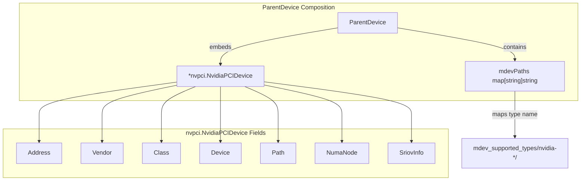
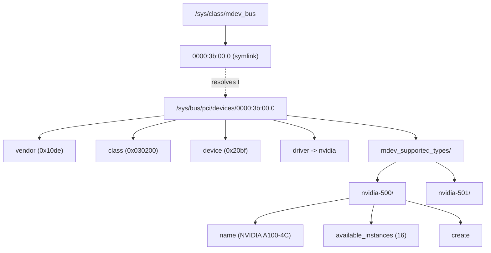
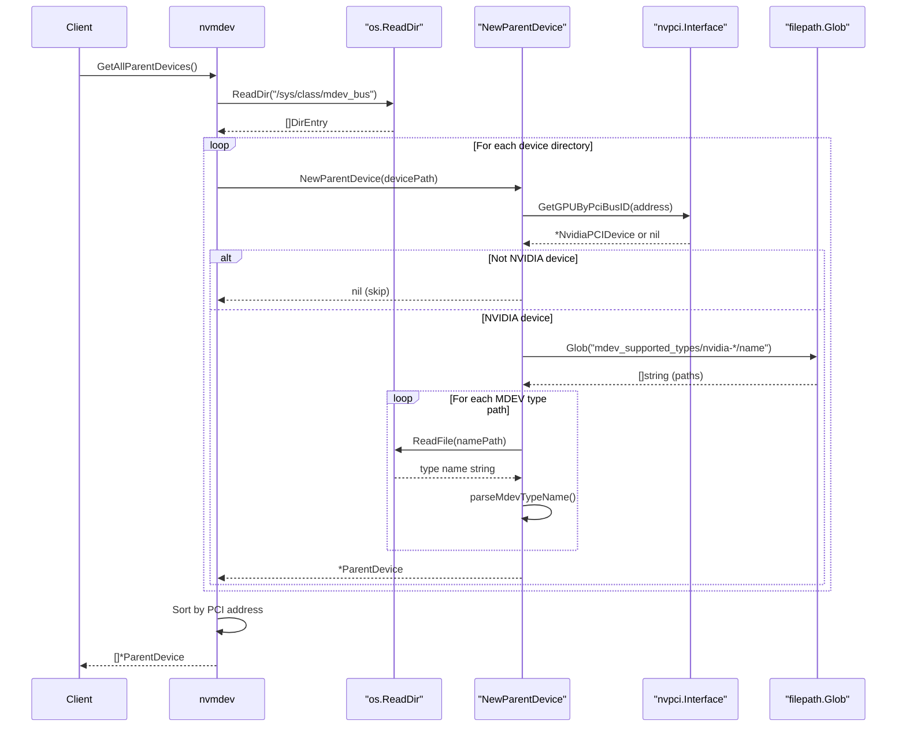
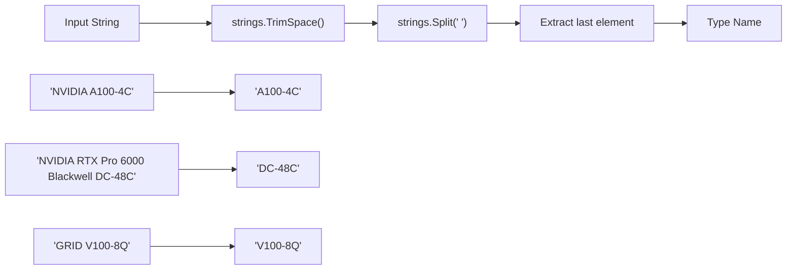
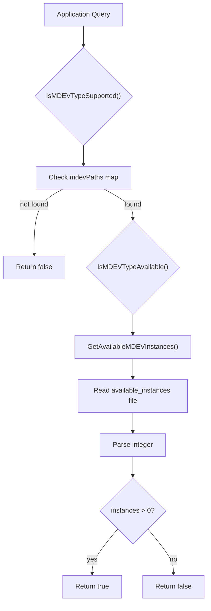

<!-- source: DeepWiki mcp.deepwiki.com · repo NVIDIA/go-nvlib · extra page Parent Device Discovery · fetched 2026-10-26 -->

# Parent Device Discovery

<details>
<summary>Relevant source files</summary>

The following files were used as context for generating this wiki page:

- [pkg/nvmdev/mock.go](pkg/nvmdev/mock.go)
- [pkg/nvmdev/nvmdev.go](pkg/nvmdev/nvmdev.go)
- [pkg/nvmdev/nvmdev_test.go](pkg/nvmdev/nvmdev_test.go)

</details>


This document describes how the `nvmdev` package discovers and enumerates parent devices—physical NVIDIA GPUs that support the creation of mediated devices (vGPUs). Parent device discovery is the foundation for vGPU management, identifying which GPUs can host virtual GPU instances and what vGPU types they support.

For information about creating and managing MDEV instances on parent devices, see [MDEV Lifecycle Management](#5.2.2). For general PCI device discovery without MDEV capabilities, see [PCI Device Discovery](#5.1).

## Parent Device Concept

A **parent device** represents an NVIDIA GPU that supports the MDEV (Mediated Device) framework for vGPU virtualization. The `ParentDevice` struct embeds an `nvpci.NvidiaPCIDevice` and extends it with MDEV-specific capabilities, including a mapping of supported vGPU types to their sysfs paths.



**Sources:** [pkg/nvmdev/nvmdev.go:50-54]()

## Discovery Process

Parent device discovery begins by scanning the `/sys/class/mdev_bus` directory, which contains symbolic links to all PCI devices that support MDEV. The discovery process resolves these links, validates that they are NVIDIA devices, and enumerates their supported MDEV types.

### Sysfs Structure

The discovery process navigates the following sysfs hierarchy:



**Sources:** [pkg/nvmdev/nvmdev.go:31-34](), [pkg/nvmdev/nvmdev.go:88-120]()

### Discovery Sequence

The `GetAllParentDevices()` method orchestrates the discovery process:



**Sources:** [pkg/nvmdev/nvmdev.go:88-120](), [pkg/nvmdev/nvmdev.go:274-305]()

The discovery process includes the following key steps:

1. **Directory Scanning**: Read all entries in `mdevParentsRoot` (`/sys/class/mdev_bus`)
2. **Device Construction**: Call `NewParentDevice()` for each directory entry
3. **NVIDIA Validation**: Use `nvpci.GetGPUByPciBusID()` to verify the device is an NVIDIA GPU
4. **MDEV Type Enumeration**: Glob for `mdev_supported_types/nvidia-*/name` files
5. **Type Name Parsing**: Extract vGPU type names from name files
6. **Path Mapping**: Build `mdevPaths` map from type name to directory path
7. **Sorting**: Sort devices by PCI address for consistent ordering

**Sources:** [pkg/nvmdev/nvmdev.go:88-120]()

## ParentDevice Structure

The `ParentDevice` struct represents a GPU capable of hosting vGPUs:

| Field | Type | Description |
|-------|------|-------------|
| `*nvpci.NvidiaPCIDevice` | embedded | PCI device information (address, vendor, class, NUMA node, SR-IOV) |
| `mdevPaths` | `map[string]string` | Maps vGPU type name to sysfs directory path |

### Constructor: NewParentDevice

The `NewParentDevice()` method constructs a parent device from a device path:

```go
func (m *nvmdev) NewParentDevice(devicePath string) (*ParentDevice, error)
```

**Process:**
1. Extract PCI bus ID from device path using `filepath.Base()`
2. Call `nvpci.GetGPUByPciBusID()` to get PCI device information
3. Return `nil` if device is not NVIDIA (vendor check in nvpci)
4. Use `filepath.Glob()` to find all `mdev_supported_types/nvidia-*/name` files
5. Read each name file and parse the vGPU type name
6. Build `mdevPaths` map from type name to directory path
7. Return `ParentDevice` with embedded PCI device and MDEV paths

**Sources:** [pkg/nvmdev/nvmdev.go:274-305]()

## MDEV Type Discovery

Each parent device supports one or more MDEV types (vGPU profiles). The discovery process identifies these types by scanning the `mdev_supported_types` directory.

### Directory Structure

```
/sys/bus/pci/devices/0000:3b:00.0/
└── mdev_supported_types/
    ├── nvidia-500/
    │   ├── name              # "NVIDIA A100-4C"
    │   ├── available_instances  # "16"
    │   ├── device_api        # "vfio-pci"
    │   └── create            # Write UUID here to create vGPU
    ├── nvidia-501/
    │   ├── name              # "NVIDIA A100-8C"
    │   └── ...
    └── nvidia-502/
        └── ...
```

### Type Name Parsing

The `parseMdevTypeName()` function extracts the vGPU type name from strings that may contain product prefixes:



The parsing logic handles multiple formats:
- Simple format: `"NVIDIA A100-4C"` → `"A100-4C"`
- Multi-word format: `"NVIDIA RTX Pro 6000 Blackwell DC-48C"` → `"DC-48C"`
- Legacy format: `"GRID V100-8Q"` → `"V100-8Q"`
- Standalone: `"A100-4C"` → `"A100-4C"`

**Sources:** [pkg/nvmdev/nvmdev.go:237-250](), [pkg/nvmdev/nvmdev_test.go:65-126]()

## Capability Queries

The `ParentDevice` provides several methods for querying MDEV type capabilities:

### IsMDEVTypeSupported

Checks if a vGPU type is supported by the parent device:

```go
func (p *ParentDevice) IsMDEVTypeSupported(mdevType string) bool
```

Implementation: Simple map lookup in `mdevPaths`

**Sources:** [pkg/nvmdev/nvmdev.go:366-370]()

### IsMDEVTypeAvailable

Checks if a vGPU instance of the specified type can currently be created:

```go
func (p *ParentDevice) IsMDEVTypeAvailable(mdevType string) (bool, error)
```

Implementation: Calls `GetAvailableMDEVInstances()` and returns `true` if count > 0

**Sources:** [pkg/nvmdev/nvmdev.go:372-380]()

### GetAvailableMDEVInstances

Returns the number of vGPU instances of a given type that can be created:

```go
func (p *ParentDevice) GetAvailableMDEVInstances(mdevType string) (int, error)
```

**Process:**
1. Look up type in `mdevPaths` map (returns -1 if not supported)
2. Read `available_instances` file in the type's directory
3. Parse integer value from file contents
4. Return count

The `available_instances` value is managed by the kernel and decreases as vGPUs are created.

**Sources:** [pkg/nvmdev/nvmdev.go:382-401]()

### Capability Query Flow



**Sources:** [pkg/nvmdev/nvmdev.go:366-401]()

## Physical Function Resolution

Parent devices may be either SR-IOV Physical Functions (PFs), Virtual Functions (VFs), or non-SR-IOV devices. The `GetPhysicalFunction()` method resolves the underlying physical device:

```go
func (p *ParentDevice) GetPhysicalFunction() *nvpci.NvidiaPCIDevice
```

**Logic:**
- If device is a Virtual Function: return the parent Physical Function
- Otherwise: return the device itself (either PF or non-SR-IOV device)

This method is crucial for operations that require the physical device, such as tracking GPU resources or mapping vGPUs to physical hardware.

**Sources:** [pkg/nvmdev/nvmdev.go:352-359]()

## Example Usage

```go
// Create nvmdev interface
nvmdevLib := nvmdev.New()

// Discover all parent devices
parentDevices, err := nvmdevLib.GetAllParentDevices()
if err != nil {
    log.Fatal(err)
}

for _, parent := range parentDevices {
    fmt.Printf("Parent Device: %s\n", parent.Address)
    
    // Check if device supports A100-4C vGPU type
    if parent.IsMDEVTypeSupported("A100-4C") {
        available, err := parent.GetAvailableMDEVInstances("A100-4C")
        if err != nil {
            log.Printf("Error checking availability: %v\n", err)
            continue
        }
        fmt.Printf("  A100-4C: %d instances available\n", available)
    }
    
    // Get the physical function backing this device
    pf := parent.GetPhysicalFunction()
    fmt.Printf("  Physical Function: %s\n", pf.Address)
}
```

**Sources:** [pkg/nvmdev/nvmdev_test.go:25-63]()

## Testing Support

The `nvmdev` package provides mock implementations for testing without physical hardware:

```go
// Create mock environment
mock, err := nvmdev.NewMock()
defer mock.Cleanup()

// Add mock A100 parent device
err = mock.AddMockA100Parent("0000:3b:04.1", 0)

// Discovery works normally with mocked devices
parents, err := mock.GetAllParentDevices()
```

The mock creates temporary sysfs structures with realistic MDEV type directories and available instance counts.

**Sources:** [pkg/nvmdev/mock.go:36-78](), [pkg/nvmdev/mock.go:87-226](), [pkg/nvmdev/nvmdev_test.go:25-63]()

---

