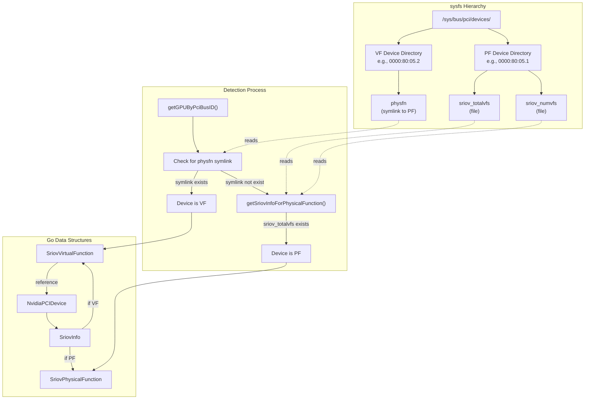
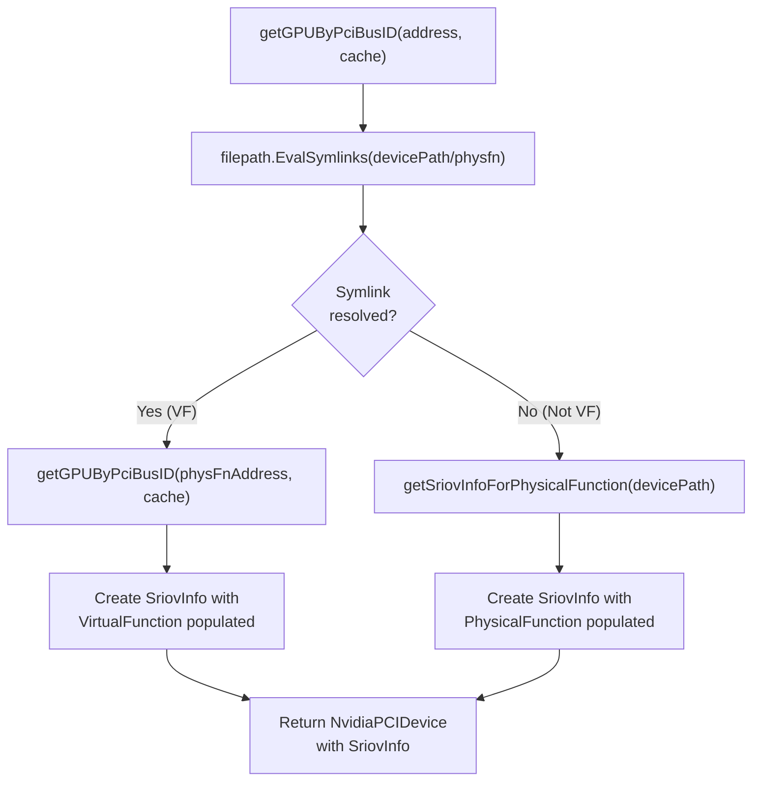
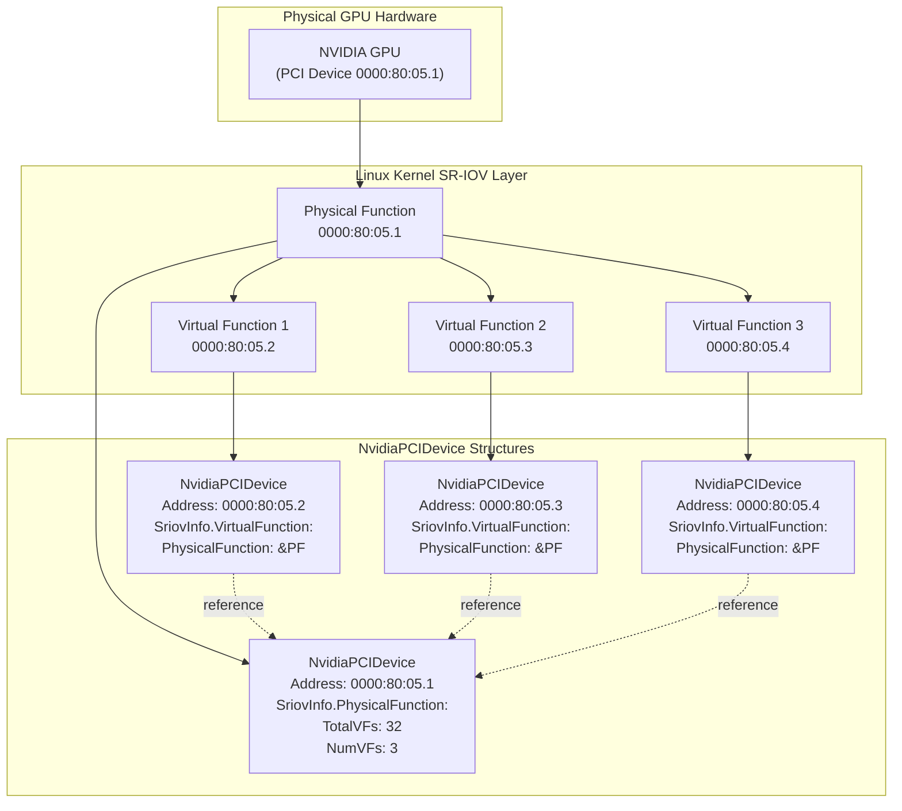

<!-- source: DeepWiki mcp.deepwiki.com · repo NVIDIA/go-nvlib · extra page SR-IOV Support · fetched 2026-10-26 -->

# SR-IOV Support

<details>
<summary>Relevant source files</summary>

The following files were used as context for generating this wiki page:

- [pkg/nvpci/mock.go](pkg/nvpci/mock.go)
- [pkg/nvpci/nvpci.go](pkg/nvpci/nvpci.go)
- [pkg/nvpci/nvpci_mock.go](pkg/nvpci/nvpci_mock.go)
- [pkg/nvpci/nvpci_test.go](pkg/nvpci/nvpci_test.go)

</details>


This document describes how the `nvpci` package detects and represents SR-IOV (Single Root I/O Virtualization) capable devices. SR-IOV is a PCI Express specification that allows a single physical device to be partitioned into multiple virtual functions that can be assigned to different virtual machines or containers.

For information about MDEV-based virtualization (an alternative virtualization mechanism), see [MDEV and vGPU Management](#5.2).

## Overview

The `nvpci` package provides automatic detection of SR-IOV Physical Functions (PFs) and Virtual Functions (VFs). When enumerating PCI devices, the package reads sysfs attributes to determine whether a device is an SR-IOV capable Physical Function, a Virtual Function, or neither. This information is exposed through the `SriovInfo` field on each `NvidiaPCIDevice`.

**Sources:** [pkg/nvpci/nvpci.go:81-97]()

## SR-IOV Data Structures

The package defines three primary types to represent SR-IOV information:

| Type | Purpose | Key Fields |
|------|---------|------------|
| `SriovInfo` | Container holding SR-IOV status | `PhysicalFunction *SriovPhysicalFunction`<br>`VirtualFunction *SriovVirtualFunction` |
| `SriovPhysicalFunction` | Information about a Physical Function | `TotalVFs uint64` - Maximum VFs supported<br>`NumVFs uint64` - Currently configured VFs |
| `SriovVirtualFunction` | Information about a Virtual Function | `PhysicalFunction *NvidiaPCIDevice` - Reference to parent PF |

The `SriovInfo` struct contains mutually exclusive fields—only one should be populated at any given time. Helper methods `IsPF()` and `IsVF()` provide convenient status checking:

```go
func (s *SriovInfo) IsPF() bool {
    return s != nil && s.PhysicalFunction != nil
}

func (s *SriovInfo) IsVF() bool {
    return s != nil && s.VirtualFunction != nil
}
```

**Sources:** [pkg/nvpci/nvpci.go:81-105]()

## SR-IOV Detection Architecture

The following diagram illustrates how SR-IOV information is detected and populated during device discovery:



**Sources:** [pkg/nvpci/nvpci.go:348-393](), [pkg/nvpci/nvpci.go:477-513]()

## Physical Function Detection

A device is identified as an SR-IOV Physical Function when the `sriov_totalvfs` file exists in its sysfs directory. The `getSriovInfoForPhysicalFunction()` function performs this detection:

1. Check for existence of `sriov_totalvfs` file at `{devicePath}/sriov_totalvfs`
2. If file does not exist, device is not SR-IOV capable (return empty `SriovInfo`)
3. If file exists, read both `sriov_totalvfs` (maximum VFs supported) and `sriov_numvfs` (currently configured VFs)
4. Populate `SriovPhysicalFunction` struct with these values

**sysfs Paths:**
- `{devicePath}/sriov_totalvfs` - Maximum number of VFs the PF can support
- `{devicePath}/sriov_numvfs` - Number of VFs currently configured

**Sources:** [pkg/nvpci/nvpci.go:477-513]()

## Virtual Function Detection

A device is identified as a Virtual Function when the `physfn` symlink exists in its sysfs directory. This symlink points to the parent Physical Function's device directory. The detection process within `getGPUByPciBusID()` works as follows:



When a VF is detected, the package recursively calls `getGPUByPciBusID()` to retrieve the parent PF device. This creates a bidirectional relationship where VFs maintain a reference to their parent PF.

**Key Implementation Details:**
- The `physfn` symlink is evaluated using `filepath.EvalSymlinks()` at [pkg/nvpci/nvpci.go:350]()
- The parent PF address is extracted using `filepath.Base(physFnAddress)` at [pkg/nvpci/nvpci.go:353]()
- A cache parameter prevents infinite recursion and improves performance by reusing PF device objects at [pkg/nvpci/nvpci.go:388-390]()

**Sources:** [pkg/nvpci/nvpci.go:348-369]()

## Device Filtering and GPU Enumeration

The `GetGPUs()` method filters out Virtual Functions when returning the list of GPU devices. This ensures that only Physical Functions (which represent actual physical GPUs) are returned to callers who want to enumerate GPUs:

```go
func (p *nvpci) GetGPUs() ([]*NvidiaPCIDevice, error) {
    devices, err := p.GetAllDevices()
    // ... error handling ...
    
    var filtered []*NvidiaPCIDevice
    for _, d := range devices {
        if d.IsGPU() && !d.SriovInfo.IsVF() {
            filtered = append(filtered, d)
        }
    }
    return filtered, nil
}
```

This filtering behavior means:
- `GetGPUs()` returns only Physical Functions (excludes VFs)
- `GetAllDevices()` returns both Physical Functions and Virtual Functions
- Applications that need access to VFs should use `GetAllDevices()` and inspect the `SriovInfo` field

**Sources:** [pkg/nvpci/nvpci.go:446-461]()

## SR-IOV Device Hierarchy

The following diagram shows the relationship between Physical Functions and Virtual Functions:



**Sources:** [pkg/nvpci/nvpci.go:81-97](), [pkg/nvpci/nvpci.go:357-361]()

## SR-IOV Configuration Properties

The following table summarizes the SR-IOV properties exposed through the API:

| Property | Type | PF/VF | Description |
|----------|------|-------|-------------|
| `SriovInfo.IsPF()` | `bool` | Both | Returns true if device is a Physical Function |
| `SriovInfo.IsVF()` | `bool` | Both | Returns true if device is a Virtual Function |
| `PhysicalFunction.TotalVFs` | `uint64` | PF only | Maximum number of VFs this PF can support |
| `PhysicalFunction.NumVFs` | `uint64` | PF only | Number of VFs currently configured and enabled |
| `VirtualFunction.PhysicalFunction` | `*NvidiaPCIDevice` | VF only | Reference to the parent Physical Function device |

**Sources:** [pkg/nvpci/nvpci.go:81-105]()

## Testing SR-IOV Support

The `MockNvpci` implementation provides comprehensive SR-IOV testing capabilities without requiring actual SR-IOV hardware. The mock creates a temporary sysfs-like directory structure that simulates SR-IOV devices.

### Creating Mock SR-IOV Devices

The `AddMockA100()` method accepts an optional `SriovInfo` parameter to configure SR-IOV:

```go
// Create a mock PF with 16 VFs configured out of 32 maximum
sriov := &SriovInfo{
    PhysicalFunction: &SriovPhysicalFunction{
        TotalVFs: 32,
        NumVFs:   16,
    },
}
err := mockNvpci.AddMockA100("0000:80:05.1", 0, sriov)
```

When SR-IOV is configured, the mock implementation:
1. Creates `sriov_totalvfs` and `sriov_numvfs` files in the PF directory
2. Generates VF device directories with sequential PCI addresses (e.g., 0000:80:05.2, 0000:80:05.3, etc.)
3. Creates `physfn` symlinks in each VF directory pointing to the PF
4. Assigns unique IOMMU groups to each VF

### Mock VF Address Generation

VF addresses are generated by incrementing the function number of the PF address:

```
PF Address:  0000:80:05.1
VF 1:        0000:80:05.2  (function number: 1 + 1)
VF 2:        0000:80:05.3  (function number: 1 + 2)
VF 3:        0000:80:05.4  (function number: 1 + 3)
```

**Sources:** [pkg/nvpci/mock.go:106-133](), [pkg/nvpci/mock.go:212-260]()

### SR-IOV Test Cases

The test suite validates SR-IOV detection and hierarchy:

| Test Scenario | Validation Points |
|---------------|-------------------|
| **SR-IOV Enabled** | - PF correctly identified with `IsPF() == true`<br/>- `TotalVFs` and `NumVFs` match configuration<br/>- VF count equals `NumVFs + 1` (PF)<br/>- Each VF has `IsVF() == true`<br/>- Each VF references the correct parent PF |
| **SR-IOV Disabled** | - Device has `IsPF() == false` and `IsVF() == false`<br/>- `SriovInfo` is empty struct<br/>- GPU count equals device count |
| **GPU Enumeration** | - `GetGPUs()` returns only PFs (excludes VFs)<br/>- `GetAllDevices()` returns both PFs and VFs |

**Sources:** [pkg/nvpci/nvpci_test.go:114-173]()

---

