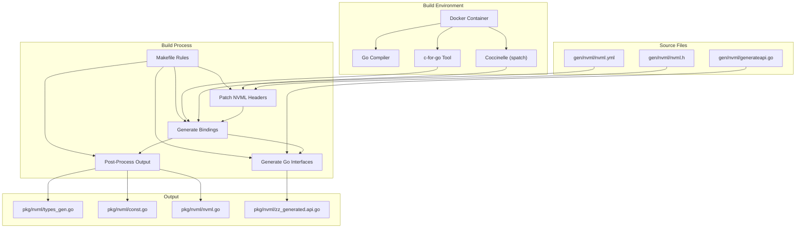
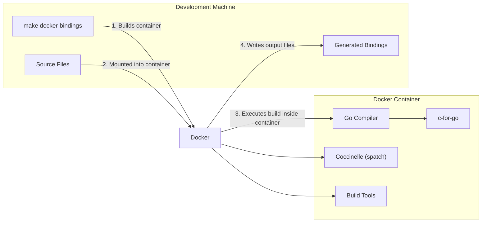
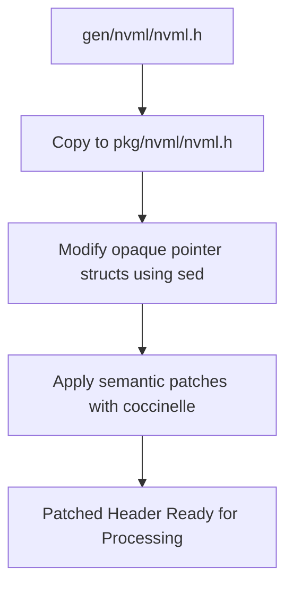
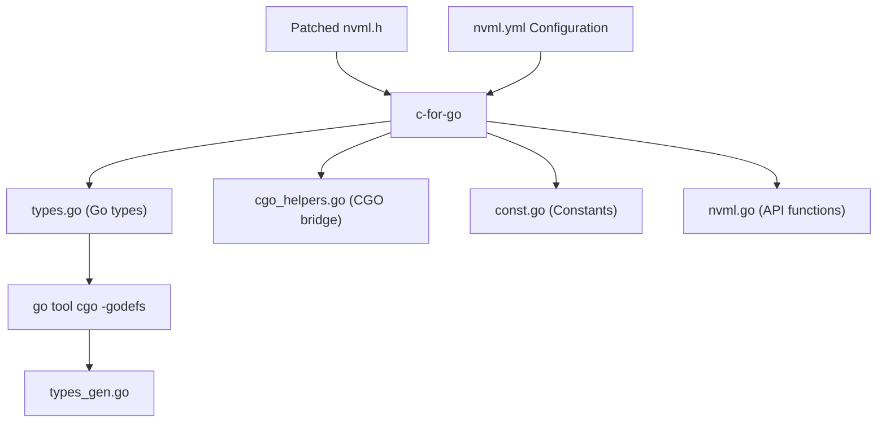
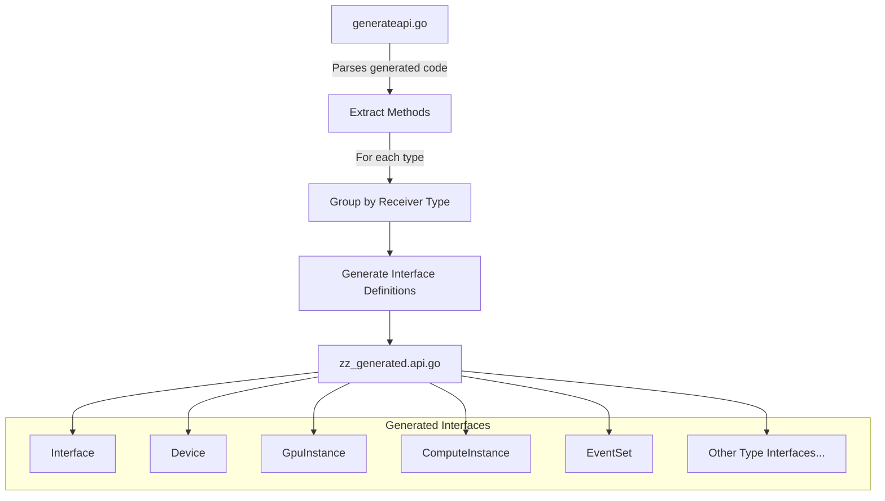
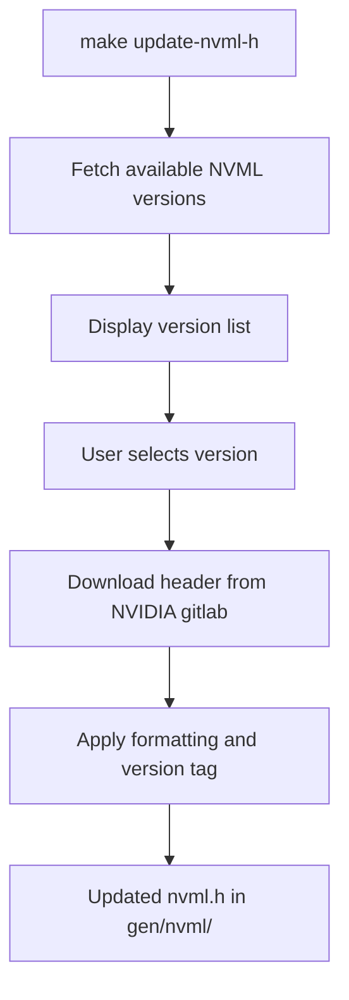

<!-- source: DeepWiki mcp.deepwiki.com · repo NVIDIA/go-nvml · page 2 Building and Generating Bindings · fetched 2026-10-26 -->

# Building and Generating Bindings

<details>
<summary>Relevant source files</summary>

The following files were used as context for generating this wiki page:

- [Makefile](Makefile)
- [docker/Dockerfile.devel](docker/Dockerfile.devel)
- [gen/nvml/generateapi.go](gen/nvml/generateapi.go)
- [gen/nvml/nvml.h](gen/nvml/nvml.h)
- [gen/nvml/nvml.yml](gen/nvml/nvml.yml)

</details>


This document explains the process of building the Go-NVML project and how the Go bindings are generated from the NVIDIA Management Library (NVML) C headers. It covers the build environment, binding generation workflow, and the tools used in this process.

## Build System Overview

The Go-NVML project uses a structured build system to generate Go language bindings from the NVML C header files. This process transforms the C-style API into idiomatic Go code that's easier to use in Go applications.



Sources: [Makefile:131-180](), [docker/Dockerfile.devel:1-57]()

## Docker Build Environment

To ensure a consistent build environment, Go-NVML uses a Docker container that includes all necessary tools and dependencies.



The Docker environment contains:

- Go compiler and tools
- c-for-go tool (for generating Go bindings from C)
- Coccinelle (for semantic patching of C code)
- Other build utilities

Sources: [docker/Dockerfile.devel:1-57](), [Makefile:83-128]()

## Binding Generation Process

The binding generation process transforms NVML's C header files into Go code through several stages:

### 1. Header Patching

Before generating bindings, the NVML header files need to be patched to be compatible with the c-for-go tool:



The patching process includes:

- Modifying opaque pointer structures to be compatible with cgo
- Applying semantic patches to handle anonymous structs
- Ensuring consistent formatting

Sources: [Makefile:139-143]()

### 2. Binding Generation

After patching, the c-for-go tool generates the bindings using a configuration defined in `nvml.yml`:



The `nvml.yml` configuration controls:

- Mapping of C types to Go types
- Rules for handling constants and enumerations
- Function export/import rules
- Package structure and naming

Sources: [gen/nvml/nvml.yml:1-100](), [Makefile:146-153]()

### 3. Interface Generation

After the basic bindings are generated, additional Go interfaces are created using the `generateapi.go` tool:



The interface generation:

- Creates idiomatic Go interfaces for each type
- Groups methods by receiver type
- Generates mock implementations for testing

Sources: [gen/nvml/generateapi.go:1-421](), [Makefile:154-157]()

## Relationship Between C and Go Types

The binding process creates a layered architecture that bridges C types to idiomatic Go interfaces:

```mermaid
classDiagram
    class "NVML C Header" {
        nvmlDevice_t
        nvmlReturn_t
        nvmlDeviceGetName()
        nvmlDeviceGetCount()
    }
    
    class "Generated Go Types" {
        nvmlDevice
        Return
        DeviceGetName()
        DeviceGetCount()
    }
    
    class "Go Interfaces" {
        Interface
        Device
        GpuInstance
        ComputeInstance
    }
    
    class "Application Code" {
        Uses Go interfaces
    }
    
    "NVML C Header" --> "Generated Go Types" : c-for-go
    "Generated Go Types" --> "Go Interfaces" : generateapi.go
    "Go Interfaces" --> "Application Code" : imports
```

Sources: [gen/nvml/nvml.yml:42-99](), [gen/nvml/generateapi.go:35-81]()

## Building With Make

The entire build process is orchestrated by the Makefile with several key targets:

| Make Target | Description |
|-------------|-------------|
| `bindings` | Main target to generate all bindings |
| `patch-nvml-h` | Only patch the NVML header file |
| `clean-bindings` | Remove all generated binding files |
| `update-nvml-h` | Update NVML header from NVIDIA's repository |
| `docker-bindings` | Run binding generation in Docker container |

The most common command to generate bindings is:

```
make docker-bindings
```

This will:
1. Build the Docker container if needed
2. Mount the source directory into the container
3. Run the binding generation process inside the container
4. Output the generated files to the local filesystem

Sources: [Makefile:133-180](), [Makefile:102-114]()

## Updating NVML Headers

The project includes a mechanism to update the NVML headers to newer versions:



After updating the headers, you need to regenerate the bindings with:

```
make docker-bindings
```

Sources: [Makefile:182-222]()

## Build Output Structure

The binding generation process creates several output files in the `pkg/nvml/` directory:

| File | Description |
|------|-------------|
| `const.go` | Contains constants and enumerations from NVML |
| `nvml.go` | Contains the core API function bindings |
| `types_gen.go` | Contains Go type definitions for NVML structures |
| `zz_generated.api.go` | Contains Go interfaces for the NVML API |

These files together provide a complete Go binding for the NVML library.

Sources: [Makefile:171-179]()

## Common Build Issues and Solutions

Here are some common issues that might arise during the build process:

1. **Missing Docker environment**: Ensure Docker is installed and running
2. **Build failures**: Try cleaning with `make docker-clean-bindings` before rebuilding
3. **Header compatibility issues**: If updating to a new NVML header causes problems, 
   check if additional patches are needed in the patching process

For more information about using the generated bindings in your code, see [Core API](#3) for details on the API components.

---

