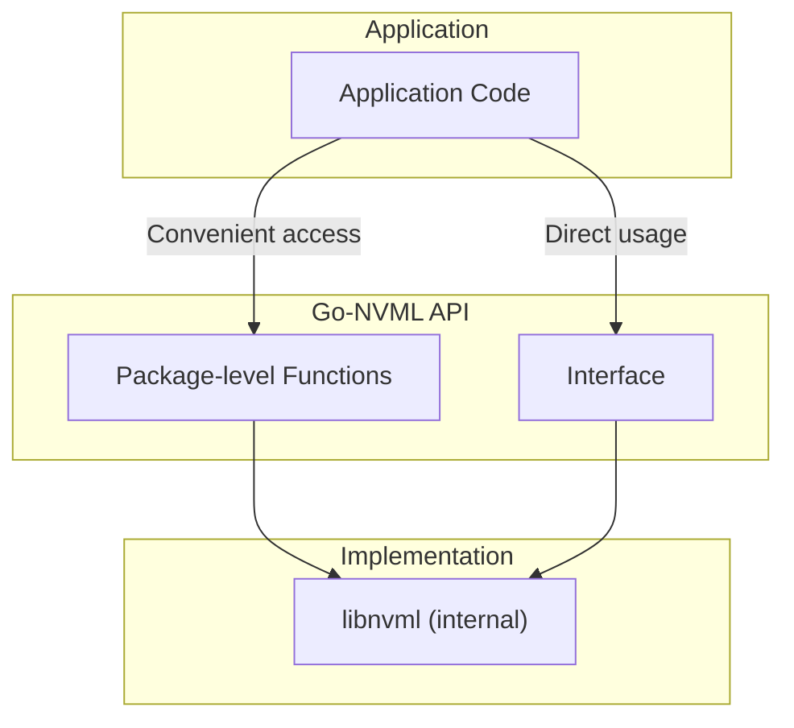
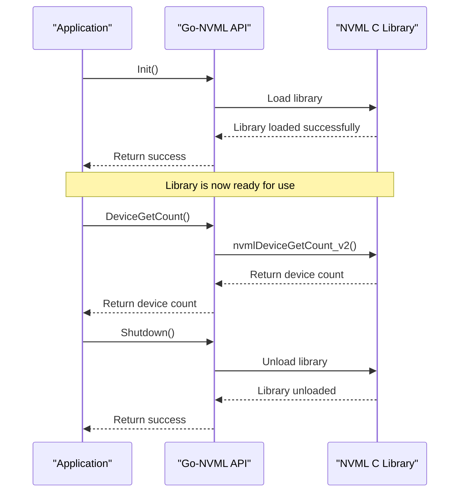
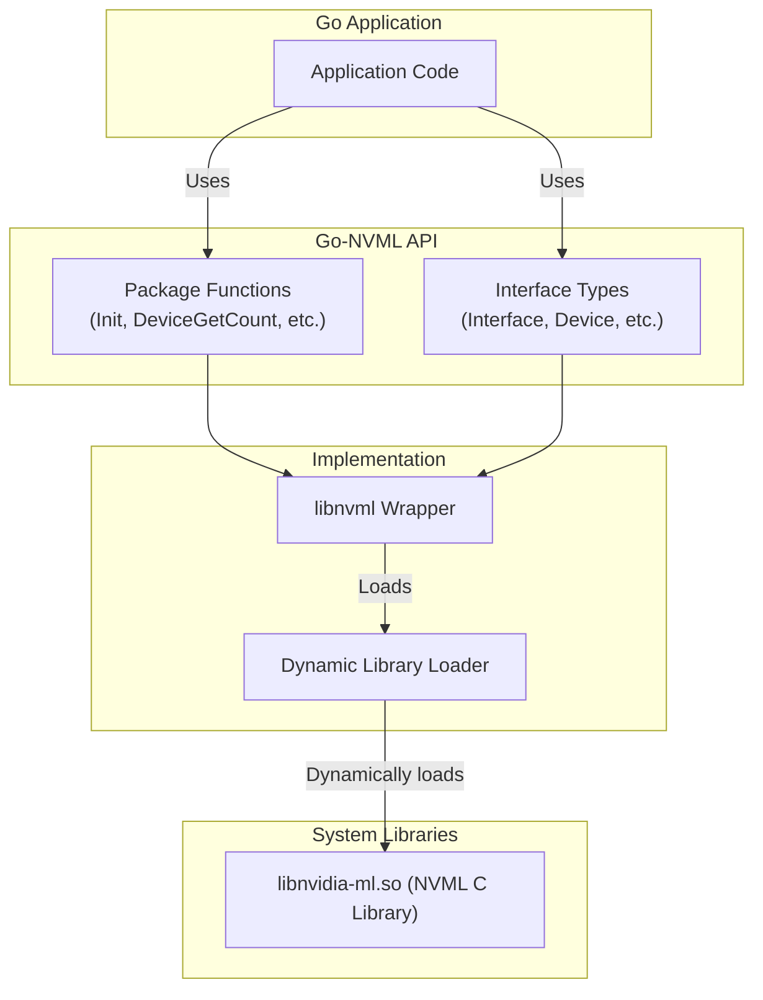

<!-- source: DeepWiki mcp.deepwiki.com · repo NVIDIA/go-nvml · page 3 Core API · fetched 2026-10-26 -->

# Core API

<details>
<summary>Relevant source files</summary>

The following files were used as context for generating this wiki page:

- [pkg/nvml/api.go](pkg/nvml/api.go)
- [pkg/nvml/nvml.go](pkg/nvml/nvml.go)
- [pkg/nvml/zz_generated.api.go](pkg/nvml/zz_generated.api.go)

</details>


## Purpose and Scope

The Core API provides the foundational interfaces and functions needed to interact with NVIDIA GPUs through the NVIDIA Management Library (NVML). This page documents the main components of the Go bindings for NVML, explaining the interface hierarchy and the primary patterns for interfacing with GPU hardware. 

The Core API serves as the primary entry point for applications to access GPU information, manage resources, and monitor performance. For more detailed information about specific capabilities like device management and performance metrics, see [Device Management](#3.1) and [Performance Metrics](#4.1) respectively.

## Interface Hierarchy

The Go-NVML bindings follow a well-defined interface hierarchy that represents the relationship between various components in the NVIDIA GPU ecosystem.

```mermaid
classDiagram
    class "Interface" {
        Init()
        Shutdown()
        DeviceGetCount()
        DeviceGetHandleByIndex()
        SystemGetDriverVersion()
        ...200+ methods
    }
    
    class "Device" {
        GetName()
        GetUUID()
        GetMemoryInfo()
        GetUtilizationRates()
        GetPowerUsage()
        CreateGpuInstance()
        ...900+ methods
    }
    
    class "GpuInstance" {
        GetInfo()
        CreateComputeInstance()
        GetComputeInstances()
        Destroy()
        ...12 methods
    }
    
    class "ComputeInstance" {
        GetInfo()
        Destroy()
        ...2 methods
    }
    
    class "EventSet" {
        Wait()
        Free()
        ...2 methods
    }
    
    class "Unit" {
        GetUnitInfo()
        GetDevices()
        GetLedState()
        GetPsuInfo()
        ...7 methods
    }
    
    class "VgpuInstance" {
        GetVmID()
        GetUUID()
        GetType()
        GetFbUsage()
        ...23 methods
    }
    
    class "VgpuTypeId" {
        GetCapabilities()
        GetClass()
        GetDeviceID()
        GetName()
        ...12 methods
    }
    
    Interface --> Device : creates/manages
    Interface --> EventSet : creates
    Interface --> Unit : manages
    Device --> GpuInstance : creates/contains
    GpuInstance --> ComputeInstance : creates/contains
    Device --> VgpuInstance : related to
    VgpuInstance --> VgpuTypeId : has type
```

This diagram shows the core interfaces defined in the Go-NVML API and their relationships. The main `Interface` provides methods for initializing the library and accessing devices and other system-level resources. Specific objects like `Device`, `GpuInstance`, and `ComputeInstance` provide specialized functionality for their respective domains.

Sources: [pkg/nvml/zz_generated.api.go:346-1007]()

## Core Components

### Primary Interface

The top-level `Interface` type serves as the main entry point to the NVML API. It defines over 300 methods that provide access to all NVML functionality, including system-level operations, device management, GPU instance handling, and more.



The API can be accessed in two primary ways:
1. Through the package-level functions (e.g., `nvml.Init()`, `nvml.DeviceGetCount()`)
2. By obtaining and using an explicit interface instance

Package-level functions are actually variables that point to methods of a global library instance, making the API more convenient to use.

Sources: [pkg/nvml/zz_generated.api.go:22-344](), [pkg/nvml/api.go:19-28]()

### Device Interface

The `Device` interface is one of the most important interfaces, representing a physical NVIDIA GPU. It provides methods for querying device properties, monitoring performance, managing resources, and performing device-specific operations.

Key capabilities of the `Device` interface include:
- Retrieving basic information (name, UUID, PCIe info)
- Monitoring performance metrics (utilization, temperature, power)
- Managing device settings (clocks, power limits, compute mode)
- Creating and managing GPU instances (for MIG-capable GPUs)
- Handling events and error reporting

Sources: [pkg/nvml/zz_generated.api.go:673-903]()

### GPU Instances and Compute Instances

For GPUs that support Multi-Instance GPU (MIG) technology, the API provides interfaces to manage GPU instances and compute instances:

- `GpuInstance`: Represents a partition of a physical GPU, provides methods for creating and managing compute instances
- `ComputeInstance`: Represents a compute instance within a GPU instance

These interfaces enable fine-grained control of GPU resources in environments where multiple workloads need to share GPU resources securely and with guaranteed quality of service.

Sources: [pkg/nvml/zz_generated.api.go:906-928]()

### Events and Monitoring

The API provides mechanisms for event handling and monitoring through the `EventSet` interface. This allows applications to register for notifications of specific events such as GPU state changes, rather than having to poll for status changes.

Sources: [pkg/nvml/zz_generated.api.go:929-936]()

### Extended Functionality

The `ExtendedInterface` provides additional functionality beyond the core NVML API, such as the ability to dynamically look up symbols in the NVML library.

```go
type ExtendedInterface interface {
	LookupSymbol(string) error
}
```

This extension mechanism allows for accessing functions that might not be part of the standard API or that might vary across different versions of the NVML library.

Sources: [pkg/nvml/api.go:19-28]()

## Initialization and Usage

### Library Initialization

Before using any of the API functions, the NVML library must be initialized. This is typically done using the `Init()` function, which dynamically loads the NVML C library.



The library supports customization through options that can be set using `SetLibraryOptions()` before initialization:

```go
// Example: Set custom library path
err := nvml.SetLibraryOptions(nvml.WithLibraryPath("/custom/path/libnvidia-ml.so"))
if err != nil {
    // Handle error
}

// Initialize the library
ret := nvml.Init()
if ret != nvml.SUCCESS {
    // Handle error
}
```

Sources: [pkg/nvml/api.go:36-56]()

### Error Handling

All API functions that can fail return a `Return` value, which is an enumeration representing the success or failure of the operation. The `ErrorString()` function can be used to get a human-readable error message for a given return code.

```go
ret := nvml.Init()
if ret != nvml.SUCCESS {
    errMsg := nvml.ErrorString(ret)
    fmt.Printf("Failed to initialize NVML: %s\n", errMsg)
    // Handle error
}
```

For more details on error handling, see [Error Handling](#3.4).

Sources: [pkg/nvml/nvml.go:53-59]()

## Key Function Categories

The Core API functions can be categorized into several key areas:

| Category | Description | Example Functions |
|----------|-------------|-------------------|
| Library Management | Functions to initialize, shut down, and configure the library | `Init()`, `Shutdown()`, `SetLibraryOptions()` |
| Device Discovery | Functions to find and access NVIDIA GPUs | `DeviceGetCount()`, `DeviceGetHandleByIndex()`, `DeviceGetHandleByUUID()` |
| System Information | Functions to retrieve system-level information | `SystemGetDriverVersion()`, `SystemGetNVMLVersion()`, `SystemGetProcessName()` |
| Device Information | Functions to get basic device properties | `Device.GetName()`, `Device.GetUUID()`, `Device.GetPciInfo()` |
| Performance Monitoring | Functions to monitor device performance | `Device.GetUtilizationRates()`, `Device.GetPowerUsage()`, `Device.GetTemperature()` |
| Resource Management | Functions to control device resources | `Device.SetPowerManagementLimit()`, `Device.SetApplicationsClocks()` |
| MIG Management | Functions to manage Multi-Instance GPU | `Device.SetMigMode()`, `Device.CreateGpuInstance()`, `GpuInstance.CreateComputeInstance()` |
| Event Handling | Functions for event registration and handling | `DeviceRegisterEvents()`, `EventSet.Wait()` |

Sources: [pkg/nvml/zz_generated.api.go:22-344](), [pkg/nvml/zz_generated.api.go:346-671]()

## API Structure Overview

The following diagram illustrates how the Go-NVML Core API maps to the underlying NVML C library:



This architecture provides a clean, idiomatic Go interface to the underlying C library while handling the complexities of dynamic library loading and memory management.

Sources: [pkg/nvml/api.go:19-56](), [pkg/nvml/zz_generated.api.go:22-344]()

## Example Workflow

A typical workflow using the Go-NVML Core API follows these steps:

1. Initialize the library
2. Discover available devices
3. Select and obtain a device handle
4. Query device information or perform operations
5. Clean up by shutting down the library

```go
// Initialize NVML
ret := nvml.Init()
if ret != nvml.SUCCESS {
    fmt.Printf("Failed to initialize NVML: %s\n", nvml.ErrorString(ret))
    return
}
defer nvml.Shutdown() // Ensure we clean up on exit

// Get device count
var count uint32
ret = nvml.DeviceGetCount(&count)
if ret != nvml.SUCCESS {
    fmt.Printf("Failed to get device count: %s\n", nvml.ErrorString(ret))
    return
}

// Get device handle
var device nvml.Device
ret = nvml.DeviceGetHandleByIndex(0, &device)
if ret != nvml.SUCCESS {
    fmt.Printf("Failed to get device handle: %s\n", nvml.ErrorString(ret))
    return
}

// Query device information
name, ret := device.GetName()
if ret != nvml.SUCCESS {
    fmt.Printf("Failed to get device name: %s\n", nvml.ErrorString(ret))
    return
}

uuid, ret := device.GetUUID()
if ret != nvml.SUCCESS {
    fmt.Printf("Failed to get device UUID: %s\n", nvml.ErrorString(ret))
    return
}

fmt.Printf("Device: %s (UUID: %s)\n", name, uuid)

// Get utilization information
util, ret := device.GetUtilizationRates()
if ret != nvml.SUCCESS {
    fmt.Printf("Failed to get utilization rates: %s\n", nvml.ErrorString(ret))
    return
}

fmt.Printf("GPU Utilization: %d%%\n", util.Gpu)
fmt.Printf("Memory Utilization: %d%%\n", util.Memory)
```

This example demonstrates the core pattern of using the API: initialize, get device handle, perform operations, and clean up.

Sources: [pkg/nvml/nvml.go:31-103](), [pkg/nvml/zz_generated.api.go:673-903]()

## Summary

The Core API of Go-NVML provides a comprehensive set of interfaces and functions for interacting with NVIDIA GPUs. The API is structured around a hierarchy of interfaces that represent different components of the NVIDIA GPU ecosystem, from the system level down to individual GPU and compute instances.

Key aspects of the Core API include:
- A top-level `Interface` that provides access to all NVML functionality
- Specialized interfaces for devices, GPU instances, and compute instances
- Support for event handling and performance monitoring
- Dynamic library loading for flexibility
- Extension mechanisms for advanced use cases

Understanding this core structure is essential for effectively using the Go-NVML bindings to monitor and manage NVIDIA GPUs in Go applications.

---

