<!-- source: DeepWiki mcp.deepwiki.com · repo NVIDIA/go-nvml · page 3.1 Device Management · fetched 2026-10-26 -->

# Device Management

Relevant source files

The following files were used as context for generating this wiki page:

- [pkg/nvml/device.go](pkg/nvml/device.go)
- [pkg/nvml/init.go](pkg/nvml/init.go)

## Purpose and Scope

This document explains how to discover and interact with NVIDIA GPUs using the go-nvml bindings. It covers device discovery, querying device properties, monitoring performance metrics, and controlling device states. This page focuses on the core device management functionality; for specialized features like Multi-Instance GPU (MIG), see [GPU Features](#4) and [Multi-Instance GPU (MIG)](#4.2).

## Overview

Device management is a foundational capability in NVML that allows applications to enumerate available NVIDIA GPUs and interact with them. The Go bindings provide a clean interface to these capabilities through the `Device` interface.

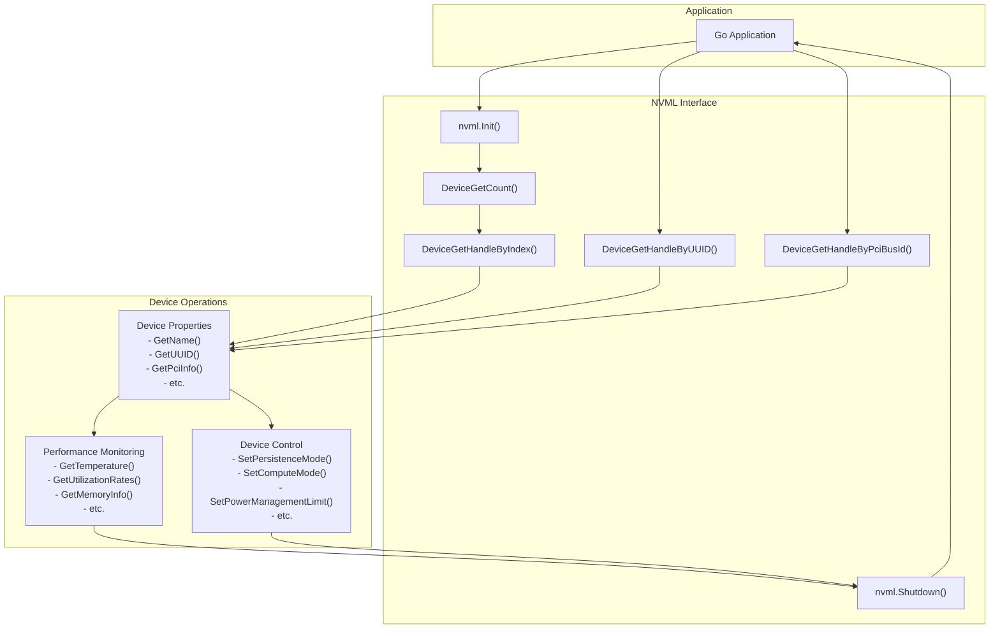

Sources: [pkg/nvml/init.go:20-48](), [pkg/nvml/device.go:101-134]()

## Device Discovery

Before interacting with GPU devices, you need to discover them in the system. The NVML interface provides several methods for this purpose.

### Initializing NVML

Before discovering devices, you must initialize the NVML library:

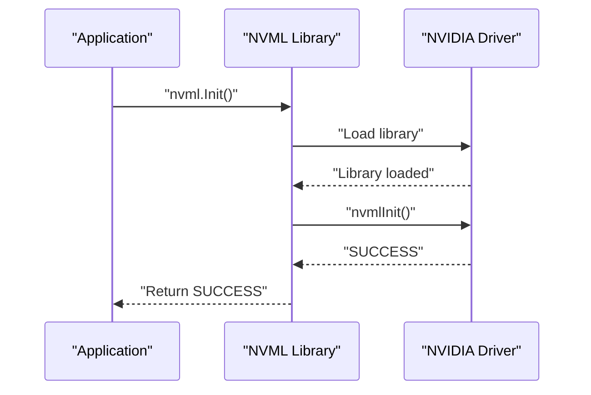

Sources: [pkg/nvml/init.go:20-25]()

### Enumerating Devices

After initialization, you can get the count of available devices and retrieve handles to each one:

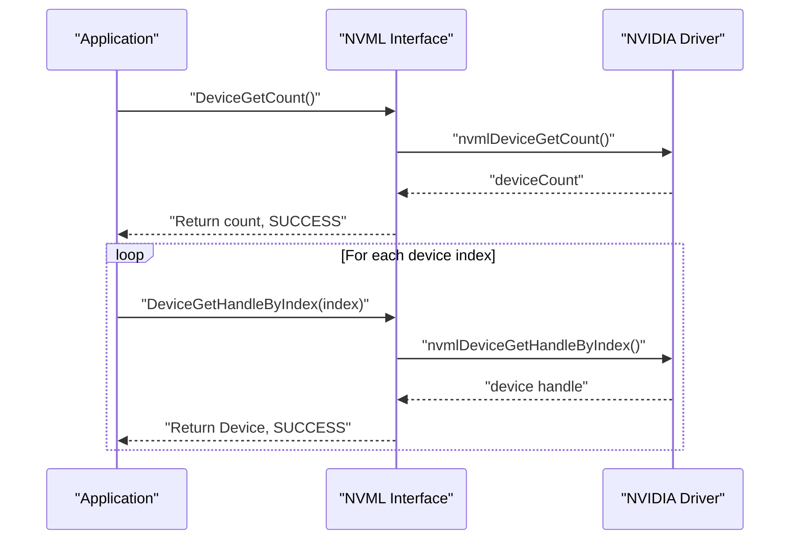

The primary methods for device discovery are:

| Method | Description |
|--------|-------------|
| `DeviceGetCount()` | Returns the number of NVIDIA GPUs in the system |
| `DeviceGetHandleByIndex(index)` | Gets a device handle for the GPU at the given index |
| `DeviceGetHandleByUUID(uuid)` | Gets a device handle for the GPU with the given UUID |
| `DeviceGetHandleByPciBusId(pciBusId)` | Gets a device handle for the GPU at the given PCI bus ID |
| `DeviceGetHandleBySerial(serial)` | Gets a device handle for the GPU with the given serial number |

Sources: [pkg/nvml/device.go:101-134]()

## Device Properties

Once you have a device handle, you can query various properties of the device.

### Basic Properties

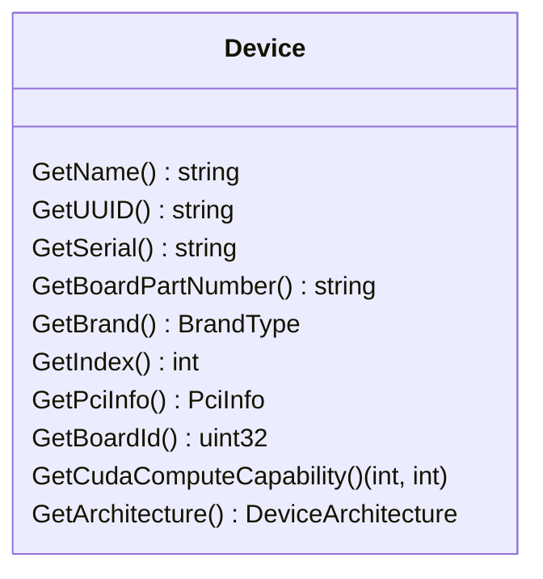

Basic device properties include:

| Property | Method | Description |
|----------|--------|-------------|
| Name | `GetName()` | Product name of the device |
| UUID | `GetUUID()` | Globally unique identifier |
| Serial | `GetSerial()` | Serial number |
| PCI Info | `GetPciInfo()` | PCI bus information |
| Brand | `GetBrand()` | Brand type (e.g., GeForce, Tesla) |
| Index | `GetIndex()` | Index of the device in the system |
| CUDA Capability | `GetCudaComputeCapability()` | CUDA compute capability major/minor version |
| Architecture | `GetArchitecture()` | GPU architecture (e.g., Ampere, Hopper) |

Sources: [pkg/nvml/device.go:136-178](), [pkg/nvml/device.go:377-395](), [pkg/nvml/device.go:821-830](), [pkg/nvml/device.go:1987-1997]()

### PCI Information

The `GetPciInfo()` method returns detailed PCI information about the device:

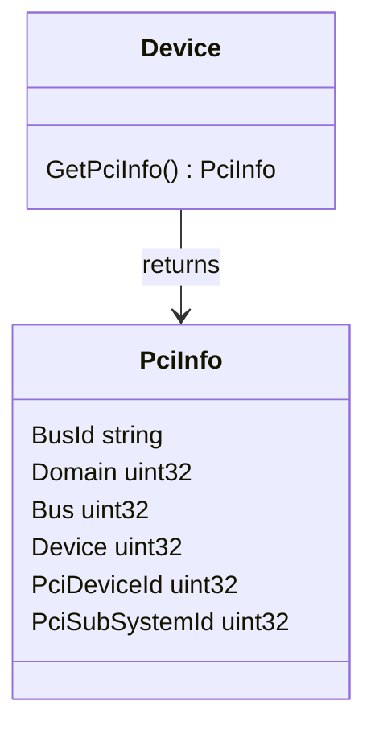

You can also query specific PCI-related properties:

| Method | Description |
|--------|-------------|
| `GetMaxPcieLinkGeneration()` | Maximum PCIe link generation |
| `GetMaxPcieLinkWidth()` | Maximum PCIe link width |
| `GetCurrPcieLinkGeneration()` | Current PCIe link generation |
| `GetCurrPcieLinkWidth()` | Current PCIe link width |
| `GetPcieThroughput()` | PCIe throughput in KB/s |
| `GetBusType()` | Bus type (e.g., PCIe, PCI, AGP) |

Sources: [pkg/nvml/device.go:377-461](), [pkg/nvml/device.go:2378-2387]()

## Performance Monitoring

NVML provides extensive capabilities for monitoring various performance metrics of the device.

### Memory Usage

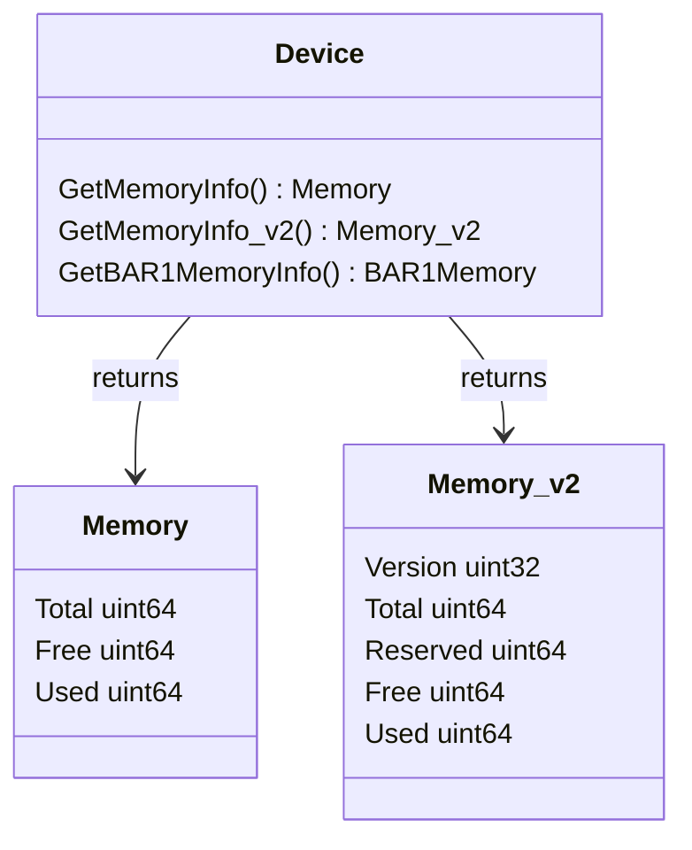

Methods for monitoring memory usage:

| Method | Description |
|--------|-------------|
| `GetMemoryInfo()` | Basic memory usage information |
| `GetMemoryInfo_v2()` | Extended memory usage information |
| `GetBAR1MemoryInfo()` | BAR1 memory usage information |

Sources: [pkg/nvml/device.go:787-808](), [pkg/nvml/device.go:1241-1250]()

### Utilization Rates

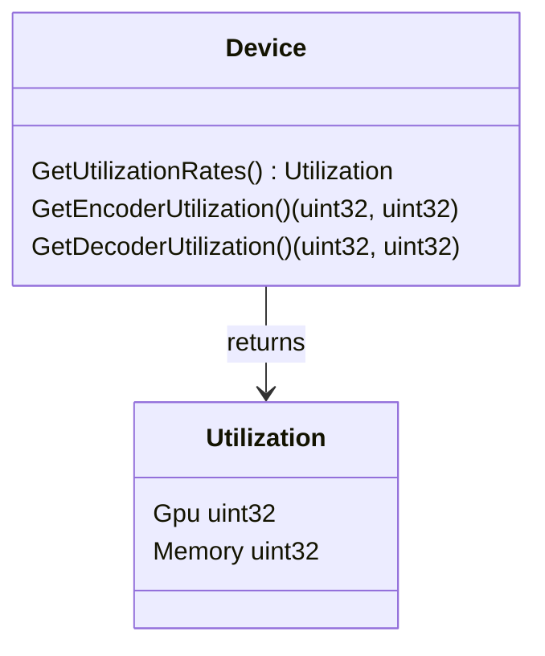

Methods for monitoring utilization:

| Method | Description |
|--------|-------------|
| `GetUtilizationRates()` | GPU and memory utilization percentage |
| `GetEncoderUtilization()` | Video encoder utilization |
| `GetDecoderUtilization()` | Video decoder utilization |
| `GetProcessUtilization()` | Per-process GPU utilization |

Sources: [pkg/nvml/device.go:898-972](), [pkg/nvml/device.go:1810-1826]()

### Temperature and Cooling

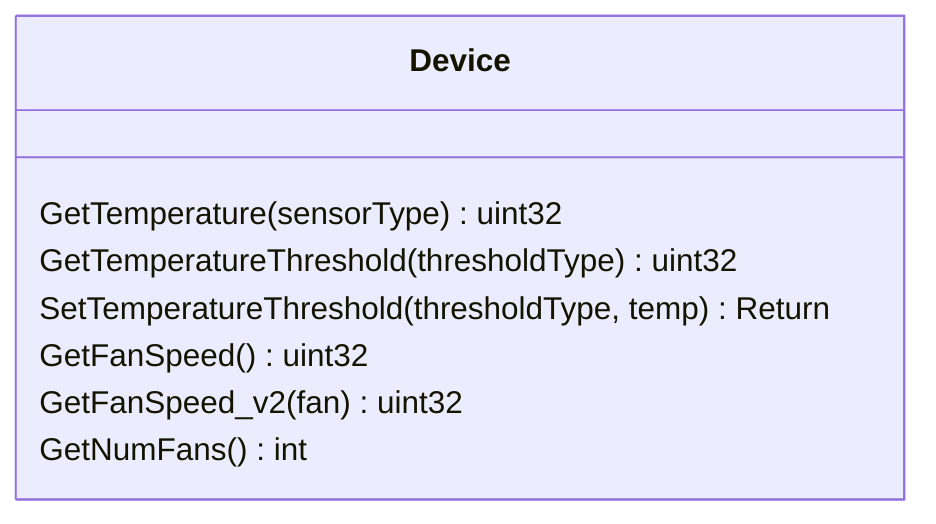

Methods for monitoring temperature and cooling:

| Method | Description |
|--------|-------------|
| `GetTemperature()` | Current temperature of the device |
| `GetTemperatureThreshold()` | Temperature thresholds |
| `GetFanSpeed()` | Fan speed percentage |
| `GetFanSpeed_v2()` | Fan speed percentage for specific fan |
| `GetNumFans()` | Number of fans on the device |
| `GetMinMaxFanSpeed()` | Minimum and maximum fan speed |

Sources: [pkg/nvml/device.go:589-642](), [pkg/nvml/device.go:2398-2407]()

### Power Usage

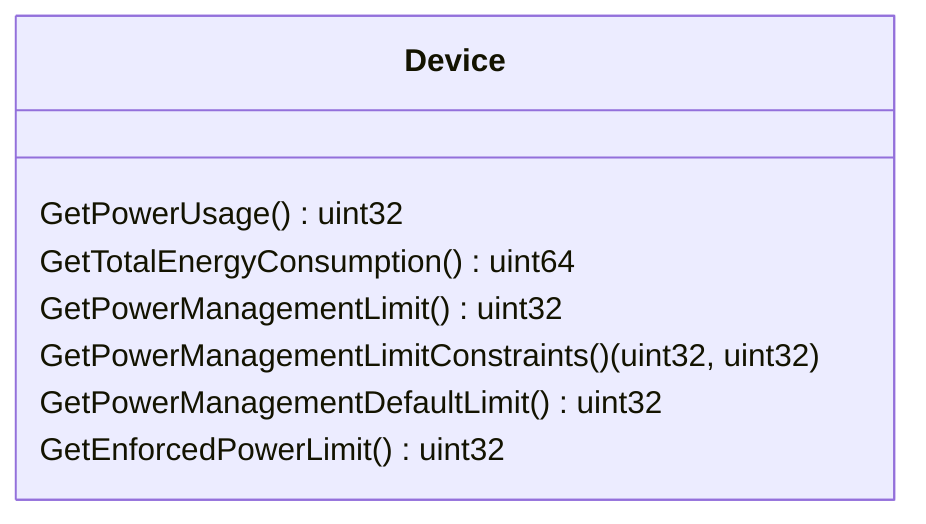

Methods for monitoring power usage:

| Method | Description |
|--------|-------------|
| `GetPowerUsage()` | Current power usage in milliwatts |
| `GetTotalEnergyConsumption()` | Total energy consumption in millijoules |
| `GetPowerManagementLimit()` | Current power management limit |
| `GetPowerManagementLimitConstraints()` | Min/max power management limits |
| `GetPowerManagementDefaultLimit()` | Default power management limit |

Sources: [pkg/nvml/device.go:710-774]()

### Clock Speeds

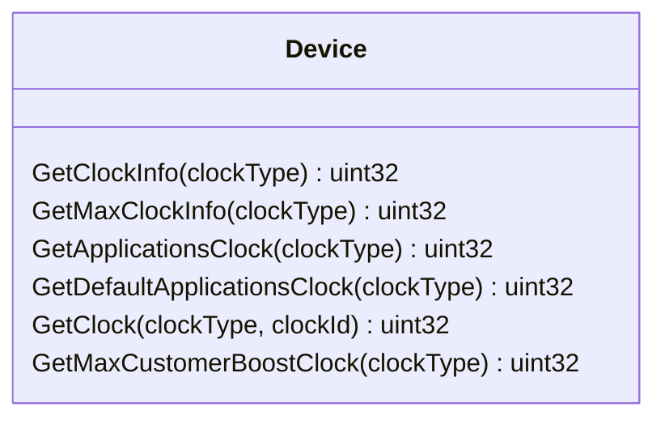

Methods for monitoring clock speeds:

| Method | Description |
|--------|-------------|
| `GetClockInfo()` | Current clock speed for specified clock type |
| `GetMaxClockInfo()` | Maximum clock speed for specified clock type |
| `GetApplicationsClock()` | Current application clock setting |
| `GetDefaultApplicationsClock()` | Default application clock setting |
| `GetSupportedMemoryClocks()` | List of supported memory clock speeds |
| `GetSupportedGraphicsClocks()` | List of supported graphics clock speeds |

Sources: [pkg/nvml/device.go:463-558]()

### Process Monitoring

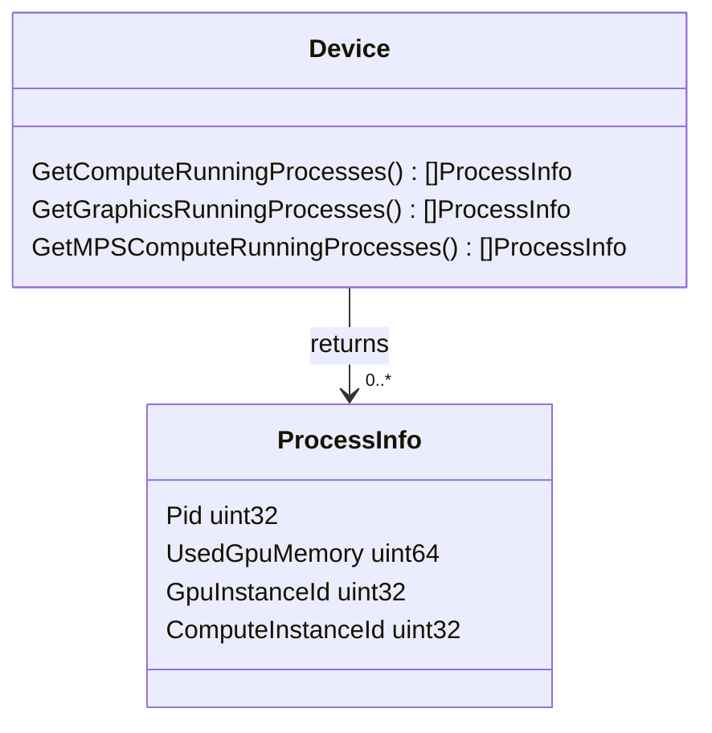

Methods for monitoring processes using the GPU:

| Method | Description |
|--------|-------------|
| `GetComputeRunningProcesses()` | List of compute processes |
| `GetGraphicsRunningProcesses()` | List of graphics processes |
| `GetMPSComputeRunningProcesses()` | List of MPS compute processes |
| `GetProcessUtilization()` | Per-process utilization statistics |

Sources: [pkg/nvml/device.go:1037-1197](), [pkg/nvml/device.go:1810-1826]()

## Device Control

NVML allows controlling various aspects of GPU operation.

### Mode Control

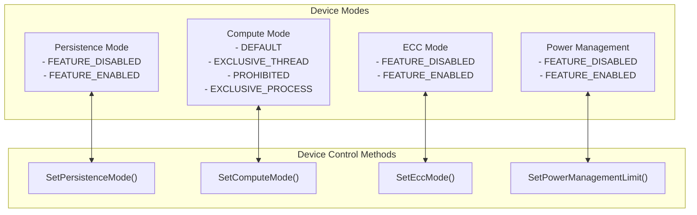

Key device control methods:

| Method | Description |
|--------|-------------|
| `SetPersistenceMode()` | Set persistence mode (driver remains loaded when no apps are connected) |
| `SetComputeMode()` | Set compute mode (controls whether multiple processes can use the GPU) |
| `SetEccMode()` | Enable or disable ECC memory |
| `SetGpuOperationMode()` | Set GPU operation mode |
| `SetPowerManagementLimit()` | Set power management limit |

Sources: [pkg/nvml/device.go:376-384](), [pkg/nvml/device.go:810-819](), [pkg/nvml/device.go:1434-1465](), [pkg/nvml/device.go:1535-1542]()

### Clock Control

Methods for controlling device clocks:

| Method | Description |
|--------|-------------|
| `SetApplicationsClocks()` | Set application clocks |
| `ResetApplicationsClocks()` | Reset application clocks to default |
| `SetGpuLockedClocks()` | Lock GPU clocks at specified frequencies |
| `ResetGpuLockedClocks()` | Reset GPU clock lock |
| `SetMemoryLockedClocks()` | Lock memory clocks at specified frequencies |
| `ResetMemoryLockedClocks()` | Reset memory clock lock |
| `SetAutoBoostedClocksEnabled()` | Enable or disable auto-boosted clocks |

Sources: [pkg/nvml/device.go:507-514](), [pkg/nvml/device.go:1527-1534](), [pkg/nvml/device.go:1479-1513]()

### Fan Control

Methods for controlling device fans:

| Method | Description |
|--------|-------------|
| `SetFanSpeed_v2()` | Set speed of specified fan |
| `SetDefaultFanSpeed_v2()` | Reset fan to default speed |
| `SetFanControlPolicy()` | Set fan control policy |

Sources: [pkg/nvml/device.go:2475-2482](), [pkg/nvml/device.go:2389-2396](), [pkg/nvml/device.go:2607-2613]()

## Example Usage Patterns

Here's a typical flow for using the device management API:

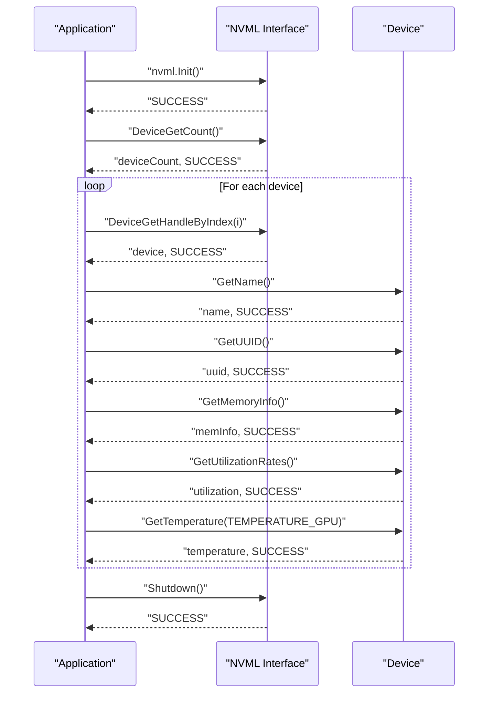

Sources: [pkg/nvml/init.go:20-48](), [pkg/nvml/device.go:101-178](), [pkg/nvml/device.go:787-807](), [pkg/nvml/device.go:898-907](), [pkg/nvml/device.go:622-631]()

## Error Handling

All device management methods return a `Return` value which indicates success or failure. For detailed information about error handling, see [Error Handling](#3.4).

## Related Components

The Device Management functionality interacts with several other components of the NVML system:

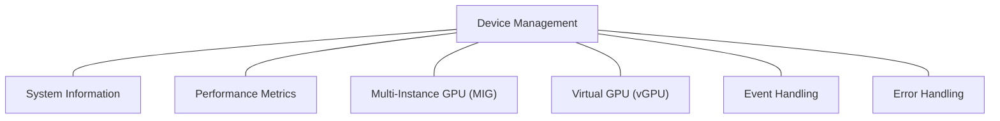

Sources: [pkg/nvml/device.go]()

## Conclusion

The Device Management component of the NVML Go bindings provides comprehensive capabilities for discovering, querying, monitoring, and controlling NVIDIA GPUs. It serves as the foundation for other higher-level functionality such as Multi-Instance GPU and Virtual GPU management.

---

