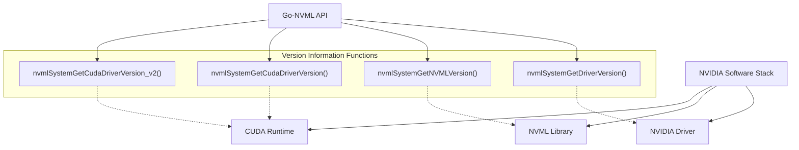
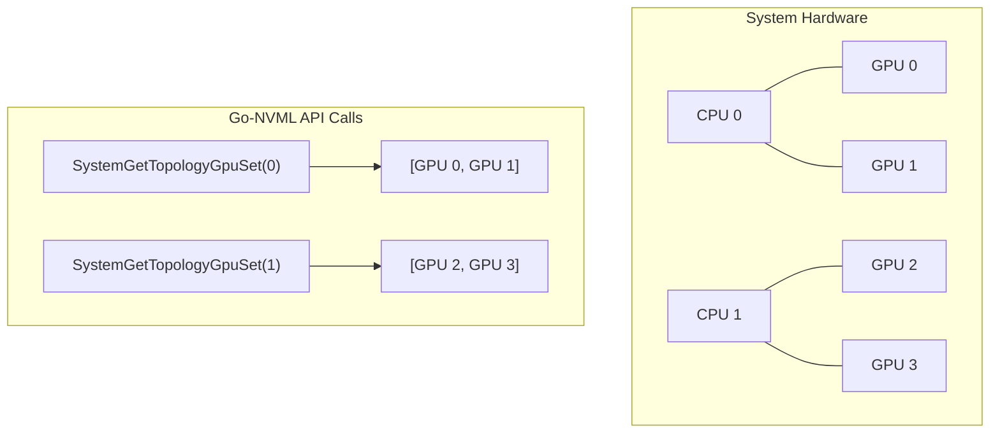
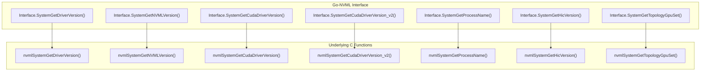

<!-- source: DeepWiki mcp.deepwiki.com · repo NVIDIA/go-nvml · page 3.2 System Information · fetched 2026-10-26 -->

# System Information

<details>
<summary>Relevant source files</summary>

The following files were used as context for generating this wiki page:

- [pkg/nvml/gpm.go](pkg/nvml/gpm.go)
- [pkg/nvml/nvml.go](pkg/nvml/nvml.go)
- [pkg/nvml/system.go](pkg/nvml/system.go)

</details>


This page documents the system-level information retrieval capabilities provided by the Go-NVML bindings. It covers functions for obtaining information about the NVIDIA driver, NVML library version, CUDA version, system topology, and other system-wide configuration details that apply to the entire system rather than individual devices. For device-specific information, see [Device Management](#3.1).

## Overview of System Information API

The Go-NVML bindings provide several functions to query system-wide information about the NVIDIA GPU environment. These functions are typically prefixed with `System` and allow applications to retrieve various system-level details without requiring a specific device handle.

### System Information API Hierarchy

```mermaid
graph TD
    A["nvml.Interface"] --> B["SystemGetDriverVersion()"]
    A --> C["SystemGetNVMLVersion()"]
    A --> D["SystemGetCudaDriverVersion()"]
    A --> E["SystemGetCudaDriverVersion_v2()"]
    A --> F["SystemGetProcessName()"]
    A --> G["SystemGetHicVersion()"]
    A --> H["SystemGetTopologyGpuSet()"]
    A --> I["SystemGetNvlinkBwMode()/SystemSetNvlinkBwMode()"]
    A --> J["ConfCompute* Functions"]
    
    subgraph "Version Information"
        B
        C
        D
        E
    end

    subgraph "Topology Information"
        H
    end

    subgraph "Process Information"
        F
    end

    subgraph "Hardware Information"
        G
    end

    subgraph "System Configuration"
        I
        J
    end
```



Sources: [pkg/nvml/system.go:1-141]()

## Version Information

The Go-NVML bindings provide several functions to retrieve version information about different components of the NVIDIA GPU software stack.

### Driver Version

To retrieve the NVIDIA GPU driver version:

```go
driverVersion, ret := nvml.SystemGetDriverVersion()
if ret == nvml.SUCCESS {
    fmt.Printf("Driver Version: %s\n", driverVersion)
}
```

Sources: [pkg/nvml/system.go:18-22]()

### NVML Version

To retrieve the version of the NVIDIA Management Library:

```go
nvmlVersion, ret := nvml.SystemGetNVMLVersion()
if ret == nvml.SUCCESS {
    fmt.Printf("NVML Version: %s\n", nvmlVersion)
}
```

Sources: [pkg/nvml/system.go:24-29]()

### CUDA Driver Version

Go-NVML provides two methods to retrieve the CUDA driver version:

```go
// Original method
cudaVersion, ret := nvml.SystemGetCudaDriverVersion()
if ret == nvml.SUCCESS {
    fmt.Printf("CUDA Driver Version: %d\n", cudaVersion)
}

// Newer method
cudaVersionV2, ret := nvml.SystemGetCudaDriverVersion_v2()
if ret == nvml.SUCCESS {
    fmt.Printf("CUDA Driver Version (v2): %d\n", cudaVersionV2)
}
```

The CUDA driver version is returned as an integer, where the major and minor version numbers can be extracted. For example, a value of 11020 would represent CUDA version 11.2.

Sources: [pkg/nvml/system.go:31-43]()

### Version Components Relationship



Sources: [pkg/nvml/nvml.go:61-93]()

## System Topology

The NVML library allows querying the topology of the system to understand the relationships between CPUs and GPUs.

### Getting GPUs Associated with a CPU

The `SystemGetTopologyGpuSet` function returns all GPUs that have an affinity with a specific CPU:

```go
cpuNumber := 0 // CPU number to query
devices, ret := nvml.SystemGetTopologyGpuSet(cpuNumber)
if ret == nvml.SUCCESS {
    fmt.Printf("Found %d GPUs associated with CPU %d\n", len(devices), cpuNumber)
    for i, device := range devices {
        // Work with each device
    }
}
```

Sources: [pkg/nvml/system.go:68-81]()

### CPU-GPU Topology Example



Sources: [pkg/nvml/system.go:68-81](), [pkg/nvml/nvml.go:114-122]()

## Hardware Information Controller (HIC)

The Hardware Information Controller provides information about firmware versions and hardware IDs of components in the system.

### Getting HIC Version

```go
entries, ret := nvml.SystemGetHicVersion()
if ret == nvml.SUCCESS {
    fmt.Printf("Found %d HIC entries\n", len(entries))
    for _, entry := range entries {
        fmt.Printf("Firmware Version: %s, Hardware ID: %d\n", 
                  entry.FirmwareVersion, entry.HwbcId)
    }
}
```

This function helps gather information about the firmware versions of various hardware components in the system.

Sources: [pkg/nvml/system.go:52-66](), [pkg/nvml/nvml.go:105-112]()

## Process Information

NVML allows querying information about processes that are interacting with NVIDIA GPUs.

### Getting Process Name by PID

```go
pid := 1234 // Process ID to query
name, ret := nvml.SystemGetProcessName(pid)
if ret == nvml.SUCCESS {
    fmt.Printf("Process Name for PID %d: %s\n", pid, name)
}
```

This function is particularly useful for monitoring applications that are using GPU resources.

Sources: [pkg/nvml/system.go:45-50](), [pkg/nvml/nvml.go:95-103]()

## NVLink Bandwidth Mode

NVLink is NVIDIA's high-speed interconnect technology. The NVML API allows querying and setting the NVLink bandwidth mode at the system level.

```go
// Get current NVLink bandwidth mode
mode, ret := nvml.SystemGetNvlinkBwMode()
if ret == nvml.SUCCESS {
    fmt.Printf("Current NVLink BW Mode: %d\n", mode)
}

// Set NVLink bandwidth mode
newMode := uint32(1) // Example mode value
ret = nvml.SystemSetNvlinkBwMode(newMode)
if ret == nvml.SUCCESS {
    fmt.Printf("Successfully set NVLink BW Mode to %d\n", newMode)
}
```

Sources: [pkg/nvml/system.go:109-119]()

## Confidential Computing

NVIDIA Confidential Computing provides secure execution environments for GPU workloads. The NVML API provides several functions to query and configure Confidential Computing settings.

### Basic Confidential Computing States

```go
// Get Confidential Computing capabilities
caps, ret := nvml.SystemGetConfComputeCapabilities()
if ret == nvml.SUCCESS {
    fmt.Printf("Confidential Computing Capabilities: %+v\n", caps)
}

// Get Confidential Computing state
state, ret := nvml.SystemGetConfComputeState()
if ret == nvml.SUCCESS {
    fmt.Printf("Confidential Computing State: %+v\n", state)
}

// Check if GPUs are ready for Confidential Computing workloads
ready, ret := nvml.SystemGetConfComputeGpusReadyState()
if ret == nvml.SUCCESS {
    fmt.Printf("GPUs ready for Confidential Computing: %d\n", ready)
}

// Set GPUs ready state for Confidential Computing
isAcceptingWork := uint32(1) // 1 = accepting work, 0 = not accepting
ret = nvml.SystemSetConfComputeGpusReadyState(isAcceptingWork)
if ret == nvml.SUCCESS {
    fmt.Printf("Successfully set GPUs ready state to %d\n", isAcceptingWork)
}
```

### Advanced Confidential Computing Settings

```go
// Get key rotation threshold information
keyInfo, ret := nvml.SystemGetConfComputeKeyRotationThresholdInfo()
if ret == nvml.SUCCESS {
    fmt.Printf("Key Rotation Threshold: %+v\n", keyInfo)
}

// Get Confidential Computing settings
settings, ret := nvml.SystemGetConfComputeSettings()
if ret == nvml.SUCCESS {
    fmt.Printf("Confidential Computing Settings: %+v\n", settings)
}

// Set key rotation threshold information
var newKeyInfo nvml.ConfComputeSetKeyRotationThresholdInfo
// Configure newKeyInfo fields as needed
ret = nvml.SystemSetConfComputeKeyRotationThresholdInfo(newKeyInfo)
if ret == nvml.SUCCESS {
    fmt.Printf("Successfully set key rotation threshold info\n")
}
```

Sources: [pkg/nvml/system.go:84-140]()

## System Information API Mapping

This diagram shows how the Go-NVML interface functions map to the underlying C library functions for system information:



Sources: [pkg/nvml/system.go:1-141](), [pkg/nvml/nvml.go:61-122]()

## Complete Example: Retrieving System Information

Here's a comprehensive example showing how to initialize NVML and retrieve various types of system information:

```go
package main

import (
    "fmt"
    "github.com/NVIDIA/go-nvml/pkg/nvml"
)

func main() {
    // Initialize NVML
    ret := nvml.Init()
    if ret != nvml.SUCCESS {
        fmt.Printf("Failed to initialize NVML: %v\n", nvml.ErrorString(ret))
        return
    }
    defer nvml.Shutdown()
    
    // Get version information
    driverVersion, ret := nvml.SystemGetDriverVersion()
    if ret == nvml.SUCCESS {
        fmt.Printf("Driver Version: %s\n", driverVersion)
    }
    
    nvmlVersion, ret := nvml.SystemGetNVMLVersion()
    if ret == nvml.SUCCESS {
        fmt.Printf("NVML Version: %s\n", nvmlVersion)
    }
    
    cudaVersion, ret := nvml.SystemGetCudaDriverVersion()
    if ret == nvml.SUCCESS {
        fmt.Printf("CUDA Driver Version: %d\n", cudaVersion)
    }
    
    // Get topology information for CPU 0
    devices, ret := nvml.SystemGetTopologyGpuSet(0)
    if ret == nvml.SUCCESS {
        fmt.Printf("Found %d GPUs associated with CPU 0\n", len(devices))
        for i, device := range devices {
            name, _ := device.GetName()
            fmt.Printf("  GPU %d: %s\n", i, name)
        }
    }
    
    // Get HIC information
    entries, ret := nvml.SystemGetHicVersion()
    if ret == nvml.SUCCESS {
        fmt.Printf("Found %d HIC entries\n", len(entries))
        for i, entry := range entries {
            fmt.Printf("  Entry %d: Firmware: %s, HW ID: %d\n", 
                     i, entry.FirmwareVersion, entry.HwbcId)
        }
    }
    
    // Get NVLink bandwidth mode
    mode, ret := nvml.SystemGetNvlinkBwMode()
    if ret == nvml.SUCCESS {
        fmt.Printf("Current NVLink BW Mode: %d\n", mode)
    }
}
```

Sources: [pkg/nvml/system.go:1-141]()

---

