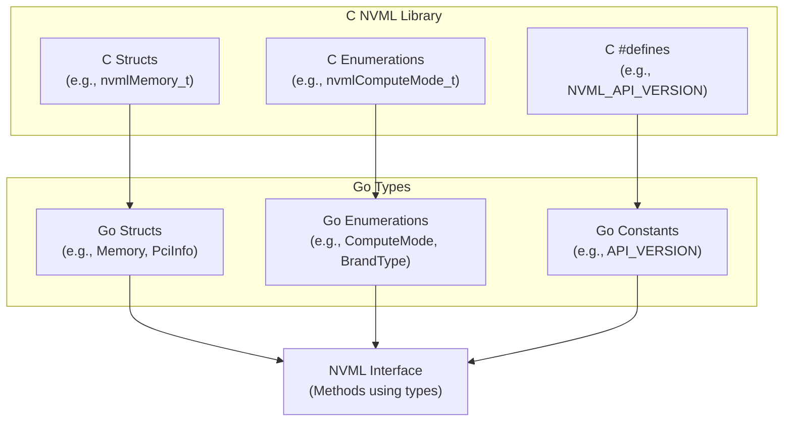
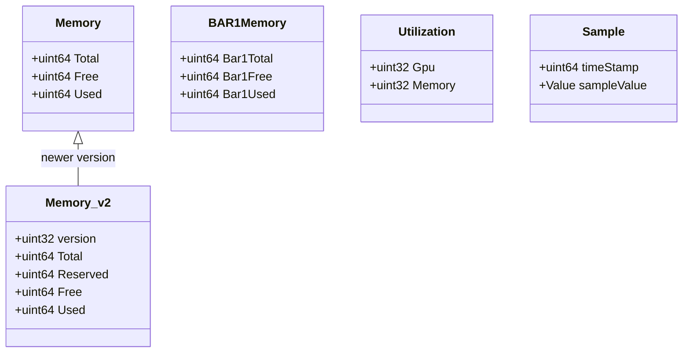
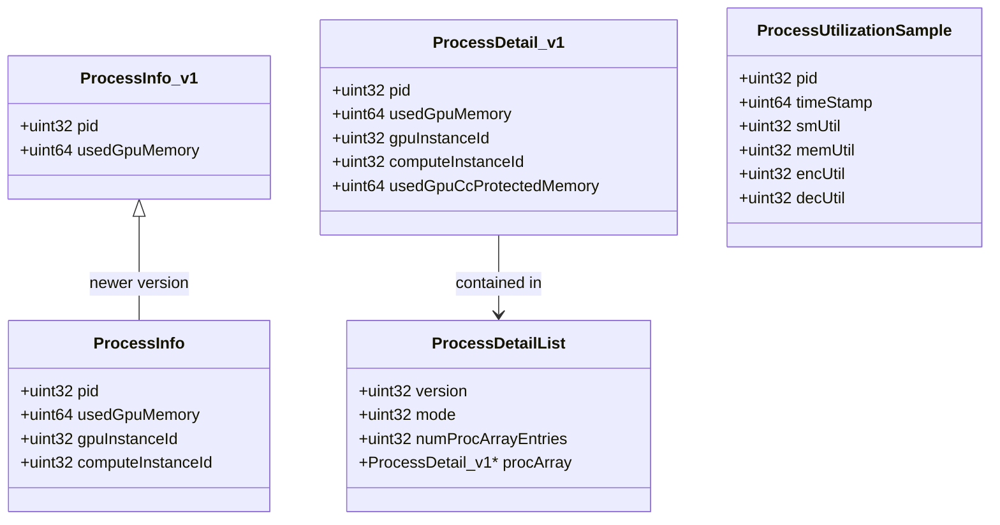
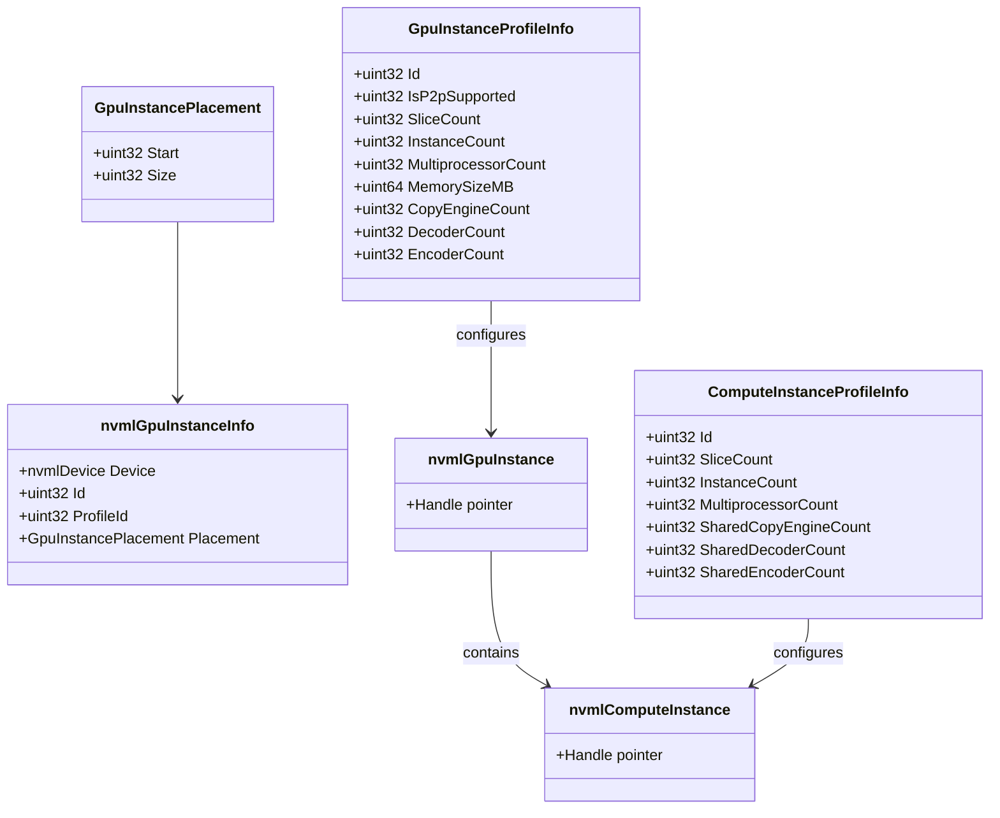
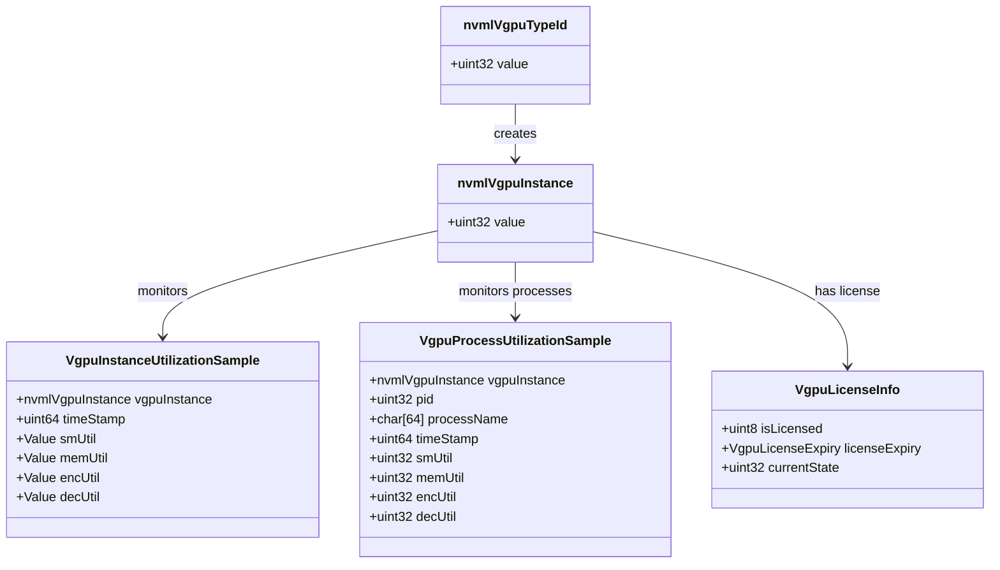
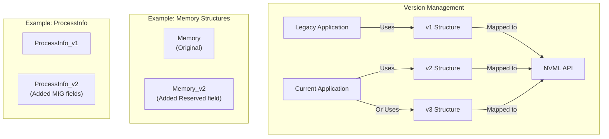

<!-- source: DeepWiki mcp.deepwiki.com · repo NVIDIA/go-nvml · page 3.3 Types and Constants · fetched 2026-10-26 -->

# Types and Constants

<details>
<summary>Relevant source files</summary>

The following files were used as context for generating this wiki page:

- [pkg/nvml/const.go](pkg/nvml/const.go)
- [pkg/nvml/nvml.h](pkg/nvml/nvml.h)
- [pkg/nvml/types_gen.go](pkg/nvml/types_gen.go)

</details>


This page documents the data structures, enumerations, and constants used throughout the Go NVML bindings. These types and constants are direct mappings from the C-based NVIDIA Management Library (NVML) into Go, providing type-safe access to NVIDIA GPU information and capabilities.

For information about error handling mechanisms, see [Error Handling](#3.4).

## Type System Overview

The Go-NVML bindings use automatically generated type definitions to maintain compatibility with the C NVML library. The type system includes device handles, measurement structures, configuration settings, and capability flags.



Sources: [pkg/nvml/types_gen.go:1-909](), [pkg/nvml/const.go:1-805]()

## Core Type Categories

The NVML Go bindings organize types into several categories:

1. **Handle Types** - Opaque references to NVML objects
2. **Device Information Types** - Structures containing device capabilities and state
3. **Measurement Types** - Structures for performance, utilization, and power metrics
4. **Enumeration Types** - Type-safe constants for states, capabilities, and options
5. **Version-dependent Types** - Types with multiple versions for backward compatibility

```mermaid
classDiagram
    class "Handle Types" {
        nvmlDevice
        nvmlUnit
        nvmlEventSet
        nvmlGpuInstance
        nvmlComputeInstance
    }
    
    class "Device Information" {
        PciInfo
        DeviceAttributes
        GridLicensableFeatures
    }
    
    class "Measurement Types" {
        Memory
        Utilization
        Sample
        ProcessInfo
    }
    
    class "Enumeration Types" {
        ComputeMode
        TemperatureSensors
        BrandType
        ClockType
    }
    
    class "Version-dependent Types" {
        Memory_v2
        ProcessInfo_v1/v2
        VgpuInstancesUtilizationInfo_v1
    }
    
    "Handle Types" --> "Device Information" : references
    "Handle Types" --> "Measurement Types" : provides
    "Handle Types" --> "Version-dependent Types" : supports
    "Enumeration Types" --> "Measurement Types" : used by
```

Sources: [pkg/nvml/types_gen.go:8-910]()

## Handle Types and Device Structures

NVML uses opaque handle types to reference devices, units, and other objects. These handles are passed to API methods to operate on specific devices.

```go
// Primary handle types
type nvmlDevice struct {
    Handle *_Ctype_struct_nvmlDevice_st
}

type nvmlUnit struct {
    Handle *_Ctype_struct_nvmlUnit_st
}

type nvmlEventSet struct {
    Handle *_Ctype_struct_nvmlEventSet_st
}

type nvmlGpuInstance struct {
    Handle *_Ctype_struct_nvmlGpuInstance_st
}

type nvmlComputeInstance struct {
    Handle *_Ctype_struct_nvmlComputeInstance_st
}
```

Key device-related structures include:

| Structure | Description |
|-----------|-------------|
| `PciInfo` | PCI bus information for a GPU device |
| `PciInfoExt` | Extended PCI information with additional fields |
| `DeviceAttributes` | Core capabilities of a GPU device |
| `Memory` | Memory allocation statistics |
| `Utilization` | GPU and memory utilization percentages |
| `ProcessInfo` | Information about processes using GPU resources |

Sources: [pkg/nvml/types_gen.go:8-20](), [pkg/nvml/types_gen.go:36-44](), [pkg/nvml/types_gen.go:53-62](), [pkg/nvml/types_gen.go:119-129]()

## Memory and Performance Types

NVML provides structures to query GPU memory usage, utilization, and performance metrics:



Sources: [pkg/nvml/types_gen.go:53-76](), [pkg/nvml/types_gen.go:162-165]()

## Process Information Types

Structures for monitoring processes using GPU resources:



Sources: [pkg/nvml/types_gen.go:78-117](), [pkg/nvml/types_gen.go:523-531]()

## Enumeration Types

NVML provides numerous enumeration types for various aspects of GPU operation:

| Enumeration Type | Description | Example Values |
|------------------|-------------|----------------|
| `BrandType` | GPU brand classification | `BRAND_QUADRO`, `BRAND_TESLA`, `BRAND_GEFORCE` |
| `ComputeMode` | GPU compute mode setting | `COMPUTEMODE_DEFAULT`, `COMPUTEMODE_EXCLUSIVE_PROCESS` |
| `ClockType` | GPU clock domains | `CLOCK_GRAPHICS`, `CLOCK_SM`, `CLOCK_MEM` |
| `TemperatureSensors` | Temperature sensor locations | `TEMPERATURE_GPU` |
| `MemoryErrorType` | Types of memory errors | `MEMORY_ERROR_TYPE_CORRECTED`, `MEMORY_ERROR_TYPE_UNCORRECTED` |
| `EccCounterType` | Types of ECC counters | `VOLATILE_ECC`, `AGGREGATE_ECC` |
| `GpuVirtualizationMode` | GPU virtualization mode | `GPU_VIRTUALIZATION_MODE_NONE`, `GPU_VIRTUALIZATION_MODE_VGPU` |
| `Return` | API return status codes | `SUCCESS`, `ERROR_NOT_SUPPORTED`, `ERROR_INVALID_ARGUMENT` |

Sources: [pkg/nvml/const.go:807-1187](), [pkg/nvml/const.go:1227-1322](), [pkg/nvml/const.go:1152-1186]()

## Constants

The NVML Go bindings define several categories of constants:

### API Version Constants

```go
// API version information
const API_VERSION = 12
const API_VERSION_STR = "12"
```

### Buffer Size Constants

These constants define buffer sizes for strings and arrays:

```go
const DEVICE_PCI_BUS_ID_BUFFER_SIZE = 32
const DEVICE_UUID_BUFFER_SIZE = 80
const DEVICE_NAME_BUFFER_SIZE = 64
const SYSTEM_DRIVER_VERSION_BUFFER_SIZE = 80
// ... and more
```

### Feature Flag Constants

```go
const FlagDefault = 0
const FlagForce = 1
```

### Limit and Feature Constants

```go
const NVLINK_MAX_LINKS = 18
const MAX_PHYSICAL_BRIDGE = 128
const MAX_THERMAL_SENSORS_PER_GPU = 3
const VALUE_NOT_AVAILABLE = -1
```

Sources: [pkg/nvml/const.go:30-804]()

## MIG-related Types

Multi-Instance GPU (MIG) functionality has specialized types:



Sources: [pkg/nvml/types_gen.go:755-874]()

## vGPU-related Types

Virtual GPU support includes numerous types:



Sources: [pkg/nvml/types_gen.go:196-222](), [pkg/nvml/types_gen.go:234-353]()

## Temperature and Thermal Types

Structures for monitoring GPU temperature:

```go
typedef struct {
    TemperatureController controller;
    int defaultMinTemp;
    int defaultMaxTemp;
    int currentTemp;
    TemperatureTarget target;
} GpuThermalSettingsSensor;

typedef struct {
    unsigned int count;
    GpuThermalSettingsSensor sensor[NVML_MAX_THERMAL_SENSORS_PER_GPU];
} GpuThermalSettings;
```

Sources: [pkg/nvml/types_gen.go:172-183]()

## Error Return Codes

NVML uses a comprehensive set of error codes to indicate the result of operations:

```go
// Return codes for NVML API calls
type Return int32

const (
    SUCCESS                         Return = iota
    ERROR_UNINITIALIZED             Return = 1
    ERROR_INVALID_ARGUMENT          Return = 2
    ERROR_NOT_SUPPORTED             Return = 3
    ERROR_NO_PERMISSION             Return = 4
    ERROR_ALREADY_INITIALIZED       Return = 5
    ERROR_NOT_FOUND                 Return = 6
    ERROR_INSUFFICIENT_SIZE         Return = 7
    ERROR_INSUFFICIENT_POWER        Return = 8
    // ... many more error codes ...
    ERROR_UNKNOWN                   Return = 999
)
```

Sources: [pkg/nvml/const.go:1152-1187]()

## Versioned Types

The NVML API supports versioned structures to maintain backward compatibility:



Many structures have versioned variants to support API evolution while maintaining backward compatibility:

| Base Type | Versioned Types | Key Differences |
|-----------|-----------------|-----------------|
| Memory | Memory_v2 | Adds Reserved field and version tracking |
| ProcessInfo | ProcessInfo_v1, ProcessInfo_v2 | v2 adds MIG-related fields |
| GpuInstanceProfileInfo | v1, v2, v3 | v2 adds Name field, v3 adds Capabilities |
| ComputeInstanceProfileInfo | v1, v2, v3 | Similar progression of capabilities |
| VgpuInstancesUtilizationInfo | v1 | Basic vGPU utilization tracking |

Sources: [pkg/nvml/types_gen.go:64-70](), [pkg/nvml/types_gen.go:78-95](), [pkg/nvml/types_gen.go:774-805]()

## Capability Flag Constants

Many NVML structures use bit flags to represent capabilities:

```go
// GPU Instance capability flags
const GPU_INTSTANCE_PROFILE_CAPS_P2P = 1

// Clock throttle reason flags
const ClocksThrottleReasonGpuIdle = 1
const ClocksThrottleReasonApplicationsClocksSetting = 2
const ClocksThrottleReasonUserDefinedClocks = 2
const ClocksThrottleReasonSwPowerCap = 4
const ClocksThrottleReasonHwSlowdown = 8
// ... and many more
```

Sources: [pkg/nvml/const.go:611-626](), [pkg/nvml/const.go:767-768]()

## Field Identifiers

NVML uses constants to identify specific metrics and properties that can be queried:

```go
// Field identifiers for various device metrics
const FI_DEV_ECC_CURRENT = 1
const FI_DEV_ECC_PENDING = 2
const FI_DEV_ECC_SBE_VOL_TOTAL = 3
const FI_DEV_ECC_DBE_VOL_TOTAL = 4
// ... many more field identifiers ...
const FI_MAX = 200
```

Sources: [pkg/nvml/const.go:174-568]()

## Architecture Constants

Constants that identify GPU architectures:

```go
const DEVICE_ARCH_KEPLER = 2
const DEVICE_ARCH_MAXWELL = 3
const DEVICE_ARCH_PASCAL = 4
const DEVICE_ARCH_VOLTA = 5
const DEVICE_ARCH_TURING = 6
const DEVICE_ARCH_AMPERE = 7
const DEVICE_ARCH_ADA = 8
const DEVICE_ARCH_HOPPER = 9
const DEVICE_ARCH_UNKNOWN = 4294967295
```

Sources: [pkg/nvml/const.go:116-132]()

## Summary

The NVML Go bindings provide a comprehensive type system that maps directly to the C NVML library's types, enumerations, and constants. These types enable Go applications to interact with NVIDIA GPUs in a type-safe manner, accessing detailed information about GPU state, configuration, and performance.

The versioned structure system allows for API evolution while maintaining backward compatibility, and the various enumeration types provide type safety for operations that would otherwise rely on magic number constants.

---

