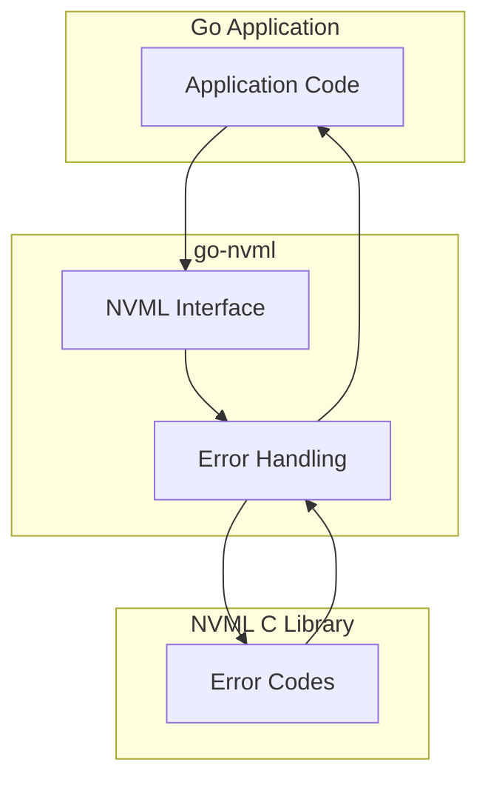
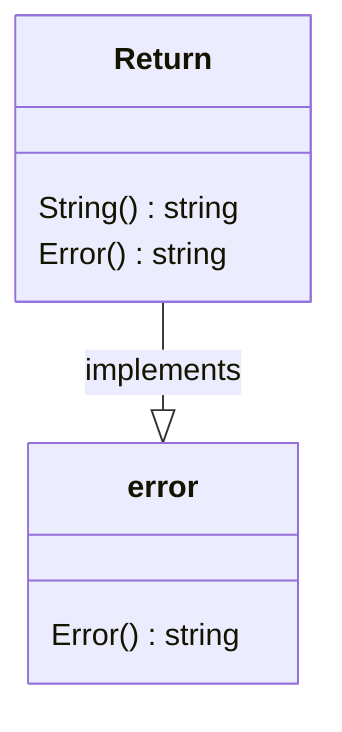
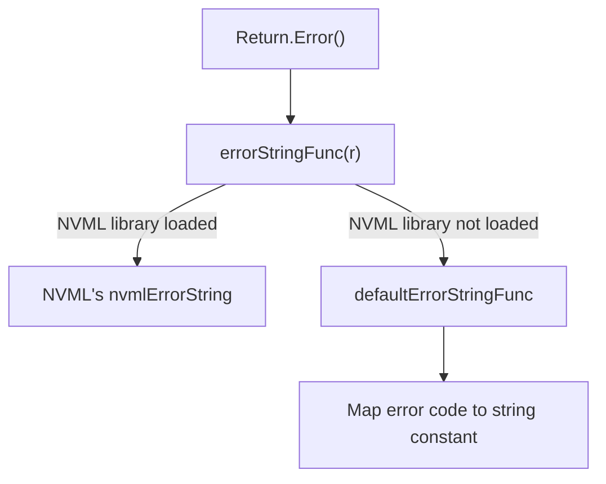
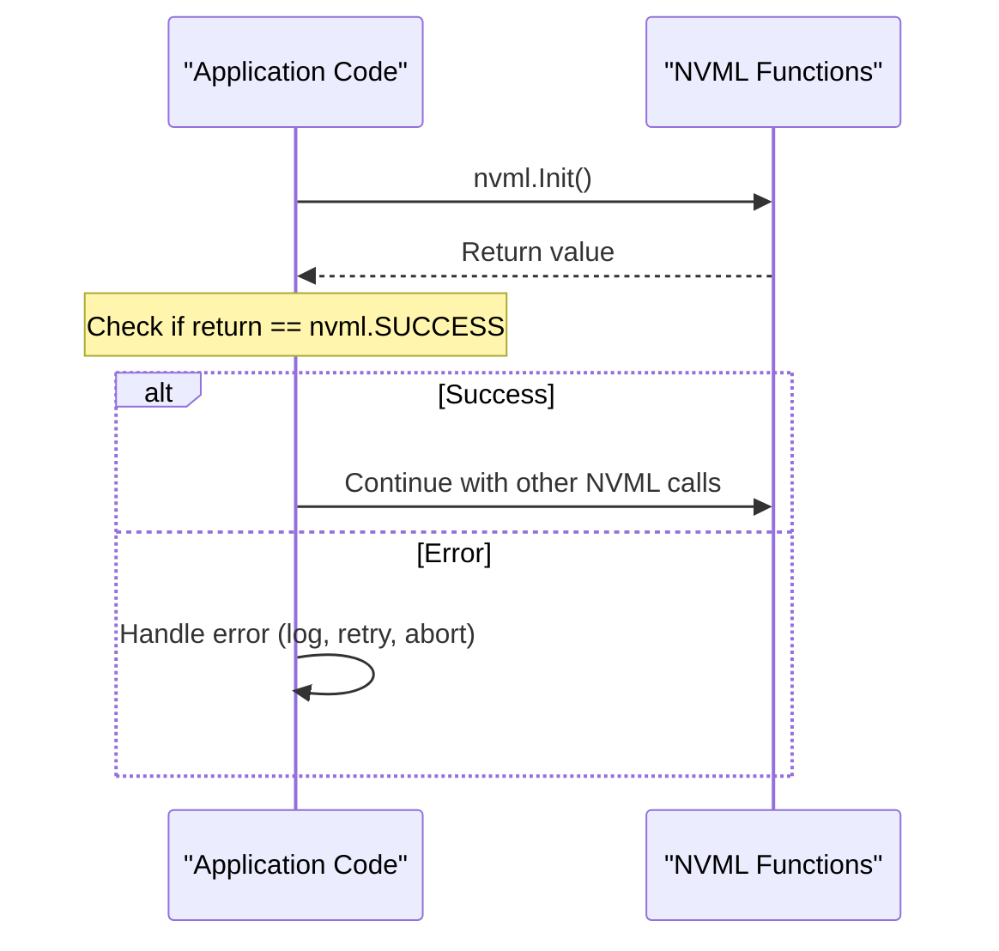
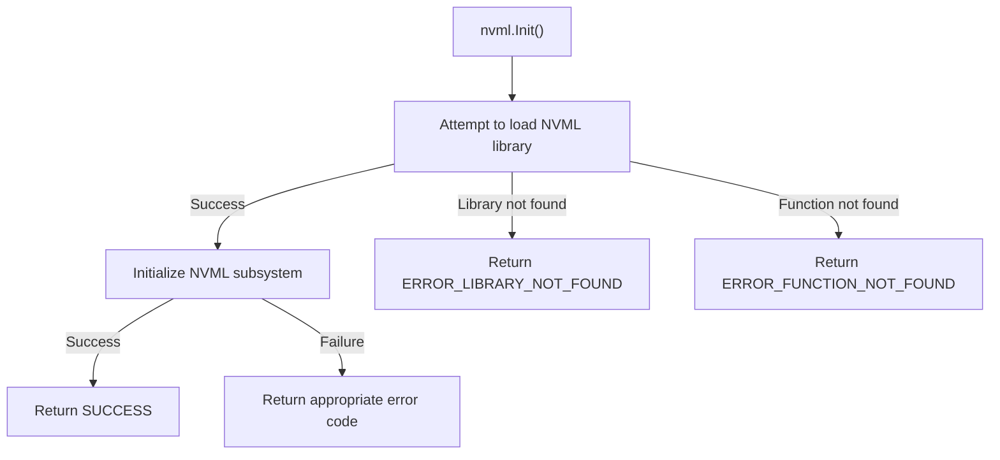

<!-- source: DeepWiki mcp.deepwiki.com · repo NVIDIA/go-nvml · page 3.4 Error Handling · fetched 2026-10-26 -->

# Error Handling

<details>
<summary>Relevant source files</summary>

The following files were used as context for generating this wiki page:

- [pkg/nvml/return.go](pkg/nvml/return.go)

</details>


This document describes the error handling mechanisms in the go-nvml library. It covers how errors are represented, propagated, and handled when interacting with the NVIDIA Management Library through Go bindings. For information about specific error types related to features like GPU virtualization, see [GPU Features](#4).

## Overview of Error Handling

The go-nvml library bridges C-style error codes from the NVML C library with Go's error interface. This approach maintains compatibility with the original C library while providing idiomatic error handling in Go applications.



Sources: [pkg/nvml/return.go:15-34]()

## The Return Type

At the core of error handling in go-nvml is the `Return` type, which represents NVML error codes. The `Return` type implements Go's standard `error` interface, making it compatible with idiomatic Go error handling.



The `Return` type provides two methods:
- `String()`: Returns the string representation of a Return value
- `Error()`: Returns the string representation, implementing the error interface

Sources: [pkg/nvml/return.go:26-34]()

## Error Code Constants

NVML defines numerous error code constants, which are exposed in the go-nvml bindings. These constants are used to indicate the success or failure of operations.

| Constant | Meaning |
|----------|---------|
| SUCCESS | Operation completed successfully |
| ERROR_UNINITIALIZED | NVML was not first initialized |
| ERROR_INVALID_ARGUMENT | Invalid argument passed |
| ERROR_NOT_SUPPORTED | Operation not supported |
| ERROR_NO_PERMISSION | User lacks permission |
| ERROR_ALREADY_INITIALIZED | Library already initialized |
| ERROR_NOT_FOUND | Item not found |
| ERROR_INSUFFICIENT_SIZE | Buffer too small |
| ERROR_DRIVER_NOT_LOADED | Driver not loaded |
| ERROR_TIMEOUT | Driver took too long to respond |
| ERROR_LIBRARY_NOT_FOUND | NVML library not found |
| ERROR_FUNCTION_NOT_FOUND | Function not found in NVML library |
| ERROR_GPU_IS_LOST | GPU has fallen off the bus |
| ERROR_RESET_REQUIRED | GPU requires reset |
| ERROR_UNKNOWN | Unknown error |

This is a subset of the available error codes. For a complete list, refer to the NVML documentation or the default error mapping implementation.

Sources: [pkg/nvml/return.go:42-102]()

## Error String Conversion

When you call the `Error()` method on a `Return` value, it converts the numeric error code to a human-readable string. This conversion is handled by a function referenced by the `errorStringFunc` variable:



The `defaultErrorStringFunc` provides a fallback mechanism that works even when the NVML library isn't loaded. It maps known error codes to their string representations. This design ensures that meaningful error messages are available even if the NVIDIA driver or NVML library is not present.

Sources: [pkg/nvml/return.go:31-38](), [pkg/nvml/return.go:42-103]()

## Practical Error Handling

When working with go-nvml, you should check the return value of each NVML function against `SUCCESS` to determine if the operation succeeded:



Here's a typical error handling pattern in code:

```go
// Initialize NVML
ret := nvml.Init()
if ret != nvml.SUCCESS {
    log.Fatalf("Failed to initialize NVML: %v", ret)
}
defer nvml.Shutdown()

// Get the device count
count, ret := nvml.DeviceGetCount()
if ret != nvml.SUCCESS {
    log.Fatalf("Failed to get device count: %v", ret)
}

// Process each device
for i := 0; i < count; i++ {
    device, ret := nvml.DeviceGetHandleByIndex(i)
    if ret != nvml.SUCCESS {
        log.Printf("Failed to get device %d: %v", i, ret)
        continue
    }
    
    // Use device...
}
```

This pattern ensures that errors are properly checked and handled at each step of interaction with the NVML library.

Sources: Common usage patterns for NVML bindings

## Error Handling Best Practices

1. **Always check return values**:
   ```go
   ret := nvmlFunction()
   if ret != nvml.SUCCESS {
       // Handle error
   }
   ```

2. **Use defer for cleanup**:
   ```go
   ret := nvml.Init()
   if ret != nvml.SUCCESS {
       return fmt.Errorf("nvml init failed: %v", ret)
   }
   defer nvml.Shutdown()
   ```

3. **Handle specific error codes when appropriate**:
   ```go
   if ret == nvml.ERROR_NOT_SUPPORTED {
       // Handle unsupported feature specifically
   } else if ret != nvml.SUCCESS {
       // Handle other errors generally
   }
   ```

4. **Convert errors to strings for logging**:
   ```go
   if ret != nvml.SUCCESS {
       log.Printf("Operation failed: %s", ret.Error())
   }
   ```

5. **Gracefully handle missing driver scenarios**:
   ```go
   if ret == nvml.ERROR_LIBRARY_NOT_FOUND || ret == nvml.ERROR_DRIVER_NOT_LOADED {
       log.Println("NVIDIA driver not available, using fallback")
       // Use alternative path
   }
   ```

Sources: [pkg/nvml/return.go:31-34]()

## Error Handling and Library Loading

The go-nvml library dynamically loads the NVML C library at runtime. If the library fails to load or a function isn't found, appropriate error codes are returned:



This design ensures that applications can still handle errors gracefully even if the NVIDIA driver or NVML library is not present on the system.

Sources: [pkg/nvml/return.go:36-42]() and system architecture diagram

## Common Error Scenarios

| Error | Common Causes | Recommended Actions |
|-------|--------------|-------------------|
| ERROR_LIBRARY_NOT_FOUND | NVIDIA driver not installed | Install NVIDIA drivers |
| ERROR_DRIVER_NOT_LOADED | NVIDIA driver installed but not loaded | Check driver status with `nvidia-smi` |
| ERROR_UNINITIALIZED | Calling NVML functions before `nvml.Init()` | Always call `nvml.Init()` first |
| ERROR_NO_PERMISSION | Insufficient privileges | Run as administrator/root |
| ERROR_INVALID_ARGUMENT | Incorrect parameter value | Check parameter values |
| ERROR_NOT_SUPPORTED | Function not supported on current configuration | Check hardware/driver compatibility |
| ERROR_GPU_IS_LOST | Communication with GPU lost | Reset system or check GPU connection |

Sources: Common usage patterns and error scenarios in NVML applications

---

