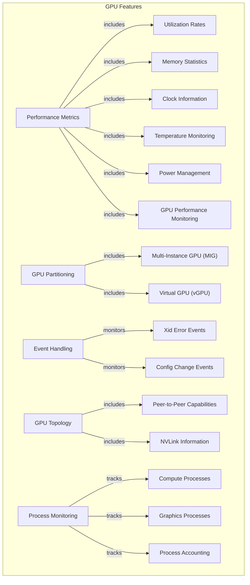
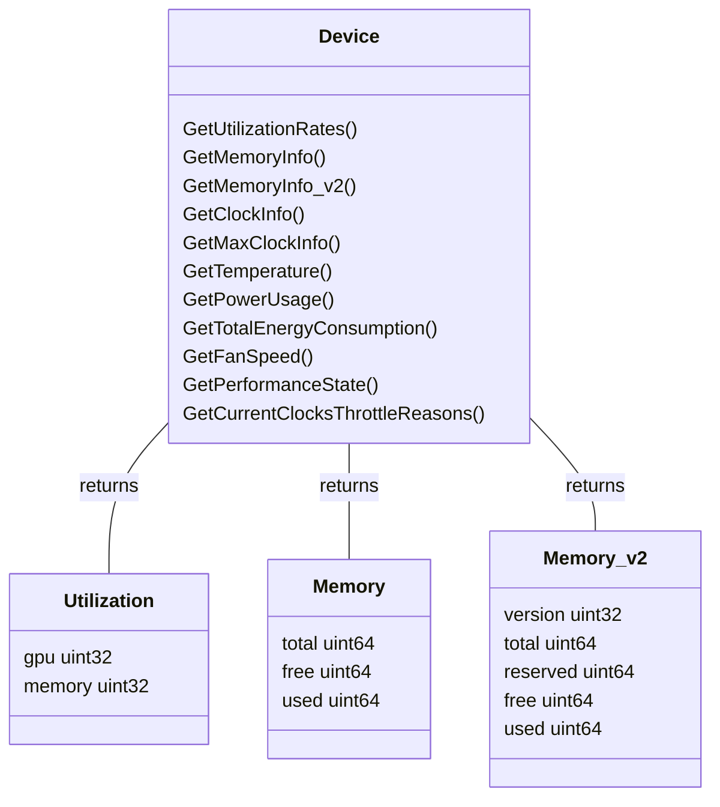
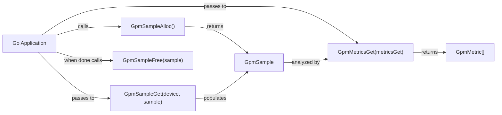
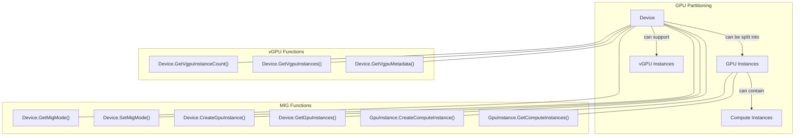
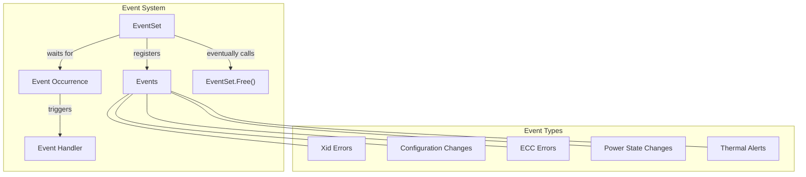
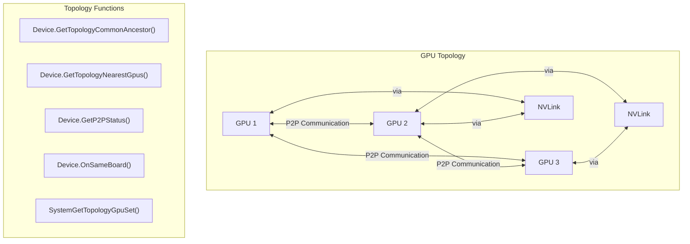
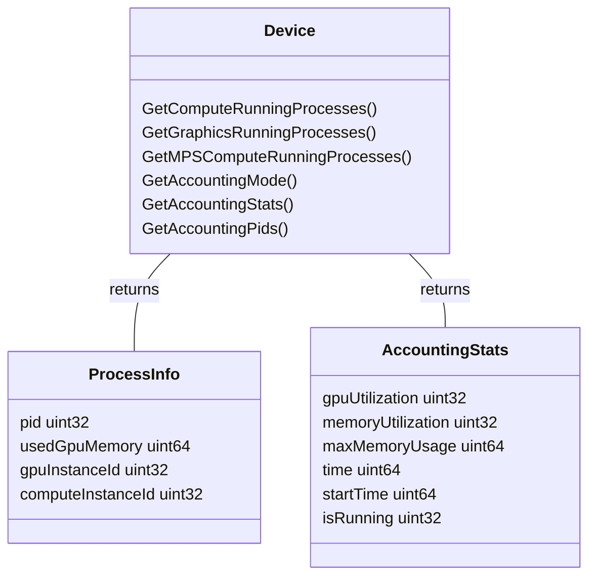
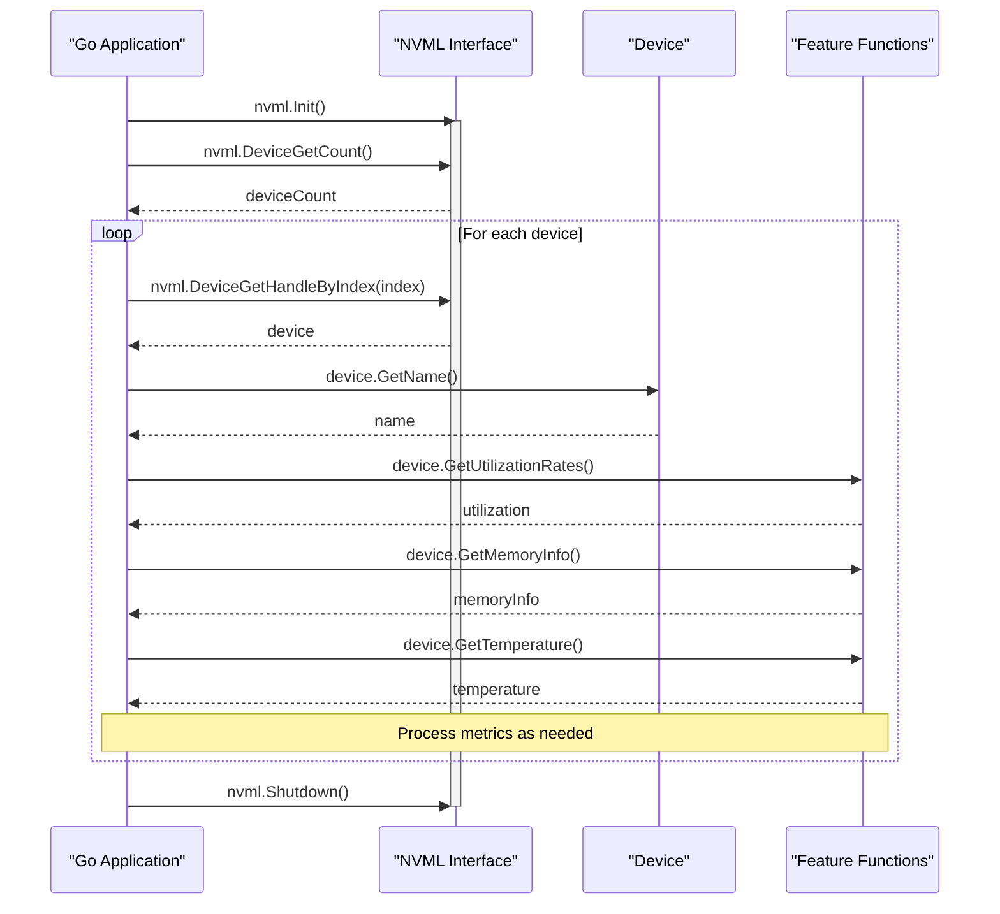

<!-- source: DeepWiki mcp.deepwiki.com · repo NVIDIA/go-nvml · page 4 GPU Features · fetched 2026-10-26 -->

# GPU Features

Relevant source files

The following files were used as context for generating this wiki page:

- [pkg/nvml/device.go](pkg/nvml/device.go)
- [pkg/nvml/gpm.go](pkg/nvml/gpm.go)
- [pkg/nvml/nvml.go](pkg/nvml/nvml.go)
- [pkg/nvml/system.go](pkg/nvml/system.go)

This page provides an overview of the specialized GPU features accessible through the go-nvml bindings. It covers the broad categories of functionality that allow Go applications to monitor, manage, and interact with NVIDIA GPUs. For details about the core API structure, see [Core API](#3).

## Feature Overview

The go-nvml bindings provide access to various GPU features that can be broadly categorized into the following areas:

Sources: [pkg/nvml/device.go:1-1407](), [pkg/nvml/gpm.go:1-171]()

## Performance Metrics

The Go bindings provide extensive capabilities for monitoring GPU performance metrics, which are essential for understanding GPU utilization and optimizing applications.

Key performance metrics functions include:

- **Utilization Metrics**: Monitor GPU and memory utilization percentages using `Device.GetUtilizationRates()`
- **Memory Statistics**: Get detailed memory allocation information with `Device.GetMemoryInfo()` and the more detailed `Device.GetMemoryInfo_v2()`
- **Clock Information**: Retrieve clock speeds for various GPU components with `Device.GetClockInfo()` and `Device.GetMaxClockInfo()`
- **Temperature Monitoring**: Monitor GPU temperature with `Device.GetTemperature()`
- **Power Consumption**: Track power usage with `Device.GetPowerUsage()` and `Device.GetTotalEnergyConsumption()`

For more detailed information about performance metrics, see [Performance Metrics](#4.1).

Sources: [pkg/nvml/device.go:788-808]()(Memory info), [pkg/nvml/device.go:897-907]()(Utilization rates), [pkg/nvml/device.go:464-483]()(Clock info), [pkg/nvml/device.go:622-631]()(Temperature), [pkg/nvml/device.go:743-763]()(Power usage)

## GPU Performance Monitoring (GPM)

NVML provides a more advanced GPU Performance Monitoring system that allows for detailed metric collection and analysis:

The GPM functions allow for:
- Creating a sample container with `GpmSampleAlloc()`
- Collecting metric samples from a device with `GpmSampleGet()`
- Analyzing samples to extract metrics with `GpmMetricsGet()`
- Proper cleanup with `GpmSampleFree()`

This system provides a more comprehensive set of metrics than the basic utilization functions.

Sources: [pkg/nvml/gpm.go:79-106]()

## GPU Partitioning and Virtualization

NVML supports technologies for partitioning and virtualizing GPUs to enable multi-tenant workloads.

### Multi-Instance GPU (MIG)

MIG allows you to partition a single physical GPU into multiple isolated GPU instances, each with its own memory, compute resources, and bandwidth. The API provides functions to:

- Get and set MIG mode on a device
- Create and manage GPU instances
- Create and manage compute instances within GPU instances
- Monitor MIG configurations and resources

For more detailed information, see [Multi-Instance GPU (MIG)](#4.2).

### Virtual GPU (vGPU)

Virtual GPU technology enables sharing a physical GPU across multiple virtual machines or containers. The API provides functions to:

- Get the count and list of vGPU instances on a device
- Retrieve metadata about vGPU instances
- Monitor vGPU resource usage and configurations

For more detailed information, see [Virtual GPU (vGPU)](#4.3).

Sources: [pkg/nvml/device.go:60-99]()(GpuInstance and ComputeInstance types)

## Event Handling

NVML supports monitoring various GPU-related events, allowing applications to react to changes in GPU state or configuration.

The event handling system allows applications to:
- Register for specific types of events
- Wait for events to occur with configurable timeouts
- React to events with appropriate handling logic
- Properly clean up event resources

For more detailed information about event handling, see [Event Handling](#4.4).

Sources: [pkg/nvml/device.go:1196-1197]()(References to EventSet in the class diagram)

## GPU Topology and Multi-GPU Management

For systems with multiple GPUs, NVML provides functions to understand and optimize the topology and connectivity between GPUs.

Key topology features include:
- Discovering GPUs near a specific CPU with `SystemGetTopologyGpuSet()`
- Finding GPUs near another GPU with `Device.GetTopologyNearestGpus()`
- Checking peer-to-peer compatibility with `Device.GetP2PStatus()`
- Determining if GPUs share a common ancestor with `Device.GetTopologyCommonAncestor()`
- Checking if GPUs are on the same board with `Device.OnSameBoard()`

Understanding the topology helps optimize multi-GPU workloads by minimizing data transfer costs between GPUs.

Sources: [pkg/nvml/device.go:234-265]()(Topology functions), [pkg/nvml/system.go:67-81]()(System topology functions)

## Process Monitoring

NVML provides capabilities to monitor processes using the GPU, useful for diagnostics and resource management.

Process monitoring functions allow you to:
- Get information about compute processes with `Device.GetComputeRunningProcesses()`
- Get information about graphics processes with `Device.GetGraphicsRunningProcesses()`
- Get information about MPS compute processes with `Device.GetMPSComputeRunningProcesses()`
- Enable and use the accounting system with various accounting functions to track resource usage over time

These functions help identify which processes are consuming GPU resources and how much they're using.

Sources: [pkg/nvml/device.go:1035-1197]()(Process monitoring functions), [pkg/nvml/device.go:1330-1380]()(Accounting functions)

## Integration with Go Applications

To utilize the GPU features provided by go-nvml, applications follow a common pattern:

This sequence demonstrates the typical flow of interacting with GPU features:
1. Initialize the NVML library
2. Get the count of available devices
3. Get handles to each device
4. Query device features as needed
5. Process the obtained metrics
6. Shutdown the NVML library when finished

Sources: [pkg/nvml/nvml.go:15-51]()(Init and Shutdown functions), [pkg/nvml/device.go:100-133]()(Device enumeration functions)

## Summary

The go-nvml bindings provide a rich set of features for interacting with NVIDIA GPUs, ranging from basic monitoring to advanced management capabilities. This page has provided an overview of the main feature categories, which are explored in more detail in the following pages:

- [Performance Metrics](#4.1) - Details about monitoring GPU performance
- [Multi-Instance GPU (MIG)](#4.2) - Information about GPU partitioning capabilities
- [Virtual GPU (vGPU)](#4.3) - Details about GPU virtualization features
- [Event Handling](#4.4) - Information about monitoring GPU events

These GPU features enable Go applications to effectively monitor, manage, and optimize GPU usage for various workloads and scenarios.

Sources: [pkg/nvml/device.go:1-1407](), [pkg/nvml/gpm.go:1-171](), [pkg/nvml/nvml.go:1-1030](), [pkg/nvml/system.go:1-141]()

---

