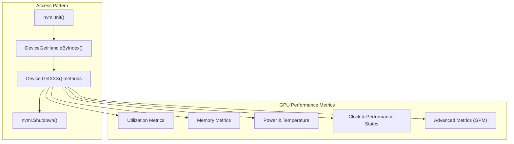
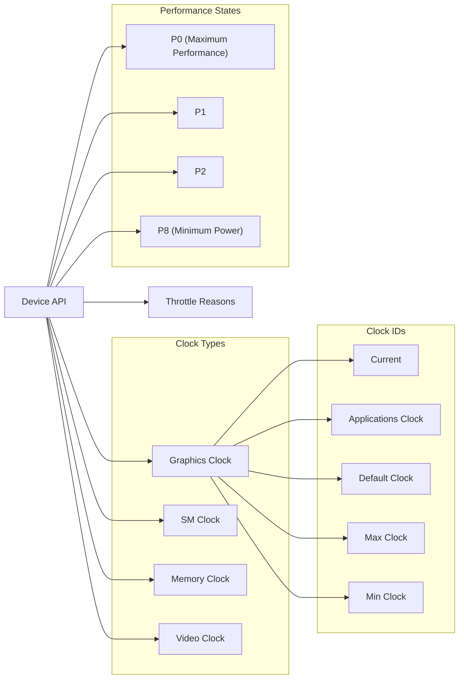
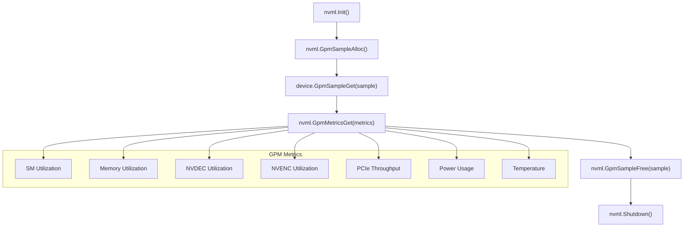

<!-- source: DeepWiki mcp.deepwiki.com · repo NVIDIA/go-nvml · page 4.1 Performance Metrics · fetched 2026-10-26 -->

# Performance Metrics

<details>
<summary>Relevant source files</summary>

The following files were used as context for generating this wiki page:

- [pkg/nvml/device.go](pkg/nvml/device.go)
- [pkg/nvml/gpm.go](pkg/nvml/gpm.go)
- [pkg/nvml/system.go](pkg/nvml/system.go)

</details>


This page provides documentation for monitoring NVIDIA GPU performance metrics using the Go-NVML bindings. It covers utilization, memory usage, power consumption, temperatures, clock speeds, and advanced performance monitoring capabilities available through the NVML API.

## Overview of GPU Performance Metrics

The NVML API provides access to a comprehensive set of real-time GPU performance metrics. These metrics are essential for monitoring GPU health, optimizing workloads, detecting performance bottlenecks, and implementing resource management solutions.



**Diagram: GPU Performance Metrics Overview and Access Pattern**

Sources: [pkg/nvml/device.go:100-140](), [pkg/nvml/device.go:744-908]()

## Core Utilization Metrics

Utilization metrics provide insights into how heavily different components of the GPU are being used.

### GPU and Memory Utilization

The most fundamental performance metric is the GPU utilization rate, which indicates the percentage of time the GPU is actively processing tasks and the memory controller utilization.

```go
// Get GPU and memory utilization rates
utilization, ret := device.GetUtilizationRates()
if ret == nvml.SUCCESS {
    fmt.Printf("GPU Utilization: %d%%\n", utilization.Gpu)
    fmt.Printf("Memory Utilization: %d%%\n", utilization.Memory)
}
```

The `Utilization` struct provides two key metrics:
- `Gpu`: Percentage of time the GPU is actively processing (0-100)
- `Memory`: Percentage of time the memory controller is busy (0-100)

Sources: [pkg/nvml/device.go:898-907]()

### Encoder and Decoder Utilization

For applications involving video encoding or decoding, NVML provides metrics to monitor the utilization of dedicated hardware encoders and decoders.

```go
// Get encoder utilization
encoderUtilization, samplingPeriodUs, ret := device.GetEncoderUtilization()
if ret == nvml.SUCCESS {
    fmt.Printf("Encoder Utilization: %d%%\n", encoderUtilization)
}

// Get decoder utilization
decoderUtilization, samplingPeriodUs, ret := device.GetDecoderUtilization()
if ret == nvml.SUCCESS {
    fmt.Printf("Decoder Utilization: %d%%\n", decoderUtilization)
}
```

Sources: [pkg/nvml/device.go:910-918](), [pkg/nvml/device.go:962-971]()

### Process-Specific Utilization

NVML can track GPU utilization for individual processes, which is valuable for identifying which applications are consuming GPU resources.

```go
// Get process utilization samples
lastSeenTimestamp := uint64(0) // Use 0 to get all samples
samples, ret := device.GetProcessUtilization(lastSeenTimestamp)
if ret == nvml.SUCCESS {
    for _, sample := range samples {
        fmt.Printf("Process ID: %d, GPU Utilization: %d%%\n", 
                  sample.Pid, sample.SmUtil)
    }
}
```

The `ProcessUtilizationSample` struct provides detailed per-process metrics:
- `Pid`: Process ID
- `SmUtil`: SM (Streaming Multiprocessor) utilization percentage
- `MemUtil`: Memory utilization percentage
- `EncUtil`: Encoder utilization percentage
- `DecUtil`: Decoder utilization percentage

Sources: [pkg/nvml/device.go:1810-1819]()

## Memory Metrics

Memory usage metrics help monitor how GPU memory is being allocated and used.

```mermaid
classDiagram
    class "Memory" {
        +uint64 Total
        +uint64 Free
        +uint64 Used
    }
    
    class "Memory_v2" {
        +uint32 Version
        +uint64 Total
        +uint64 Reserved
        +uint64 Free
        +uint64 Used
    }
    
    class "BAR1Memory" {
        +uint64 Bar1Total
        +uint64 Bar1Free
        +uint64 Bar1Used
    }
    
    class "Device" {
        +GetMemoryInfo() (Memory, Return)
        +GetMemoryInfo_v2() (Memory_v2, Return)
        +GetBAR1MemoryInfo() (BAR1Memory, Return)
    }
    
    Device -- Memory: provides
    Device -- Memory_v2: provides
    Device -- BAR1Memory: provides
```

**Diagram: GPU Memory Metric Structures**

### Memory Usage

To retrieve basic memory information:

```go
// Get memory info
memInfo, ret := device.GetMemoryInfo()
if ret == nvml.SUCCESS {
    fmt.Printf("Total Memory: %d bytes\n", memInfo.Total)
    fmt.Printf("Free Memory: %d bytes\n", memInfo.Free)
    fmt.Printf("Used Memory: %d bytes\n", memInfo.Used)
}

// Get detailed memory info (v2)
memInfoV2, ret := device.GetMemoryInfo_v2()
if ret == nvml.SUCCESS {
    fmt.Printf("Total Memory: %d bytes\n", memInfoV2.Total)
    fmt.Printf("Reserved Memory: %d bytes\n", memInfoV2.Reserved)
    fmt.Printf("Free Memory: %d bytes\n", memInfoV2.Free)
    fmt.Printf("Used Memory: %d bytes\n", memInfoV2.Used)
}
```

The extended `Memory_v2` structure provides additional information including reserved memory.

Sources: [pkg/nvml/device.go:787-808]()

### BAR1 Memory

Base Address Register 1 (BAR1) is used for mapping device memory for direct access by host or other devices.

```go
// Get BAR1 memory info
bar1Info, ret := device.GetBAR1MemoryInfo()
if ret == nvml.SUCCESS {
    fmt.Printf("BAR1 Total: %d bytes\n", bar1Info.Bar1Total)
    fmt.Printf("BAR1 Free: %d bytes\n", bar1Info.Bar1Free)
    fmt.Printf("BAR1 Used: %d bytes\n", bar1Info.Bar1Used)
}
```

Sources: [pkg/nvml/device.go:1242-1250]()

## Power and Temperature Monitoring

Power and temperature metrics are crucial for monitoring GPU health and power efficiency.

### Power Usage

Power consumption metrics help monitor energy usage and can be used to detect power-related issues.

```go
// Get current power usage
powerUsage, ret := device.GetPowerUsage()
if ret == nvml.SUCCESS {
    fmt.Printf("Power Usage: %d mW\n", powerUsage)
}

// Get total energy consumption
energy, ret := device.GetTotalEnergyConsumption()
if ret == nvml.SUCCESS {
    fmt.Printf("Total Energy Consumption: %d mJ\n", energy)
}
```

You can also retrieve power management limits:

```go
// Get power management limit
powerLimit, ret := device.GetPowerManagementLimit()
if ret == nvml.SUCCESS {
    fmt.Printf("Power Limit: %d mW\n", powerLimit)
}
```

Sources: [pkg/nvml/device.go:744-752](), [pkg/nvml/device.go:755-763](), [pkg/nvml/device.go:711-719]()

### Temperature Monitoring

Temperature monitoring is critical for ensuring GPUs operate within safe thermal limits.

```go
// Get GPU temperature
temperature, ret := device.GetTemperature(nvml.TEMPERATURE_GPU)
if ret == nvml.SUCCESS {
    fmt.Printf("GPU Temperature: %d°C\n", temperature)
}

// Get temperature thresholds
throttleTemp, ret := device.GetTemperatureThreshold(nvml.TEMPERATURE_THRESHOLD_SLOWDOWN)
if ret == nvml.SUCCESS {
    fmt.Printf("Throttle Temperature Threshold: %d°C\n", throttleTemp)
}

shutdownTemp, ret := device.GetTemperatureThreshold(nvml.TEMPERATURE_THRESHOLD_SHUTDOWN)
if ret == nvml.SUCCESS {
    fmt.Printf("Shutdown Temperature Threshold: %d°C\n", shutdownTemp)
}
```

Sources: [pkg/nvml/device.go:623-642]()

### Fan Speed

Fan speed metrics can be useful for monitoring cooling performance.

```go
// Get fan speed (percentage)
fanSpeed, ret := device.GetFanSpeed()
if ret == nvml.SUCCESS {
    fmt.Printf("Fan Speed: %d%%\n", fanSpeed)
}

// Get fan count and individual fan speeds
numFans, ret := device.GetNumFans()
if ret == nvml.SUCCESS {
    for i := 0; i < numFans; i++ {
        speed, ret := device.GetFanSpeed_v2(i)
        if ret == nvml.SUCCESS {
            fmt.Printf("Fan %d Speed: %d%%\n", i, speed)
        }
    }
}
```

Sources: [pkg/nvml/device.go:590-620]()

## Clock and Performance States

Clock frequencies and performance states provide insight into the current operating mode of the GPU.



**Diagram: GPU Clock and Performance States**

### Clock Frequencies

GPU clock frequencies indicate the current operating speed of various GPU components.

```go
// Get current clock frequencies
graphicsClock, ret := device.GetClockInfo(nvml.CLOCK_GRAPHICS)
if ret == nvml.SUCCESS {
    fmt.Printf("Graphics Clock: %d MHz\n", graphicsClock)
}

memoryClock, ret := device.GetClockInfo(nvml.CLOCK_MEM)
if ret == nvml.SUCCESS {
    fmt.Printf("Memory Clock: %d MHz\n", memoryClock)
}

// Get maximum clock frequencies
maxGraphicsClock, ret := device.GetMaxClockInfo(nvml.CLOCK_GRAPHICS)
if ret == nvml.SUCCESS {
    fmt.Printf("Max Graphics Clock: %d MHz\n", maxGraphicsClock)
}
```

You can also retrieve application clocks, which are the preferred clocks when running compute workloads:

```go
// Get applications clocks
appMemoryClock, ret := device.GetApplicationsClock(nvml.CLOCK_MEM)
if ret == nvml.SUCCESS {
    fmt.Printf("Applications Memory Clock: %d MHz\n", appMemoryClock)
}
```

Sources: [pkg/nvml/device.go:464-494]()

### Performance States

Performance states (P-states) indicate the current performance level of the GPU.

```go
// Get current performance state
pstate, ret := device.GetPerformanceState()
if ret == nvml.SUCCESS {
    fmt.Printf("Performance State: P%d\n", pstate)
}
```

Performance states range from P0 (maximum performance) to P15 (minimum performance), though most GPUs use a subset of these states.

Sources: [pkg/nvml/device.go:656-664]()

### Throttle Reasons

NVML can report reasons why a GPU might be throttling its clocks.

```go
// Get current throttle reasons
throttleReasons, ret := device.GetCurrentClocksThrottleReasons()
if ret == nvml.SUCCESS {
    if throttleReasons & nvml.CLOCKS_THROTTLE_REASON_GPU_IDLE != 0 {
        fmt.Println("GPU is idle")
    }
    if throttleReasons & nvml.CLOCKS_THROTTLE_REASON_HW_SLOWDOWN != 0 {
        fmt.Println("Hardware slowdown (high temperature)")
    }
    // Check other throttle reasons as needed
}
```

Sources: [pkg/nvml/device.go:667-675]()

## Advanced Performance Monitoring

For more detailed performance analysis, NVML provides advanced monitoring capabilities.

### Samples Collection

The `DeviceGetSamples` function provides time-series data for various performance metrics.

```go
// Get samples for power usage
valueType, samples, ret := device.GetSamples(nvml.SAMPLINGTYPE_GPU_UTILIZATION, 0)
if ret == nvml.SUCCESS {
    for _, sample := range samples {
        fmt.Printf("Timestamp: %d, Value: %d\n", sample.TimeStamp, sample.SampleValue.UintVal)
    }
}
```

Sources: [pkg/nvml/device.go:1222-1239]()

### GPU Performance Monitor (GPM)

For advanced performance monitoring, NVML provides the GPU Performance Monitor (GPM) API, which offers comprehensive performance metrics with minimal overhead.



**Diagram: GPU Performance Monitor (GPM) Workflow**

The GPM API follows this general workflow:

1. Allocate a GPM sample
2. Collect a sample from the device
3. Process the sample to extract metrics
4. Free the sample when done

```go
// Initialize NVML
ret := nvml.Init()
if ret != nvml.SUCCESS {
    fmt.Printf("Failed to initialize NVML: %v\n", ret)
    return
}
defer nvml.Shutdown()

// Get device handle
device, ret := nvml.DeviceGetHandleByIndex(0)
if ret != nvml.SUCCESS {
    fmt.Printf("Failed to get device: %v\n", ret)
    return
}

// Allocate GPM sample
sample, ret := nvml.GpmSampleAlloc()
if ret != nvml.SUCCESS {
    fmt.Printf("Failed to allocate GPM sample: %v\n", ret)
    return
}
defer nvml.GpmSampleFree(sample)

// Get sample from device
ret = device.GpmSampleGet(sample)
if ret != nvml.SUCCESS {
    fmt.Printf("Failed to get GPM sample: %v\n", ret)
    return
}

// Process metrics
metricsGet := &nvml.GpmMetricsGetType{
    Sample1: sample,
    Sample2: sample,
}
ret = nvml.GpmMetricsGet(metricsGet)
if ret != nvml.SUCCESS {
    fmt.Printf("Failed to process GPM metrics: %v\n", ret)
    return
}

// Access the metrics
for i := uint32(0); i < metricsGet.NumMetrics; i++ {
    metric := metricsGet.Metrics[i]
    fmt.Printf("Metric %d: ID=%d, Value=%f\n", i, metric.Id, metric.Value)
}
```

Sources: [pkg/nvml/gpm.go:50-77](), [pkg/nvml/gpm.go:79-93]()

## Best Practices

When monitoring GPU performance metrics, consider the following best practices:

1. **Sampling Frequency**: Avoid polling metrics too frequently, as this can impact performance. A sampling rate of once per second is sufficient for most monitoring scenarios.

2. **Contextual Analysis**: Analyze related metrics together for better insights. For example, high GPU utilization with low memory utilization might indicate compute-bound workloads.

3. **Throttling Awareness**: Always check for throttling when monitoring performance to detect cases where the GPU is not operating at full capacity due to power, thermal, or other constraints.

4. **Resource Management**: Use metrics to implement resource management policies, such as job scheduling based on GPU utilization or power capping to optimize energy efficiency.

5. **MIG Considerations**: When using Multi-Instance GPU (MIG), monitor instance-specific metrics to ensure appropriate resource allocation. For MIG-specific metrics, see [Multi-Instance GPU (MIG)](#4.2).

## Summary

This page covered the key performance metrics available through the Go-NVML bindings, including:

- GPU and memory utilization
- Memory usage and allocation
- Power consumption and thermal metrics
- Clock frequencies and performance states
- Advanced monitoring with GPU Performance Monitor (GPM)

These metrics provide valuable insights for monitoring, debugging, and optimizing GPU workloads.

Sources: [pkg/nvml/device.go:590-1250](), [pkg/nvml/gpm.go:15-170](), [pkg/nvml/system.go:1-141]()

---

