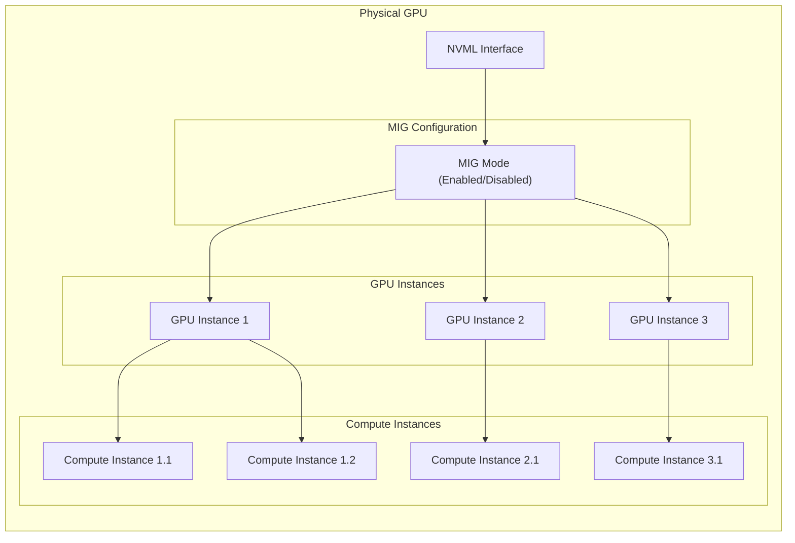
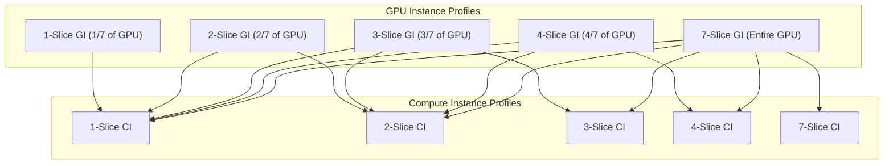
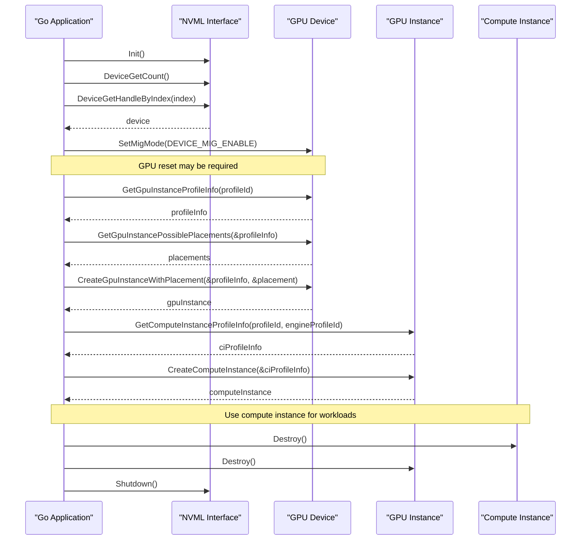
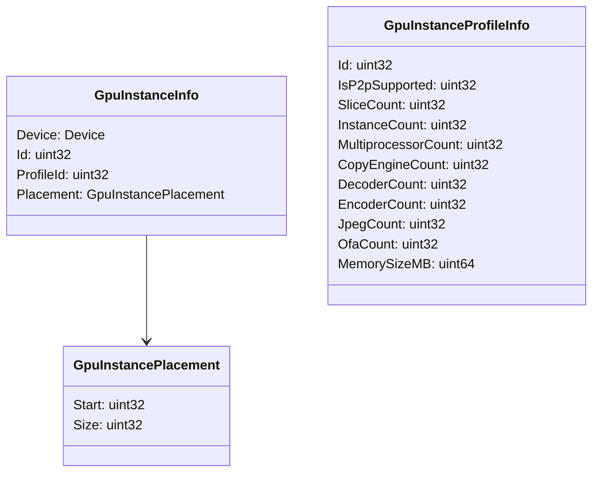
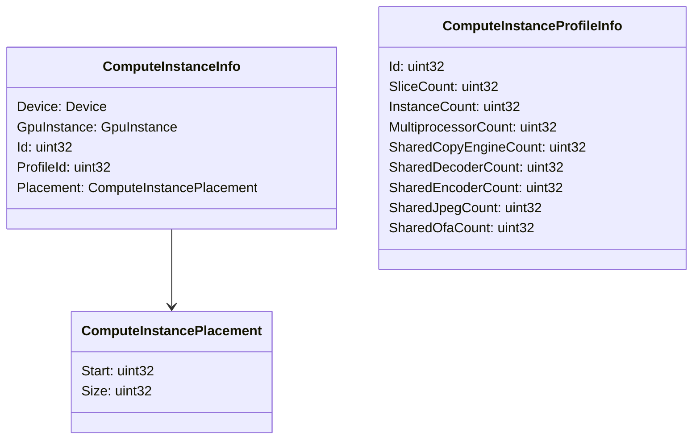

<!-- source: DeepWiki mcp.deepwiki.com · repo NVIDIA/go-nvml · page 4.2 Multi-Instance GPU (MIG) · fetched 2026-10-26 -->

# Multi-Instance GPU (MIG)

<details>
<summary>Relevant source files</summary>

The following files were used as context for generating this wiki page:

- [.github/workflows/golang.yml](.github/workflows/golang.yml)
- [.golangci.yaml](.golangci.yaml)
- [pkg/nvml/device.go](pkg/nvml/device.go)
- [pkg/nvml/mock/dgxa100/dgxa100.go](pkg/nvml/mock/dgxa100/dgxa100.go)
- [pkg/nvml/mock/dgxa100/mig-profile.go](pkg/nvml/mock/dgxa100/mig-profile.go)

</details>


## Purpose and Overview

This document explains how to work with NVIDIA's Multi-Instance GPU (MIG) technology using the go-nvml bindings. MIG allows a single NVIDIA GPU to be partitioned into multiple GPU instances, each with dedicated compute resources, memory, and bandwidth, providing hardware-level isolation between workloads.

For information about Virtual GPU (vGPU) technology, see [Virtual GPU (vGPU)](#4.3).

## MIG Architecture

MIG partitions a GPU into multiple isolated GPU Instances (GIs), each of which can be further divided into one or more Compute Instances (CIs). This partitioning allows multiple applications to run concurrently on a single GPU with predictable performance.



Sources: [pkg/nvml/device.go:63-89](), [pkg/nvml/mock/dgxa100/dgxa100.go:37-65]()

### Key Concepts

1. **GPU Instance (GI)**: A partition of a physical GPU with dedicated resources:
   - GPU Slices (SM units)
   - Memory
   - Copy Engines
   - Media Engines (decoders, encoders, etc.)

2. **Compute Instance (CI)**: A further subdivision of a GPU Instance's compute resources.

3. **Profiles**: Predefined configurations that specify the resources allocated to a GPU or Compute Instance.

4. **Placement**: The physical location on the GPU where an instance is created.

## MIG Profiles

MIG uses standardized profiles to define the resources allocated to GPU Instances and Compute Instances. The profile IDs are defined as constants in the NVML API.

### GPU Instance Profiles

The following table shows common GPU Instance profiles available on NVIDIA A100 GPUs:

| Profile ID | Profile Constant | Slices | Memory (GB) | SMs | Instances per GPU |
|------------|------------------|--------|-------------|-----|-------------------|
| 1 | GPU_INSTANCE_PROFILE_1_SLICE | 1 | ~5 | 14 | 7 |
| 2 | GPU_INSTANCE_PROFILE_2_SLICE | 2 | ~10 | 28 | 3 |
| 3 | GPU_INSTANCE_PROFILE_3_SLICE | 3 | ~20 | 42 | 2 |
| 4 | GPU_INSTANCE_PROFILE_4_SLICE | 4 | ~20 | 56 | 1 |
| 7 | GPU_INSTANCE_PROFILE_7_SLICE | 7 | ~40 | 98 | 1 |

Sources: [pkg/nvml/mock/dgxa100/mig-profile.go:29-121]()

### Compute Instance Profiles

Each GPU Instance can host one or more Compute Instances with profiles that must match the parent GPU Instance's capabilities.



Sources: [pkg/nvml/mock/dgxa100/mig-profile.go:122-313]()

## Working with MIG using go-nvml

### Enabling MIG Mode

Before creating GPU Instances, MIG mode must be enabled on the GPU:

```go
// Enable MIG mode on a device
ret, pendingRet := device.SetMigMode(nvml.DEVICE_MIG_ENABLE)
if ret == nvml.SUCCESS && pendingRet == nvml.SUCCESS {
    // MIG mode enabled successfully
} else if pendingRet != nvml.SUCCESS {
    // Requires GPU reset to apply change
}
```

### MIG Configuration Workflow



Sources: [pkg/nvml/mock/dgxa100/dgxa100.go:235-245](), [pkg/nvml/mock/dgxa100/dgxa100.go:274-287](), [pkg/nvml/mock/dgxa100/dgxa100.go:342-346]()

### Creating GPU Instances

To create a GPU Instance, you need to:
1. Get a GPU Instance profile
2. Optionally get possible placements for that profile
3. Create the GPU Instance with or without specifying placement

```go
// Get profile info for a 1-slice GPU Instance
profileInfo, ret := device.GetGpuInstanceProfileInfo(nvml.GPU_INSTANCE_PROFILE_1_SLICE)
if ret != nvml.SUCCESS {
    // Handle error
}

// Create a GPU Instance
gpuInstance, ret := device.CreateGpuInstance(&profileInfo)
if ret != nvml.SUCCESS {
    // Handle error
}
```

With placement:

```go
// Get possible placements
placements, ret := device.GetGpuInstancePossiblePlacements(&profileInfo)
if ret != nvml.SUCCESS || len(placements) == 0 {
    // Handle error or no placements available
}

// Create GPU Instance with specific placement
gpuInstance, ret := device.CreateGpuInstanceWithPlacement(&profileInfo, &placements[0])
if ret != nvml.SUCCESS {
    // Handle error
}
```

Sources: [pkg/nvml/mock/dgxa100/dgxa100.go:244-259](), [pkg/nvml/mock/dgxa100/dgxa100.go:274-287]()

### Creating Compute Instances

After creating a GPU Instance, you can create one or more Compute Instances within it:

```go
// Get compute instance profile info
ciProfileInfo, ret := gpuInstance.GetComputeInstanceProfileInfo(nvml.COMPUTE_INSTANCE_PROFILE_1_SLICE, nvml.COMPUTE_INSTANCE_ENGINE_PROFILE_SHARED)
if ret != nvml.SUCCESS {
    // Handle error
}

// Create a compute instance
computeInstance, ret := gpuInstance.CreateComputeInstance(&ciProfileInfo)
if ret != nvml.SUCCESS {
    // Handle error
}
```

Sources: [pkg/nvml/mock/dgxa100/dgxa100.go:307-327](), [pkg/nvml/mock/dgxa100/dgxa100.go:333-346]()

### Getting MIG Instance Information

To query existing GPU Instances on a device:

```go
// Get all GPU Instances for a specific profile
gpuInstances, ret := device.GetGpuInstances(&profileInfo)
if ret != nvml.SUCCESS {
    // Handle error
}

// Iterate through GPU Instances
for _, gi := range gpuInstances {
    info, ret := gi.GetInfo()
    if ret == nvml.SUCCESS {
        // Use info.Id, info.ProfileId, etc.
    }
    
    // Get compute instances in this GPU Instance
    computeInstances, ret := gi.GetComputeInstances(&ciProfileInfo)
    if ret == nvml.SUCCESS {
        // Use compute instances
    }
}
```

Sources: [pkg/nvml/mock/dgxa100/dgxa100.go:289-299](), [pkg/nvml/mock/dgxa100/dgxa100.go:348-358]()

## Device Structures and MIG Data Types

The go-nvml binding defines several MIG-related data structures:

### GPU Instance



Sources: [pkg/nvml/device.go:63-79](), [pkg/nvml/mock/dgxa100/dgxa100.go:54-60]()

### Compute Instance



Sources: [pkg/nvml/device.go:81-89](), [pkg/nvml/mock/dgxa100/dgxa100.go:62-65]()

## Mock Implementation for Testing

The go-nvml library includes a mock implementation of MIG functionality for the NVIDIA A100 GPU, allowing developers to test MIG-related code without physical hardware.

```go
// Create a mock DGX A100 server with 8 GPUs
server := dgxa100.New()

// Initialize the NVML library with the mock server
nvml.SetLib(server)
ret := nvml.Init()

// Get a device handle
device, ret := nvml.DeviceGetHandleByIndex(0)

// Enable MIG mode
ret, _ := device.SetMigMode(nvml.DEVICE_MIG_ENABLE)

// Work with MIG instances...

// Shutdown when done
nvml.Shutdown()
```

Sources: [pkg/nvml/mock/dgxa100/dgxa100.go:77-95]()

## Limitations and Considerations

1. MIG is only available on select NVIDIA GPU architectures (such as NVIDIA Ampere A100).
2. Once MIG mode is enabled/disabled, a GPU reset is generally required for changes to take effect.
3. GPU Instances created on the same GPU are isolated from each other at the hardware level.
4. Some operations that affect the entire GPU may not be available when MIG mode is enabled.

## Conclusion

Multi-Instance GPU (MIG) provides a way to partition NVIDIA GPUs into multiple isolated instances, each with dedicated resources. The go-nvml binding provides a comprehensive API to manage MIG configurations, making it possible to create, query, and destroy GPU Instances and Compute Instances programmatically.

For testing without physical hardware, the mock implementation in `pkg/nvml/mock/dgxa100` provides a complete simulation of MIG functionality on an NVIDIA DGX A100 server.

---

