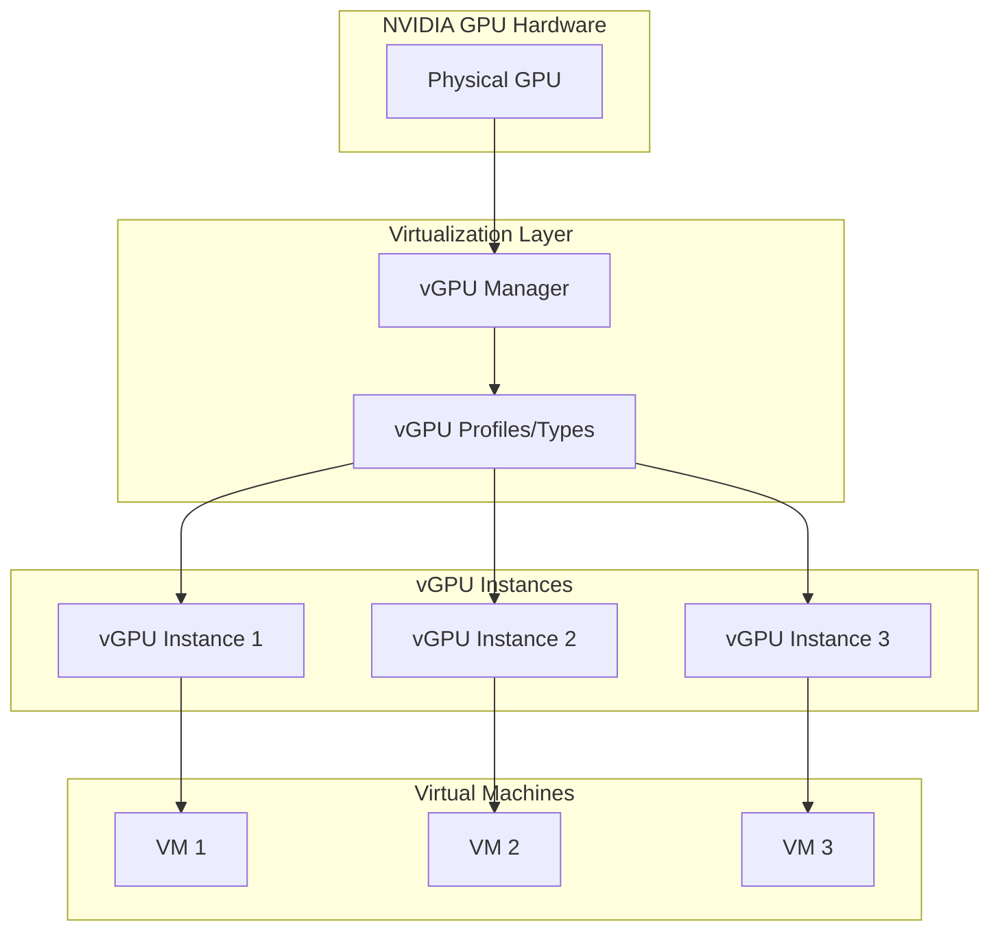
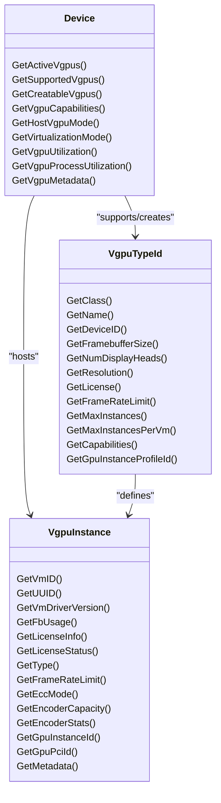
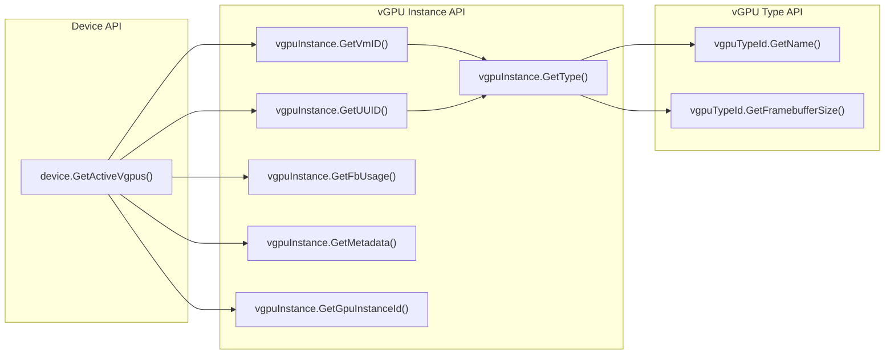

<!-- source: DeepWiki mcp.deepwiki.com · repo NVIDIA/go-nvml · page 4.3 Virtual GPU (vGPU) · fetched 2026-10-26 -->

# Virtual GPU (vGPU)

<details>
<summary>Relevant source files</summary>

The following files were used as context for generating this wiki page:

- [pkg/nvml/mock/device.go](pkg/nvml/mock/device.go)
- [pkg/nvml/mock/vgputypeid.go](pkg/nvml/mock/vgputypeid.go)
- [pkg/nvml/vgpu.go](pkg/nvml/vgpu.go)

</details>


## Introduction

This document describes the Virtual GPU (vGPU) functionality provided by the go-nvml bindings. NVIDIA's vGPU technology allows a physical GPU to be virtualized and shared among multiple virtual machines, providing hardware-accelerated graphics and compute capabilities to virtualized environments. The Go bindings enable management and monitoring of vGPU resources from Go applications.

For information about Multi-Instance GPU (MIG) technology, which offers a different approach to GPU partitioning, see [Multi-Instance GPU (MIG)](#4.2).

Sources: [pkg/nvml/vgpu.go:1-481]()

## vGPU Architecture Overview

NVIDIA vGPU enables the sharing of a single physical GPU among multiple virtual machines. The physical GPU is partitioned into multiple virtual GPU instances, each with its own dedicated framebuffer, encoders, and compute resources.



Sources: [pkg/nvml/vgpu.go:1-481]()

## Core vGPU Components in go-nvml

The go-nvml bindings provide interfaces for working with vGPU types and instances, allowing applications to query, manage, and monitor virtual GPUs.



Sources: [pkg/nvml/vgpu.go:21-481](), [pkg/nvml/mock/device.go:745-1252](), [pkg/nvml/mock/vgputypeid.go:11-584]()

## Working with vGPU Types

vGPU types represent the different profiles that define the capabilities of virtual GPUs. Each vGPU type has specific characteristics such as framebuffer size, number of display heads, and maximum resolution.

### Retrieving vGPU Types

To get the vGPU types supported by a physical GPU:

```go
// Get supported vGPU types
supportedTypes, ret := device.GetSupportedVgpus()
if ret != nvml.SUCCESS {
    // Handle error
}

// Get creatable vGPU types 
creatableTypes, ret := device.GetCreatableVgpus()
if ret != nvml.SUCCESS {
    // Handle error
}
```

Sources: [pkg/nvml/mock/device.go:1177-1179](), [pkg/nvml/mock/device.go:820-822]()

### vGPU Type Properties

vGPU types have various properties that can be queried:

```go
// Get vGPU type name and class
name, ret := vgpuTypeId.GetName()
class, ret := vgpuTypeId.GetClass()

// Get framebuffer size in bytes
fbSize, ret := vgpuTypeId.GetFramebufferSize()

// Get display capabilities
numHeads, ret := vgpuTypeId.GetNumDisplayHeads()
xRes, yRes, ret := vgpuTypeId.GetResolution(displayIndex)

// Get licensing information
license, ret := vgpuTypeId.GetLicense()

// Get maximum instances
maxInstances, ret := vgpuTypeId.GetMaxInstances(device)
maxInstancesPerVm, ret := vgpuTypeId.GetMaxInstancesPerVm()
```

The table below summarizes the key methods for querying vGPU type properties:

| Method | Description | Return Values |
|--------|-------------|---------------|
| `GetName()` | Get the name of the vGPU type | String, Return code |
| `GetClass()` | Get the class of the vGPU type | String, Return code |
| `GetFramebufferSize()` | Get the framebuffer size in bytes | uint64, Return code |
| `GetNumDisplayHeads()` | Get the number of display heads | int, Return code |
| `GetResolution(displayIndex)` | Get the maximum resolution for a display | uint32 (x), uint32 (y), Return code |
| `GetLicense()` | Get the license required for the vGPU type | String, Return code |
| `GetFrameRateLimit()` | Get the frame rate limit | uint32, Return code |
| `GetMaxInstances(device)` | Get the maximum number of instances on a device | int, Return code |
| `GetMaxInstancesPerVm()` | Get the maximum instances per VM | int, Return code |
| `GetDeviceID()` | Get the device and subsystem IDs | uint64, uint64, Return code |
| `GetGpuInstanceProfileId()` | Get the GPU instance profile ID | uint32, Return code |
| `GetCapabilities(capability)` | Check if a specific capability is supported | bool, Return code |

Sources: [pkg/nvml/vgpu.go:33-158](), [pkg/nvml/mock/vgputypeid.go:69-111]()

## Managing vGPU Instances

vGPU instances are the virtual GPUs that are created from vGPU types and assigned to virtual machines.



### Retrieving Active vGPU Instances

To get the active vGPU instances on a physical GPU:

```go
activeVgpus, ret := device.GetActiveVgpus()
if ret != nvml.SUCCESS {
    // Handle error
}

// Process each vGPU instance
for _, vgpu := range activeVgpus {
    // Get vGPU information
    vmId, vmIdType, ret := vgpu.GetVmID()
    uuid, ret := vgpu.GetUUID()
    // etc.
}
```

Sources: [pkg/nvml/vgpu.go:160-181](), [pkg/nvml/mock/device.go:745-747]()

### vGPU Instance Properties

vGPU instances have various properties that can be queried:

```go
// Get VM information
vmId, vmIdType, ret := vgpuInstance.GetVmID()
uuid, ret := vgpuInstance.GetUUID()
vmDriverVersion, ret := vgpuInstance.GetVmDriverVersion()

// Get resource usage
fbUsage, ret := vgpuInstance.GetFbUsage()
sessionCount, avgFps, avgLatency, ret := vgpuInstance.GetEncoderStats()

// Get vGPU type
vgpuTypeId, ret := vgpuInstance.GetType()

// Get licensing information
licenseInfo, ret := vgpuInstance.GetLicenseInfo()
licenseStatus, ret := vgpuInstance.GetLicenseStatus()
```

The table below summarizes the key methods for querying vGPU instance properties:

| Method | Description | Return Values |
|--------|-------------|---------------|
| `GetVmID()` | Get the VM ID associated with the vGPU instance | String, VgpuVmIdType, Return code |
| `GetUUID()` | Get the UUID of the vGPU instance | String, Return code |
| `GetVmDriverVersion()` | Get the driver version in the VM | String, Return code |
| `GetFbUsage()` | Get the framebuffer usage in bytes | uint64, Return code |
| `GetLicenseInfo()` | Get the license information | VgpuLicenseInfo, Return code |
| `GetLicenseStatus()` | Get the license status (0=unlicensed, 1=licensed) | int, Return code |
| `GetType()` | Get the vGPU type of this instance | VgpuTypeId, Return code |
| `GetFrameRateLimit()` | Get the frame rate limit | uint32, Return code |
| `GetEccMode()` | Get the ECC mode | EnableState, Return code |
| `GetEncoderCapacity()` | Get the encoder capacity | int, Return code |
| `GetEncoderStats()` | Get encoder statistics | int (sessionCount), uint32 (avgFps), uint32 (avgLatency), Return code |
| `GetEncoderSessions()` | Get encoder session information | int (sessionCount), EncoderSessionInfo, Return code |
| `GetFBCStats()` | Get Frame Buffer Capture statistics | FBCStats, Return code |
| `GetFBCSessions()` | Get Frame Buffer Capture session information | int (sessionCount), FBCSessionInfo, Return code |
| `GetGpuInstanceId()` | Get the GPU instance ID if using MIG | int, Return code |
| `GetGpuPciId()` | Get the GPU PCI ID | String, Return code |
| `GetMetadata()` | Get the vGPU metadata | VgpuMetadata, Return code |
| `GetMdevUUID()` | Get the mdev UUID | String, Return code |

Sources: [pkg/nvml/vgpu.go:160-462]()

### Monitoring vGPU Instances

The go-nvml bindings provide several methods for monitoring the utilization and performance of vGPU instances:

```go
// Get encoder information
encoderCapacity, ret := vgpuInstance.GetEncoderCapacity()
sessionCount, avgFps, avgLatency, ret := vgpuInstance.GetEncoderStats()
sessionCount, sessionInfo, ret := vgpuInstance.GetEncoderSessions()

// Get FBC (Frame Buffer Capture) information
fbcStats, ret := vgpuInstance.GetFBCStats()
sessionCount, fbcSessionInfo, ret := vgpuInstance.GetFBCSessions()

// Get accounting information (if enabled)
mode, ret := vgpuInstance.GetAccountingMode()
if mode == nvml.FEATURE_ENABLED {
    pids, ret := vgpuInstance.GetAccountingPids()
    for _, pid := range pids {
        stats, ret := vgpuInstance.GetAccountingStats(pid)
        // Process stats
    }
}
```

Sources: [pkg/nvml/vgpu.go:260-423]()

## Advanced vGPU Functionality

### vGPU Metadata and Compatibility

The go-nvml bindings allow checking compatibility between vGPU instances and physical GPUs:

```go
// Get vGPU instance metadata
vgpuMetadata, ret := vgpuInstance.GetMetadata()

// Get physical GPU metadata
pgpuMetadata, ret := device.GetVgpuMetadata()

// Check compatibility
compatibility, ret := nvml.GetVgpuCompatibility(&vgpuMetadata, &pgpuMetadata)
```

Sources: [pkg/nvml/vgpu.go:357-430](), [pkg/nvml/mock/device.go:534-536]()

### vGPU Encoder Management

The go-nvml bindings provide methods for managing video encoders on vGPU instances:

```go
// Get current encoder capacity
capacity, ret := vgpuInstance.GetEncoderCapacity()

// Set encoder capacity
ret := vgpuInstance.SetEncoderCapacity(newCapacity)

// Get encoder statistics
sessionCount, avgFps, avgLatency, ret := vgpuInstance.GetEncoderStats()
```

Sources: [pkg/nvml/vgpu.go:260-289]()

### vGPU Driver Capabilities

The go-nvml bindings provide a method to check if specific vGPU driver capabilities are supported:

```go
// Check if a specific vGPU driver capability is supported
supported, ret := nvml.GetVgpuDriverCapabilities(capability)

// Check if a vGPU type supports a specific capability
supported, ret := vgpuTypeId.GetCapabilities(capability)

// Check if a device supports a specific vGPU capability
supported, ret := device.GetVgpuCapabilities(deviceCapability)
```

Sources: [pkg/nvml/vgpu.go:464-480](), [pkg/nvml/mock/device.go:525-527](), [pkg/nvml/mock/vgputypeid.go:70-72]()

## vGPU Version Management

The go-nvml bindings provide methods to get and set vGPU versions:

```go
// Get supported and current vGPU versions
supportedVersion, currentVersion, ret := nvml.GetVgpuVersion()

// Set vGPU version
ret := nvml.SetVgpuVersion(&vgpuVersion)
```

Sources: [pkg/nvml/vgpu.go:432-442]()

## Mock Implementation for Testing

The go-nvml package includes mock implementations of the vGPU interfaces for testing purposes without requiring actual GPU hardware.

### Mock VgpuTypeId Interface

The mock implementation of the VgpuTypeId interface allows simulation of vGPU types:

```go
// Create a mock vGPU type
mockVgpuType := &mock.VgpuTypeId{
    GetNameFunc: func() (string, nvml.Return) {
        return "GRID V100-8C", nvml.SUCCESS
    },
    GetFramebufferSizeFunc: func() (uint64, nvml.Return) {
        return 8 * 1024 * 1024 * 1024, nvml.SUCCESS // 8 GB
    },
    GetMaxInstancesFunc: func(device nvml.Device) (int, nvml.Return) {
        return 4, nvml.SUCCESS
    },
}
```

Sources: [pkg/nvml/mock/vgputypeid.go:11-584]()

### Mock Device Interface for vGPU Operations

The mock implementation of the Device interface includes methods for vGPU operations:

```go
// Create a mock device with vGPU support
mockDevice := &mock.Device{
    GetVirtualizationModeFunc: func() (nvml.GpuVirtualizationMode, nvml.Return) {
        return nvml.GPU_VIRTUALIZATION_MODE_VGPU, nvml.SUCCESS
    },
    GetActiveVgpusFunc: func() ([]nvml.VgpuInstance, nvml.Return) {
        // Return mock vGPU instances
        return []nvml.VgpuInstance{mockVgpuInstance}, nvml.SUCCESS
    },
    GetSupportedVgpusFunc: func() ([]nvml.VgpuTypeId, nvml.Return) {
        // Return mock vGPU types
        return []nvml.VgpuTypeId{mockVgpuType}, nvml.SUCCESS
    },
}
```

Sources: [pkg/nvml/mock/device.go:745-1252]()

## Summary

The go-nvml vGPU bindings provide a comprehensive API for working with NVIDIA's Virtual GPU technology. The bindings enable Go applications to:

1. Query supported vGPU types and their properties
2. Retrieve active vGPU instances and their attributes
3. Monitor vGPU resource usage and performance
4. Manage encoder resources and check compatibility
5. Verify vGPU driver capabilities and versions

When used with the provided mock implementations, applications can be thoroughly tested without requiring actual vGPU hardware.

---

