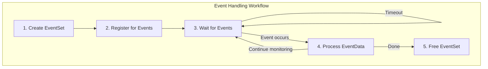
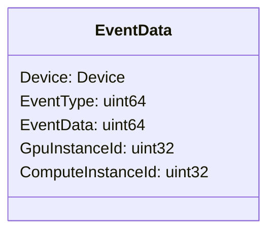
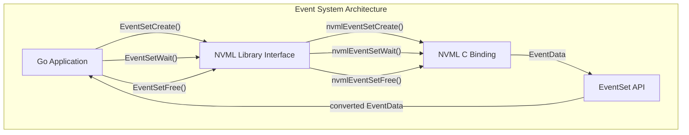
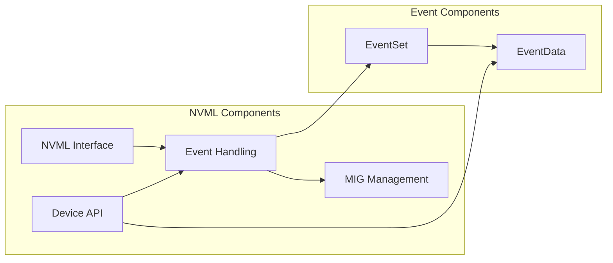

<!-- source: DeepWiki mcp.deepwiki.com · repo NVIDIA/go-nvml · page 4.4 Event Handling · fetched 2026-10-26 -->

# Event Handling

<details>
<summary>Relevant source files</summary>

The following files were used as context for generating this wiki page:

- [pkg/nvml/event_set.go](pkg/nvml/event_set.go)
- [pkg/nvml/unit.go](pkg/nvml/unit.go)

</details>


Event Handling in go-nvml provides a mechanism for monitoring and responding to state changes on NVIDIA GPUs. This system allows applications to be notified when specific events occur, enabling reactive programming patterns for GPU monitoring and management.

## Overview

The go-nvml event handling system is built around the `EventSet` abstraction. An event set acts as a container for monitoring GPU events. Applications create an event set, register for specific events on devices, wait for events to occur, and process the resulting event data.



Sources: [pkg/nvml/event_set.go:37-62]()

## Core Components

### EventSet

The `EventSet` is an opaque handle representing a collection of events to monitor. It is created with `EventSetCreate()` and must be freed with `EventSetFree()` when no longer needed.

### EventData Structure

When an event occurs, an `EventData` structure is returned with detailed information about the event:



This structure includes:
- **Device**: Reference to the GPU device that generated the event
- **EventType**: Identifier for the type of event
- **EventData**: Additional data specific to the event type
- **GpuInstanceId**: For MIG-related events, identifies the GPU instance
- **ComputeInstanceId**: For MIG-related events, identifies the compute instance

Sources: [pkg/nvml/event_set.go:17-24]()

## Core API Functions

The go-nvml library provides three main functions for event handling:

| Function | Description | Return Values |
|----------|-------------|---------------|
| `EventSetCreate()` | Creates a new event set | `(EventSet, Return)` |
| `EventSetWait(set EventSet, timeoutms uint32)` | Waits for events with a timeout | `(EventData, Return)` |
| `EventSetFree(set EventSet)` | Frees resources associated with an event set | `Return` |

The `EventSet` interface also provides direct methods:
- `Wait(timeoutms uint32)`: Waits for events to occur with a timeout
- `Free()`: Releases resources associated with the event set

Sources: [pkg/nvml/event_set.go:37-62]()

## Implementation Details

The event handling in go-nvml follows a layered approach:



The library layer provides Go-friendly wrapper functions around the lower-level NVML C bindings. When an event occurs, the NVML C structure is converted to a Go structure through the `convert()` method.

Sources: [pkg/nvml/event_set.go:26-35](), [pkg/nvml/event_set.go:45-53]()

## Usage Example

Here's a typical pattern for using the event handling system:

```go
// Initialize NVML
ret := nvml.Init()
if ret != nvml.SUCCESS {
    // Handle error
}
defer nvml.Shutdown()

// Create an event set
eventSet, ret := nvml.EventSetCreate()
if ret != nvml.SUCCESS {
    // Handle error
}
defer nvml.EventSetFree(eventSet)

// Register for events (device-specific methods)
// ...

// Wait for events with a timeout (e.g., 1000ms)
for {
    data, ret := eventSet.Wait(1000)
    if ret == nvml.SUCCESS {
        // Process the event data
        fmt.Printf("Event occurred on device: Type=%d\n", data.EventType)
        
        // Continue monitoring or break based on application logic
    } else if ret == nvml.ERROR_TIMEOUT {
        // Timeout occurred, no events
        continue
    } else {
        // Handle other errors
        break
    }
}
```

Note that the specific methods for registering for events would be device-specific and are part of the Device interface.

Sources: [pkg/nvml/event_set.go:37-62]()

## Relationship to Other Components

Event handling is connected to several other components in the go-nvml system:



Events can be related to various aspects of GPU operation, including general device status, MIG configuration changes, and other state transitions.

Sources: [pkg/nvml/event_set.go:17-24]()

## Conclusion

The Event Handling system in go-nvml provides a flexible mechanism for monitoring GPU state changes. By creating event sets and waiting for events, applications can respond reactively to changes in GPU status without constant polling, leading to more efficient and responsive GPU management applications.

---

