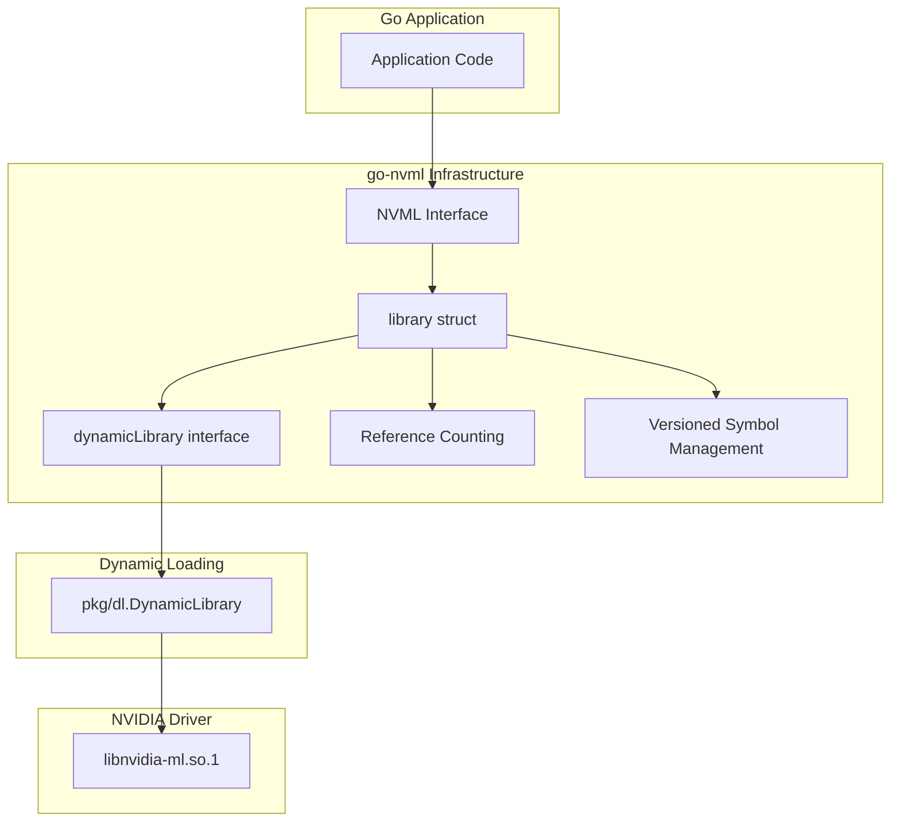
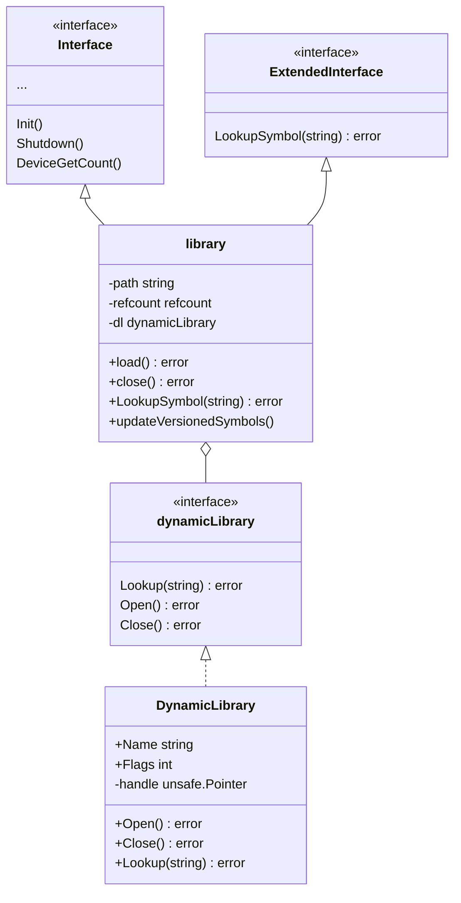
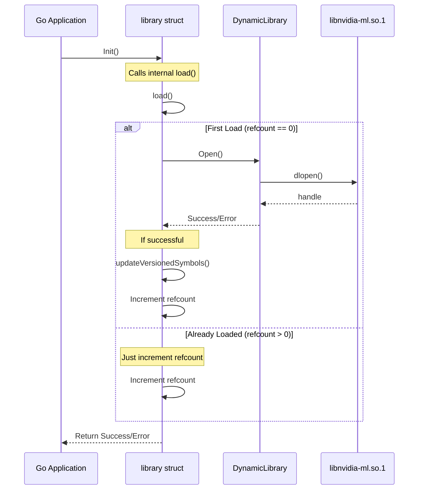
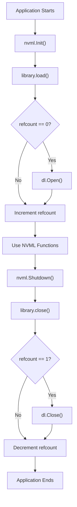
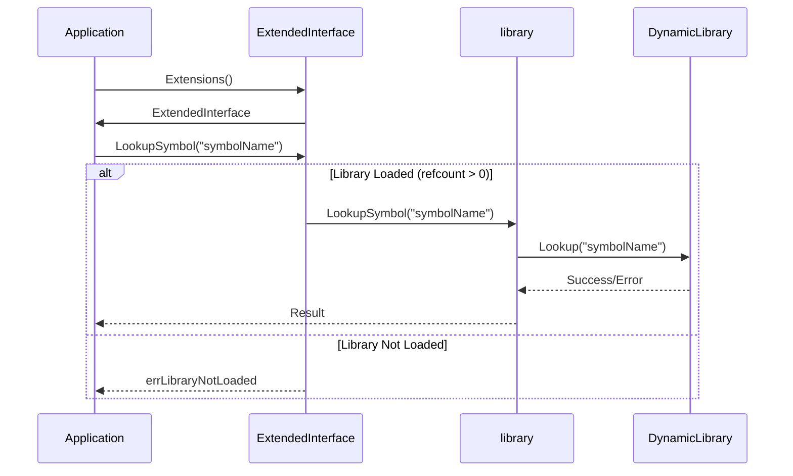
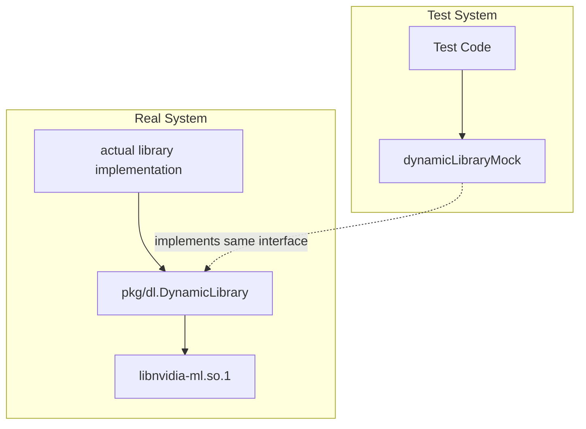

<!-- source: DeepWiki mcp.deepwiki.com · repo NVIDIA/go-nvml · page 5 Library Infrastructure · fetched 2026-10-26 -->

# Library Infrastructure

<details>
<summary>Relevant source files</summary>

The following files were used as context for generating this wiki page:

- [pkg/dl/dl.go](pkg/dl/dl.go)
- [pkg/dl/dl_linux.go](pkg/dl/dl_linux.go)
- [pkg/dl/dl_test.go](pkg/dl/dl_test.go)
- [pkg/nvml/cgo_helpers.h](pkg/nvml/cgo_helpers.h)
- [pkg/nvml/doc.go](pkg/nvml/doc.go)
- [pkg/nvml/lib.go](pkg/nvml/lib.go)
- [pkg/nvml/lib_test.go](pkg/nvml/lib_test.go)
- [pkg/nvml/mock/extendedinterface.go](pkg/nvml/mock/extendedinterface.go)

</details>


The Library Infrastructure in go-nvml provides the foundation for how the Go bindings interface with the underlying NVIDIA Management Library (NVML) C library. This document explains the architecture of the dynamic library loading system, reference counting mechanism, versioned symbol management, and the extension interface that enables the Go bindings to communicate with NVIDIA GPUs.

For information about the Dynamic Library Loading implementation details, see [Dynamic Library Loading](#5.1).

## Overview

The go-nvml library infrastructure is designed to provide a robust, thread-safe interface between Go applications and the native NVML C library. The infrastructure handles dynamic loading of the NVML library, function symbol resolution, versioned API support, and reference counting to ensure proper resource management.



Sources: [pkg/nvml/lib.go:17-57](), [pkg/dl/dl.go:15-50]()

## Library Structure

The core of the library infrastructure is the `library` struct defined in `pkg/nvml/lib.go`, which implements the `Interface` interface. This structure manages the lifecycle of the NVML library and provides methods to interact with it.

### Key Components

1. **Library Struct**: The central component that manages interactions with the NVML C library
2. **Dynamic Library Interface**: An abstraction for loading and accessing the underlying C library
3. **Reference Counting**: Mechanism to track library usage and manage resource lifecycle
4. **Versioned Symbol Management**: System to support multiple versions of NVML API functions



Sources: [pkg/nvml/lib.go:38-56](), [pkg/dl/dl.go:38-50]()

## Dynamic Library Loading

The go-nvml library uses dynamic loading to interact with the NVIDIA Management Library at runtime rather than at compile time. This approach provides flexibility and allows applications to work even when specific versions of the NVML library are not available during compilation.

### Library Loading Process

When a Go application calls `nvml.Init()`, the following process occurs:



Sources: [pkg/nvml/lib.go:101-123](), [pkg/dl/dl.go:67-82]()

### Reference Counting

The library uses a reference counting mechanism to track how many times the library has been loaded and ensure proper cleanup when it's no longer needed. This allows multiple components within the same application to use the NVML library independently without interfering with each other.

The reference count is incremented when:
- `Init()` is called successfully
- Any function requiring the library is called and loads it successfully

The reference count is decremented when:
- `Shutdown()` is called successfully
- The library fails to be used and cleanup is needed



Sources: [pkg/nvml/lib.go:103-107](), [pkg/nvml/lib.go:128-132]()

## Versioned Symbol Management

One of the key features of the go-nvml library infrastructure is its ability to support multiple versions of the NVML API. The NVML C library may have different versions of the same function (e.g., `nvmlInit_v1`, `nvmlInit_v2`), and the go-nvml bindings need to select the most appropriate version at runtime.

### Symbol Version Resolution

When the library is loaded, it performs a version check to determine which API versions are available and chooses the most recent compatible version for each function:

```mermaid
flowchart LR
    subgraph "Loading Process"
        Load["library.load()"]
        Update["updateVersionedSymbols()"]
    end
    
    subgraph "Symbol Functions"
        v1["nvmlInit_v1"]
        v2["nvmlInit_v2"]
        Current["nvmlInit"]
    end
    
    Load --> Update
    Update --> |"Lookup(\"nvmlInit_v2\")"|v2
    v2 --> |"Found: Update pointer"|Current
    Update --> |"Lookup failed: Keep v1"|v1
    v1 --> |"Default if v2 not found"|Current
```

The versioned symbol management system works by:

1. Initially pointing all function variables to the v1 version
2. During library loading, checking if newer versions exist
3. If newer versions are found, updating the function pointers to use them

This allows the go-nvml bindings to use the most feature-rich version of each function available in the installed NVML library.

Sources: [pkg/nvml/lib.go:146-165](), [pkg/nvml/lib.go:196-290]()

## Extended Interface

The go-nvml library provides an extended interface that offers additional functionality beyond the standard NVML API. This interface includes methods for inspecting the library itself, such as looking up symbols directly.

### Symbol Lookup

The `LookupSymbol` method allows applications to check whether specific library symbols exist in the loaded NVML library:



This capability is particularly useful for:
- Feature detection based on available NVML functions
- Compatibility checks for different NVIDIA driver versions
- Advanced use cases requiring direct interaction with the library

Sources: [pkg/nvml/lib.go:88-99]()

## Error Handling

The library infrastructure includes robust error handling to manage various failure scenarios:

1. **Library Loading Errors**: Errors during the loading of the NVML library
2. **Symbol Lookup Errors**: Errors when attempting to find specific functions
3. **Reference Count Management**: Proper error propagation to ensure reference counting integrity

Key error types include:
- `errLibraryNotLoaded`: Returned when trying to use the library before initialization
- `errLibraryAlreadyLoaded`: Returned when trying to load an already loaded library
- Errors from the underlying `dl` package: Propagated with additional context

Sources: [pkg/nvml/lib.go:34-35](), [pkg/dl/dl.go:59-65]()

## Integration with Testing

The library infrastructure is designed to support testing through mocking capabilities. The `dynamicLibrary` interface can be mocked to simulate various library behaviors without requiring actual GPU hardware or NVIDIA drivers.



This design enables comprehensive testing of code that uses the NVML bindings without requiring actual GPU hardware.

Sources: [pkg/nvml/lib_test.go:27-173]()

## Summary

The Library Infrastructure of go-nvml provides a robust foundation for the Go bindings to interact with the NVIDIA Management Library. It handles the complexities of dynamic library loading, versioned APIs, and reference counting to ensure reliable operation across different environments and driver versions.

For more detailed information about specific aspects of the Library Infrastructure, refer to:
- [Dynamic Library Loading](#5.1) for details on how the NVML library is loaded at runtime
- [Extended Interface](#5.2) for information about the extension mechanisms

---

