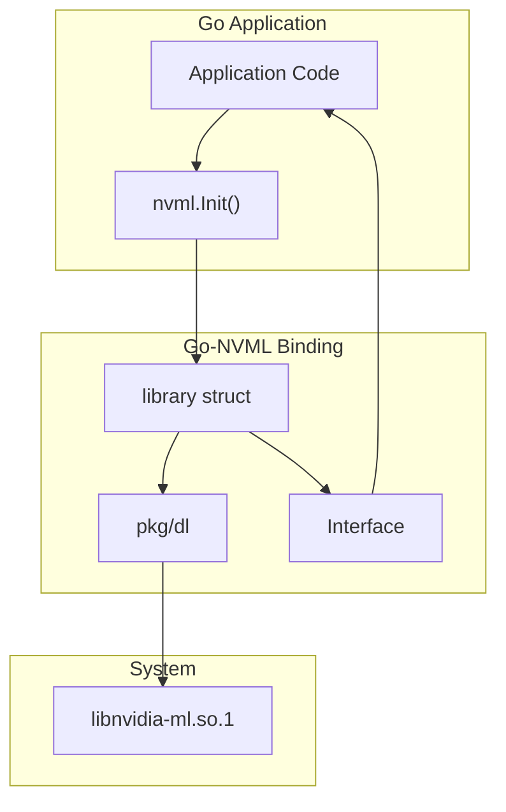
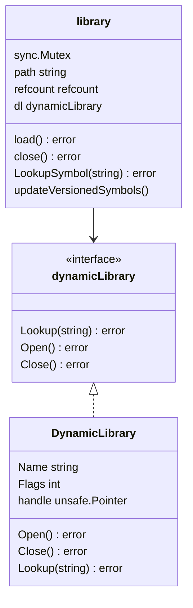
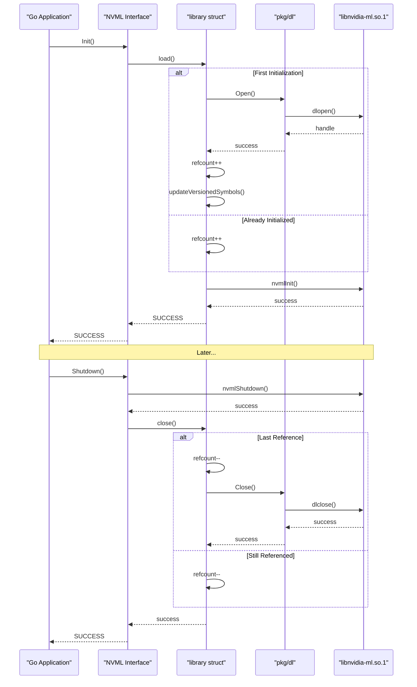
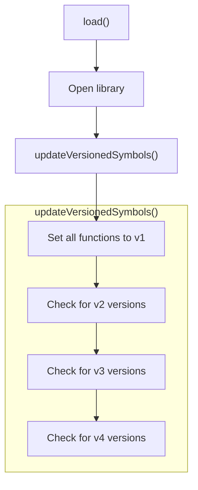
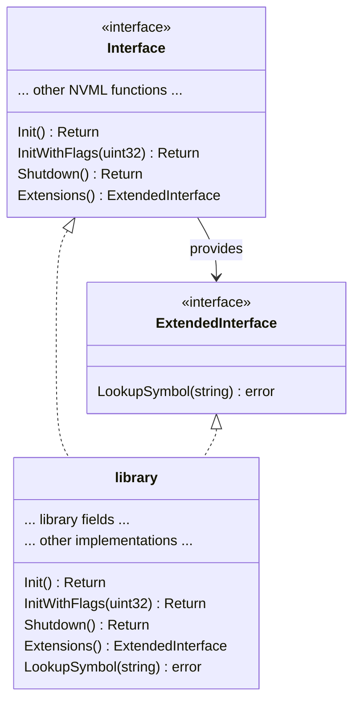
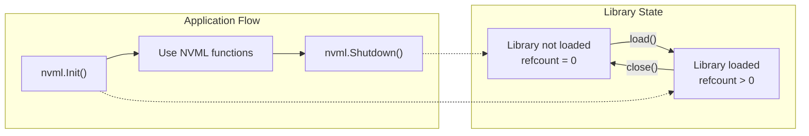

<!-- source: DeepWiki mcp.deepwiki.com · repo NVIDIA/go-nvml · page 5.1 Dynamic Library Loading · fetched 2026-10-26 -->

# Dynamic Library Loading

<details>
<summary>Relevant source files</summary>

The following files were used as context for generating this wiki page:

- [pkg/dl/dl.go](pkg/dl/dl.go)
- [pkg/dl/dl_linux.go](pkg/dl/dl_linux.go)
- [pkg/dl/dl_test.go](pkg/dl/dl_test.go)
- [pkg/nvml/init.go](pkg/nvml/init.go)
- [pkg/nvml/lib.go](pkg/nvml/lib.go)
- [pkg/nvml/lib_test.go](pkg/nvml/lib_test.go)
- [pkg/nvml/mock/extendedinterface.go](pkg/nvml/mock/extendedinterface.go)

</details>


This document explains the dynamic library loading system used in the go-nvml repository. It covers how the Go bindings interface with the underlying NVIDIA Management Library (NVML) C library at runtime, including library initialization, reference counting, and version management.

For information about the extended interface capabilities, see [Extended Interface](#5.2).

## Purpose and Scope

The dynamic library loading system enables go-nvml to:

1. Load the NVIDIA Management Library (`libnvidia-ml.so.1`) at runtime rather than compile-time
2. Manage library loading and unloading through reference counting
3. Support multiple versions of NVML APIs by detecting and selecting the most recent available versions
4. Provide a clean interface for Go applications to interact with the NVML library

Sources: [pkg/nvml/lib.go:27-60](), [pkg/nvml/init.go:15-48]()

## Architecture Overview



The dynamic library loading system serves as a bridge between Go applications and the NVML C library. The `library` struct in the go-nvml package manages the loading, initialization, and reference counting of the NVML library through the `pkg/dl` package, which provides a wrapper around the C functions `dlopen`, `dlclose`, and `dlsym`.

Sources: [pkg/nvml/lib.go:27-60](), [pkg/dl/dl.go:15-37]()

## Library Loading Components

### Library Structure



The `library` struct is the central component that manages the NVML library. It contains:

- A path to the library file
- A reference counter to track library usage
- A `dynamicLibrary` interface implementation for actual library operations

The `DynamicLibrary` struct from the `pkg/dl` package implements the `dynamicLibrary` interface by wrapping the C dynamic loading functions.

Sources: [pkg/nvml/lib.go:37-56](), [pkg/dl/dl.go:38-49]()

## Initialization and Reference Counting



The initialization process ensures that the NVML library is loaded only once, even if multiple components attempt to initialize it. Similarly, the library is only unloaded when all references to it are released.

Sources: [pkg/nvml/init.go:19-48](), [pkg/nvml/lib.go:101-145]()

## Library Loading and Unloading Flow

### Loading Process

When a Go application calls `nvml.Init()`, the following happens:

1. The `Init()` method calls `load()` on the library instance
2. If the reference count is greater than 0, the library is already loaded, and the reference count is incremented
3. Otherwise, the library is opened using `dl.Open()`
4. The `updateVersionedSymbols()` function is called to select the most recent versions of NVML functions
5. The reference count is incremented

### Unloading Process

When a Go application calls `nvml.Shutdown()`, the following happens:

1. The NVML shutdown function is called
2. The `close()` method is called on the library instance
3. The reference count is decremented
4. If the reference count reaches 0, the library is closed using `dl.Close()`

Sources: [pkg/nvml/lib.go:101-145](), [pkg/nvml/init.go:19-48]()

## Default Configuration

The dynamic loading system comes with sensible defaults:

```
Default library name: libnvidia-ml.so.1
Default flags: RTLD_LAZY | RTLD_GLOBAL
```

These can be customized using `LibraryOption` functions when creating a new library instance with `nvml.New()`.

Sources: [pkg/nvml/lib.go:29-32](), [pkg/nvml/lib.go:61-86]()

## Version Management

One of the key features of the dynamic library loading system is its ability to detect and use the most recent version of NVML functions available in the loaded library.



During library initialization, the `updateVersionedSymbols()` function checks for newer versions of NVML functions and updates the function pointers accordingly. For example, if `nvmlInit_v2` is available, it will be used instead of `nvmlInit_v1`.

Sources: [pkg/nvml/lib.go:147-291]()

## Error Handling

The dynamic library loading system provides specific error types to indicate loading and unloading issues:

- `errLibraryNotLoaded`: Returned when attempting to use the library before it's loaded
- `errLibraryAlreadyLoaded`: Returned when attempting to load an already loaded library
- Other errors from the underlying `dlopen`, `dlclose`, and `dlsym` functions are wrapped with additional context

Error handling during initialization:

```
If library loading fails: Return ERROR_LIBRARY_NOT_FOUND
If NVML initialization fails: Return the error from nvmlInit()
```

Sources: [pkg/nvml/lib.go:34-35](), [pkg/nvml/init.go:19-34]()

## Thread Safety

The dynamic library loading system ensures thread safety through:

1. Mutex locking in the `library` struct for all operations that affect the reference count or library state
2. OS thread locking during calls to C functions using `runtime.LockOSThread()` and `runtime.UnlockOSThread()`

This prevents race conditions when multiple goroutines initialize or shut down the NVML library simultaneously.

Sources: [pkg/nvml/lib.go:50](), [pkg/dl/dl.go:52-57]()

## Integration with NVML Interface



The `library` struct implements both the `Interface` and `ExtendedInterface` interfaces, providing a complete implementation of the NVML API while managing the dynamic library loading.

Sources: [pkg/nvml/lib.go:56-90](), [pkg/nvml/init.go:19-48]()

## Example Usage Flow



A typical application flow involves initializing the NVML library, using various NVML functions, and then shutting down the library when done. The dynamic library loading system handles the actual loading and unloading of the library based on the reference count.

Sources: [pkg/nvml/init.go:19-48]()

## Testing and Mocking

The dynamic library loading system is designed to be testable through:

1. The `dynamicLibrary` interface, which can be mocked for testing
2. The ability to create multiple instances of the library with custom options
3. Generation of mock implementations using the `moq` tool

This allows for testing NVML functionality without actually loading the NVML library.

Sources: [pkg/nvml/lib.go:37-45](), [pkg/nvml/lib_test.go:17-245]()

---

