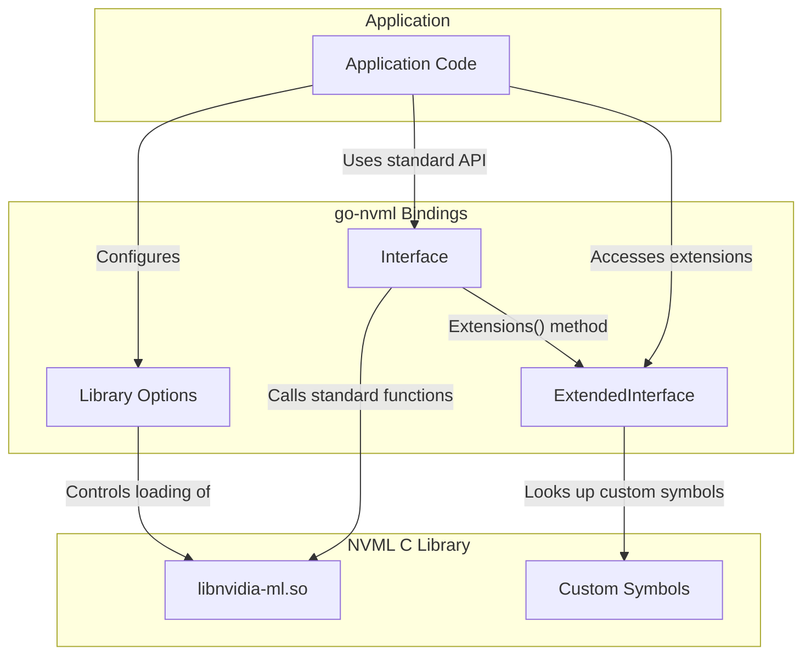
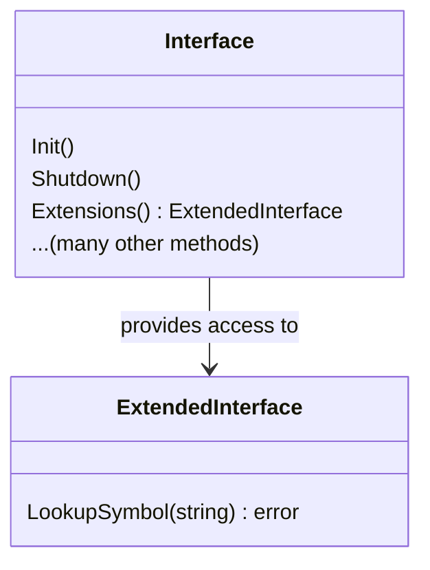
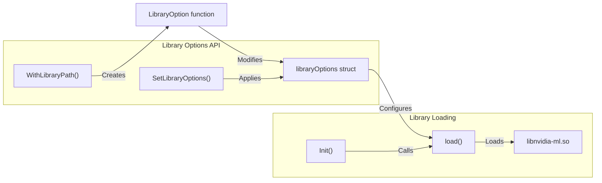
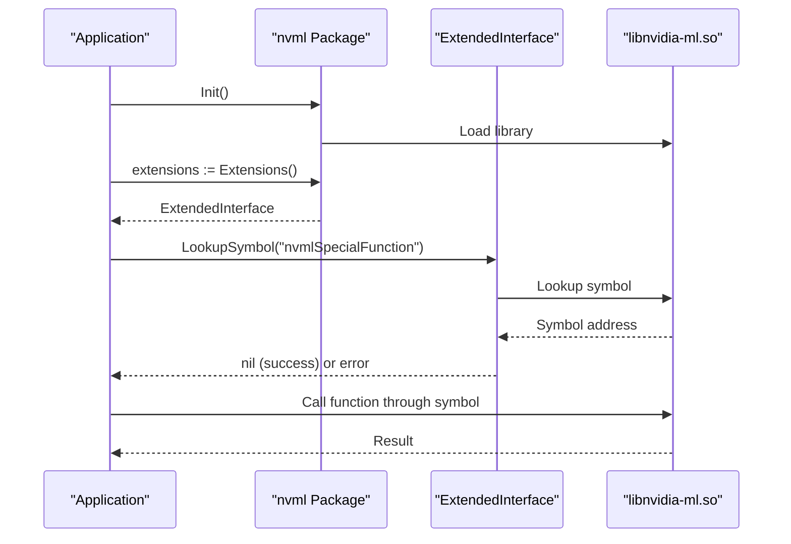

<!-- source: DeepWiki mcp.deepwiki.com · repo NVIDIA/go-nvml · page 5.2 Extended Interface · fetched 2026-10-26 -->

# Extended Interface

Relevant source files

The following files were used as context for generating this wiki page:

- [pkg/nvml/api.go](pkg/nvml/api.go)
- [pkg/nvml/zz_generated.api.go](pkg/nvml/zz_generated.api.go)

The Extended Interface in the go-nvml bindings provides a mechanism to extend the functionality of the core NVML API, allowing for additional capability that isn't part of the standard interface. This page documents the extension mechanisms in the NVML bindings API, including the `ExtendedInterface` type and library configuration options.

For information about the dynamic loading of the NVML library, see [Dynamic Library Loading](#5.1).

## Overview

The Extended Interface system enables two key capabilities:

1. Access to custom or specialized NVML functions not exposed through the standard API
2. Configuration of the underlying NVML library loading behavior

Sources: [pkg/nvml/api.go:19-28](), [pkg/nvml/zz_generated.api.go:586]()

## ExtendedInterface API

The `ExtendedInterface` is defined as a minimal interface with a single method, designed to provide access to functionality beyond the standard NVML API:

The `ExtendedInterface` is accessed through the `Extensions()` method of the main `Interface`. This design separates the core API from extension capabilities.

Sources: [pkg/nvml/api.go:19-28](), [pkg/nvml/zz_generated.api.go:586]()

### LookupSymbol Method

The `LookupSymbol` method allows for looking up and accessing NVML functions that are not part of the standard API exposed through the Go bindings. This is particularly useful when:

1. The NVML C library has added new functions that haven't yet been incorporated into the Go bindings
2. You need to access internal or specialized functions for advanced use cases

When a symbol is successfully looked up, it becomes available for use, but you must handle the function calling and type conversions manually, typically using Go's `unsafe` package.

Sources: [pkg/nvml/api.go:26-27]()

## Library Configuration

The go-nvml bindings provide a way to configure how the NVML library is loaded through library options. These options must be set before the library is initialized.

### Library Options

The library options are implemented as a functional options pattern:

The library options currently include:

- **Library Path**: Allows specifying a custom path to the NVML library using `WithLibraryPath()`

Sources: [pkg/nvml/api.go:30-56]()

### Setting Library Options

The `SetLibraryOptions` function applies the specified options to the NVML library. This must be called before initializing the library with `Init()`. If the library is already loaded, an error is returned.

Example usage pattern:

1. Call `SetLibraryOptions()` with desired options
2. Call `Init()` to initialize the NVML library
3. Use the NVML API

Sources: [pkg/nvml/api.go:46-56]()

## Accessing the Extended Interface

The Extended Interface is accessed through the `Extensions()` method of the main Interface. This design separates the core functionality from extensions while maintaining a clean API.

Using the Extended Interface requires understanding of the underlying NVML C API and careful management of memory and type conversions.

Sources: [pkg/nvml/api.go:19-28](), [pkg/nvml/zz_generated.api.go:586]()

## Implementation Note

The `ExtendedInterface` is designed as a minimal interface that can be expanded in the future. Currently, the list of methods in this interface needs to be manually kept in sync with the list of excluded methods for the `Interface` type in the binding generator. Future improvements may automate this process.

Sources: [pkg/nvml/api.go:19-25]()

## Example Use Cases

1. **Accessing Experimental NVML Features**: Some new GPU features may be available in the latest NVML C library but not yet exposed in the Go bindings
2. **Custom Library Paths**: When the NVML library is installed in a non-standard location
3. **Driver Version Compatibility**: Working with specific driver versions by pointing to the exact library version needed

In advanced scenarios, you might combine both the extended interface and library options to create a custom setup that works with specific driver versions and accesses specialized functionality.

Sources: [pkg/nvml/api.go:19-56]()

## Relationship to the Mock System

The Extended Interface is also implemented in the mock system, allowing for consistent API usage even when testing without real GPU hardware. The mock implementation provides a simulated version of the `LookupSymbol` method and follows the same interface contract.

Sources: [pkg/nvml/api.go:25]()

---

