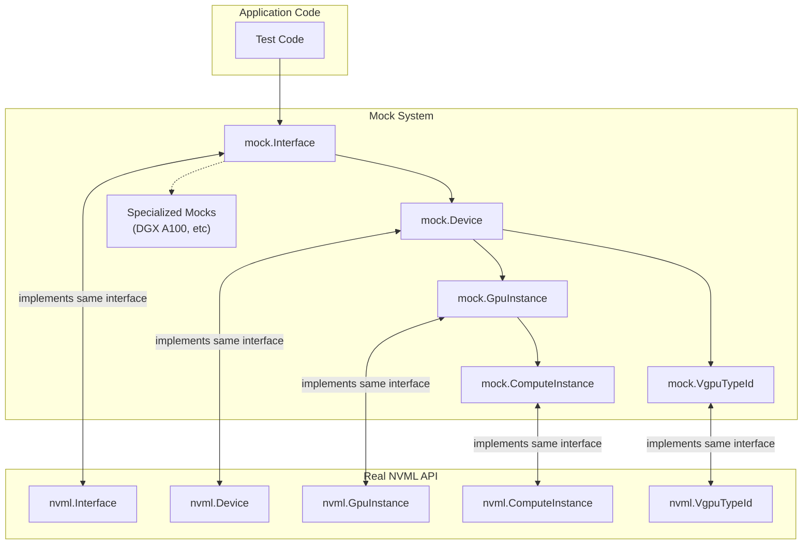
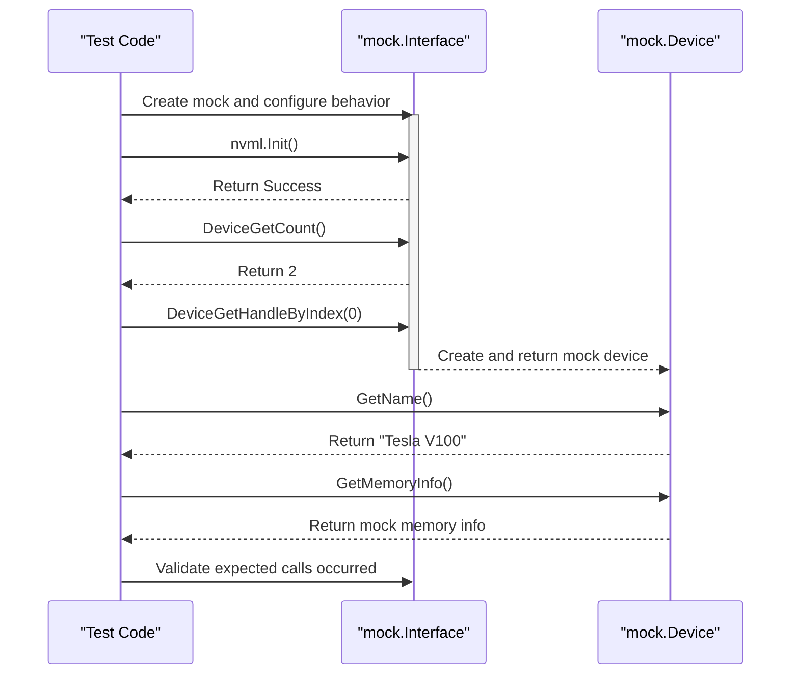
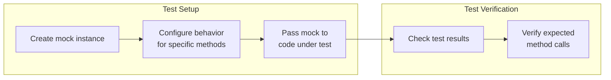
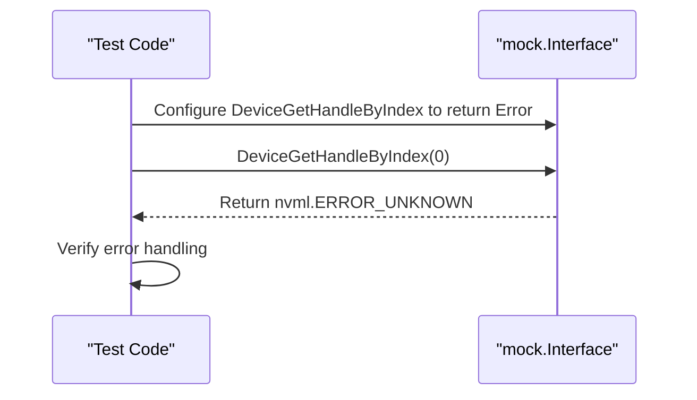
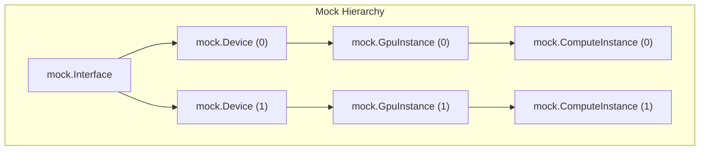

<!-- source: DeepWiki mcp.deepwiki.com · repo NVIDIA/go-nvml · page 6 Testing · fetched 2026-10-26 -->

# Testing

Relevant source files

The following files were used as context for generating this wiki page:

- [pkg/nvml/mock/device.go](pkg/nvml/mock/device.go)
- [pkg/nvml/mock/interface.go](pkg/nvml/mock/interface.go)
- [pkg/nvml/mock/vgputypeid.go](pkg/nvml/mock/vgputypeid.go)

This page provides an overview of the testing capabilities available for applications that use the Go-NVML bindings. It covers the mock implementations provided to facilitate testing without requiring actual NVIDIA GPU hardware. For specific details about the mock implementations, see [Mock Implementation](#6.1) and [DGX A100 Mock System](#6.2).

## Purpose and Testing Approach

The Go-NVML library provides robust mock implementations of its interfaces to enable comprehensive testing of applications that depend on NVIDIA GPUs without requiring physical GPU hardware. This approach allows developers to:

1. Develop and test applications in environments without GPUs
2. Test edge cases and failure scenarios that might be difficult to reproduce with physical hardware
3. Run automated tests in CI/CD pipelines regardless of hardware availability
4. Create deterministic tests that are not affected by the state of physical hardware

Sources: [pkg/nvml/mock/interface.go:11-990](), [pkg/nvml/mock/device.go:11-708]()

## Mock System Architecture

The mock system is designed to mirror the structure of the real NVML API, providing mock implementations for all interfaces and types that your application might use.

Sources: [pkg/nvml/mock/interface.go:11-15](), [pkg/nvml/mock/device.go:11-15](), [pkg/nvml/mock/vgputypeid.go:11-15]()

## Using Mocks in Tests

The mock implementations are generated using the [moq](https://github.com/matryer/moq) tool and follow a consistent pattern that makes them easy to use in tests. Each mock type includes functions that can be customized to return specific values for testing different scenarios.

### Basic Mock Usage Pattern

Sources: [pkg/nvml/mock/interface.go:16-89](), [pkg/nvml/mock/device.go:16-89]()

## Mock Implementation Details

The mock system provides implementations for all the key interfaces in the NVML library:

| Mock Type | Real Interface | Purpose |
|-----------|----------------|---------|
| `mock.Interface` | `nvml.Interface` | Top-level API for initializing NVML and accessing devices |
| `mock.Device` | `nvml.Device` | Represents an NVIDIA GPU device |
| `mock.GpuInstance` | `nvml.GpuInstance` | Represents a GPU instance (for MIG) |
| `mock.ComputeInstance` | `nvml.ComputeInstance` | Represents a compute instance within a GPU instance |
| `mock.VgpuTypeId` | `nvml.VgpuTypeId` | Represents a vGPU type identifier |
| `mock.EventSet` | `nvml.EventSet` | Represents a set of events to monitor |
| `mock.Unit` | `nvml.Unit` | Represents a unit in an S-class system |

Each mock type provides:

1. Function fields that you can customize to control behavior
2. Call tracking to verify which methods were called and with what arguments
3. Thread-safe implementation for concurrent testing

Sources: [pkg/nvml/mock/interface.go:990-1390](), [pkg/nvml/mock/device.go:708-1388](), [pkg/nvml/mock/vgputypeid.go:69-181]()

## Example: Configuring a Mock Interface

To use the mock implementations in your tests, you typically:

1. Create a mock instance
2. Configure the behavior of specific methods
3. Use the mock in your test code
4. Verify that expected calls were made

The function fields in the mock implementations follow a naming pattern of `{MethodName}Func`. For example, to mock the `DeviceGetCount` method, you would set the `DeviceGetCountFunc` field.

Here's the structure of configuring a mock:

Sources: [pkg/nvml/mock/interface.go:16-89](), [pkg/nvml/mock/device.go:16-89]()

## Advanced Testing Scenarios

The mock system supports advanced testing scenarios such as:

### 1. Simulating Error Conditions

You can configure mocks to return specific error codes to test your application's error handling:

### 2. Testing Complex Device Hierarchies

You can create and configure complex hierarchies of mock objects to test scenarios involving multiple GPUs, GPU instances, and compute instances:

### 3. Testing Specific Hardware Configurations

The mock system can be extended to simulate specific hardware configurations, such as the DGX A100 server mock that is provided with the library, which simulates a server with multiple A100 GPUs configured for MIG.

Sources: [pkg/nvml/mock/interface.go:990-1390](), [pkg/nvml/mock/device.go:708-1388]()

## Best Practices for Testing with Go-NVML Mocks

When testing with the Go-NVML mock implementations, consider the following best practices:

1. **Define expected behavior up-front**: Configure all mock methods that your test will call before executing the test code
2. **Test failure paths**: Use the mocks to simulate error conditions and verify your code handles them correctly
3. **Verify method calls**: Use the call tracking functionality to verify that your code is calling the expected methods with the expected arguments
4. **Reset mocks between tests**: Create new mock instances for each test to ensure clean state
5. **Use specialized mocks for complex scenarios**: For complex hardware configurations, consider using or creating specialized mock implementations

Sources: [pkg/nvml/mock/interface.go:16-89](), [pkg/nvml/mock/device.go:16-89]()

## Conclusion

The mock implementations provided by Go-NVML enable comprehensive testing of applications that use NVIDIA GPUs without requiring physical hardware. By using these mocks, you can develop and test your applications in any environment, create deterministic tests, and verify behavior under various conditions including error scenarios.

For more detailed information on specific mock implementations, refer to [Mock Implementation](#6.1) and for information about the specialized DGX A100 mock system, see [DGX A100 Mock System](#6.2).

---

