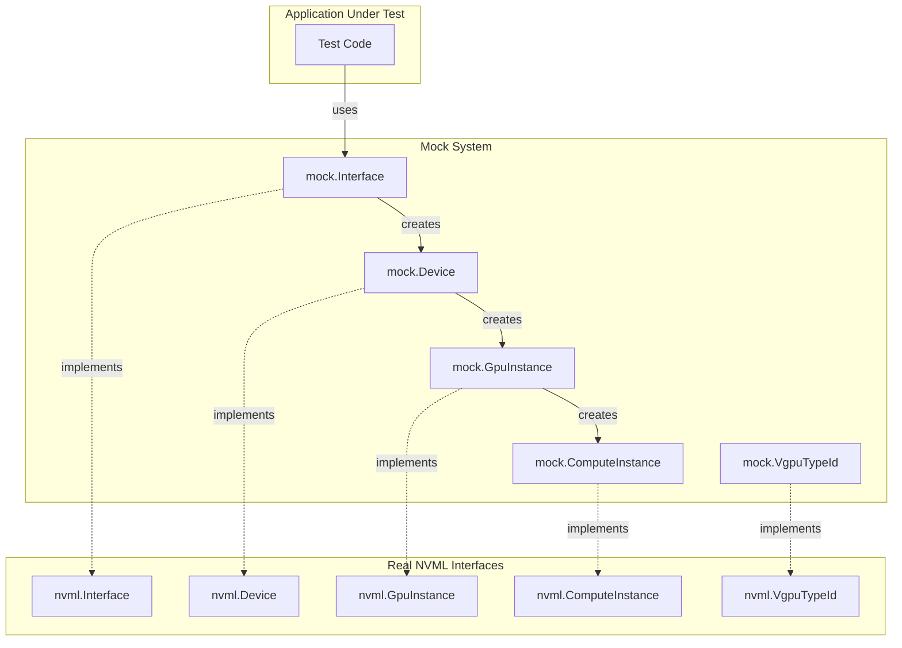
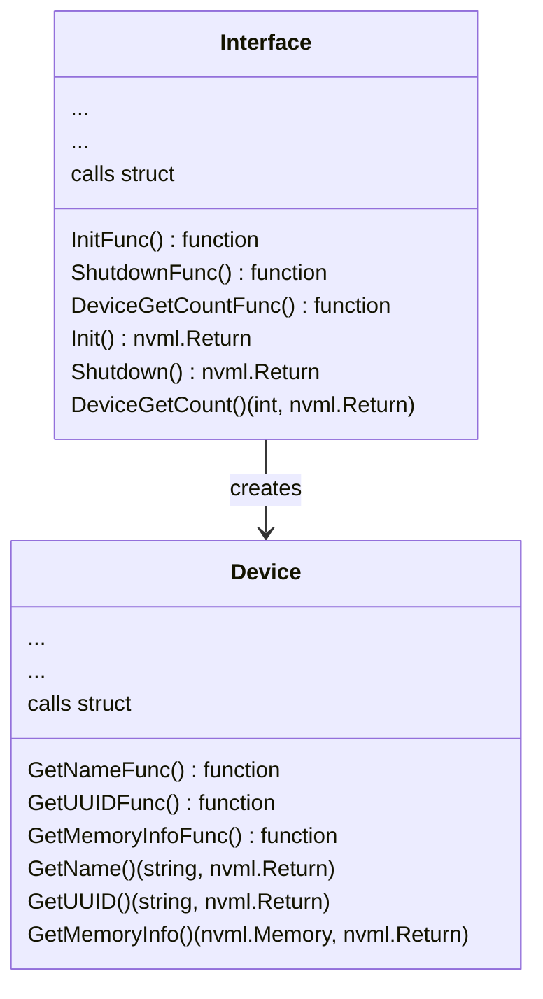
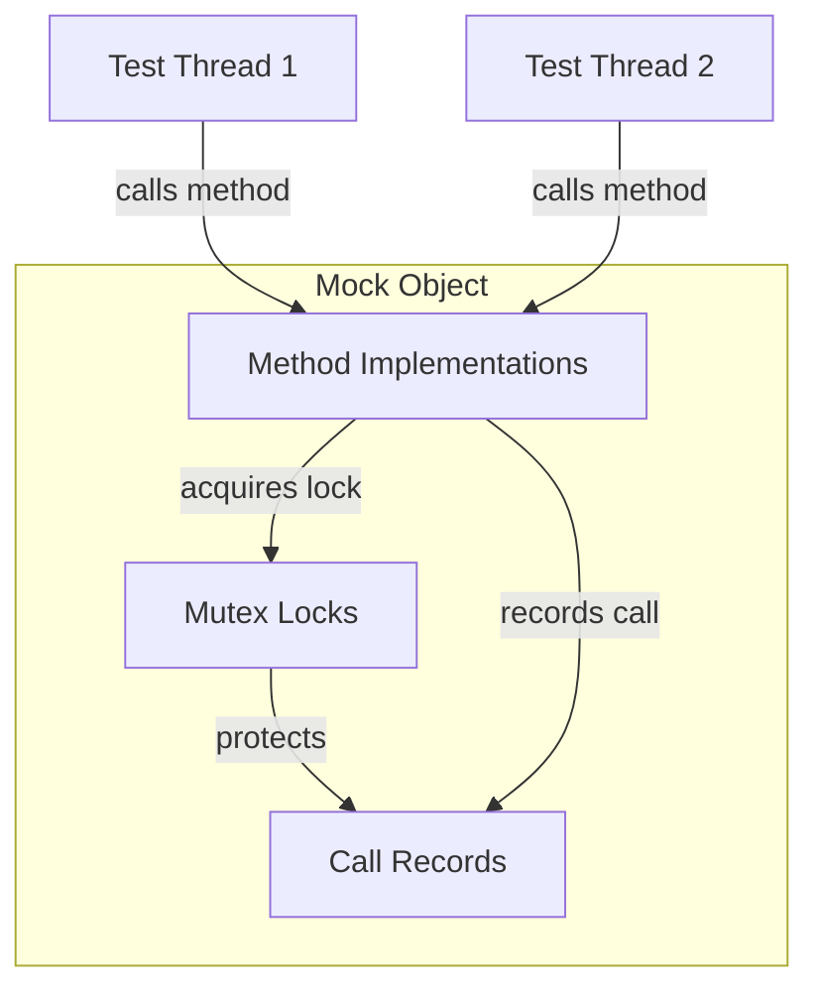

<!-- source: DeepWiki mcp.deepwiki.com · repo NVIDIA/go-nvml · page 6.1 Mock Implementation · fetched 2026-10-26 -->

# Mock Implementation

<details>
<summary>Relevant source files</summary>

The following files were used as context for generating this wiki page:

- [pkg/nvml/mock/device.go](pkg/nvml/mock/device.go)
- [pkg/nvml/mock/interface.go](pkg/nvml/mock/interface.go)
- [pkg/nvml/mock/vgputypeid.go](pkg/nvml/mock/vgputypeid.go)

</details>


## Purpose and Scope

The Mock Implementation in Go-NVML provides a comprehensive framework for testing applications that rely on NVIDIA GPU functionality without requiring physical NVIDIA hardware. This page explains how to use the mock system to simulate NVML interfaces, devices, and other components for unit testing and integration testing purposes.

For information about the specialized DGX A100 mock system that simulates a specific server configuration, see [DGX A100 Mock System](#6.2).

Sources: [pkg/nvml/mock/interface.go:11-14](), [pkg/nvml/mock/device.go:11-14]()

## Mock Architecture Overview

The mock implementation mirrors the structure of the real NVML API by providing mock objects that implement the same interfaces as their real counterparts. The mocks are generated using the [moq](https://github.com/matryer/moq) tool, which creates type-safe mock implementations from Go interfaces.



Sources: [pkg/nvml/mock/interface.go:15-16](), [pkg/nvml/mock/device.go:15-16](), [pkg/nvml/mock/vgputypeid.go:15-16]()

## Key Components

The mock system consists of several key components, each mocking a different part of the NVML API:

### mock.Interface

The `mock.Interface` type implements the `nvml.Interface` interface and serves as the main entry point to the NVML API. It provides mock implementations for all NVML functions, such as library initialization, device enumeration, and system queries.

### mock.Device

The `mock.Device` type implements the `nvml.Device` interface and represents a single NVIDIA GPU. It provides mock implementations for all device-related functions, including querying device properties, monitoring performance metrics, and managing device state.

### Other Mock Components

Additional mock types are provided for other NVML components, such as:

- `mock.GpuInstance` for GPU instances in Multi-Instance GPU (MIG) mode
- `mock.ComputeInstance` for compute instances within GPU instances
- `mock.VgpuTypeId` for virtual GPU types

Sources: [pkg/nvml/mock/vgputypeid.go:1-15]()

## How Mocking Works

Each mock implementation follows a consistent pattern:

1. A struct type that implements the corresponding NVML interface
2. Function fields for each method in the interface
3. Method implementations that delegate to the function fields
4. Call tracking for verification purposes



Sources: [pkg/nvml/mock/interface.go:990-1390](), [pkg/nvml/mock/device.go:708-1390]()

## Using the Mock Implementation

### Basic Usage Pattern

Using the mock implementation typically follows these steps:

1. Create a mock instance
2. Configure the behavior of the required methods
3. Pass the mock to the code under test
4. Verify method calls after execution

Here's a simplified example:

```go
// Create a mock interface
mockInterface := &mock.Interface{
    InitFunc: func() nvml.Return {
        return nvml.SUCCESS
    },
    DeviceGetCountFunc: func() (int, nvml.Return) {
        return 2, nvml.SUCCESS
    },
    DeviceGetHandleByIndexFunc: func(index int) (nvml.Device, nvml.Return) {
        mockDevice := &mock.Device{
            GetNameFunc: func() (string, nvml.Return) {
                return "Tesla V100", nvml.SUCCESS
            },
            GetUUIDFunc: func() (string, nvml.Return) {
                return "GPU-abcdef-1234", nvml.SUCCESS
            },
        }
        return mockDevice, nvml.SUCCESS
    },
}

// Use the mock in your test
result := CodeUnderTest(mockInterface)

// Verify method calls
assert.Equal(t, 1, len(mockInterface.InitCalls()))
assert.Equal(t, 1, len(mockInterface.DeviceGetCountCalls()))
```

Sources: [pkg/nvml/mock/interface.go:17-989](), [pkg/nvml/mock/device.go:17-707]()

### Configuring Mock Behavior

Each method in the real NVML API has a corresponding function field in the mock object. To configure the behavior of a method, simply assign a function with the appropriate signature:

```go
mockDevice := &mock.Device{
    GetMemoryInfoFunc: func() (nvml.Memory, nvml.Return) {
        return nvml.Memory{
            Total: 16 * 1024 * 1024 * 1024, // 16GB
            Free:  8 * 1024 * 1024 * 1024,  // 8GB
            Used:  8 * 1024 * 1024 * 1024,  // 8GB
        }, nvml.SUCCESS
    },
    GetTemperatureFunc: func(sensor nvml.TemperatureSensors) (uint32, nvml.Return) {
        return 65, nvml.SUCCESS // 65°C
    },
}
```

Sources: [pkg/nvml/mock/device.go:1009-1011](), [pkg/nvml/mock/device.go:1183-1185]()

### Verifying Method Calls

The mock objects record each method call, allowing tests to verify that methods were called with the expected arguments:

```go
// Check if a method was called
assert.Equal(t, 1, len(mockDevice.GetMemoryInfoCalls()))

// Check if a method was called with specific arguments
temperatureCalls := mockDevice.GetTemperatureCalls()
assert.Equal(t, 1, len(temperatureCalls))
assert.Equal(t, nvml.TEMPERATURE_GPU, temperatureCalls[0].TemperatureSensors)
```

The call tracking is thread-safe, using mutex locks to protect access to the call records.

Sources: [pkg/nvml/mock/interface.go:1390-1400](), [pkg/nvml/mock/device.go:1390-1400](), [pkg/nvml/mock/vgputypeid.go:112-180]()

## Simulating Error Conditions

One of the key benefits of using mocks is the ability to simulate error conditions that might be difficult to reproduce with real hardware. To simulate an error, simply return an error code from the mock function:

```go
mockInterface := &mock.Interface{
    InitFunc: func() nvml.Return {
        return nvml.ERROR_DRIVER_NOT_LOADED
    },
}
```

This allows testing how the application handles various error conditions.

Sources: [pkg/nvml/mock/interface.go:716-719]()

## Thread Safety

The mock implementation is designed to be thread-safe. Each mock object uses mutex locks to protect access to its call records:



This ensures that tests can safely use the mock objects in concurrent scenarios.

Sources: [pkg/nvml/mock/vgputypeid.go:167-180]()

## Integration with Testing Frameworks

The mock implementation can be easily integrated with Go testing frameworks like `testing`, `testify`, or `gomock`:

### With Standard Testing

```go
func TestWithMock(t *testing.T) {
    mockInterface := &mock.Interface{
        // Configure mock behavior
    }
    
    // Run test
    
    // Assert using standard testing
    if len(mockInterface.InitCalls()) != 1 {
        t.Errorf("Expected Init to be called once")
    }
}
```

### With Testify

```go
func TestWithMockAndTestify(t *testing.T) {
    mockInterface := &mock.Interface{
        // Configure mock behavior
    }
    
    // Run test
    
    // Assert using testify
    assert.Equal(t, 1, len(mockInterface.InitCalls()), "Init should be called once")
}
```

Sources: [pkg/nvml/mock/interface.go:17-40]()

## Limitations and Considerations

While the mock implementation provides a powerful way to test NVML-dependent code without real hardware, there are some limitations to be aware of:

1. **Behavior differences**: The mock implementation may not perfectly replicate all subtle behaviors of the real NVML API.

2. **Performance characteristics**: The mocks don't replicate the timing characteristics of actual GPU operations.

3. **Initialization requirements**: All mock methods must be implemented or initialized to avoid runtime panics when called.

4. **Manual state management**: Unlike real hardware, state changes in one mock method don't automatically affect other methods unless explicitly programmed.

For more complex testing scenarios that require realistic simulation of a multi-GPU system with MIG support, consider using the specialized DGX A100 mock system described in [DGX A100 Mock System](#6.2).

---

