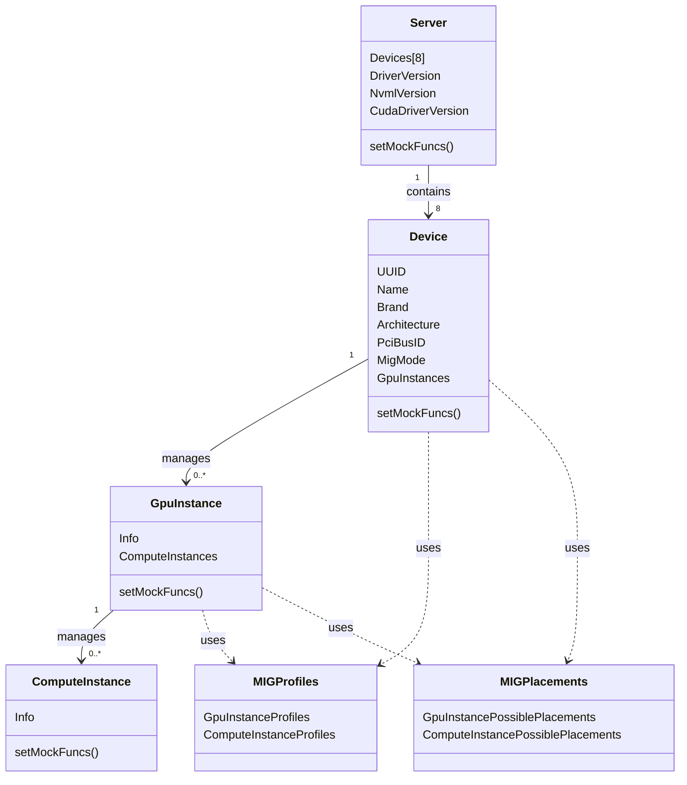
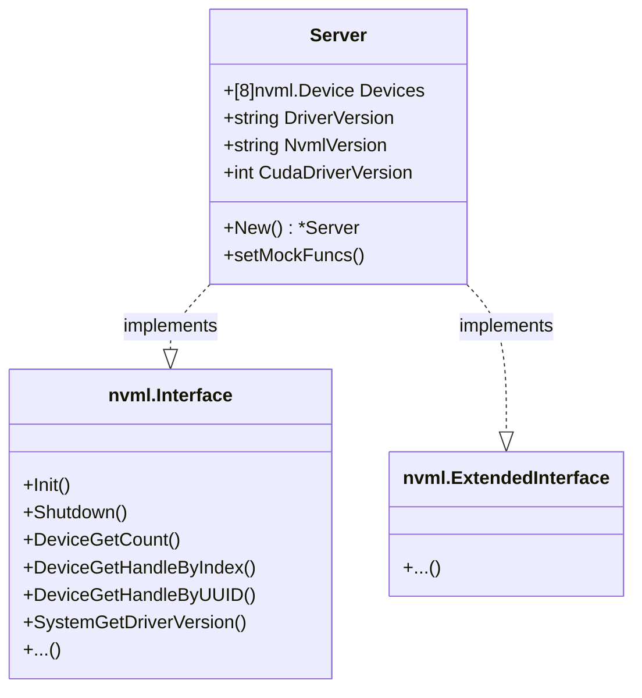
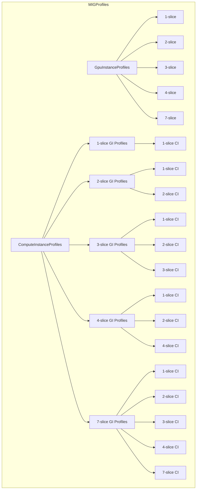
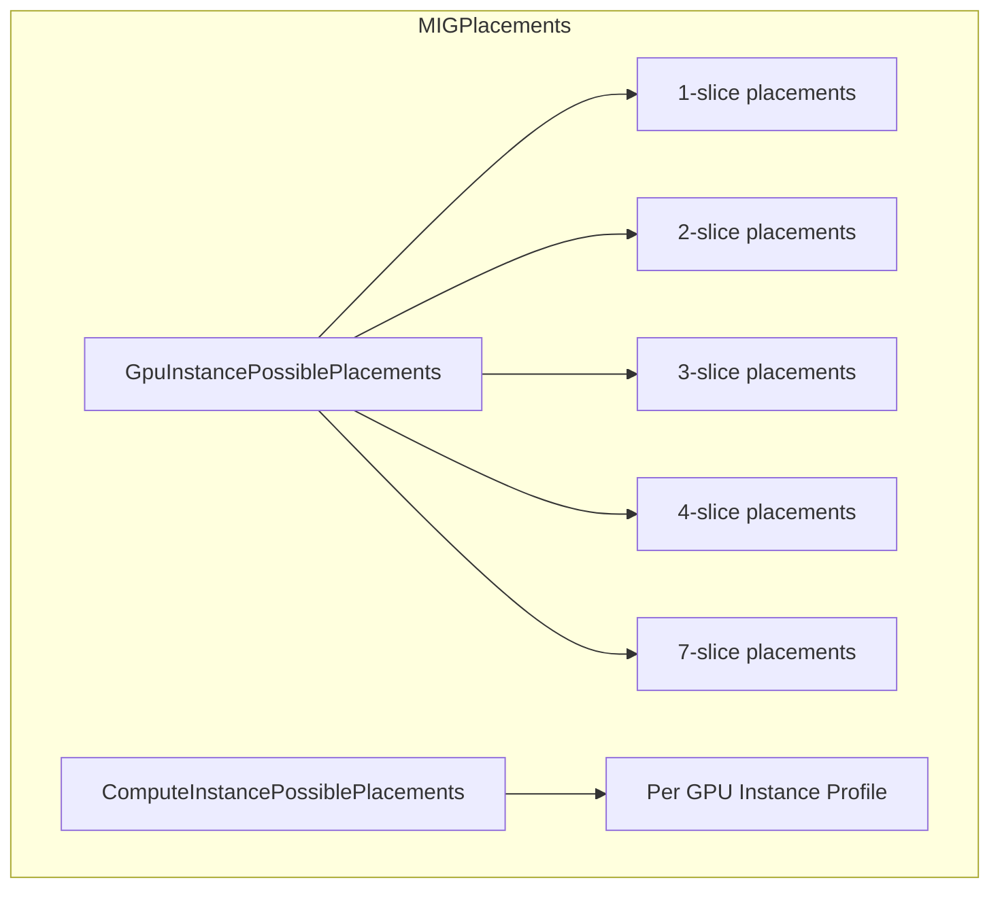
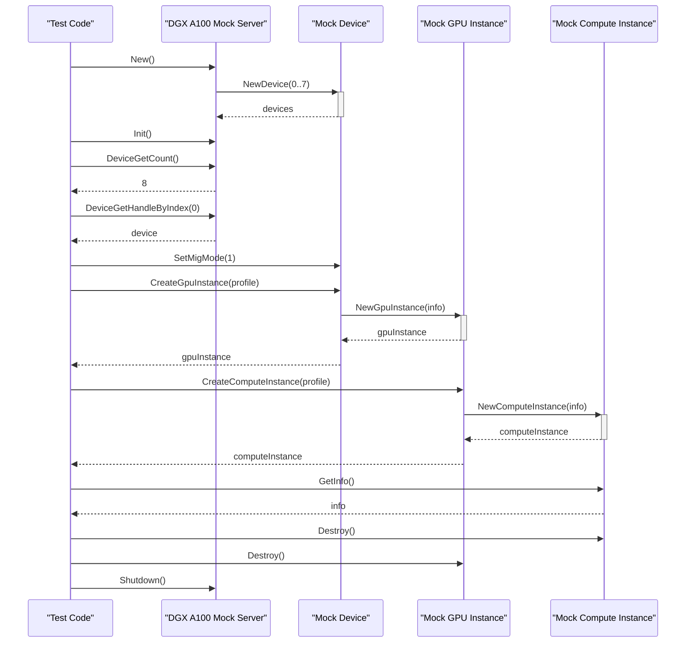
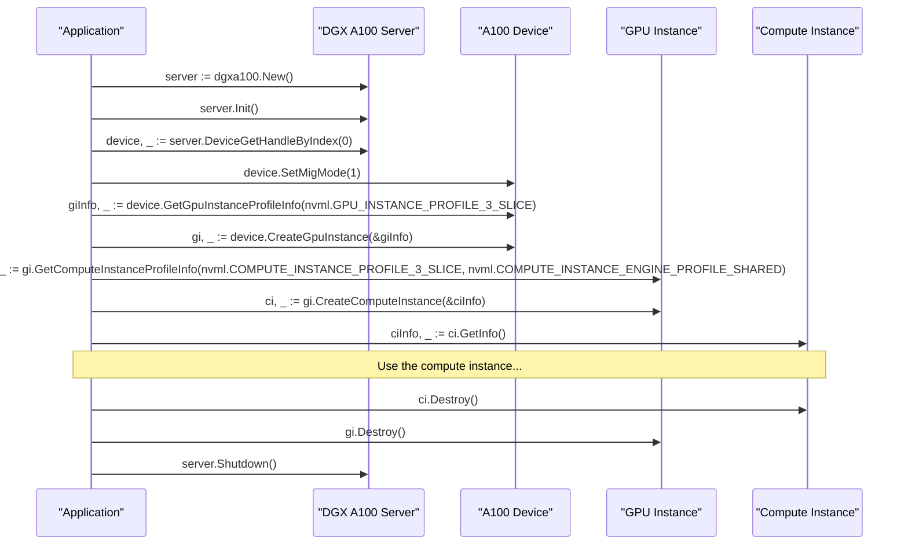
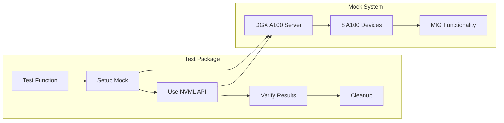

<!-- source: DeepWiki mcp.deepwiki.com · repo NVIDIA/go-nvml · page 6.2 DGX A100 Mock System · fetched 2026-10-26 -->

# DGX A100 Mock System

<details>
<summary>Relevant source files</summary>

The following files were used as context for generating this wiki page:

- [.github/workflows/golang.yml](.github/workflows/golang.yml)
- [.golangci.yaml](.golangci.yaml)
- [pkg/nvml/mock/dgxa100/dgxa100.go](pkg/nvml/mock/dgxa100/dgxa100.go)
- [pkg/nvml/mock/dgxa100/mig-profile.go](pkg/nvml/mock/dgxa100/mig-profile.go)

</details>


## Purpose and Overview

The DGX A100 Mock System provides a comprehensive simulation of an NVIDIA DGX A100 server environment for testing applications that use the NVML API without requiring actual hardware. This mock implementation specifically emulates a DGX A100 server with 8 NVIDIA A100-SXM4-40GB GPUs, complete with Multi-Instance GPU (MIG) capabilities. For information about the general mock implementation approach, see [Mock Implementation](#6.1).

## Architecture

The DGX A100 Mock System consists of several key components that together simulate a complete DGX A100 server:



Sources: [pkg/nvml/mock/dgxa100/dgxa100.go:29-75]()

### Server Component

The `Server` struct is the top-level component that implements the NVML interfaces and manages a collection of devices:



Sources: [pkg/nvml/mock/dgxa100/dgxa100.go:29-36](), [pkg/nvml/mock/dgxa100/dgxa100.go:77-95](), [pkg/nvml/mock/dgxa100/dgxa100.go:136-193]()

The `Server` struct implements both the standard NVML interface and the extended interface, providing mock implementations for functions like:

- Initialization and shutdown
- Device enumeration
- System information retrieval (driver versions, NVML version)

Each server instance is initialized with 8 devices, simulating the 8 GPUs in a DGX A100 server, along with predefined driver and NVML versions.

### Device Component

The `Device` struct represents an individual A100 GPU in the mock system:

```mermaid
classDiagram
    class Device {
        +string UUID
        +string Name
        +nvml.BrandType Brand
        +nvml.DeviceArchitecture Architecture
        +string PciBusID
        +int Minor
        +int Index
        +CudaComputeCapability CudaComputeCapability
        +int MigMode
        +map[*GpuInstance]struct{} GpuInstances
        +uint32 GpuInstanceCounter
        +nvml.Memory MemoryInfo
        +NewDevice(index int) *Device
        +setMockFuncs()
    }
    
    class nvml.Device {
        +GetUUID()
        +GetName()
        +GetBrand()
        +GetArchitecture()
        +GetMemoryInfo()
        +SetMigMode()
        +GetMigMode()
        +CreateGpuInstance()
        +GetGpuInstances()
        +...()
    }
    
    Device ..|> nvml.Device : implements
```

Sources: [pkg/nvml/mock/dgxa100/dgxa100.go:37-52](), [pkg/nvml/mock/dgxa100/dgxa100.go:97-116](), [pkg/nvml/mock/dgxa100/dgxa100.go:195-300]()

Each device is configured to simulate an NVIDIA A100-SXM4-40GB GPU with the following characteristics:
- Ampere architecture
- 40GB memory (42,949,672,960 bytes)
- CUDA compute capability 8.0
- MIG capability

The device implements methods for:
- Getting basic device information (UUID, name, PCI bus ID)
- Managing MIG mode
- Creating and managing GPU instances
- Querying GPU instance profiles and placement options

### Multi-Instance GPU (MIG) Components

The mock system includes a comprehensive implementation of MIG capabilities, which is a key feature of the A100 GPU:

```mermaid
classDiagram
    class GpuInstance {
        +nvml.GpuInstanceInfo Info
        +map[*ComputeInstance]struct{} ComputeInstances
        +uint32 ComputeInstanceCounter
        +NewGpuInstance(info) *GpuInstance
        +setMockFuncs()
    }
    
    class ComputeInstance {
        +nvml.ComputeInstanceInfo Info
        +NewComputeInstance(info) *ComputeInstance
        +setMockFuncs()
    }
    
    class nvml.GpuInstance {
        +GetInfo()
        +CreateComputeInstance()
        +GetComputeInstances()
        +Destroy()
        +...()
    }
    
    class nvml.ComputeInstance {
        +GetInfo()
        +Destroy()
        +...()
    }
    
    GpuInstance ..|> nvml.GpuInstance : implements
    ComputeInstance ..|> nvml.ComputeInstance : implements
```

Sources: [pkg/nvml/mock/dgxa100/dgxa100.go:54-65](), [pkg/nvml/mock/dgxa100/dgxa100.go:118-134](), [pkg/nvml/mock/dgxa100/dgxa100.go:302-381]()

The MIG components consist of:

1. **GPU Instances**: Represents a partition of the GPU with dedicated resources
2. **Compute Instances**: Represents compute units within a GPU instance

These components implement methods for:
- Creating and destroying instances
- Getting instance information
- Managing the hierarchy of instances

### MIG Profiles and Placements

The mock system includes detailed MIG profiles that mirror the actual profiles available on A100 GPUs:



Sources: [pkg/nvml/mock/dgxa100/mig-profile.go:25-314]()

The profiles define the characteristics of each GPU instance and compute instance, including:
- Slice count (1, 2, 3, 4, or 7 slices)
- Memory size
- Multiprocessor count
- Engine counts (copy, decoder, encoder, etc.)

Additionally, the mock system defines placement information for the instances:



Sources: [pkg/nvml/mock/dgxa100/mig-profile.go:318-471]()

## Usage

The DGX A100 Mock System can be instantiated and used in tests as a replacement for the real NVML interface:



Sources: [pkg/nvml/mock/dgxa100/dgxa100.go:77-95]()

### Implementation Details

The mock system uses a pattern of struct composition and function pointers to implement the NVML interfaces:

1. Each component (Server, Device, GpuInstance, ComputeInstance) embeds the corresponding mock interface
2. During initialization, each component calls a `setMockFuncs()` method to set up the function pointers
3. These function pointers implement the behavior of the real NVML functions

This approach allows the mock system to:
- Be easily instantiated in tests
- Provide consistent behavior that mimics real hardware
- Support complex scenarios involving MIG functionality

## MIG Configuration Options

The DGX A100 Mock System supports the following GPU Instance profiles:

| Profile ID | Name | Slices | Instances Per GPU | Memory (MB) | SMs |
|------------|------|--------|-------------------|-------------|-----|
| 0 | GPU_INSTANCE_PROFILE_1_SLICE | 1 | 7 | 4,864 | 14 |
| 1 | GPU_INSTANCE_PROFILE_2_SLICE | 2 | 3 | 9,856 | 28 |
| 2 | GPU_INSTANCE_PROFILE_3_SLICE | 3 | 2 | 19,968 | 42 |
| 3 | GPU_INSTANCE_PROFILE_4_SLICE | 4 | 1 | 19,968 | 56 |
| 9 | GPU_INSTANCE_PROFILE_7_SLICE | 7 | 1 | 40,192 | 98 |

Sources: [pkg/nvml/mock/dgxa100/mig-profile.go:29-121]()

Each GPU Instance profile supports specific Compute Instance profiles:

| GPU Instance | Supported Compute Instance Profiles |
|--------------|-------------------------------------|
| 1-slice | 1-slice |
| 2-slice | 1-slice, 2-slice |
| 3-slice | 1-slice, 2-slice, 3-slice |
| 4-slice | 1-slice, 2-slice, 4-slice |
| 7-slice | 1-slice, 2-slice, 3-slice, 4-slice, 7-slice |

Sources: [pkg/nvml/mock/dgxa100/mig-profile.go:122-313]()

## Example: Creating and Managing MIG Instances

The following sequence demonstrates how to use the DGX A100 Mock System to create and manage MIG instances:



Sources: [pkg/nvml/mock/dgxa100/dgxa100.go:136-381]()

## Integration with Testing Framework

The DGX A100 Mock System integrates easily with Go's testing framework, allowing developers to write tests that simulate complex GPU configurations without actual hardware:



Sources: [pkg/nvml/mock/dgxa100/dgxa100.go:77-95](), [.github/workflows/golang.yml:48-55]()