# Page: Overview

# Overview

<details>
<summary>Relevant source files</summary>

The following files were used as context for generating this wiki page:

- [README.md](README.md)
- [go.mod](go.mod)
- [go.sum](go.sum)
- [pkg/nvml/cgo_helpers.h](pkg/nvml/cgo_helpers.h)
- [pkg/nvml/doc.go](pkg/nvml/doc.go)

</details>


The go-nvml repository provides Go language bindings for the [NVIDIA Management Library (NVML)](https://docs.nvidia.com/deploy/nvml-api/), enabling Go applications to monitor and manage NVIDIA GPUs. These bindings act as wrappers around the C API provided by `libnvidia-ml.so`, which is part of the standard NVIDIA driver distribution.

The NVML API allows applications to query device state, monitor performance metrics, manage GPU instances, handle events, and control various aspects of NVIDIA GPUs. This document provides a high-level overview of the go-nvml repository structure, components, and how they interact.

For detailed information about building and generating the bindings, see [Building and Generating Bindings](#2).

Sources: [README.md:22-42]()

## System Architecture

The go-nvml repository consists of several interconnected components that work together to provide a Go interface to the NVIDIA Management Library.

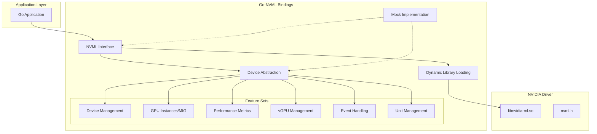

The architecture consists of several layers:

1. **Application Layer**: Go applications that use the NVML bindings to interact with NVIDIA GPUs
2. **Go-NVML Bindings**: The core components of the repository
   - NVML Interface: Primary entry point for accessing NVML functionality
   - Device Abstraction: Representation of physical GPUs
   - Dynamic Library Loading: System for loading the NVIDIA driver's library
   - Mock Implementation: Test environment for when physical hardware is unavailable
3. **Feature Sets**: Various capabilities exposed through the bindings
4. **NVIDIA Driver**: The underlying driver containing the native NVML implementation

Sources: [README.md:22-42]()

## Binding Generation Process

The Go bindings are not written manually but generated from the NVML C headers using a tool called `c-for-go`. This ensures that the bindings stay up-to-date with the NVML API.

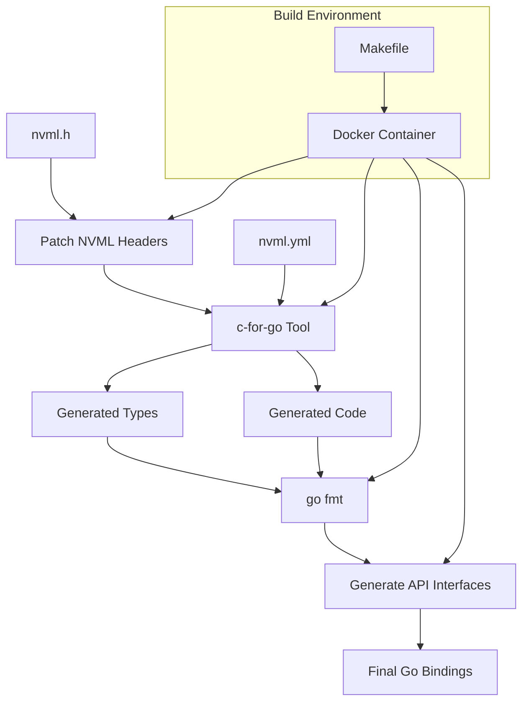

The process involves:

1. Starting with the NVML C header file (`nvml.h`)
2. Patching it to make it compatible with the binding generator
3. Processing it with `c-for-go` using configuration from `nvml.yml`
4. Generating Go types and code
5. Formatting the generated code and adding API interfaces
6. Creating the final Go bindings

This entire process is orchestrated by a Makefile and typically runs in a Docker container to ensure a consistent build environment.

Sources: [README.md:109-148]()

## Code Structure

The go-nvml repository is organized into two main directories:

1. `/gen`: Contains code used to generate the final Go bindings
2. `/pkg`: Houses the generated bindings and static packages

Key components include:

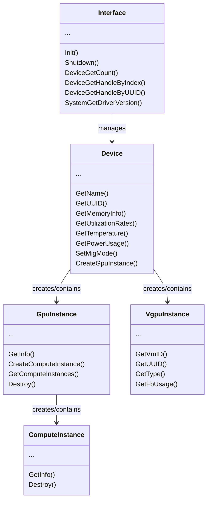

The key components are:

1. **Interface**: The main API entry point that provides methods for initializing the library and accessing devices
2. **Device**: Represents a physical GPU with methods for querying properties and creating instances
3. **GpuInstance**: Represents a GPU instance created through Multi-Instance GPU (MIG) technology
4. **ComputeInstance**: Represents a compute instance within a GPU instance
5. **VgpuInstance**: Represents a virtual GPU instance

Sources: [README.md:232-236](), [README.md:394-400]()

## Dynamic Library Loading

The go-nvml bindings dynamically load the NVIDIA Management Library (`libnvidia-ml.so`) at runtime. This means that the library does not need to be present during compilation, only at runtime.

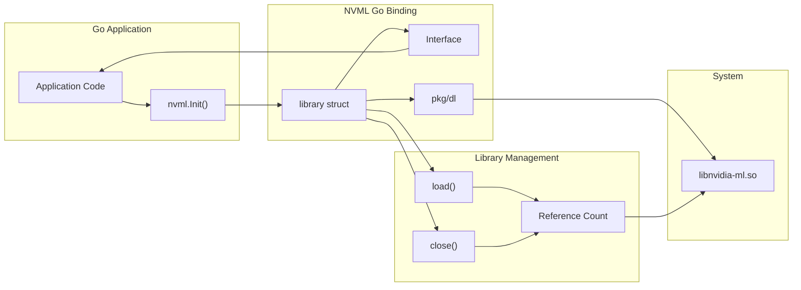

The process works as follows:

1. A Go application calls `nvml.Init()`
2. The library struct attempts to load `libnvidia-ml.so` using the `pkg/dl` package
3. It maintains a reference count to ensure the library is only loaded once
4. The loaded library functions are made available through the Interface

The dynamic loading system also handles versioned symbols in the NVML library, ensuring that the correct version of each function is used.

Sources: [README.md:292-325]()

## Usage Example

Using the go-nvml bindings is straightforward. Here's a basic example of initializing the library and querying information about available GPUs:

```go
package main

import (
    "fmt"
    "log"

    "github.com/NVIDIA/go-nvml/pkg/nvml"
)

func main() {
    // Initialize NVML
    ret := nvml.Init()
    if ret != nvml.SUCCESS {
        log.Fatalf("Unable to initialize NVML: %v", nvml.ErrorString(ret))
    }
    defer func() {
        ret := nvml.Shutdown()
        if ret != nvml.SUCCESS {
            log.Fatalf("Unable to shutdown NVML: %v", nvml.ErrorString(ret))
        }
    }()

    // Get device count
    count, ret := nvml.DeviceGetCount()
    if ret != nvml.SUCCESS {
        log.Fatalf("Unable to get device count: %v", nvml.ErrorString(ret))
    }

    // Iterate through devices
    for i := 0; i < count; i++ {
        device, ret := nvml.DeviceGetHandleByIndex(i)
        if ret != nvml.SUCCESS {
            log.Fatalf("Unable to get device at index %d: %v", i, nvml.ErrorString(ret))
        }

        uuid, ret := device.GetUUID()
        if ret != nvml.SUCCESS {
            log.Fatalf("Unable to get uuid of device at index %d: %v", i, nvml.ErrorString(ret))
        }

        fmt.Printf("%v\n", uuid)
    }
}
```

Sources: [README.md:52-93]()

## Mock Implementation for Testing

For testing without actual NVIDIA hardware, go-nvml provides a mock implementation that simulates the behavior of real GPUs. This is particularly useful for development and testing in environments where GPUs may not be available.

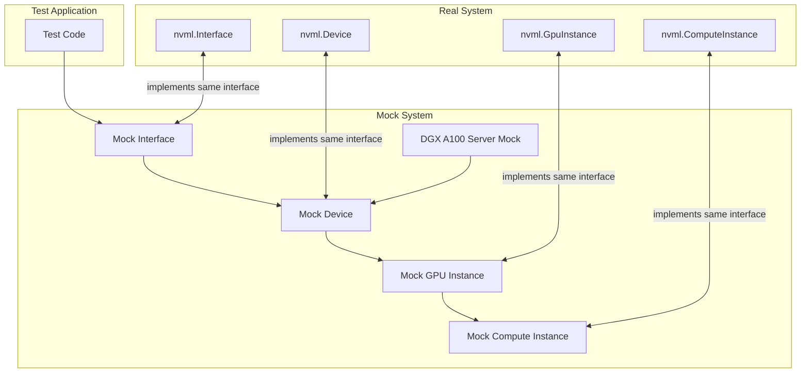

The mock system:

1. Implements the same interfaces as the real system
2. Allows test code to interact with simulated GPUs
3. Provides a specialized DGX A100 server mock for testing complex scenarios
4. Enables testing of Multi-Instance GPU (MIG) functionality without actual hardware

For more detailed information about the mock implementation and testing capabilities, see [Mock Implementation](#6.1) and [DGX A100 Mock System](#6.2).

Sources: [README.md:476-480]()

## Related Pages

For more detailed information about specific aspects of go-nvml, refer to the following pages:

- [Building and Generating Bindings](#2): Detailed explanation of how the bindings are generated
- [Core API](#3): Overview of the main NVML API components
- [Library Infrastructure](#5): Details about how the Go bindings interface with the C library
- [Testing](#6): Information about testing capabilities and mock implementations

---

# Page: Building and Generating Bindings

# Building and Generating Bindings

<details>
<summary>Relevant source files</summary>

The following files were used as context for generating this wiki page:

- [Makefile](Makefile)
- [docker/Dockerfile.devel](docker/Dockerfile.devel)
- [gen/nvml/generateapi.go](gen/nvml/generateapi.go)
- [gen/nvml/nvml.h](gen/nvml/nvml.h)
- [gen/nvml/nvml.yml](gen/nvml/nvml.yml)

</details>


This document explains the process of building the Go-NVML project and how the Go bindings are generated from the NVIDIA Management Library (NVML) C headers. It covers the build environment, binding generation workflow, and the tools used in this process.

## Build System Overview

The Go-NVML project uses a structured build system to generate Go language bindings from the NVML C header files. This process transforms the C-style API into idiomatic Go code that's easier to use in Go applications.

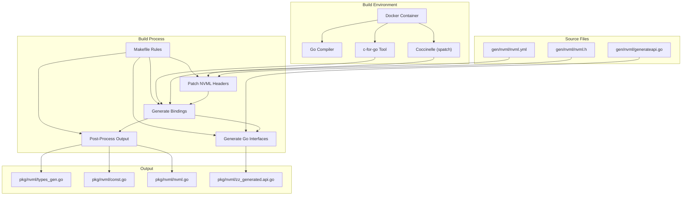

Sources: [Makefile:131-180](), [docker/Dockerfile.devel:1-57]()

## Docker Build Environment

To ensure a consistent build environment, Go-NVML uses a Docker container that includes all necessary tools and dependencies.

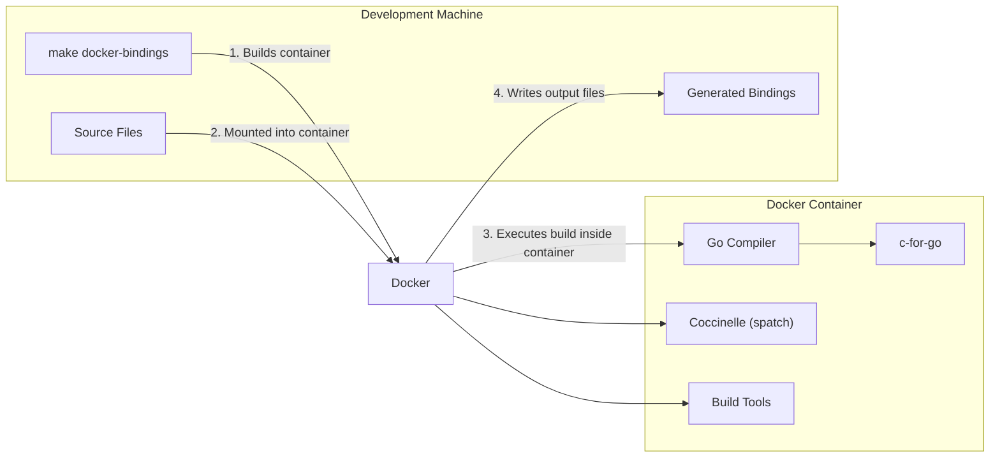

The Docker environment contains:

- Go compiler and tools
- c-for-go tool (for generating Go bindings from C)
- Coccinelle (for semantic patching of C code)
- Other build utilities

Sources: [docker/Dockerfile.devel:1-57](), [Makefile:83-128]()

## Binding Generation Process

The binding generation process transforms NVML's C header files into Go code through several stages:

### 1. Header Patching

Before generating bindings, the NVML header files need to be patched to be compatible with the c-for-go tool:

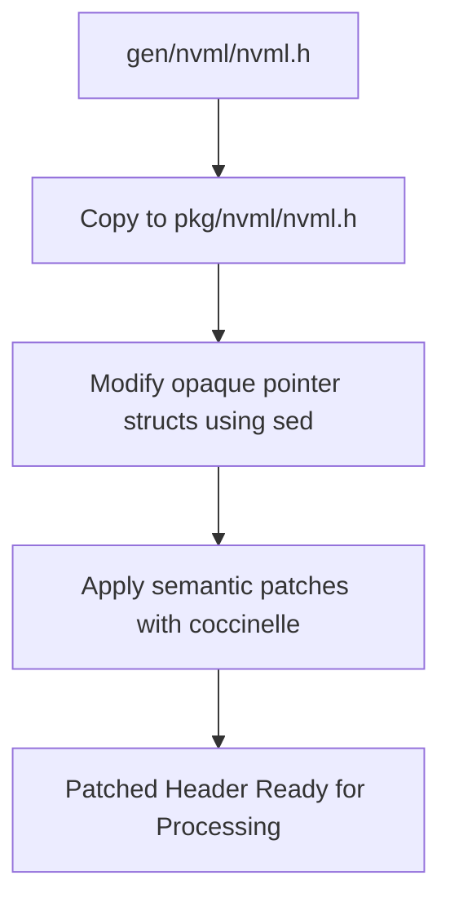

The patching process includes:

- Modifying opaque pointer structures to be compatible with cgo
- Applying semantic patches to handle anonymous structs
- Ensuring consistent formatting

Sources: [Makefile:139-143]()

### 2. Binding Generation

After patching, the c-for-go tool generates the bindings using a configuration defined in `nvml.yml`:

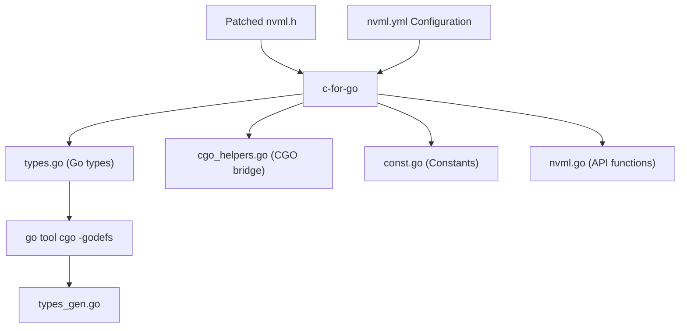

The `nvml.yml` configuration controls:

- Mapping of C types to Go types
- Rules for handling constants and enumerations
- Function export/import rules
- Package structure and naming

Sources: [gen/nvml/nvml.yml:1-100](), [Makefile:146-153]()

### 3. Interface Generation

After the basic bindings are generated, additional Go interfaces are created using the `generateapi.go` tool:

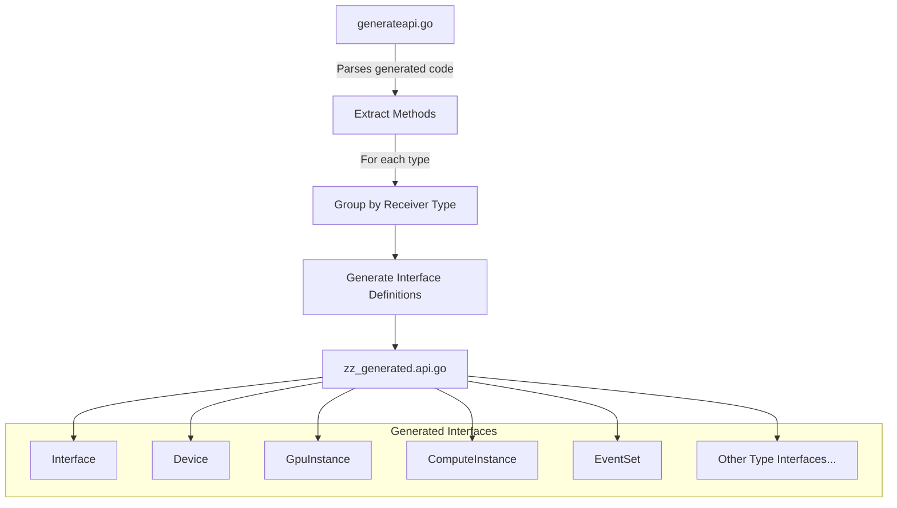

The interface generation:

- Creates idiomatic Go interfaces for each type
- Groups methods by receiver type
- Generates mock implementations for testing

Sources: [gen/nvml/generateapi.go:1-421](), [Makefile:154-157]()

## Relationship Between C and Go Types

The binding process creates a layered architecture that bridges C types to idiomatic Go interfaces:

```mermaid
classDiagram
    class "NVML C Header" {
        nvmlDevice_t
        nvmlReturn_t
        nvmlDeviceGetName()
        nvmlDeviceGetCount()
    }
    
    class "Generated Go Types" {
        nvmlDevice
        Return
        DeviceGetName()
        DeviceGetCount()
    }
    
    class "Go Interfaces" {
        Interface
        Device
        GpuInstance
        ComputeInstance
    }
    
    class "Application Code" {
        Uses Go interfaces
    }
    
    "NVML C Header" --> "Generated Go Types" : c-for-go
    "Generated Go Types" --> "Go Interfaces" : generateapi.go
    "Go Interfaces" --> "Application Code" : imports
```

Sources: [gen/nvml/nvml.yml:42-99](), [gen/nvml/generateapi.go:35-81]()

## Building With Make

The entire build process is orchestrated by the Makefile with several key targets:

| Make Target | Description |
|-------------|-------------|
| `bindings` | Main target to generate all bindings |
| `patch-nvml-h` | Only patch the NVML header file |
| `clean-bindings` | Remove all generated binding files |
| `update-nvml-h` | Update NVML header from NVIDIA's repository |
| `docker-bindings` | Run binding generation in Docker container |

The most common command to generate bindings is:

```
make docker-bindings
```

This will:
1. Build the Docker container if needed
2. Mount the source directory into the container
3. Run the binding generation process inside the container
4. Output the generated files to the local filesystem

Sources: [Makefile:133-180](), [Makefile:102-114]()

## Updating NVML Headers

The project includes a mechanism to update the NVML headers to newer versions:

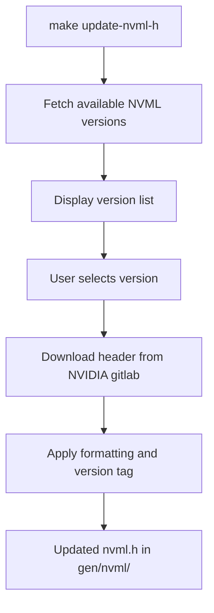

After updating the headers, you need to regenerate the bindings with:

```
make docker-bindings
```

Sources: [Makefile:182-222]()

## Build Output Structure

The binding generation process creates several output files in the `pkg/nvml/` directory:

| File | Description |
|------|-------------|
| `const.go` | Contains constants and enumerations from NVML |
| `nvml.go` | Contains the core API function bindings |
| `types_gen.go` | Contains Go type definitions for NVML structures |
| `zz_generated.api.go` | Contains Go interfaces for the NVML API |

These files together provide a complete Go binding for the NVML library.

Sources: [Makefile:171-179]()

## Common Build Issues and Solutions

Here are some common issues that might arise during the build process:

1. **Missing Docker environment**: Ensure Docker is installed and running
2. **Build failures**: Try cleaning with `make docker-clean-bindings` before rebuilding
3. **Header compatibility issues**: If updating to a new NVML header causes problems, 
   check if additional patches are needed in the patching process

For more information about using the generated bindings in your code, see [Core API](#3) for details on the API components.

---

# Page: Core API

# Core API

<details>
<summary>Relevant source files</summary>

The following files were used as context for generating this wiki page:

- [pkg/nvml/api.go](pkg/nvml/api.go)
- [pkg/nvml/nvml.go](pkg/nvml/nvml.go)
- [pkg/nvml/zz_generated.api.go](pkg/nvml/zz_generated.api.go)

</details>


## Purpose and Scope

The Core API provides the foundational interfaces and functions needed to interact with NVIDIA GPUs through the NVIDIA Management Library (NVML). This page documents the main components of the Go bindings for NVML, explaining the interface hierarchy and the primary patterns for interfacing with GPU hardware. 

The Core API serves as the primary entry point for applications to access GPU information, manage resources, and monitor performance. For more detailed information about specific capabilities like device management and performance metrics, see [Device Management](#3.1) and [Performance Metrics](#4.1) respectively.

## Interface Hierarchy

The Go-NVML bindings follow a well-defined interface hierarchy that represents the relationship between various components in the NVIDIA GPU ecosystem.

```mermaid
classDiagram
    class "Interface" {
        Init()
        Shutdown()
        DeviceGetCount()
        DeviceGetHandleByIndex()
        SystemGetDriverVersion()
        ...200+ methods
    }
    
    class "Device" {
        GetName()
        GetUUID()
        GetMemoryInfo()
        GetUtilizationRates()
        GetPowerUsage()
        CreateGpuInstance()
        ...900+ methods
    }
    
    class "GpuInstance" {
        GetInfo()
        CreateComputeInstance()
        GetComputeInstances()
        Destroy()
        ...12 methods
    }
    
    class "ComputeInstance" {
        GetInfo()
        Destroy()
        ...2 methods
    }
    
    class "EventSet" {
        Wait()
        Free()
        ...2 methods
    }
    
    class "Unit" {
        GetUnitInfo()
        GetDevices()
        GetLedState()
        GetPsuInfo()
        ...7 methods
    }
    
    class "VgpuInstance" {
        GetVmID()
        GetUUID()
        GetType()
        GetFbUsage()
        ...23 methods
    }
    
    class "VgpuTypeId" {
        GetCapabilities()
        GetClass()
        GetDeviceID()
        GetName()
        ...12 methods
    }
    
    Interface --> Device : creates/manages
    Interface --> EventSet : creates
    Interface --> Unit : manages
    Device --> GpuInstance : creates/contains
    GpuInstance --> ComputeInstance : creates/contains
    Device --> VgpuInstance : related to
    VgpuInstance --> VgpuTypeId : has type
```

This diagram shows the core interfaces defined in the Go-NVML API and their relationships. The main `Interface` provides methods for initializing the library and accessing devices and other system-level resources. Specific objects like `Device`, `GpuInstance`, and `ComputeInstance` provide specialized functionality for their respective domains.

Sources: [pkg/nvml/zz_generated.api.go:346-1007]()

## Core Components

### Primary Interface

The top-level `Interface` type serves as the main entry point to the NVML API. It defines over 300 methods that provide access to all NVML functionality, including system-level operations, device management, GPU instance handling, and more.

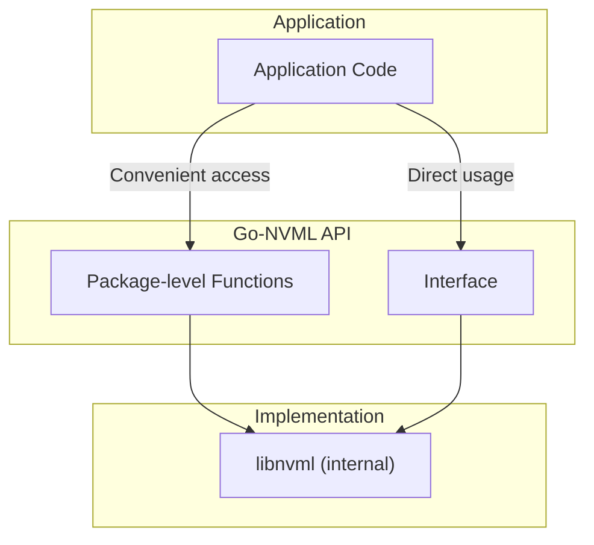

The API can be accessed in two primary ways:
1. Through the package-level functions (e.g., `nvml.Init()`, `nvml.DeviceGetCount()`)
2. By obtaining and using an explicit interface instance

Package-level functions are actually variables that point to methods of a global library instance, making the API more convenient to use.

Sources: [pkg/nvml/zz_generated.api.go:22-344](), [pkg/nvml/api.go:19-28]()

### Device Interface

The `Device` interface is one of the most important interfaces, representing a physical NVIDIA GPU. It provides methods for querying device properties, monitoring performance, managing resources, and performing device-specific operations.

Key capabilities of the `Device` interface include:
- Retrieving basic information (name, UUID, PCIe info)
- Monitoring performance metrics (utilization, temperature, power)
- Managing device settings (clocks, power limits, compute mode)
- Creating and managing GPU instances (for MIG-capable GPUs)
- Handling events and error reporting

Sources: [pkg/nvml/zz_generated.api.go:673-903]()

### GPU Instances and Compute Instances

For GPUs that support Multi-Instance GPU (MIG) technology, the API provides interfaces to manage GPU instances and compute instances:

- `GpuInstance`: Represents a partition of a physical GPU, provides methods for creating and managing compute instances
- `ComputeInstance`: Represents a compute instance within a GPU instance

These interfaces enable fine-grained control of GPU resources in environments where multiple workloads need to share GPU resources securely and with guaranteed quality of service.

Sources: [pkg/nvml/zz_generated.api.go:906-928]()

### Events and Monitoring

The API provides mechanisms for event handling and monitoring through the `EventSet` interface. This allows applications to register for notifications of specific events such as GPU state changes, rather than having to poll for status changes.

Sources: [pkg/nvml/zz_generated.api.go:929-936]()

### Extended Functionality

The `ExtendedInterface` provides additional functionality beyond the core NVML API, such as the ability to dynamically look up symbols in the NVML library.

```go
type ExtendedInterface interface {
	LookupSymbol(string) error
}
```

This extension mechanism allows for accessing functions that might not be part of the standard API or that might vary across different versions of the NVML library.

Sources: [pkg/nvml/api.go:19-28]()

## Initialization and Usage

### Library Initialization

Before using any of the API functions, the NVML library must be initialized. This is typically done using the `Init()` function, which dynamically loads the NVML C library.

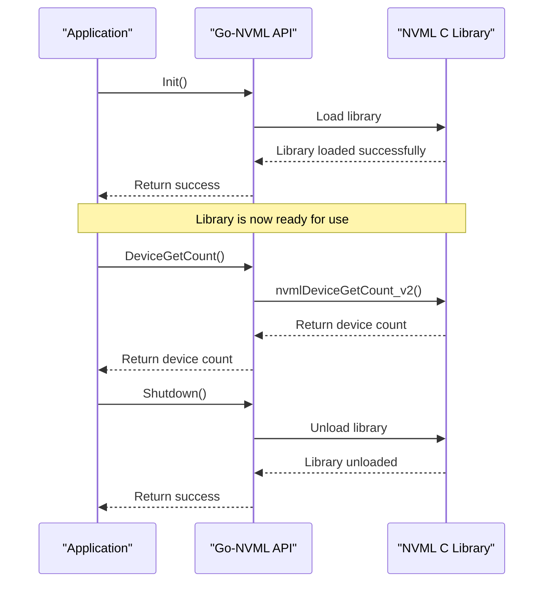

The library supports customization through options that can be set using `SetLibraryOptions()` before initialization:

```go
// Example: Set custom library path
err := nvml.SetLibraryOptions(nvml.WithLibraryPath("/custom/path/libnvidia-ml.so"))
if err != nil {
    // Handle error
}

// Initialize the library
ret := nvml.Init()
if ret != nvml.SUCCESS {
    // Handle error
}
```

Sources: [pkg/nvml/api.go:36-56]()

### Error Handling

All API functions that can fail return a `Return` value, which is an enumeration representing the success or failure of the operation. The `ErrorString()` function can be used to get a human-readable error message for a given return code.

```go
ret := nvml.Init()
if ret != nvml.SUCCESS {
    errMsg := nvml.ErrorString(ret)
    fmt.Printf("Failed to initialize NVML: %s\n", errMsg)
    // Handle error
}
```

For more details on error handling, see [Error Handling](#3.4).

Sources: [pkg/nvml/nvml.go:53-59]()

## Key Function Categories

The Core API functions can be categorized into several key areas:

| Category | Description | Example Functions |
|----------|-------------|-------------------|
| Library Management | Functions to initialize, shut down, and configure the library | `Init()`, `Shutdown()`, `SetLibraryOptions()` |
| Device Discovery | Functions to find and access NVIDIA GPUs | `DeviceGetCount()`, `DeviceGetHandleByIndex()`, `DeviceGetHandleByUUID()` |
| System Information | Functions to retrieve system-level information | `SystemGetDriverVersion()`, `SystemGetNVMLVersion()`, `SystemGetProcessName()` |
| Device Information | Functions to get basic device properties | `Device.GetName()`, `Device.GetUUID()`, `Device.GetPciInfo()` |
| Performance Monitoring | Functions to monitor device performance | `Device.GetUtilizationRates()`, `Device.GetPowerUsage()`, `Device.GetTemperature()` |
| Resource Management | Functions to control device resources | `Device.SetPowerManagementLimit()`, `Device.SetApplicationsClocks()` |
| MIG Management | Functions to manage Multi-Instance GPU | `Device.SetMigMode()`, `Device.CreateGpuInstance()`, `GpuInstance.CreateComputeInstance()` |
| Event Handling | Functions for event registration and handling | `DeviceRegisterEvents()`, `EventSet.Wait()` |

Sources: [pkg/nvml/zz_generated.api.go:22-344](), [pkg/nvml/zz_generated.api.go:346-671]()

## API Structure Overview

The following diagram illustrates how the Go-NVML Core API maps to the underlying NVML C library:

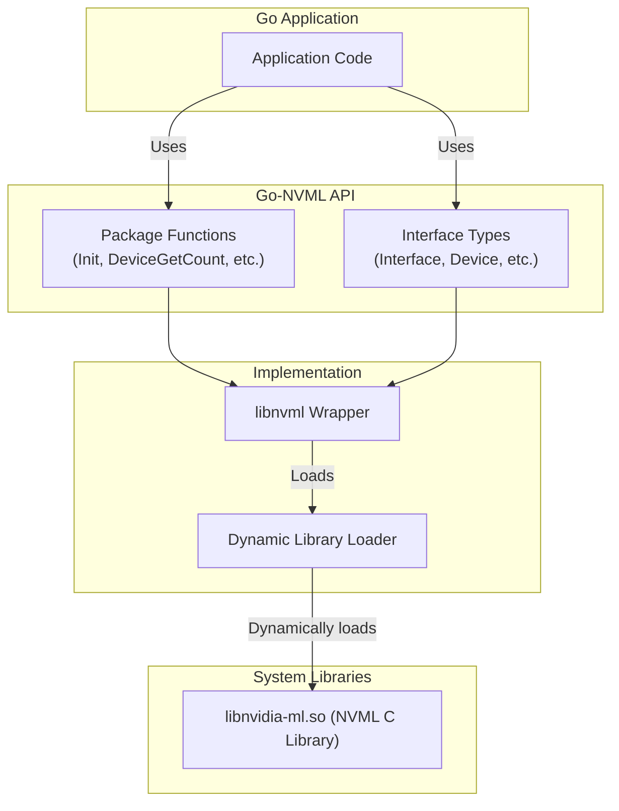

This architecture provides a clean, idiomatic Go interface to the underlying C library while handling the complexities of dynamic library loading and memory management.

Sources: [pkg/nvml/api.go:19-56](), [pkg/nvml/zz_generated.api.go:22-344]()

## Example Workflow

A typical workflow using the Go-NVML Core API follows these steps:

1. Initialize the library
2. Discover available devices
3. Select and obtain a device handle
4. Query device information or perform operations
5. Clean up by shutting down the library

```go
// Initialize NVML
ret := nvml.Init()
if ret != nvml.SUCCESS {
    fmt.Printf("Failed to initialize NVML: %s\n", nvml.ErrorString(ret))
    return
}
defer nvml.Shutdown() // Ensure we clean up on exit

// Get device count
var count uint32
ret = nvml.DeviceGetCount(&count)
if ret != nvml.SUCCESS {
    fmt.Printf("Failed to get device count: %s\n", nvml.ErrorString(ret))
    return
}

// Get device handle
var device nvml.Device
ret = nvml.DeviceGetHandleByIndex(0, &device)
if ret != nvml.SUCCESS {
    fmt.Printf("Failed to get device handle: %s\n", nvml.ErrorString(ret))
    return
}

// Query device information
name, ret := device.GetName()
if ret != nvml.SUCCESS {
    fmt.Printf("Failed to get device name: %s\n", nvml.ErrorString(ret))
    return
}

uuid, ret := device.GetUUID()
if ret != nvml.SUCCESS {
    fmt.Printf("Failed to get device UUID: %s\n", nvml.ErrorString(ret))
    return
}

fmt.Printf("Device: %s (UUID: %s)\n", name, uuid)

// Get utilization information
util, ret := device.GetUtilizationRates()
if ret != nvml.SUCCESS {
    fmt.Printf("Failed to get utilization rates: %s\n", nvml.ErrorString(ret))
    return
}

fmt.Printf("GPU Utilization: %d%%\n", util.Gpu)
fmt.Printf("Memory Utilization: %d%%\n", util.Memory)
```

This example demonstrates the core pattern of using the API: initialize, get device handle, perform operations, and clean up.

Sources: [pkg/nvml/nvml.go:31-103](), [pkg/nvml/zz_generated.api.go:673-903]()

## Summary

The Core API of Go-NVML provides a comprehensive set of interfaces and functions for interacting with NVIDIA GPUs. The API is structured around a hierarchy of interfaces that represent different components of the NVIDIA GPU ecosystem, from the system level down to individual GPU and compute instances.

Key aspects of the Core API include:
- A top-level `Interface` that provides access to all NVML functionality
- Specialized interfaces for devices, GPU instances, and compute instances
- Support for event handling and performance monitoring
- Dynamic library loading for flexibility
- Extension mechanisms for advanced use cases

Understanding this core structure is essential for effectively using the Go-NVML bindings to monitor and manage NVIDIA GPUs in Go applications.

---

# Page: Device Management

# Device Management

<details>
<summary>Relevant source files</summary>

The following files were used as context for generating this wiki page:

- [pkg/nvml/device.go](pkg/nvml/device.go)
- [pkg/nvml/init.go](pkg/nvml/init.go)

</details>


## Purpose and Scope

This document explains how to discover and interact with NVIDIA GPUs using the go-nvml bindings. It covers device discovery, querying device properties, monitoring performance metrics, and controlling device states. This page focuses on the core device management functionality; for specialized features like Multi-Instance GPU (MIG), see [GPU Features](#4) and [Multi-Instance GPU (MIG)](#4.2).

## Overview

Device management is a foundational capability in NVML that allows applications to enumerate available NVIDIA GPUs and interact with them. The Go bindings provide a clean interface to these capabilities through the `Device` interface.

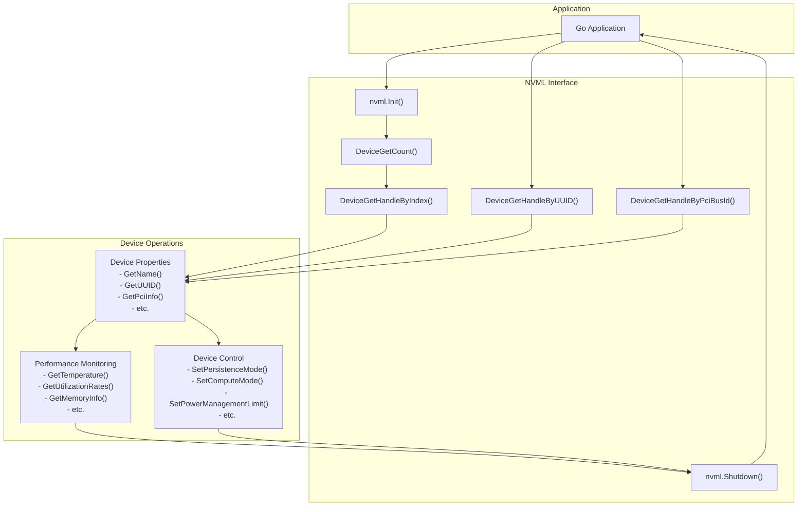

Sources: [pkg/nvml/init.go:20-48](), [pkg/nvml/device.go:101-134]()

## Device Discovery

Before interacting with GPU devices, you need to discover them in the system. The NVML interface provides several methods for this purpose.

### Initializing NVML

Before discovering devices, you must initialize the NVML library:

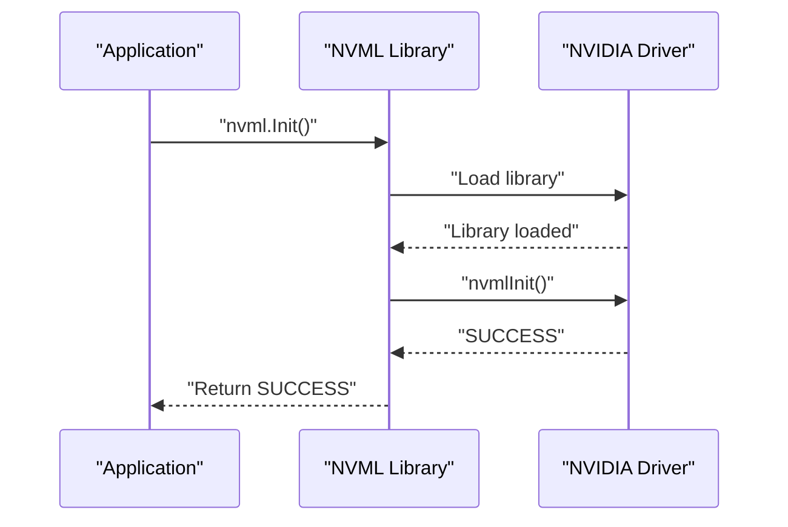

Sources: [pkg/nvml/init.go:20-25]()

### Enumerating Devices

After initialization, you can get the count of available devices and retrieve handles to each one:

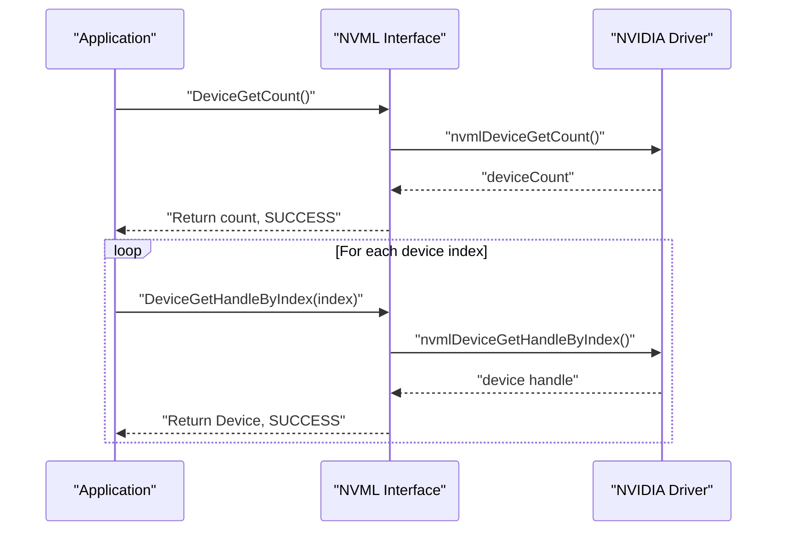

The primary methods for device discovery are:

| Method | Description |
|--------|-------------|
| `DeviceGetCount()` | Returns the number of NVIDIA GPUs in the system |
| `DeviceGetHandleByIndex(index)` | Gets a device handle for the GPU at the given index |
| `DeviceGetHandleByUUID(uuid)` | Gets a device handle for the GPU with the given UUID |
| `DeviceGetHandleByPciBusId(pciBusId)` | Gets a device handle for the GPU at the given PCI bus ID |
| `DeviceGetHandleBySerial(serial)` | Gets a device handle for the GPU with the given serial number |

Sources: [pkg/nvml/device.go:101-134]()

## Device Properties

Once you have a device handle, you can query various properties of the device.

### Basic Properties

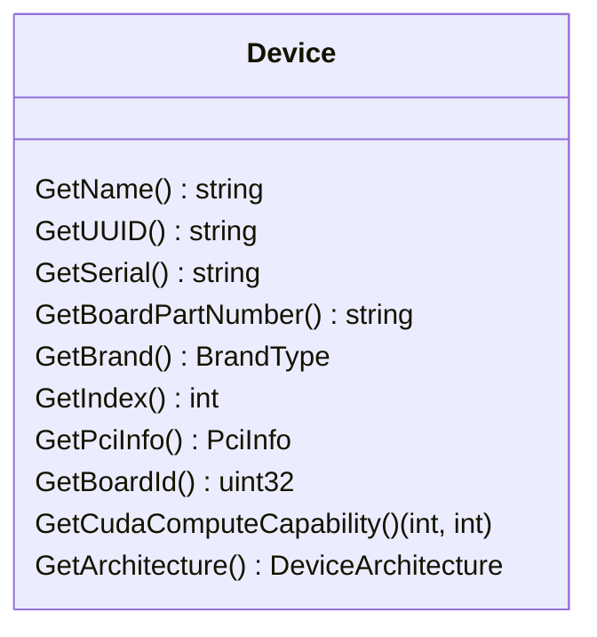

Basic device properties include:

| Property | Method | Description |
|----------|--------|-------------|
| Name | `GetName()` | Product name of the device |
| UUID | `GetUUID()` | Globally unique identifier |
| Serial | `GetSerial()` | Serial number |
| PCI Info | `GetPciInfo()` | PCI bus information |
| Brand | `GetBrand()` | Brand type (e.g., GeForce, Tesla) |
| Index | `GetIndex()` | Index of the device in the system |
| CUDA Capability | `GetCudaComputeCapability()` | CUDA compute capability major/minor version |
| Architecture | `GetArchitecture()` | GPU architecture (e.g., Ampere, Hopper) |

Sources: [pkg/nvml/device.go:136-178](), [pkg/nvml/device.go:377-395](), [pkg/nvml/device.go:821-830](), [pkg/nvml/device.go:1987-1997]()

### PCI Information

The `GetPciInfo()` method returns detailed PCI information about the device:

```mermaid
classDiagram
    class PciInfo {
        BusId string
        Domain uint32
        Bus uint32
        Device uint32
        PciDeviceId uint32
        PciSubSystemId uint32
    }

    class Device {
        GetPciInfo() PciInfo
    }

    Device --> PciInfo : returns
```

You can also query specific PCI-related properties:

| Method | Description |
|--------|-------------|
| `GetMaxPcieLinkGeneration()` | Maximum PCIe link generation |
| `GetMaxPcieLinkWidth()` | Maximum PCIe link width |
| `GetCurrPcieLinkGeneration()` | Current PCIe link generation |
| `GetCurrPcieLinkWidth()` | Current PCIe link width |
| `GetPcieThroughput()` | PCIe throughput in KB/s |
| `GetBusType()` | Bus type (e.g., PCIe, PCI, AGP) |

Sources: [pkg/nvml/device.go:377-461](), [pkg/nvml/device.go:2378-2387]()

## Performance Monitoring

NVML provides extensive capabilities for monitoring various performance metrics of the device.

### Memory Usage

```mermaid
classDiagram
    class Memory {
        Total uint64
        Free uint64
        Used uint64
    }

    class Memory_v2 {
        Version uint32
        Total uint64
        Reserved uint64
        Free uint64
        Used uint64
    }

    class Device {
        GetMemoryInfo() Memory
        GetMemoryInfo_v2() Memory_v2
        GetBAR1MemoryInfo() BAR1Memory
    }

    Device --> Memory : returns
    Device --> Memory_v2 : returns
```

Methods for monitoring memory usage:

| Method | Description |
|--------|-------------|
| `GetMemoryInfo()` | Basic memory usage information |
| `GetMemoryInfo_v2()` | Extended memory usage information |
| `GetBAR1MemoryInfo()` | BAR1 memory usage information |

Sources: [pkg/nvml/device.go:787-808](), [pkg/nvml/device.go:1241-1250]()

### Utilization Rates

```mermaid
classDiagram
    class Utilization {
        Gpu uint32
        Memory uint32
    }

    class Device {
        GetUtilizationRates() Utilization
        GetEncoderUtilization() (uint32, uint32)
        GetDecoderUtilization() (uint32, uint32)
    }

    Device --> Utilization : returns
```

Methods for monitoring utilization:

| Method | Description |
|--------|-------------|
| `GetUtilizationRates()` | GPU and memory utilization percentage |
| `GetEncoderUtilization()` | Video encoder utilization |
| `GetDecoderUtilization()` | Video decoder utilization |
| `GetProcessUtilization()` | Per-process GPU utilization |

Sources: [pkg/nvml/device.go:898-972](), [pkg/nvml/device.go:1810-1826]()

### Temperature and Cooling

```mermaid
classDiagram
    class Device {
        GetTemperature(sensorType) uint32
        GetTemperatureThreshold(thresholdType) uint32
        SetTemperatureThreshold(thresholdType, temp) Return
        GetFanSpeed() uint32
        GetFanSpeed_v2(fan) uint32
        GetNumFans() int
    }
```

Methods for monitoring temperature and cooling:

| Method | Description |
|--------|-------------|
| `GetTemperature()` | Current temperature of the device |
| `GetTemperatureThreshold()` | Temperature thresholds |
| `GetFanSpeed()` | Fan speed percentage |
| `GetFanSpeed_v2()` | Fan speed percentage for specific fan |
| `GetNumFans()` | Number of fans on the device |
| `GetMinMaxFanSpeed()` | Minimum and maximum fan speed |

Sources: [pkg/nvml/device.go:589-642](), [pkg/nvml/device.go:2398-2407]()

### Power Usage

```mermaid
classDiagram
    class Device {
        GetPowerUsage() uint32
        GetTotalEnergyConsumption() uint64
        GetPowerManagementLimit() uint32
        GetPowerManagementLimitConstraints() (uint32, uint32)
        GetPowerManagementDefaultLimit() uint32
        GetEnforcedPowerLimit() uint32
    }
```

Methods for monitoring power usage:

| Method | Description |
|--------|-------------|
| `GetPowerUsage()` | Current power usage in milliwatts |
| `GetTotalEnergyConsumption()` | Total energy consumption in millijoules |
| `GetPowerManagementLimit()` | Current power management limit |
| `GetPowerManagementLimitConstraints()` | Min/max power management limits |
| `GetPowerManagementDefaultLimit()` | Default power management limit |

Sources: [pkg/nvml/device.go:710-774]()

### Clock Speeds

```mermaid
classDiagram
    class Device {
        GetClockInfo(clockType) uint32
        GetMaxClockInfo(clockType) uint32
        GetApplicationsClock(clockType) uint32
        GetDefaultApplicationsClock(clockType) uint32
        GetClock(clockType, clockId) uint32
        GetMaxCustomerBoostClock(clockType) uint32
    }
```

Methods for monitoring clock speeds:

| Method | Description |
|--------|-------------|
| `GetClockInfo()` | Current clock speed for specified clock type |
| `GetMaxClockInfo()` | Maximum clock speed for specified clock type |
| `GetApplicationsClock()` | Current application clock setting |
| `GetDefaultApplicationsClock()` | Default application clock setting |
| `GetSupportedMemoryClocks()` | List of supported memory clock speeds |
| `GetSupportedGraphicsClocks()` | List of supported graphics clock speeds |

Sources: [pkg/nvml/device.go:463-558]()

### Process Monitoring

```mermaid
classDiagram
    class ProcessInfo {
        Pid uint32
        UsedGpuMemory uint64
        GpuInstanceId uint32
        ComputeInstanceId uint32
    }

    class Device {
        GetComputeRunningProcesses() []ProcessInfo
        GetGraphicsRunningProcesses() []ProcessInfo
        GetMPSComputeRunningProcesses() []ProcessInfo
    }

    Device --> "0..*" ProcessInfo : returns
```

Methods for monitoring processes using the GPU:

| Method | Description |
|--------|-------------|
| `GetComputeRunningProcesses()` | List of compute processes |
| `GetGraphicsRunningProcesses()` | List of graphics processes |
| `GetMPSComputeRunningProcesses()` | List of MPS compute processes |
| `GetProcessUtilization()` | Per-process utilization statistics |

Sources: [pkg/nvml/device.go:1037-1197](), [pkg/nvml/device.go:1810-1826]()

## Device Control

NVML allows controlling various aspects of GPU operation.

### Mode Control

```mermaid
flowchart TB
    subgraph "Device Modes"
        Persistence["Persistence Mode
        - FEATURE_DISABLED
        - FEATURE_ENABLED"]
        
        Compute["Compute Mode
        - DEFAULT
        - EXCLUSIVE_THREAD
        - PROHIBITED
        - EXCLUSIVE_PROCESS"]
        
        ECC["ECC Mode
        - FEATURE_DISABLED
        - FEATURE_ENABLED"]
        
        PowerMgmt["Power Management
        - FEATURE_DISABLED
        - FEATURE_ENABLED"]
    end
    
    subgraph "Device Control Methods"
        SetPersistence["SetPersistenceMode()"]
        SetCompute["SetComputeMode()"]
        SetECC["SetEccMode()"]
        SetPowerLimit["SetPowerManagementLimit()"]
    end
    
    Persistence <--> SetPersistence
    Compute <--> SetCompute
    ECC <--> SetECC
    PowerMgmt <--> SetPowerLimit
```

Key device control methods:

| Method | Description |
|--------|-------------|
| `SetPersistenceMode()` | Set persistence mode (driver remains loaded when no apps are connected) |
| `SetComputeMode()` | Set compute mode (controls whether multiple processes can use the GPU) |
| `SetEccMode()` | Enable or disable ECC memory |
| `SetGpuOperationMode()` | Set GPU operation mode |
| `SetPowerManagementLimit()` | Set power management limit |

Sources: [pkg/nvml/device.go:376-384](), [pkg/nvml/device.go:810-819](), [pkg/nvml/device.go:1434-1465](), [pkg/nvml/device.go:1535-1542]()

### Clock Control

Methods for controlling device clocks:

| Method | Description |
|--------|-------------|
| `SetApplicationsClocks()` | Set application clocks |
| `ResetApplicationsClocks()` | Reset application clocks to default |
| `SetGpuLockedClocks()` | Lock GPU clocks at specified frequencies |
| `ResetGpuLockedClocks()` | Reset GPU clock lock |
| `SetMemoryLockedClocks()` | Lock memory clocks at specified frequencies |
| `ResetMemoryLockedClocks()` | Reset memory clock lock |
| `SetAutoBoostedClocksEnabled()` | Enable or disable auto-boosted clocks |

Sources: [pkg/nvml/device.go:507-514](), [pkg/nvml/device.go:1527-1534](), [pkg/nvml/device.go:1479-1513]()

### Fan Control

Methods for controlling device fans:

| Method | Description |
|--------|-------------|
| `SetFanSpeed_v2()` | Set speed of specified fan |
| `SetDefaultFanSpeed_v2()` | Reset fan to default speed |
| `SetFanControlPolicy()` | Set fan control policy |

Sources: [pkg/nvml/device.go:2475-2482](), [pkg/nvml/device.go:2389-2396](), [pkg/nvml/device.go:2607-2613]()

## Example Usage Patterns

Here's a typical flow for using the device management API:

```mermaid
sequenceDiagram
    participant App as "Application"
    participant NVML as "NVML Interface"
    participant Device as "Device"
    
    App->>NVML: "nvml.Init()"
    NVML-->>App: "SUCCESS"
    
    App->>NVML: "DeviceGetCount()"
    NVML-->>App: "deviceCount, SUCCESS"
    
    loop For each device
        App->>NVML: "DeviceGetHandleByIndex(i)"
        NVML-->>App: "device, SUCCESS"
        
        App->>Device: "GetName()"
        Device-->>App: "name, SUCCESS"
        
        App->>Device: "GetUUID()"
        Device-->>App: "uuid, SUCCESS"
        
        App->>Device: "GetMemoryInfo()"
        Device-->>App: "memInfo, SUCCESS"
        
        App->>Device: "GetUtilizationRates()"
        Device-->>App: "utilization, SUCCESS"
        
        App->>Device: "GetTemperature(TEMPERATURE_GPU)"
        Device-->>App: "temperature, SUCCESS"
    end
    
    App->>NVML: "Shutdown()"
    NVML-->>App: "SUCCESS"
```

Sources: [pkg/nvml/init.go:20-48](), [pkg/nvml/device.go:101-178](), [pkg/nvml/device.go:787-807](), [pkg/nvml/device.go:898-907](), [pkg/nvml/device.go:622-631]()

## Error Handling

All device management methods return a `Return` value which indicates success or failure. For detailed information about error handling, see [Error Handling](#3.4).

## Related Components

The Device Management functionality interacts with several other components of the NVML system:

```mermaid
flowchart TB
    deviceMgmt["Device Management"]
    sysInfo["System Information"]
    perfMetrics["Performance Metrics"]
    mig["Multi-Instance GPU (MIG)"]
    vgpu["Virtual GPU (vGPU)"]
    events["Event Handling"]
    errHandling["Error Handling"]
    
    deviceMgmt --- sysInfo
    deviceMgmt --- perfMetrics
    deviceMgmt --- mig
    deviceMgmt --- vgpu
    deviceMgmt --- events
    deviceMgmt --- errHandling
    
    click sysInfo "#3.2" "System Information"
    click perfMetrics "#4.1" "Performance Metrics"
    click mig "#4.2" "Multi-Instance GPU (MIG)"
    click vgpu "#4.3" "Virtual GPU (vGPU)"
    click events "#4.4" "Event Handling"
    click errHandling "#3.4" "Error Handling"
```

Sources: [pkg/nvml/device.go]()

## Conclusion

The Device Management component of the NVML Go bindings provides comprehensive capabilities for discovering, querying, monitoring, and controlling NVIDIA GPUs. It serves as the foundation for other higher-level functionality such as Multi-Instance GPU and Virtual GPU management.

---

# Page: System Information

# System Information

<details>
<summary>Relevant source files</summary>

The following files were used as context for generating this wiki page:

- [pkg/nvml/gpm.go](pkg/nvml/gpm.go)
- [pkg/nvml/nvml.go](pkg/nvml/nvml.go)
- [pkg/nvml/system.go](pkg/nvml/system.go)

</details>


This page documents the system-level information retrieval capabilities provided by the Go-NVML bindings. It covers functions for obtaining information about the NVIDIA driver, NVML library version, CUDA version, system topology, and other system-wide configuration details that apply to the entire system rather than individual devices. For device-specific information, see [Device Management](#3.1).

## Overview of System Information API

The Go-NVML bindings provide several functions to query system-wide information about the NVIDIA GPU environment. These functions are typically prefixed with `System` and allow applications to retrieve various system-level details without requiring a specific device handle.

### System Information API Hierarchy

```mermaid
graph TD
    A["nvml.Interface"] --> B["SystemGetDriverVersion()"]
    A --> C["SystemGetNVMLVersion()"]
    A --> D["SystemGetCudaDriverVersion()"]
    A --> E["SystemGetCudaDriverVersion_v2()"]
    A --> F["SystemGetProcessName()"]
    A --> G["SystemGetHicVersion()"]
    A --> H["SystemGetTopologyGpuSet()"]
    A --> I["SystemGetNvlinkBwMode()/SystemSetNvlinkBwMode()"]
    A --> J["ConfCompute* Functions"]
    
    subgraph "Version Information"
        B
        C
        D
        E
    end

    subgraph "Topology Information"
        H
    end

    subgraph "Process Information"
        F
    end

    subgraph "Hardware Information"
        G
    end

    subgraph "System Configuration"
        I
        J
    end
```

Sources: [pkg/nvml/system.go:1-141]()

## Version Information

The Go-NVML bindings provide several functions to retrieve version information about different components of the NVIDIA GPU software stack.

### Driver Version

To retrieve the NVIDIA GPU driver version:

```go
driverVersion, ret := nvml.SystemGetDriverVersion()
if ret == nvml.SUCCESS {
    fmt.Printf("Driver Version: %s\n", driverVersion)
}
```

Sources: [pkg/nvml/system.go:18-22]()

### NVML Version

To retrieve the version of the NVIDIA Management Library:

```go
nvmlVersion, ret := nvml.SystemGetNVMLVersion()
if ret == nvml.SUCCESS {
    fmt.Printf("NVML Version: %s\n", nvmlVersion)
}
```

Sources: [pkg/nvml/system.go:24-29]()

### CUDA Driver Version

Go-NVML provides two methods to retrieve the CUDA driver version:

```go
// Original method
cudaVersion, ret := nvml.SystemGetCudaDriverVersion()
if ret == nvml.SUCCESS {
    fmt.Printf("CUDA Driver Version: %d\n", cudaVersion)
}

// Newer method
cudaVersionV2, ret := nvml.SystemGetCudaDriverVersion_v2()
if ret == nvml.SUCCESS {
    fmt.Printf("CUDA Driver Version (v2): %d\n", cudaVersionV2)
}
```

The CUDA driver version is returned as an integer, where the major and minor version numbers can be extracted. For example, a value of 11020 would represent CUDA version 11.2.

Sources: [pkg/nvml/system.go:31-43]()

### Version Components Relationship

```mermaid
graph TD
    A["NVIDIA Software Stack"] --> B["NVIDIA Driver"]
    A --> C["NVML Library"]
    A --> D["CUDA Runtime"]
    
    E["Go-NVML API"] --> F["nvmlSystemGetDriverVersion()"]
    E --> G["nvmlSystemGetNVMLVersion()"]
    E --> H["nvmlSystemGetCudaDriverVersion()"]
    E --> I["nvmlSystemGetCudaDriverVersion_v2()"]
    
    F -.-> B
    G -.-> C
    H -.-> D
    I -.-> D
    
    subgraph "Version Information Functions"
        F
        G
        H
        I
    end
```

Sources: [pkg/nvml/nvml.go:61-93]()

## System Topology

The NVML library allows querying the topology of the system to understand the relationships between CPUs and GPUs.

### Getting GPUs Associated with a CPU

The `SystemGetTopologyGpuSet` function returns all GPUs that have an affinity with a specific CPU:

```go
cpuNumber := 0 // CPU number to query
devices, ret := nvml.SystemGetTopologyGpuSet(cpuNumber)
if ret == nvml.SUCCESS {
    fmt.Printf("Found %d GPUs associated with CPU %d\n", len(devices), cpuNumber)
    for i, device := range devices {
        // Work with each device
    }
}
```

Sources: [pkg/nvml/system.go:68-81]()

### CPU-GPU Topology Example

```mermaid
graph TD
    subgraph "System Hardware"
        CPU0["CPU 0"]
        CPU1["CPU 1"]
        
        GPU0["GPU 0"]
        GPU1["GPU 1"]
        GPU2["GPU 2"]
        GPU3["GPU 3"]
        
        CPU0 --- GPU0
        CPU0 --- GPU1
        CPU1 --- GPU2
        CPU1 --- GPU3
    end
    
    subgraph "Go-NVML API Calls"
        Call0["SystemGetTopologyGpuSet(0)"]
        Call1["SystemGetTopologyGpuSet(1)"]
        
        Result0["[GPU 0, GPU 1]"]
        Result1["[GPU 2, GPU 3]"]
        
        Call0 --> Result0
        Call1 --> Result1
    end
```

Sources: [pkg/nvml/system.go:68-81](), [pkg/nvml/nvml.go:114-122]()

## Hardware Information Controller (HIC)

The Hardware Information Controller provides information about firmware versions and hardware IDs of components in the system.

### Getting HIC Version

```go
entries, ret := nvml.SystemGetHicVersion()
if ret == nvml.SUCCESS {
    fmt.Printf("Found %d HIC entries\n", len(entries))
    for _, entry := range entries {
        fmt.Printf("Firmware Version: %s, Hardware ID: %d\n", 
                  entry.FirmwareVersion, entry.HwbcId)
    }
}
```

This function helps gather information about the firmware versions of various hardware components in the system.

Sources: [pkg/nvml/system.go:52-66](), [pkg/nvml/nvml.go:105-112]()

## Process Information

NVML allows querying information about processes that are interacting with NVIDIA GPUs.

### Getting Process Name by PID

```go
pid := 1234 // Process ID to query
name, ret := nvml.SystemGetProcessName(pid)
if ret == nvml.SUCCESS {
    fmt.Printf("Process Name for PID %d: %s\n", pid, name)
}
```

This function is particularly useful for monitoring applications that are using GPU resources.

Sources: [pkg/nvml/system.go:45-50](), [pkg/nvml/nvml.go:95-103]()

## NVLink Bandwidth Mode

NVLink is NVIDIA's high-speed interconnect technology. The NVML API allows querying and setting the NVLink bandwidth mode at the system level.

```go
// Get current NVLink bandwidth mode
mode, ret := nvml.SystemGetNvlinkBwMode()
if ret == nvml.SUCCESS {
    fmt.Printf("Current NVLink BW Mode: %d\n", mode)
}

// Set NVLink bandwidth mode
newMode := uint32(1) // Example mode value
ret = nvml.SystemSetNvlinkBwMode(newMode)
if ret == nvml.SUCCESS {
    fmt.Printf("Successfully set NVLink BW Mode to %d\n", newMode)
}
```

Sources: [pkg/nvml/system.go:109-119]()

## Confidential Computing

NVIDIA Confidential Computing provides secure execution environments for GPU workloads. The NVML API provides several functions to query and configure Confidential Computing settings.

### Basic Confidential Computing States

```go
// Get Confidential Computing capabilities
caps, ret := nvml.SystemGetConfComputeCapabilities()
if ret == nvml.SUCCESS {
    fmt.Printf("Confidential Computing Capabilities: %+v\n", caps)
}

// Get Confidential Computing state
state, ret := nvml.SystemGetConfComputeState()
if ret == nvml.SUCCESS {
    fmt.Printf("Confidential Computing State: %+v\n", state)
}

// Check if GPUs are ready for Confidential Computing workloads
ready, ret := nvml.SystemGetConfComputeGpusReadyState()
if ret == nvml.SUCCESS {
    fmt.Printf("GPUs ready for Confidential Computing: %d\n", ready)
}

// Set GPUs ready state for Confidential Computing
isAcceptingWork := uint32(1) // 1 = accepting work, 0 = not accepting
ret = nvml.SystemSetConfComputeGpusReadyState(isAcceptingWork)
if ret == nvml.SUCCESS {
    fmt.Printf("Successfully set GPUs ready state to %d\n", isAcceptingWork)
}
```

### Advanced Confidential Computing Settings

```go
// Get key rotation threshold information
keyInfo, ret := nvml.SystemGetConfComputeKeyRotationThresholdInfo()
if ret == nvml.SUCCESS {
    fmt.Printf("Key Rotation Threshold: %+v\n", keyInfo)
}

// Get Confidential Computing settings
settings, ret := nvml.SystemGetConfComputeSettings()
if ret == nvml.SUCCESS {
    fmt.Printf("Confidential Computing Settings: %+v\n", settings)
}

// Set key rotation threshold information
var newKeyInfo nvml.ConfComputeSetKeyRotationThresholdInfo
// Configure newKeyInfo fields as needed
ret = nvml.SystemSetConfComputeKeyRotationThresholdInfo(newKeyInfo)
if ret == nvml.SUCCESS {
    fmt.Printf("Successfully set key rotation threshold info\n")
}
```

Sources: [pkg/nvml/system.go:84-140]()

## System Information API Mapping

This diagram shows how the Go-NVML interface functions map to the underlying C library functions for system information:

```mermaid
graph TD
    subgraph "Go-NVML Interface"
        A["Interface.SystemGetDriverVersion()"]
        B["Interface.SystemGetNVMLVersion()"]
        C["Interface.SystemGetCudaDriverVersion()"]
        D["Interface.SystemGetCudaDriverVersion_v2()"]
        E["Interface.SystemGetProcessName()"]
        F["Interface.SystemGetHicVersion()"]
        G["Interface.SystemGetTopologyGpuSet()"]
    end
    
    subgraph "Underlying C Functions"
        H["nvmlSystemGetDriverVersion()"]
        I["nvmlSystemGetNVMLVersion()"]
        J["nvmlSystemGetCudaDriverVersion()"]
        K["nvmlSystemGetCudaDriverVersion_v2()"]
        L["nvmlSystemGetProcessName()"]
        M["nvmlSystemGetHicVersion()"]
        N["nvmlSystemGetTopologyGpuSet()"]
    end
    
    A --> H
    B --> I
    C --> J
    D --> K
    E --> L
    F --> M
    G --> N
```

Sources: [pkg/nvml/system.go:1-141](), [pkg/nvml/nvml.go:61-122]()

## Complete Example: Retrieving System Information

Here's a comprehensive example showing how to initialize NVML and retrieve various types of system information:

```go
package main

import (
    "fmt"
    "github.com/NVIDIA/go-nvml/pkg/nvml"
)

func main() {
    // Initialize NVML
    ret := nvml.Init()
    if ret != nvml.SUCCESS {
        fmt.Printf("Failed to initialize NVML: %v\n", nvml.ErrorString(ret))
        return
    }
    defer nvml.Shutdown()
    
    // Get version information
    driverVersion, ret := nvml.SystemGetDriverVersion()
    if ret == nvml.SUCCESS {
        fmt.Printf("Driver Version: %s\n", driverVersion)
    }
    
    nvmlVersion, ret := nvml.SystemGetNVMLVersion()
    if ret == nvml.SUCCESS {
        fmt.Printf("NVML Version: %s\n", nvmlVersion)
    }
    
    cudaVersion, ret := nvml.SystemGetCudaDriverVersion()
    if ret == nvml.SUCCESS {
        fmt.Printf("CUDA Driver Version: %d\n", cudaVersion)
    }
    
    // Get topology information for CPU 0
    devices, ret := nvml.SystemGetTopologyGpuSet(0)
    if ret == nvml.SUCCESS {
        fmt.Printf("Found %d GPUs associated with CPU 0\n", len(devices))
        for i, device := range devices {
            name, _ := device.GetName()
            fmt.Printf("  GPU %d: %s\n", i, name)
        }
    }
    
    // Get HIC information
    entries, ret := nvml.SystemGetHicVersion()
    if ret == nvml.SUCCESS {
        fmt.Printf("Found %d HIC entries\n", len(entries))
        for i, entry := range entries {
            fmt.Printf("  Entry %d: Firmware: %s, HW ID: %d\n", 
                     i, entry.FirmwareVersion, entry.HwbcId)
        }
    }
    
    // Get NVLink bandwidth mode
    mode, ret := nvml.SystemGetNvlinkBwMode()
    if ret == nvml.SUCCESS {
        fmt.Printf("Current NVLink BW Mode: %d\n", mode)
    }
}
```

Sources: [pkg/nvml/system.go:1-141]()

---

# Page: Types and Constants

# Types and Constants

<details>
<summary>Relevant source files</summary>

The following files were used as context for generating this wiki page:

- [pkg/nvml/const.go](pkg/nvml/const.go)
- [pkg/nvml/nvml.h](pkg/nvml/nvml.h)
- [pkg/nvml/types_gen.go](pkg/nvml/types_gen.go)

</details>


This page documents the data structures, enumerations, and constants used throughout the Go NVML bindings. These types and constants are direct mappings from the C-based NVIDIA Management Library (NVML) into Go, providing type-safe access to NVIDIA GPU information and capabilities.

For information about error handling mechanisms, see [Error Handling](#3.4).

## Type System Overview

The Go-NVML bindings use automatically generated type definitions to maintain compatibility with the C NVML library. The type system includes device handles, measurement structures, configuration settings, and capability flags.

```mermaid
flowchart TD
    subgraph "Go Types"
        GoStruct["Go Structs\n(e.g., Memory, PciInfo)"]
        GoEnum["Go Enumerations\n(e.g., ComputeMode, BrandType)"]
        GoConstants["Go Constants\n(e.g., API_VERSION)"]
    end
    
    subgraph "C NVML Library"
        CStruct["C Structs\n(e.g., nvmlMemory_t)"] 
        CEnum["C Enumerations\n(e.g., nvmlComputeMode_t)"]
        CDefines["C #defines\n(e.g., NVML_API_VERSION)"]
    end
    
    CStruct --> GoStruct
    CEnum --> GoEnum
    CDefines --> GoConstants
    
    GoStruct --> nvmlInterface["NVML Interface\n(Methods using types)"]
    GoEnum --> nvmlInterface
    GoConstants --> nvmlInterface
```

Sources: [pkg/nvml/types_gen.go:1-909](), [pkg/nvml/const.go:1-805]()

## Core Type Categories

The NVML Go bindings organize types into several categories:

1. **Handle Types** - Opaque references to NVML objects
2. **Device Information Types** - Structures containing device capabilities and state
3. **Measurement Types** - Structures for performance, utilization, and power metrics
4. **Enumeration Types** - Type-safe constants for states, capabilities, and options
5. **Version-dependent Types** - Types with multiple versions for backward compatibility

```mermaid
classDiagram
    class "Handle Types" {
        nvmlDevice
        nvmlUnit
        nvmlEventSet
        nvmlGpuInstance
        nvmlComputeInstance
    }
    
    class "Device Information" {
        PciInfo
        DeviceAttributes
        GridLicensableFeatures
    }
    
    class "Measurement Types" {
        Memory
        Utilization
        Sample
        ProcessInfo
    }
    
    class "Enumeration Types" {
        ComputeMode
        TemperatureSensors
        BrandType
        ClockType
    }
    
    class "Version-dependent Types" {
        Memory_v2
        ProcessInfo_v1/v2
        VgpuInstancesUtilizationInfo_v1
    }
    
    "Handle Types" --> "Device Information" : references
    "Handle Types" --> "Measurement Types" : provides
    "Handle Types" --> "Version-dependent Types" : supports
    "Enumeration Types" --> "Measurement Types" : used by
```

Sources: [pkg/nvml/types_gen.go:8-910]()

## Handle Types and Device Structures

NVML uses opaque handle types to reference devices, units, and other objects. These handles are passed to API methods to operate on specific devices.

```go
// Primary handle types
type nvmlDevice struct {
    Handle *_Ctype_struct_nvmlDevice_st
}

type nvmlUnit struct {
    Handle *_Ctype_struct_nvmlUnit_st
}

type nvmlEventSet struct {
    Handle *_Ctype_struct_nvmlEventSet_st
}

type nvmlGpuInstance struct {
    Handle *_Ctype_struct_nvmlGpuInstance_st
}

type nvmlComputeInstance struct {
    Handle *_Ctype_struct_nvmlComputeInstance_st
}
```

Key device-related structures include:

| Structure | Description |
|-----------|-------------|
| `PciInfo` | PCI bus information for a GPU device |
| `PciInfoExt` | Extended PCI information with additional fields |
| `DeviceAttributes` | Core capabilities of a GPU device |
| `Memory` | Memory allocation statistics |
| `Utilization` | GPU and memory utilization percentages |
| `ProcessInfo` | Information about processes using GPU resources |

Sources: [pkg/nvml/types_gen.go:8-20](), [pkg/nvml/types_gen.go:36-44](), [pkg/nvml/types_gen.go:53-62](), [pkg/nvml/types_gen.go:119-129]()

## Memory and Performance Types

NVML provides structures to query GPU memory usage, utilization, and performance metrics:

```mermaid
classDiagram
    class Memory {
        +uint64 Total
        +uint64 Free
        +uint64 Used
    }
    
    class Memory_v2 {
        +uint32 version
        +uint64 Total
        +uint64 Reserved
        +uint64 Free
        +uint64 Used
    }
    
    class BAR1Memory {
        +uint64 Bar1Total
        +uint64 Bar1Free
        +uint64 Bar1Used
    }
    
    class Utilization {
        +uint32 Gpu
        +uint32 Memory
    }
    
    class Sample {
        +uint64 timeStamp
        +Value sampleValue
    }
    
    Memory <|-- Memory_v2 : newer version
```

Sources: [pkg/nvml/types_gen.go:53-76](), [pkg/nvml/types_gen.go:162-165]()

## Process Information Types

Structures for monitoring processes using GPU resources:

```mermaid
classDiagram
    class ProcessInfo_v1 {
        +uint32 pid
        +uint64 usedGpuMemory
    }
    
    class ProcessInfo {
        +uint32 pid
        +uint64 usedGpuMemory
        +uint32 gpuInstanceId
        +uint32 computeInstanceId
    }
    
    class ProcessDetail_v1 {
        +uint32 pid
        +uint64 usedGpuMemory
        +uint32 gpuInstanceId
        +uint32 computeInstanceId
        +uint64 usedGpuCcProtectedMemory
    }
    
    class ProcessDetailList {
        +uint32 version
        +uint32 mode
        +uint32 numProcArrayEntries
        +ProcessDetail_v1* procArray
    }
    
    class ProcessUtilizationSample {
        +uint32 pid
        +uint64 timeStamp
        +uint32 smUtil
        +uint32 memUtil
        +uint32 encUtil
        +uint32 decUtil
    }
    
    ProcessInfo_v1 <|-- ProcessInfo : newer version
    ProcessDetail_v1 --> ProcessDetailList : contained in
```

Sources: [pkg/nvml/types_gen.go:78-117](), [pkg/nvml/types_gen.go:523-531]()

## Enumeration Types

NVML provides numerous enumeration types for various aspects of GPU operation:

| Enumeration Type | Description | Example Values |
|------------------|-------------|----------------|
| `BrandType` | GPU brand classification | `BRAND_QUADRO`, `BRAND_TESLA`, `BRAND_GEFORCE` |
| `ComputeMode` | GPU compute mode setting | `COMPUTEMODE_DEFAULT`, `COMPUTEMODE_EXCLUSIVE_PROCESS` |
| `ClockType` | GPU clock domains | `CLOCK_GRAPHICS`, `CLOCK_SM`, `CLOCK_MEM` |
| `TemperatureSensors` | Temperature sensor locations | `TEMPERATURE_GPU` |
| `MemoryErrorType` | Types of memory errors | `MEMORY_ERROR_TYPE_CORRECTED`, `MEMORY_ERROR_TYPE_UNCORRECTED` |
| `EccCounterType` | Types of ECC counters | `VOLATILE_ECC`, `AGGREGATE_ECC` |
| `GpuVirtualizationMode` | GPU virtualization mode | `GPU_VIRTUALIZATION_MODE_NONE`, `GPU_VIRTUALIZATION_MODE_VGPU` |
| `Return` | API return status codes | `SUCCESS`, `ERROR_NOT_SUPPORTED`, `ERROR_INVALID_ARGUMENT` |

Sources: [pkg/nvml/const.go:807-1187](), [pkg/nvml/const.go:1227-1322](), [pkg/nvml/const.go:1152-1186]()

## Constants

The NVML Go bindings define several categories of constants:

### API Version Constants

```go
// API version information
const API_VERSION = 12
const API_VERSION_STR = "12"
```

### Buffer Size Constants

These constants define buffer sizes for strings and arrays:

```go
const DEVICE_PCI_BUS_ID_BUFFER_SIZE = 32
const DEVICE_UUID_BUFFER_SIZE = 80
const DEVICE_NAME_BUFFER_SIZE = 64
const SYSTEM_DRIVER_VERSION_BUFFER_SIZE = 80
// ... and more
```

### Feature Flag Constants

```go
const FlagDefault = 0
const FlagForce = 1
```

### Limit and Feature Constants

```go
const NVLINK_MAX_LINKS = 18
const MAX_PHYSICAL_BRIDGE = 128
const MAX_THERMAL_SENSORS_PER_GPU = 3
const VALUE_NOT_AVAILABLE = -1
```

Sources: [pkg/nvml/const.go:30-804]()

## MIG-related Types

Multi-Instance GPU (MIG) functionality has specialized types:

```mermaid
classDiagram
    class GpuInstancePlacement {
        +uint32 Start
        +uint32 Size
    }
    
    class GpuInstanceProfileInfo {
        +uint32 Id
        +uint32 IsP2pSupported
        +uint32 SliceCount
        +uint32 InstanceCount
        +uint32 MultiprocessorCount
        +uint64 MemorySizeMB
        +uint32 CopyEngineCount
        +uint32 DecoderCount
        +uint32 EncoderCount
    }
    
    class nvmlGpuInstanceInfo {
        +nvmlDevice Device
        +uint32 Id
        +uint32 ProfileId
        +GpuInstancePlacement Placement
    }
    
    class ComputeInstanceProfileInfo {
        +uint32 Id
        +uint32 SliceCount
        +uint32 InstanceCount
        +uint32 MultiprocessorCount
        +uint32 SharedCopyEngineCount
        +uint32 SharedDecoderCount
        +uint32 SharedEncoderCount
    }
    
    class nvmlGpuInstance {
        +Handle pointer
    }
    
    class nvmlComputeInstance {
        +Handle pointer
    }
    
    GpuInstancePlacement --> nvmlGpuInstanceInfo
    GpuInstanceProfileInfo --> nvmlGpuInstance : configures
    nvmlGpuInstance --> nvmlComputeInstance : contains
    ComputeInstanceProfileInfo --> nvmlComputeInstance : configures
```

Sources: [pkg/nvml/types_gen.go:755-874]()

## vGPU-related Types

Virtual GPU support includes numerous types:

```mermaid
classDiagram
    class nvmlVgpuTypeId {
        +uint32 value
    }
    
    class nvmlVgpuInstance {
        +uint32 value
    }
    
    class VgpuInstanceUtilizationSample {
        +nvmlVgpuInstance vgpuInstance
        +uint64 timeStamp
        +Value smUtil
        +Value memUtil
        +Value encUtil
        +Value decUtil
    }
    
    class VgpuProcessUtilizationSample {
        +nvmlVgpuInstance vgpuInstance
        +uint32 pid
        +char[64] processName
        +uint64 timeStamp
        +uint32 smUtil
        +uint32 memUtil
        +uint32 encUtil
        +uint32 decUtil
    }
    
    class VgpuLicenseInfo {
        +uint8 isLicensed
        +VgpuLicenseExpiry licenseExpiry
        +uint32 currentState
    }
    
    nvmlVgpuTypeId --> nvmlVgpuInstance : creates
    nvmlVgpuInstance --> VgpuInstanceUtilizationSample : monitors
    nvmlVgpuInstance --> VgpuProcessUtilizationSample : monitors processes
    nvmlVgpuInstance --> VgpuLicenseInfo : has license
```

Sources: [pkg/nvml/types_gen.go:196-222](), [pkg/nvml/types_gen.go:234-353]()

## Temperature and Thermal Types

Structures for monitoring GPU temperature:

```go
typedef struct {
    TemperatureController controller;
    int defaultMinTemp;
    int defaultMaxTemp;
    int currentTemp;
    TemperatureTarget target;
} GpuThermalSettingsSensor;

typedef struct {
    unsigned int count;
    GpuThermalSettingsSensor sensor[NVML_MAX_THERMAL_SENSORS_PER_GPU];
} GpuThermalSettings;
```

Sources: [pkg/nvml/types_gen.go:172-183]()

## Error Return Codes

NVML uses a comprehensive set of error codes to indicate the result of operations:

```go
// Return codes for NVML API calls
type Return int32

const (
    SUCCESS                         Return = iota
    ERROR_UNINITIALIZED             Return = 1
    ERROR_INVALID_ARGUMENT          Return = 2
    ERROR_NOT_SUPPORTED             Return = 3
    ERROR_NO_PERMISSION             Return = 4
    ERROR_ALREADY_INITIALIZED       Return = 5
    ERROR_NOT_FOUND                 Return = 6
    ERROR_INSUFFICIENT_SIZE         Return = 7
    ERROR_INSUFFICIENT_POWER        Return = 8
    // ... many more error codes ...
    ERROR_UNKNOWN                   Return = 999
)
```

Sources: [pkg/nvml/const.go:1152-1187]()

## Versioned Types

The NVML API supports versioned structures to maintain backward compatibility:

```mermaid
flowchart TD
    subgraph "Version Management"
        Version1["v1 Structure"]
        Version2["v2 Structure"]
        Version3["v3 Structure"]
        
        App1["Legacy Application"]
        App2["Current Application"]
        
        API["NVML API"]
    end
    
    App1 -->|Uses| Version1
    App2 -->|Uses| Version2
    App2 -->|Or Uses| Version3
    
    Version1 -->|Mapped to| API
    Version2 -->|Mapped to| API
    Version3 -->|Mapped to| API
    
    subgraph "Example: Memory Structures"
        Memory["Memory\n(Original)"]
        Memory_v2["Memory_v2\n(Added Reserved field)"]
    end
    
    subgraph "Example: ProcessInfo"
        ProcessInfo_v1["ProcessInfo_v1"]
        ProcessInfo_v2["ProcessInfo_v2\n(Added MIG fields)"]
    end
```

Many structures have versioned variants to support API evolution while maintaining backward compatibility:

| Base Type | Versioned Types | Key Differences |
|-----------|-----------------|-----------------|
| Memory | Memory_v2 | Adds Reserved field and version tracking |
| ProcessInfo | ProcessInfo_v1, ProcessInfo_v2 | v2 adds MIG-related fields |
| GpuInstanceProfileInfo | v1, v2, v3 | v2 adds Name field, v3 adds Capabilities |
| ComputeInstanceProfileInfo | v1, v2, v3 | Similar progression of capabilities |
| VgpuInstancesUtilizationInfo | v1 | Basic vGPU utilization tracking |

Sources: [pkg/nvml/types_gen.go:64-70](), [pkg/nvml/types_gen.go:78-95](), [pkg/nvml/types_gen.go:774-805]()

## Capability Flag Constants

Many NVML structures use bit flags to represent capabilities:

```go
// GPU Instance capability flags
const GPU_INTSTANCE_PROFILE_CAPS_P2P = 1

// Clock throttle reason flags
const ClocksThrottleReasonGpuIdle = 1
const ClocksThrottleReasonApplicationsClocksSetting = 2
const ClocksThrottleReasonUserDefinedClocks = 2
const ClocksThrottleReasonSwPowerCap = 4
const ClocksThrottleReasonHwSlowdown = 8
// ... and many more
```

Sources: [pkg/nvml/const.go:611-626](), [pkg/nvml/const.go:767-768]()

## Field Identifiers

NVML uses constants to identify specific metrics and properties that can be queried:

```go
// Field identifiers for various device metrics
const FI_DEV_ECC_CURRENT = 1
const FI_DEV_ECC_PENDING = 2
const FI_DEV_ECC_SBE_VOL_TOTAL = 3
const FI_DEV_ECC_DBE_VOL_TOTAL = 4
// ... many more field identifiers ...
const FI_MAX = 200
```

Sources: [pkg/nvml/const.go:174-568]()

## Architecture Constants

Constants that identify GPU architectures:

```go
const DEVICE_ARCH_KEPLER = 2
const DEVICE_ARCH_MAXWELL = 3
const DEVICE_ARCH_PASCAL = 4
const DEVICE_ARCH_VOLTA = 5
const DEVICE_ARCH_TURING = 6
const DEVICE_ARCH_AMPERE = 7
const DEVICE_ARCH_ADA = 8
const DEVICE_ARCH_HOPPER = 9
const DEVICE_ARCH_UNKNOWN = 4294967295
```

Sources: [pkg/nvml/const.go:116-132]()

## Summary

The NVML Go bindings provide a comprehensive type system that maps directly to the C NVML library's types, enumerations, and constants. These types enable Go applications to interact with NVIDIA GPUs in a type-safe manner, accessing detailed information about GPU state, configuration, and performance.

The versioned structure system allows for API evolution while maintaining backward compatibility, and the various enumeration types provide type safety for operations that would otherwise rely on magic number constants.

---

# Page: Error Handling

# Error Handling

<details>
<summary>Relevant source files</summary>

The following files were used as context for generating this wiki page:

- [pkg/nvml/return.go](pkg/nvml/return.go)

</details>


This document describes the error handling mechanisms in the go-nvml library. It covers how errors are represented, propagated, and handled when interacting with the NVIDIA Management Library through Go bindings. For information about specific error types related to features like GPU virtualization, see [GPU Features](#4).

## Overview of Error Handling

The go-nvml library bridges C-style error codes from the NVML C library with Go's error interface. This approach maintains compatibility with the original C library while providing idiomatic error handling in Go applications.

```mermaid
flowchart TD
    subgraph "Go Application"
        AppCode["Application Code"]
    end
    
    subgraph "go-nvml"
        Interface["NVML Interface"]
        ErrorHandling["Error Handling"]
    end
    
    subgraph "NVML C Library"
        CErrors["Error Codes"]
    end
    
    AppCode --> Interface
    Interface --> ErrorHandling
    ErrorHandling --> CErrors
    CErrors --> ErrorHandling
    ErrorHandling --> AppCode
```

Sources: [pkg/nvml/return.go:15-34]()

## The Return Type

At the core of error handling in go-nvml is the `Return` type, which represents NVML error codes. The `Return` type implements Go's standard `error` interface, making it compatible with idiomatic Go error handling.

```mermaid
classDiagram
    class Return {
        String() string
        Error() string
    }
    class error {
        Error() string
    }
    Return --|> error: implements
```

The `Return` type provides two methods:
- `String()`: Returns the string representation of a Return value
- `Error()`: Returns the string representation, implementing the error interface

Sources: [pkg/nvml/return.go:26-34]()

## Error Code Constants

NVML defines numerous error code constants, which are exposed in the go-nvml bindings. These constants are used to indicate the success or failure of operations.

| Constant | Meaning |
|----------|---------|
| SUCCESS | Operation completed successfully |
| ERROR_UNINITIALIZED | NVML was not first initialized |
| ERROR_INVALID_ARGUMENT | Invalid argument passed |
| ERROR_NOT_SUPPORTED | Operation not supported |
| ERROR_NO_PERMISSION | User lacks permission |
| ERROR_ALREADY_INITIALIZED | Library already initialized |
| ERROR_NOT_FOUND | Item not found |
| ERROR_INSUFFICIENT_SIZE | Buffer too small |
| ERROR_DRIVER_NOT_LOADED | Driver not loaded |
| ERROR_TIMEOUT | Driver took too long to respond |
| ERROR_LIBRARY_NOT_FOUND | NVML library not found |
| ERROR_FUNCTION_NOT_FOUND | Function not found in NVML library |
| ERROR_GPU_IS_LOST | GPU has fallen off the bus |
| ERROR_RESET_REQUIRED | GPU requires reset |
| ERROR_UNKNOWN | Unknown error |

This is a subset of the available error codes. For a complete list, refer to the NVML documentation or the default error mapping implementation.

Sources: [pkg/nvml/return.go:42-102]()

## Error String Conversion

When you call the `Error()` method on a `Return` value, it converts the numeric error code to a human-readable string. This conversion is handled by a function referenced by the `errorStringFunc` variable:

```mermaid
flowchart TD
    A["Return.Error()"] --> B["errorStringFunc(r)"]
    B -- "NVML library loaded" --> C["NVML's nvmlErrorString"]
    B -- "NVML library not loaded" --> D["defaultErrorStringFunc"]
    D --> E["Map error code to string constant"]
```

The `defaultErrorStringFunc` provides a fallback mechanism that works even when the NVML library isn't loaded. It maps known error codes to their string representations. This design ensures that meaningful error messages are available even if the NVIDIA driver or NVML library is not present.

Sources: [pkg/nvml/return.go:31-38](), [pkg/nvml/return.go:42-103]()

## Practical Error Handling

When working with go-nvml, you should check the return value of each NVML function against `SUCCESS` to determine if the operation succeeded:

```mermaid
sequenceDiagram
    participant App as "Application Code"
    participant NVML as "NVML Functions"
    
    App->>NVML: nvml.Init()
    NVML-->>App: Return value
    Note over App: Check if return == nvml.SUCCESS
    alt Success
        App->>NVML: Continue with other NVML calls
    else Error
        App->>App: Handle error (log, retry, abort)
    end
```

Here's a typical error handling pattern in code:

```go
// Initialize NVML
ret := nvml.Init()
if ret != nvml.SUCCESS {
    log.Fatalf("Failed to initialize NVML: %v", ret)
}
defer nvml.Shutdown()

// Get the device count
count, ret := nvml.DeviceGetCount()
if ret != nvml.SUCCESS {
    log.Fatalf("Failed to get device count: %v", ret)
}

// Process each device
for i := 0; i < count; i++ {
    device, ret := nvml.DeviceGetHandleByIndex(i)
    if ret != nvml.SUCCESS {
        log.Printf("Failed to get device %d: %v", i, ret)
        continue
    }
    
    // Use device...
}
```

This pattern ensures that errors are properly checked and handled at each step of interaction with the NVML library.

Sources: Common usage patterns for NVML bindings

## Error Handling Best Practices

1. **Always check return values**:
   ```go
   ret := nvmlFunction()
   if ret != nvml.SUCCESS {
       // Handle error
   }
   ```

2. **Use defer for cleanup**:
   ```go
   ret := nvml.Init()
   if ret != nvml.SUCCESS {
       return fmt.Errorf("nvml init failed: %v", ret)
   }
   defer nvml.Shutdown()
   ```

3. **Handle specific error codes when appropriate**:
   ```go
   if ret == nvml.ERROR_NOT_SUPPORTED {
       // Handle unsupported feature specifically
   } else if ret != nvml.SUCCESS {
       // Handle other errors generally
   }
   ```

4. **Convert errors to strings for logging**:
   ```go
   if ret != nvml.SUCCESS {
       log.Printf("Operation failed: %s", ret.Error())
   }
   ```

5. **Gracefully handle missing driver scenarios**:
   ```go
   if ret == nvml.ERROR_LIBRARY_NOT_FOUND || ret == nvml.ERROR_DRIVER_NOT_LOADED {
       log.Println("NVIDIA driver not available, using fallback")
       // Use alternative path
   }
   ```

Sources: [pkg/nvml/return.go:31-34]()

## Error Handling and Library Loading

The go-nvml library dynamically loads the NVML C library at runtime. If the library fails to load or a function isn't found, appropriate error codes are returned:

```mermaid
flowchart TD
    A["nvml.Init()"] --> B["Attempt to load NVML library"]
    B -- "Success" --> C["Initialize NVML subsystem"]
    B -- "Library not found" --> D["Return ERROR_LIBRARY_NOT_FOUND"]
    B -- "Function not found" --> E["Return ERROR_FUNCTION_NOT_FOUND"]
    C -- "Success" --> F["Return SUCCESS"]
    C -- "Failure" --> G["Return appropriate error code"]
```

This design ensures that applications can still handle errors gracefully even if the NVIDIA driver or NVML library is not present on the system.

Sources: [pkg/nvml/return.go:36-42]() and system architecture diagram

## Common Error Scenarios

| Error | Common Causes | Recommended Actions |
|-------|--------------|-------------------|
| ERROR_LIBRARY_NOT_FOUND | NVIDIA driver not installed | Install NVIDIA drivers |
| ERROR_DRIVER_NOT_LOADED | NVIDIA driver installed but not loaded | Check driver status with `nvidia-smi` |
| ERROR_UNINITIALIZED | Calling NVML functions before `nvml.Init()` | Always call `nvml.Init()` first |
| ERROR_NO_PERMISSION | Insufficient privileges | Run as administrator/root |
| ERROR_INVALID_ARGUMENT | Incorrect parameter value | Check parameter values |
| ERROR_NOT_SUPPORTED | Function not supported on current configuration | Check hardware/driver compatibility |
| ERROR_GPU_IS_LOST | Communication with GPU lost | Reset system or check GPU connection |

Sources: Common usage patterns and error scenarios in NVML applications

---

# Page: GPU Features

# GPU Features

<details>
<summary>Relevant source files</summary>

The following files were used as context for generating this wiki page:

- [pkg/nvml/device.go](pkg/nvml/device.go)
- [pkg/nvml/gpm.go](pkg/nvml/gpm.go)
- [pkg/nvml/nvml.go](pkg/nvml/nvml.go)
- [pkg/nvml/system.go](pkg/nvml/system.go)

</details>


This page provides an overview of the specialized GPU features accessible through the go-nvml bindings. It covers the broad categories of functionality that allow Go applications to monitor, manage, and interact with NVIDIA GPUs. For details about the core API structure, see [Core API](#3).

## Feature Overview

The go-nvml bindings provide access to various GPU features that can be broadly categorized into the following areas:

```mermaid
flowchart TD
    subgraph "GPU Features"
        PM["Performance Metrics"] --> |"includes"| Util["Utilization Rates"]
        PM --> |"includes"| Mem["Memory Statistics"]
        PM --> |"includes"| Clock["Clock Information"]
        PM --> |"includes"| Temp["Temperature Monitoring"]
        PM --> |"includes"| Power["Power Management"]
        PM --> |"includes"| GPM["GPU Performance Monitoring"]
        
        PART["GPU Partitioning"] --> |"includes"| MIG["Multi-Instance GPU (MIG)"]
        PART --> |"includes"| VGPU["Virtual GPU (vGPU)"]
        
        EVENT["Event Handling"] --> |"monitors"| XID["Xid Error Events"]
        EVENT --> |"monitors"| CONF["Config Change Events"]
        
        TOPO["GPU Topology"] --> |"includes"| P2P["Peer-to-Peer Capabilities"]
        TOPO --> |"includes"| NVL["NVLink Information"]
        
        PROC["Process Monitoring"] --> |"tracks"| CompProc["Compute Processes"]
        PROC --> |"tracks"| GraphProc["Graphics Processes"]
        PROC --> |"tracks"| Acct["Process Accounting"]
    end
```

Sources: [pkg/nvml/device.go:1-1407](), [pkg/nvml/gpm.go:1-171]()

## Performance Metrics

The Go bindings provide extensive capabilities for monitoring GPU performance metrics, which are essential for understanding GPU utilization and optimizing applications.

```mermaid
classDiagram
    class Device {
        GetUtilizationRates()
        GetMemoryInfo()
        GetMemoryInfo_v2()
        GetClockInfo()
        GetMaxClockInfo()
        GetTemperature()
        GetPowerUsage()
        GetTotalEnergyConsumption()
        GetFanSpeed()
        GetPerformanceState()
        GetCurrentClocksThrottleReasons()
    }
    
    class Utilization {
        gpu uint32
        memory uint32
    }
    
    class Memory {
        total uint64
        free uint64
        used uint64
    }
    
    class Memory_v2 {
        version uint32
        total uint64
        reserved uint64
        free uint64
        used uint64
    }
    
    Device -- Utilization : returns
    Device -- Memory : returns
    Device -- Memory_v2 : returns
```

Key performance metrics functions include:

- **Utilization Metrics**: Monitor GPU and memory utilization percentages using `Device.GetUtilizationRates()`
- **Memory Statistics**: Get detailed memory allocation information with `Device.GetMemoryInfo()` and the more detailed `Device.GetMemoryInfo_v2()`
- **Clock Information**: Retrieve clock speeds for various GPU components with `Device.GetClockInfo()` and `Device.GetMaxClockInfo()`
- **Temperature Monitoring**: Monitor GPU temperature with `Device.GetTemperature()`
- **Power Consumption**: Track power usage with `Device.GetPowerUsage()` and `Device.GetTotalEnergyConsumption()`

For more detailed information about performance metrics, see [Performance Metrics](#4.1).

Sources: [pkg/nvml/device.go:788-808]()(Memory info), [pkg/nvml/device.go:897-907]()(Utilization rates), [pkg/nvml/device.go:464-483]()(Clock info), [pkg/nvml/device.go:622-631]()(Temperature), [pkg/nvml/device.go:743-763]()(Power usage)

## GPU Performance Monitoring (GPM)

NVML provides a more advanced GPU Performance Monitoring system that allows for detailed metric collection and analysis:

```mermaid
flowchart LR
    App["Go Application"] --> |"calls"| GPMA["GpmSampleAlloc()"]
    GPMA --> |"returns"| Sample["GpmSample"]
    App --> |"passes to"| GPMS["GpmSampleGet(device, sample)"]
    GPMS --> |"populates"| Sample
    App --> |"passes to"| GPMM["GpmMetricsGet(metricsGet)"]
    Sample --> |"analyzed by"| GPMM
    GPMM --> |"returns"| Metrics["GpmMetric[]"]
    App --> |"when done calls"| GPMF["GpmSampleFree(sample)"]
```

The GPM functions allow for:
- Creating a sample container with `GpmSampleAlloc()`
- Collecting metric samples from a device with `GpmSampleGet()`
- Analyzing samples to extract metrics with `GpmMetricsGet()`
- Proper cleanup with `GpmSampleFree()`

This system provides a more comprehensive set of metrics than the basic utilization functions.

Sources: [pkg/nvml/gpm.go:79-106]()

## GPU Partitioning and Virtualization

NVML supports technologies for partitioning and virtualizing GPUs to enable multi-tenant workloads.

```mermaid
flowchart TD
    subgraph "GPU Partitioning"
        Device["Device"] --> |"can be split into"| GI["GPU Instances"]
        GI --> |"can contain"| CI["Compute Instances"]
        
        Device --> |"can support"| VGPU["vGPU Instances"]
    end
    
    subgraph "MIG Functions"
        GetMigMode["Device.GetMigMode()"]
        SetMigMode["Device.SetMigMode()"]
        CreateGI["Device.CreateGpuInstance()"]
        GetGIs["Device.GetGpuInstances()"]
        CreateCI["GpuInstance.CreateComputeInstance()"]
        GetCIs["GpuInstance.GetComputeInstances()"]
    end
    
    subgraph "vGPU Functions"
        GetVgpuCount["Device.GetVgpuInstanceCount()"]
        GetVgpus["Device.GetVgpuInstances()"]
        GetVgpuMetadata["Device.GetVgpuMetadata()"]
    end
    
    Device --- GetMigMode
    Device --- SetMigMode
    Device --- CreateGI
    Device --- GetGIs
    GI --- CreateCI
    GI --- GetCIs
    
    Device --- GetVgpuCount
    Device --- GetVgpus
    Device --- GetVgpuMetadata
```

### Multi-Instance GPU (MIG)

MIG allows you to partition a single physical GPU into multiple isolated GPU instances, each with its own memory, compute resources, and bandwidth. The API provides functions to:

- Get and set MIG mode on a device
- Create and manage GPU instances
- Create and manage compute instances within GPU instances
- Monitor MIG configurations and resources

For more detailed information, see [Multi-Instance GPU (MIG)](#4.2).

### Virtual GPU (vGPU)

Virtual GPU technology enables sharing a physical GPU across multiple virtual machines or containers. The API provides functions to:

- Get the count and list of vGPU instances on a device
- Retrieve metadata about vGPU instances
- Monitor vGPU resource usage and configurations

For more detailed information, see [Virtual GPU (vGPU)](#4.3).

Sources: [pkg/nvml/device.go:60-99]()(GpuInstance and ComputeInstance types)

## Event Handling

NVML supports monitoring various GPU-related events, allowing applications to react to changes in GPU state or configuration.

```mermaid
flowchart TD
    subgraph "Event System"
        ES["EventSet"] --> |"registers"| Events["Events"]
        ES --> |"waits for"| Occur["Event Occurrence"]
        Occur --> |"triggers"| Handler["Event Handler"]
        ES --> |"eventually calls"| Free["EventSet.Free()"]
    end
    
    subgraph "Event Types"
        XidError["Xid Errors"]
        ConfigChange["Configuration Changes"]
        EccError["ECC Errors"]
        PowerChange["Power State Changes"]
        ThermalAlert["Thermal Alerts"]
    end
    
    Events --- XidError
    Events --- ConfigChange
    Events --- EccError
    Events --- PowerChange
    Events --- ThermalAlert
```

The event handling system allows applications to:
- Register for specific types of events
- Wait for events to occur with configurable timeouts
- React to events with appropriate handling logic
- Properly clean up event resources

For more detailed information about event handling, see [Event Handling](#4.4).

Sources: [pkg/nvml/device.go:1196-1197]()(References to EventSet in the class diagram)

## GPU Topology and Multi-GPU Management

For systems with multiple GPUs, NVML provides functions to understand and optimize the topology and connectivity between GPUs.

```mermaid
flowchart TD
    subgraph "GPU Topology"
        GPU1["GPU 1"] <--> |"P2P Communication"| GPU2["GPU 2"]
        GPU1 <--> |"P2P Communication"| GPU3["GPU 3"]
        GPU2 <--> |"P2P Communication"| GPU3
        
        GPU1 <--> |"via"| NVL1["NVLink"]
        GPU2 <--> |"via"| NVL1
        GPU2 <--> |"via"| NVL2["NVLink"]
        GPU3 <--> |"via"| NVL2
    end
    
    subgraph "Topology Functions"
        GetTopologyCommonAncestor["Device.GetTopologyCommonAncestor()"]
        GetTopologyNearestGpus["Device.GetTopologyNearestGpus()"]
        GetP2PStatus["Device.GetP2PStatus()"]
        OnSameBoard["Device.OnSameBoard()"]
        SystemTopology["SystemGetTopologyGpuSet()"]
    end
```

Key topology features include:
- Discovering GPUs near a specific CPU with `SystemGetTopologyGpuSet()`
- Finding GPUs near another GPU with `Device.GetTopologyNearestGpus()`
- Checking peer-to-peer compatibility with `Device.GetP2PStatus()`
- Determining if GPUs share a common ancestor with `Device.GetTopologyCommonAncestor()`
- Checking if GPUs are on the same board with `Device.OnSameBoard()`

Understanding the topology helps optimize multi-GPU workloads by minimizing data transfer costs between GPUs.

Sources: [pkg/nvml/device.go:234-265]()(Topology functions), [pkg/nvml/system.go:67-81]()(System topology functions)

## Process Monitoring

NVML provides capabilities to monitor processes using the GPU, useful for diagnostics and resource management.

```mermaid
classDiagram
    class Device {
        GetComputeRunningProcesses()
        GetGraphicsRunningProcesses()
        GetMPSComputeRunningProcesses()
        GetAccountingMode()
        GetAccountingStats()
        GetAccountingPids()
    }
    
    class ProcessInfo {
        pid uint32
        usedGpuMemory uint64
        gpuInstanceId uint32
        computeInstanceId uint32
    }
    
    class AccountingStats {
        gpuUtilization uint32
        memoryUtilization uint32
        maxMemoryUsage uint64
        time uint64
        startTime uint64
        isRunning uint32
    }
    
    Device -- ProcessInfo : returns
    Device -- AccountingStats : returns
```

Process monitoring functions allow you to:
- Get information about compute processes with `Device.GetComputeRunningProcesses()`
- Get information about graphics processes with `Device.GetGraphicsRunningProcesses()`
- Get information about MPS compute processes with `Device.GetMPSComputeRunningProcesses()`
- Enable and use the accounting system with various accounting functions to track resource usage over time

These functions help identify which processes are consuming GPU resources and how much they're using.

Sources: [pkg/nvml/device.go:1035-1197]()(Process monitoring functions), [pkg/nvml/device.go:1330-1380]()(Accounting functions)

## Integration with Go Applications

To utilize the GPU features provided by go-nvml, applications follow a common pattern:

```mermaid
sequenceDiagram
    participant App as "Go Application"
    participant NVML as "NVML Interface"
    participant Device as "Device"
    participant Features as "Feature Functions"
    
    App->>NVML: nvml.Init()
    activate NVML
    
    App->>NVML: nvml.DeviceGetCount()
    NVML-->>App: deviceCount
    
    loop For each device
        App->>NVML: nvml.DeviceGetHandleByIndex(index)
        NVML-->>App: device
        
        App->>Device: device.GetName()
        Device-->>App: name
        
        App->>Features: device.GetUtilizationRates()
        Features-->>App: utilization
        
        App->>Features: device.GetMemoryInfo()
        Features-->>App: memoryInfo
        
        App->>Features: device.GetTemperature()
        Features-->>App: temperature
        
        Note over App,Features: Process metrics as needed
    end
    
    App->>NVML: nvml.Shutdown()
    deactivate NVML
```

This sequence demonstrates the typical flow of interacting with GPU features:
1. Initialize the NVML library
2. Get the count of available devices
3. Get handles to each device
4. Query device features as needed
5. Process the obtained metrics
6. Shutdown the NVML library when finished

Sources: [pkg/nvml/nvml.go:15-51]()(Init and Shutdown functions), [pkg/nvml/device.go:100-133]()(Device enumeration functions)

## Summary

The go-nvml bindings provide a rich set of features for interacting with NVIDIA GPUs, ranging from basic monitoring to advanced management capabilities. This page has provided an overview of the main feature categories, which are explored in more detail in the following pages:

- [Performance Metrics](#4.1) - Details about monitoring GPU performance
- [Multi-Instance GPU (MIG)](#4.2) - Information about GPU partitioning capabilities
- [Virtual GPU (vGPU)](#4.3) - Details about GPU virtualization features
- [Event Handling](#4.4) - Information about monitoring GPU events

These GPU features enable Go applications to effectively monitor, manage, and optimize GPU usage for various workloads and scenarios.

Sources: [pkg/nvml/device.go:1-1407](), [pkg/nvml/gpm.go:1-171](), [pkg/nvml/nvml.go:1-1030](), [pkg/nvml/system.go:1-141]()

---

# Page: Performance Metrics

# Performance Metrics

<details>
<summary>Relevant source files</summary>

The following files were used as context for generating this wiki page:

- [pkg/nvml/device.go](pkg/nvml/device.go)
- [pkg/nvml/gpm.go](pkg/nvml/gpm.go)
- [pkg/nvml/system.go](pkg/nvml/system.go)

</details>


This page provides documentation for monitoring NVIDIA GPU performance metrics using the Go-NVML bindings. It covers utilization, memory usage, power consumption, temperatures, clock speeds, and advanced performance monitoring capabilities available through the NVML API.

## Overview of GPU Performance Metrics

The NVML API provides access to a comprehensive set of real-time GPU performance metrics. These metrics are essential for monitoring GPU health, optimizing workloads, detecting performance bottlenecks, and implementing resource management solutions.

```mermaid
flowchart TD
    subgraph "GPU Performance Metrics"
        UtilMetrics["Utilization Metrics"]
        MemMetrics["Memory Metrics"]
        PowerMetrics["Power & Temperature"]
        ClockMetrics["Clock & Performance States"]
        AdvancedMetrics["Advanced Metrics (GPM)"]
    end
    
    subgraph "Access Pattern"
        Init["nvml.Init()"]
        GetDevice["DeviceGetHandleByIndex()"]
        GetMetrics["Device.GetXXX() methods"]
        Cleanup["nvml.Shutdown()"]
    end
    
    Init --> GetDevice
    GetDevice --> GetMetrics
    GetMetrics --> Cleanup
    
    GetMetrics --> UtilMetrics
    GetMetrics --> MemMetrics
    GetMetrics --> PowerMetrics
    GetMetrics --> ClockMetrics
    GetMetrics --> AdvancedMetrics
```

**Diagram: GPU Performance Metrics Overview and Access Pattern**

Sources: [pkg/nvml/device.go:100-140](), [pkg/nvml/device.go:744-908]()

## Core Utilization Metrics

Utilization metrics provide insights into how heavily different components of the GPU are being used.

### GPU and Memory Utilization

The most fundamental performance metric is the GPU utilization rate, which indicates the percentage of time the GPU is actively processing tasks and the memory controller utilization.

```go
// Get GPU and memory utilization rates
utilization, ret := device.GetUtilizationRates()
if ret == nvml.SUCCESS {
    fmt.Printf("GPU Utilization: %d%%\n", utilization.Gpu)
    fmt.Printf("Memory Utilization: %d%%\n", utilization.Memory)
}
```

The `Utilization` struct provides two key metrics:
- `Gpu`: Percentage of time the GPU is actively processing (0-100)
- `Memory`: Percentage of time the memory controller is busy (0-100)

Sources: [pkg/nvml/device.go:898-907]()

### Encoder and Decoder Utilization

For applications involving video encoding or decoding, NVML provides metrics to monitor the utilization of dedicated hardware encoders and decoders.

```go
// Get encoder utilization
encoderUtilization, samplingPeriodUs, ret := device.GetEncoderUtilization()
if ret == nvml.SUCCESS {
    fmt.Printf("Encoder Utilization: %d%%\n", encoderUtilization)
}

// Get decoder utilization
decoderUtilization, samplingPeriodUs, ret := device.GetDecoderUtilization()
if ret == nvml.SUCCESS {
    fmt.Printf("Decoder Utilization: %d%%\n", decoderUtilization)
}
```

Sources: [pkg/nvml/device.go:910-918](), [pkg/nvml/device.go:962-971]()

### Process-Specific Utilization

NVML can track GPU utilization for individual processes, which is valuable for identifying which applications are consuming GPU resources.

```go
// Get process utilization samples
lastSeenTimestamp := uint64(0) // Use 0 to get all samples
samples, ret := device.GetProcessUtilization(lastSeenTimestamp)
if ret == nvml.SUCCESS {
    for _, sample := range samples {
        fmt.Printf("Process ID: %d, GPU Utilization: %d%%\n", 
                  sample.Pid, sample.SmUtil)
    }
}
```

The `ProcessUtilizationSample` struct provides detailed per-process metrics:
- `Pid`: Process ID
- `SmUtil`: SM (Streaming Multiprocessor) utilization percentage
- `MemUtil`: Memory utilization percentage
- `EncUtil`: Encoder utilization percentage
- `DecUtil`: Decoder utilization percentage

Sources: [pkg/nvml/device.go:1810-1819]()

## Memory Metrics

Memory usage metrics help monitor how GPU memory is being allocated and used.

```mermaid
classDiagram
    class "Memory" {
        +uint64 Total
        +uint64 Free
        +uint64 Used
    }
    
    class "Memory_v2" {
        +uint32 Version
        +uint64 Total
        +uint64 Reserved
        +uint64 Free
        +uint64 Used
    }
    
    class "BAR1Memory" {
        +uint64 Bar1Total
        +uint64 Bar1Free
        +uint64 Bar1Used
    }
    
    class "Device" {
        +GetMemoryInfo() (Memory, Return)
        +GetMemoryInfo_v2() (Memory_v2, Return)
        +GetBAR1MemoryInfo() (BAR1Memory, Return)
    }
    
    Device -- Memory: provides
    Device -- Memory_v2: provides
    Device -- BAR1Memory: provides
```

**Diagram: GPU Memory Metric Structures**

### Memory Usage

To retrieve basic memory information:

```go
// Get memory info
memInfo, ret := device.GetMemoryInfo()
if ret == nvml.SUCCESS {
    fmt.Printf("Total Memory: %d bytes\n", memInfo.Total)
    fmt.Printf("Free Memory: %d bytes\n", memInfo.Free)
    fmt.Printf("Used Memory: %d bytes\n", memInfo.Used)
}

// Get detailed memory info (v2)
memInfoV2, ret := device.GetMemoryInfo_v2()
if ret == nvml.SUCCESS {
    fmt.Printf("Total Memory: %d bytes\n", memInfoV2.Total)
    fmt.Printf("Reserved Memory: %d bytes\n", memInfoV2.Reserved)
    fmt.Printf("Free Memory: %d bytes\n", memInfoV2.Free)
    fmt.Printf("Used Memory: %d bytes\n", memInfoV2.Used)
}
```

The extended `Memory_v2` structure provides additional information including reserved memory.

Sources: [pkg/nvml/device.go:787-808]()

### BAR1 Memory

Base Address Register 1 (BAR1) is used for mapping device memory for direct access by host or other devices.

```go
// Get BAR1 memory info
bar1Info, ret := device.GetBAR1MemoryInfo()
if ret == nvml.SUCCESS {
    fmt.Printf("BAR1 Total: %d bytes\n", bar1Info.Bar1Total)
    fmt.Printf("BAR1 Free: %d bytes\n", bar1Info.Bar1Free)
    fmt.Printf("BAR1 Used: %d bytes\n", bar1Info.Bar1Used)
}
```

Sources: [pkg/nvml/device.go:1242-1250]()

## Power and Temperature Monitoring

Power and temperature metrics are crucial for monitoring GPU health and power efficiency.

### Power Usage

Power consumption metrics help monitor energy usage and can be used to detect power-related issues.

```go
// Get current power usage
powerUsage, ret := device.GetPowerUsage()
if ret == nvml.SUCCESS {
    fmt.Printf("Power Usage: %d mW\n", powerUsage)
}

// Get total energy consumption
energy, ret := device.GetTotalEnergyConsumption()
if ret == nvml.SUCCESS {
    fmt.Printf("Total Energy Consumption: %d mJ\n", energy)
}
```

You can also retrieve power management limits:

```go
// Get power management limit
powerLimit, ret := device.GetPowerManagementLimit()
if ret == nvml.SUCCESS {
    fmt.Printf("Power Limit: %d mW\n", powerLimit)
}
```

Sources: [pkg/nvml/device.go:744-752](), [pkg/nvml/device.go:755-763](), [pkg/nvml/device.go:711-719]()

### Temperature Monitoring

Temperature monitoring is critical for ensuring GPUs operate within safe thermal limits.

```go
// Get GPU temperature
temperature, ret := device.GetTemperature(nvml.TEMPERATURE_GPU)
if ret == nvml.SUCCESS {
    fmt.Printf("GPU Temperature: %d°C\n", temperature)
}

// Get temperature thresholds
throttleTemp, ret := device.GetTemperatureThreshold(nvml.TEMPERATURE_THRESHOLD_SLOWDOWN)
if ret == nvml.SUCCESS {
    fmt.Printf("Throttle Temperature Threshold: %d°C\n", throttleTemp)
}

shutdownTemp, ret := device.GetTemperatureThreshold(nvml.TEMPERATURE_THRESHOLD_SHUTDOWN)
if ret == nvml.SUCCESS {
    fmt.Printf("Shutdown Temperature Threshold: %d°C\n", shutdownTemp)
}
```

Sources: [pkg/nvml/device.go:623-642]()

### Fan Speed

Fan speed metrics can be useful for monitoring cooling performance.

```go
// Get fan speed (percentage)
fanSpeed, ret := device.GetFanSpeed()
if ret == nvml.SUCCESS {
    fmt.Printf("Fan Speed: %d%%\n", fanSpeed)
}

// Get fan count and individual fan speeds
numFans, ret := device.GetNumFans()
if ret == nvml.SUCCESS {
    for i := 0; i < numFans; i++ {
        speed, ret := device.GetFanSpeed_v2(i)
        if ret == nvml.SUCCESS {
            fmt.Printf("Fan %d Speed: %d%%\n", i, speed)
        }
    }
}
```

Sources: [pkg/nvml/device.go:590-620]()

## Clock and Performance States

Clock frequencies and performance states provide insight into the current operating mode of the GPU.

```mermaid
flowchart LR
    subgraph "Clock Types"
        Graphics["Graphics Clock"]
        SM["SM Clock"]
        Memory["Memory Clock"]
        Video["Video Clock"]
    end
    
    subgraph "Clock IDs"
        Current["Current"]
        App["Applications Clock"]
        Default["Default Clock"]
        Max["Max Clock"]
        Min["Min Clock"]
    end
    
    subgraph "Performance States"
        P0["P0 (Maximum Performance)"]
        P1["P1"]
        P2["P2"]
        P8["P8 (Minimum Power)"]
    end
    
    Device["Device API"] --> Graphics
    Device --> SM
    Device --> Memory
    Device --> Video
    
    Graphics --> Current
    Graphics --> App
    Graphics --> Default
    Graphics --> Max
    Graphics --> Min
    
    Device --> ThrottleReasons["Throttle Reasons"]
    Device --> P0
    Device --> P1
    Device --> P2
    Device --> P8
```

**Diagram: GPU Clock and Performance States**

### Clock Frequencies

GPU clock frequencies indicate the current operating speed of various GPU components.

```go
// Get current clock frequencies
graphicsClock, ret := device.GetClockInfo(nvml.CLOCK_GRAPHICS)
if ret == nvml.SUCCESS {
    fmt.Printf("Graphics Clock: %d MHz\n", graphicsClock)
}

memoryClock, ret := device.GetClockInfo(nvml.CLOCK_MEM)
if ret == nvml.SUCCESS {
    fmt.Printf("Memory Clock: %d MHz\n", memoryClock)
}

// Get maximum clock frequencies
maxGraphicsClock, ret := device.GetMaxClockInfo(nvml.CLOCK_GRAPHICS)
if ret == nvml.SUCCESS {
    fmt.Printf("Max Graphics Clock: %d MHz\n", maxGraphicsClock)
}
```

You can also retrieve application clocks, which are the preferred clocks when running compute workloads:

```go
// Get applications clocks
appMemoryClock, ret := device.GetApplicationsClock(nvml.CLOCK_MEM)
if ret == nvml.SUCCESS {
    fmt.Printf("Applications Memory Clock: %d MHz\n", appMemoryClock)
}
```

Sources: [pkg/nvml/device.go:464-494]()

### Performance States

Performance states (P-states) indicate the current performance level of the GPU.

```go
// Get current performance state
pstate, ret := device.GetPerformanceState()
if ret == nvml.SUCCESS {
    fmt.Printf("Performance State: P%d\n", pstate)
}
```

Performance states range from P0 (maximum performance) to P15 (minimum performance), though most GPUs use a subset of these states.

Sources: [pkg/nvml/device.go:656-664]()

### Throttle Reasons

NVML can report reasons why a GPU might be throttling its clocks.

```go
// Get current throttle reasons
throttleReasons, ret := device.GetCurrentClocksThrottleReasons()
if ret == nvml.SUCCESS {
    if throttleReasons & nvml.CLOCKS_THROTTLE_REASON_GPU_IDLE != 0 {
        fmt.Println("GPU is idle")
    }
    if throttleReasons & nvml.CLOCKS_THROTTLE_REASON_HW_SLOWDOWN != 0 {
        fmt.Println("Hardware slowdown (high temperature)")
    }
    // Check other throttle reasons as needed
}
```

Sources: [pkg/nvml/device.go:667-675]()

## Advanced Performance Monitoring

For more detailed performance analysis, NVML provides advanced monitoring capabilities.

### Samples Collection

The `DeviceGetSamples` function provides time-series data for various performance metrics.

```go
// Get samples for power usage
valueType, samples, ret := device.GetSamples(nvml.SAMPLINGTYPE_GPU_UTILIZATION, 0)
if ret == nvml.SUCCESS {
    for _, sample := range samples {
        fmt.Printf("Timestamp: %d, Value: %d\n", sample.TimeStamp, sample.SampleValue.UintVal)
    }
}
```

Sources: [pkg/nvml/device.go:1222-1239]()

### GPU Performance Monitor (GPM)

For advanced performance monitoring, NVML provides the GPU Performance Monitor (GPM) API, which offers comprehensive performance metrics with minimal overhead.

```mermaid
flowchart TD
    Init["nvml.Init()"]
    Alloc["nvml.GpmSampleAlloc()"]
    Get["device.GpmSampleGet(sample)"]
    Process["nvml.GpmMetricsGet(metrics)"]
    Free["nvml.GpmSampleFree(sample)"]
    Shutdown["nvml.Shutdown()"]
    
    Init --> Alloc
    Alloc --> Get
    Get --> Process
    Process --> Free
    Free --> Shutdown
    
    subgraph "GPM Metrics"
        SM["SM Utilization"]
        Memory["Memory Utilization"]
        NVDEC["NVDEC Utilization"]
        NVENC["NVENC Utilization"]
        PCIe["PCIe Throughput"]
        Power["Power Usage"]
        Temp["Temperature"]
    end
    
    Process --> SM
    Process --> Memory
    Process --> NVDEC
    Process --> NVENC
    Process --> PCIe
    Process --> Power
    Process --> Temp
```

**Diagram: GPU Performance Monitor (GPM) Workflow**

The GPM API follows this general workflow:

1. Allocate a GPM sample
2. Collect a sample from the device
3. Process the sample to extract metrics
4. Free the sample when done

```go
// Initialize NVML
ret := nvml.Init()
if ret != nvml.SUCCESS {
    fmt.Printf("Failed to initialize NVML: %v\n", ret)
    return
}
defer nvml.Shutdown()

// Get device handle
device, ret := nvml.DeviceGetHandleByIndex(0)
if ret != nvml.SUCCESS {
    fmt.Printf("Failed to get device: %v\n", ret)
    return
}

// Allocate GPM sample
sample, ret := nvml.GpmSampleAlloc()
if ret != nvml.SUCCESS {
    fmt.Printf("Failed to allocate GPM sample: %v\n", ret)
    return
}
defer nvml.GpmSampleFree(sample)

// Get sample from device
ret = device.GpmSampleGet(sample)
if ret != nvml.SUCCESS {
    fmt.Printf("Failed to get GPM sample: %v\n", ret)
    return
}

// Process metrics
metricsGet := &nvml.GpmMetricsGetType{
    Sample1: sample,
    Sample2: sample,
}
ret = nvml.GpmMetricsGet(metricsGet)
if ret != nvml.SUCCESS {
    fmt.Printf("Failed to process GPM metrics: %v\n", ret)
    return
}

// Access the metrics
for i := uint32(0); i < metricsGet.NumMetrics; i++ {
    metric := metricsGet.Metrics[i]
    fmt.Printf("Metric %d: ID=%d, Value=%f\n", i, metric.Id, metric.Value)
}
```

Sources: [pkg/nvml/gpm.go:50-77](), [pkg/nvml/gpm.go:79-93]()

## Best Practices

When monitoring GPU performance metrics, consider the following best practices:

1. **Sampling Frequency**: Avoid polling metrics too frequently, as this can impact performance. A sampling rate of once per second is sufficient for most monitoring scenarios.

2. **Contextual Analysis**: Analyze related metrics together for better insights. For example, high GPU utilization with low memory utilization might indicate compute-bound workloads.

3. **Throttling Awareness**: Always check for throttling when monitoring performance to detect cases where the GPU is not operating at full capacity due to power, thermal, or other constraints.

4. **Resource Management**: Use metrics to implement resource management policies, such as job scheduling based on GPU utilization or power capping to optimize energy efficiency.

5. **MIG Considerations**: When using Multi-Instance GPU (MIG), monitor instance-specific metrics to ensure appropriate resource allocation. For MIG-specific metrics, see [Multi-Instance GPU (MIG)](#4.2).

## Summary

This page covered the key performance metrics available through the Go-NVML bindings, including:

- GPU and memory utilization
- Memory usage and allocation
- Power consumption and thermal metrics
- Clock frequencies and performance states
- Advanced monitoring with GPU Performance Monitor (GPM)

These metrics provide valuable insights for monitoring, debugging, and optimizing GPU workloads.

Sources: [pkg/nvml/device.go:590-1250](), [pkg/nvml/gpm.go:15-170](), [pkg/nvml/system.go:1-141]()

---

# Page: Multi-Instance GPU (MIG)

# Multi-Instance GPU (MIG)

<details>
<summary>Relevant source files</summary>

The following files were used as context for generating this wiki page:

- [.github/workflows/golang.yml](.github/workflows/golang.yml)
- [.golangci.yaml](.golangci.yaml)
- [pkg/nvml/device.go](pkg/nvml/device.go)
- [pkg/nvml/mock/dgxa100/dgxa100.go](pkg/nvml/mock/dgxa100/dgxa100.go)
- [pkg/nvml/mock/dgxa100/mig-profile.go](pkg/nvml/mock/dgxa100/mig-profile.go)

</details>


## Purpose and Overview

This document explains how to work with NVIDIA's Multi-Instance GPU (MIG) technology using the go-nvml bindings. MIG allows a single NVIDIA GPU to be partitioned into multiple GPU instances, each with dedicated compute resources, memory, and bandwidth, providing hardware-level isolation between workloads.

For information about Virtual GPU (vGPU) technology, see [Virtual GPU (vGPU)](#4.3).

## MIG Architecture

MIG partitions a GPU into multiple isolated GPU Instances (GIs), each of which can be further divided into one or more Compute Instances (CIs). This partitioning allows multiple applications to run concurrently on a single GPU with predictable performance.

```mermaid
flowchart TB
    subgraph "Physical GPU"
        direction TB
        NVML["NVML Interface"]
        
        subgraph "MIG Configuration"
            MigMode["MIG Mode (Enabled/Disabled)"]
        end
        
        subgraph "GPU Instances"
            GI1["GPU Instance 1"]
            GI2["GPU Instance 2"]
            GI3["GPU Instance 3"]
        end
        
        subgraph "Compute Instances"
            CI1["Compute Instance 1.1"]
            CI2["Compute Instance 1.2"]
            CI3["Compute Instance 2.1"]
            CI4["Compute Instance 3.1"]
        end
    end
    
    NVML --> MigMode
    MigMode --> GI1 & GI2 & GI3
    GI1 --> CI1 & CI2
    GI2 --> CI3
    GI3 --> CI4
```

Sources: [pkg/nvml/device.go:63-89](), [pkg/nvml/mock/dgxa100/dgxa100.go:37-65]()

### Key Concepts

1. **GPU Instance (GI)**: A partition of a physical GPU with dedicated resources:
   - GPU Slices (SM units)
   - Memory
   - Copy Engines
   - Media Engines (decoders, encoders, etc.)

2. **Compute Instance (CI)**: A further subdivision of a GPU Instance's compute resources.

3. **Profiles**: Predefined configurations that specify the resources allocated to a GPU or Compute Instance.

4. **Placement**: The physical location on the GPU where an instance is created.

## MIG Profiles

MIG uses standardized profiles to define the resources allocated to GPU Instances and Compute Instances. The profile IDs are defined as constants in the NVML API.

### GPU Instance Profiles

The following table shows common GPU Instance profiles available on NVIDIA A100 GPUs:

| Profile ID | Profile Constant | Slices | Memory (GB) | SMs | Instances per GPU |
|------------|------------------|--------|-------------|-----|-------------------|
| 1 | GPU_INSTANCE_PROFILE_1_SLICE | 1 | ~5 | 14 | 7 |
| 2 | GPU_INSTANCE_PROFILE_2_SLICE | 2 | ~10 | 28 | 3 |
| 3 | GPU_INSTANCE_PROFILE_3_SLICE | 3 | ~20 | 42 | 2 |
| 4 | GPU_INSTANCE_PROFILE_4_SLICE | 4 | ~20 | 56 | 1 |
| 7 | GPU_INSTANCE_PROFILE_7_SLICE | 7 | ~40 | 98 | 1 |

Sources: [pkg/nvml/mock/dgxa100/mig-profile.go:29-121]()

### Compute Instance Profiles

Each GPU Instance can host one or more Compute Instances with profiles that must match the parent GPU Instance's capabilities.

```mermaid
graph TB
    subgraph "GPU Instance Profiles"
        GI1["1-Slice GI (1/7 of GPU)"]
        GI2["2-Slice GI (2/7 of GPU)"]
        GI3["3-Slice GI (3/7 of GPU)"]
        GI4["4-Slice GI (4/7 of GPU)"]
        GI7["7-Slice GI (Entire GPU)"]
    end
    
    subgraph "Compute Instance Profiles"
        CI1["1-Slice CI"]
        CI2["2-Slice CI"]
        CI3["3-Slice CI"]
        CI4["4-Slice CI"]
        CI7["7-Slice CI"]
    end
    
    GI1 --> CI1
    GI2 --> CI1
    GI2 --> CI2
    GI3 --> CI1
    GI3 --> CI2
    GI3 --> CI3
    GI4 --> CI1
    GI4 --> CI2
    GI4 --> CI4
    GI7 --> CI1
    GI7 --> CI2
    GI7 --> CI3
    GI7 --> CI4
    GI7 --> CI7
```

Sources: [pkg/nvml/mock/dgxa100/mig-profile.go:122-313]()

## Working with MIG using go-nvml

### Enabling MIG Mode

Before creating GPU Instances, MIG mode must be enabled on the GPU:

```go
// Enable MIG mode on a device
ret, pendingRet := device.SetMigMode(nvml.DEVICE_MIG_ENABLE)
if ret == nvml.SUCCESS && pendingRet == nvml.SUCCESS {
    // MIG mode enabled successfully
} else if pendingRet != nvml.SUCCESS {
    // Requires GPU reset to apply change
}
```

### MIG Configuration Workflow

```mermaid
sequenceDiagram
    participant App as "Go Application"
    participant NVML as "NVML Interface"
    participant Device as "GPU Device"
    participant GI as "GPU Instance"
    participant CI as "Compute Instance"
    
    App->>NVML: Init()
    App->>NVML: DeviceGetCount()
    App->>NVML: DeviceGetHandleByIndex(index)
    NVML-->>App: device
    
    App->>Device: SetMigMode(DEVICE_MIG_ENABLE)
    Note over App,Device: GPU reset may be required
    
    App->>Device: GetGpuInstanceProfileInfo(profileId)
    Device-->>App: profileInfo
    
    App->>Device: GetGpuInstancePossiblePlacements(&profileInfo)
    Device-->>App: placements
    
    App->>Device: CreateGpuInstanceWithPlacement(&profileInfo, &placement)
    Device-->>App: gpuInstance
    
    App->>GI: GetComputeInstanceProfileInfo(profileId, engineProfileId)
    GI-->>App: ciProfileInfo
    
    App->>GI: CreateComputeInstance(&ciProfileInfo)
    GI-->>App: computeInstance
    
    Note over App,CI: Use compute instance for workloads
    
    App->>CI: Destroy()
    App->>GI: Destroy()
    App->>NVML: Shutdown()
```

Sources: [pkg/nvml/mock/dgxa100/dgxa100.go:235-245](), [pkg/nvml/mock/dgxa100/dgxa100.go:274-287](), [pkg/nvml/mock/dgxa100/dgxa100.go:342-346]()

### Creating GPU Instances

To create a GPU Instance, you need to:
1. Get a GPU Instance profile
2. Optionally get possible placements for that profile
3. Create the GPU Instance with or without specifying placement

```go
// Get profile info for a 1-slice GPU Instance
profileInfo, ret := device.GetGpuInstanceProfileInfo(nvml.GPU_INSTANCE_PROFILE_1_SLICE)
if ret != nvml.SUCCESS {
    // Handle error
}

// Create a GPU Instance
gpuInstance, ret := device.CreateGpuInstance(&profileInfo)
if ret != nvml.SUCCESS {
    // Handle error
}
```

With placement:

```go
// Get possible placements
placements, ret := device.GetGpuInstancePossiblePlacements(&profileInfo)
if ret != nvml.SUCCESS || len(placements) == 0 {
    // Handle error or no placements available
}

// Create GPU Instance with specific placement
gpuInstance, ret := device.CreateGpuInstanceWithPlacement(&profileInfo, &placements[0])
if ret != nvml.SUCCESS {
    // Handle error
}
```

Sources: [pkg/nvml/mock/dgxa100/dgxa100.go:244-259](), [pkg/nvml/mock/dgxa100/dgxa100.go:274-287]()

### Creating Compute Instances

After creating a GPU Instance, you can create one or more Compute Instances within it:

```go
// Get compute instance profile info
ciProfileInfo, ret := gpuInstance.GetComputeInstanceProfileInfo(nvml.COMPUTE_INSTANCE_PROFILE_1_SLICE, nvml.COMPUTE_INSTANCE_ENGINE_PROFILE_SHARED)
if ret != nvml.SUCCESS {
    // Handle error
}

// Create a compute instance
computeInstance, ret := gpuInstance.CreateComputeInstance(&ciProfileInfo)
if ret != nvml.SUCCESS {
    // Handle error
}
```

Sources: [pkg/nvml/mock/dgxa100/dgxa100.go:307-327](), [pkg/nvml/mock/dgxa100/dgxa100.go:333-346]()

### Getting MIG Instance Information

To query existing GPU Instances on a device:

```go
// Get all GPU Instances for a specific profile
gpuInstances, ret := device.GetGpuInstances(&profileInfo)
if ret != nvml.SUCCESS {
    // Handle error
}

// Iterate through GPU Instances
for _, gi := range gpuInstances {
    info, ret := gi.GetInfo()
    if ret == nvml.SUCCESS {
        // Use info.Id, info.ProfileId, etc.
    }
    
    // Get compute instances in this GPU Instance
    computeInstances, ret := gi.GetComputeInstances(&ciProfileInfo)
    if ret == nvml.SUCCESS {
        // Use compute instances
    }
}
```

Sources: [pkg/nvml/mock/dgxa100/dgxa100.go:289-299](), [pkg/nvml/mock/dgxa100/dgxa100.go:348-358]()

## Device Structures and MIG Data Types

The go-nvml binding defines several MIG-related data structures:

### GPU Instance

```mermaid
classDiagram
    class GpuInstanceInfo {
        Device: Device
        Id: uint32
        ProfileId: uint32
        Placement: GpuInstancePlacement
    }
    
    class GpuInstancePlacement {
        Start: uint32
        Size: uint32
    }
    
    class GpuInstanceProfileInfo {
        Id: uint32
        IsP2pSupported: uint32
        SliceCount: uint32
        InstanceCount: uint32
        MultiprocessorCount: uint32
        CopyEngineCount: uint32
        DecoderCount: uint32
        EncoderCount: uint32
        JpegCount: uint32
        OfaCount: uint32
        MemorySizeMB: uint64
    }
    
    GpuInstanceInfo --> GpuInstancePlacement
```

Sources: [pkg/nvml/device.go:63-79](), [pkg/nvml/mock/dgxa100/dgxa100.go:54-60]()

### Compute Instance

```mermaid
classDiagram
    class ComputeInstanceInfo {
        Device: Device
        GpuInstance: GpuInstance
        Id: uint32
        ProfileId: uint32
        Placement: ComputeInstancePlacement
    }
    
    class ComputeInstancePlacement {
        Start: uint32
        Size: uint32
    }
    
    class ComputeInstanceProfileInfo {
        Id: uint32
        SliceCount: uint32
        InstanceCount: uint32
        MultiprocessorCount: uint32
        SharedCopyEngineCount: uint32
        SharedDecoderCount: uint32
        SharedEncoderCount: uint32
        SharedJpegCount: uint32
        SharedOfaCount: uint32
    }
    
    ComputeInstanceInfo --> ComputeInstancePlacement
```

Sources: [pkg/nvml/device.go:81-89](), [pkg/nvml/mock/dgxa100/dgxa100.go:62-65]()

## Mock Implementation for Testing

The go-nvml library includes a mock implementation of MIG functionality for the NVIDIA A100 GPU, allowing developers to test MIG-related code without physical hardware.

```go
// Create a mock DGX A100 server with 8 GPUs
server := dgxa100.New()

// Initialize the NVML library with the mock server
nvml.SetLib(server)
ret := nvml.Init()

// Get a device handle
device, ret := nvml.DeviceGetHandleByIndex(0)

// Enable MIG mode
ret, _ := device.SetMigMode(nvml.DEVICE_MIG_ENABLE)

// Work with MIG instances...

// Shutdown when done
nvml.Shutdown()
```

Sources: [pkg/nvml/mock/dgxa100/dgxa100.go:77-95]()

## Limitations and Considerations

1. MIG is only available on select NVIDIA GPU architectures (such as NVIDIA Ampere A100).
2. Once MIG mode is enabled/disabled, a GPU reset is generally required for changes to take effect.
3. GPU Instances created on the same GPU are isolated from each other at the hardware level.
4. Some operations that affect the entire GPU may not be available when MIG mode is enabled.

## Conclusion

Multi-Instance GPU (MIG) provides a way to partition NVIDIA GPUs into multiple isolated instances, each with dedicated resources. The go-nvml binding provides a comprehensive API to manage MIG configurations, making it possible to create, query, and destroy GPU Instances and Compute Instances programmatically.

For testing without physical hardware, the mock implementation in `pkg/nvml/mock/dgxa100` provides a complete simulation of MIG functionality on an NVIDIA DGX A100 server.

---

# Page: Virtual GPU (vGPU)

# Virtual GPU (vGPU)

<details>
<summary>Relevant source files</summary>

The following files were used as context for generating this wiki page:

- [pkg/nvml/mock/device.go](pkg/nvml/mock/device.go)
- [pkg/nvml/mock/vgputypeid.go](pkg/nvml/mock/vgputypeid.go)
- [pkg/nvml/vgpu.go](pkg/nvml/vgpu.go)

</details>


## Introduction

This document describes the Virtual GPU (vGPU) functionality provided by the go-nvml bindings. NVIDIA's vGPU technology allows a physical GPU to be virtualized and shared among multiple virtual machines, providing hardware-accelerated graphics and compute capabilities to virtualized environments. The Go bindings enable management and monitoring of vGPU resources from Go applications.

For information about Multi-Instance GPU (MIG) technology, which offers a different approach to GPU partitioning, see [Multi-Instance GPU (MIG)](#4.2).

Sources: [pkg/nvml/vgpu.go:1-481]()

## vGPU Architecture Overview

NVIDIA vGPU enables the sharing of a single physical GPU among multiple virtual machines. The physical GPU is partitioned into multiple virtual GPU instances, each with its own dedicated framebuffer, encoders, and compute resources.

```mermaid
flowchart TD
    subgraph "NVIDIA GPU Hardware"
        PhysicalGPU["Physical GPU"]
    end
    
    subgraph "Virtualization Layer"
        VGPUManager["vGPU Manager"]
        VGPUProfiles["vGPU Profiles/Types"]
    end
    
    subgraph "Virtual Machines"
        VM1["VM 1"]
        VM2["VM 2"]
        VM3["VM 3"]
    end
    
    subgraph "vGPU Instances"
        VGPU1["vGPU Instance 1"]
        VGPU2["vGPU Instance 2"]
        VGPU3["vGPU Instance 3"]
    end
    
    PhysicalGPU --> VGPUManager
    VGPUManager --> VGPUProfiles
    VGPUProfiles --> VGPU1
    VGPUProfiles --> VGPU2
    VGPUProfiles --> VGPU3
    VGPU1 --> VM1
    VGPU2 --> VM2
    VGPU3 --> VM3
```

Sources: [pkg/nvml/vgpu.go:1-481]()

## Core vGPU Components in go-nvml

The go-nvml bindings provide interfaces for working with vGPU types and instances, allowing applications to query, manage, and monitor virtual GPUs.

```mermaid
classDiagram
    class VgpuTypeId {
        GetClass()
        GetName()
        GetDeviceID()
        GetFramebufferSize()
        GetNumDisplayHeads()
        GetResolution()
        GetLicense()
        GetFrameRateLimit()
        GetMaxInstances()
        GetMaxInstancesPerVm()
        GetCapabilities()
        GetGpuInstanceProfileId()
    }
    
    class VgpuInstance {
        GetVmID()
        GetUUID()
        GetVmDriverVersion()
        GetFbUsage()
        GetLicenseInfo()
        GetLicenseStatus()
        GetType()
        GetFrameRateLimit()
        GetEccMode()
        GetEncoderCapacity()
        GetEncoderStats()
        GetGpuInstanceId()
        GetGpuPciId()
        GetMetadata()
    }
    
    class Device {
        GetActiveVgpus()
        GetSupportedVgpus()
        GetCreatableVgpus()
        GetVgpuCapabilities()
        GetHostVgpuMode()
        GetVirtualizationMode()
        GetVgpuUtilization()
        GetVgpuProcessUtilization()
        GetVgpuMetadata()
    }
    
    Device --> VgpuTypeId : "supports/creates"
    Device --> VgpuInstance : "hosts"
    VgpuTypeId --> VgpuInstance : "defines"
```

Sources: [pkg/nvml/vgpu.go:21-481](), [pkg/nvml/mock/device.go:745-1252](), [pkg/nvml/mock/vgputypeid.go:11-584]()

## Working with vGPU Types

vGPU types represent the different profiles that define the capabilities of virtual GPUs. Each vGPU type has specific characteristics such as framebuffer size, number of display heads, and maximum resolution.

### Retrieving vGPU Types

To get the vGPU types supported by a physical GPU:

```go
// Get supported vGPU types
supportedTypes, ret := device.GetSupportedVgpus()
if ret != nvml.SUCCESS {
    // Handle error
}

// Get creatable vGPU types 
creatableTypes, ret := device.GetCreatableVgpus()
if ret != nvml.SUCCESS {
    // Handle error
}
```

Sources: [pkg/nvml/mock/device.go:1177-1179](), [pkg/nvml/mock/device.go:820-822]()

### vGPU Type Properties

vGPU types have various properties that can be queried:

```go
// Get vGPU type name and class
name, ret := vgpuTypeId.GetName()
class, ret := vgpuTypeId.GetClass()

// Get framebuffer size in bytes
fbSize, ret := vgpuTypeId.GetFramebufferSize()

// Get display capabilities
numHeads, ret := vgpuTypeId.GetNumDisplayHeads()
xRes, yRes, ret := vgpuTypeId.GetResolution(displayIndex)

// Get licensing information
license, ret := vgpuTypeId.GetLicense()

// Get maximum instances
maxInstances, ret := vgpuTypeId.GetMaxInstances(device)
maxInstancesPerVm, ret := vgpuTypeId.GetMaxInstancesPerVm()
```

The table below summarizes the key methods for querying vGPU type properties:

| Method | Description | Return Values |
|--------|-------------|---------------|
| `GetName()` | Get the name of the vGPU type | String, Return code |
| `GetClass()` | Get the class of the vGPU type | String, Return code |
| `GetFramebufferSize()` | Get the framebuffer size in bytes | uint64, Return code |
| `GetNumDisplayHeads()` | Get the number of display heads | int, Return code |
| `GetResolution(displayIndex)` | Get the maximum resolution for a display | uint32 (x), uint32 (y), Return code |
| `GetLicense()` | Get the license required for the vGPU type | String, Return code |
| `GetFrameRateLimit()` | Get the frame rate limit | uint32, Return code |
| `GetMaxInstances(device)` | Get the maximum number of instances on a device | int, Return code |
| `GetMaxInstancesPerVm()` | Get the maximum instances per VM | int, Return code |
| `GetDeviceID()` | Get the device and subsystem IDs | uint64, uint64, Return code |
| `GetGpuInstanceProfileId()` | Get the GPU instance profile ID | uint32, Return code |
| `GetCapabilities(capability)` | Check if a specific capability is supported | bool, Return code |

Sources: [pkg/nvml/vgpu.go:33-158](), [pkg/nvml/mock/vgputypeid.go:69-111]()

## Managing vGPU Instances

vGPU instances are the virtual GPUs that are created from vGPU types and assigned to virtual machines.

```mermaid
flowchart LR
    subgraph "Device API"
        GetActiveVgpus["device.GetActiveVgpus()"]
    end
    
    subgraph "vGPU Instance API"
        GetVmID["vgpuInstance.GetVmID()"]
        GetUUID["vgpuInstance.GetUUID()"]
        GetType["vgpuInstance.GetType()"]
        GetFbUsage["vgpuInstance.GetFbUsage()"]
        GetMetadata["vgpuInstance.GetMetadata()"]
        GetGpuInstanceId["vgpuInstance.GetGpuInstanceId()"]
    end
    
    subgraph "vGPU Type API"
        TypeGetName["vgpuTypeId.GetName()"]
        TypeGetFbSize["vgpuTypeId.GetFramebufferSize()"]
    end
    
    GetActiveVgpus --> GetVmID
    GetActiveVgpus --> GetUUID
    GetVmID --> GetType
    GetUUID --> GetType
    GetType --> TypeGetName
    GetType --> TypeGetFbSize
    GetActiveVgpus --> GetFbUsage
    GetActiveVgpus --> GetMetadata
    GetActiveVgpus --> GetGpuInstanceId
```

### Retrieving Active vGPU Instances

To get the active vGPU instances on a physical GPU:

```go
activeVgpus, ret := device.GetActiveVgpus()
if ret != nvml.SUCCESS {
    // Handle error
}

// Process each vGPU instance
for _, vgpu := range activeVgpus {
    // Get vGPU information
    vmId, vmIdType, ret := vgpu.GetVmID()
    uuid, ret := vgpu.GetUUID()
    // etc.
}
```

Sources: [pkg/nvml/vgpu.go:160-181](), [pkg/nvml/mock/device.go:745-747]()

### vGPU Instance Properties

vGPU instances have various properties that can be queried:

```go
// Get VM information
vmId, vmIdType, ret := vgpuInstance.GetVmID()
uuid, ret := vgpuInstance.GetUUID()
vmDriverVersion, ret := vgpuInstance.GetVmDriverVersion()

// Get resource usage
fbUsage, ret := vgpuInstance.GetFbUsage()
sessionCount, avgFps, avgLatency, ret := vgpuInstance.GetEncoderStats()

// Get vGPU type
vgpuTypeId, ret := vgpuInstance.GetType()

// Get licensing information
licenseInfo, ret := vgpuInstance.GetLicenseInfo()
licenseStatus, ret := vgpuInstance.GetLicenseStatus()
```

The table below summarizes the key methods for querying vGPU instance properties:

| Method | Description | Return Values |
|--------|-------------|---------------|
| `GetVmID()` | Get the VM ID associated with the vGPU instance | String, VgpuVmIdType, Return code |
| `GetUUID()` | Get the UUID of the vGPU instance | String, Return code |
| `GetVmDriverVersion()` | Get the driver version in the VM | String, Return code |
| `GetFbUsage()` | Get the framebuffer usage in bytes | uint64, Return code |
| `GetLicenseInfo()` | Get the license information | VgpuLicenseInfo, Return code |
| `GetLicenseStatus()` | Get the license status (0=unlicensed, 1=licensed) | int, Return code |
| `GetType()` | Get the vGPU type of this instance | VgpuTypeId, Return code |
| `GetFrameRateLimit()` | Get the frame rate limit | uint32, Return code |
| `GetEccMode()` | Get the ECC mode | EnableState, Return code |
| `GetEncoderCapacity()` | Get the encoder capacity | int, Return code |
| `GetEncoderStats()` | Get encoder statistics | int (sessionCount), uint32 (avgFps), uint32 (avgLatency), Return code |
| `GetEncoderSessions()` | Get encoder session information | int (sessionCount), EncoderSessionInfo, Return code |
| `GetFBCStats()` | Get Frame Buffer Capture statistics | FBCStats, Return code |
| `GetFBCSessions()` | Get Frame Buffer Capture session information | int (sessionCount), FBCSessionInfo, Return code |
| `GetGpuInstanceId()` | Get the GPU instance ID if using MIG | int, Return code |
| `GetGpuPciId()` | Get the GPU PCI ID | String, Return code |
| `GetMetadata()` | Get the vGPU metadata | VgpuMetadata, Return code |
| `GetMdevUUID()` | Get the mdev UUID | String, Return code |

Sources: [pkg/nvml/vgpu.go:160-462]()

### Monitoring vGPU Instances

The go-nvml bindings provide several methods for monitoring the utilization and performance of vGPU instances:

```go
// Get encoder information
encoderCapacity, ret := vgpuInstance.GetEncoderCapacity()
sessionCount, avgFps, avgLatency, ret := vgpuInstance.GetEncoderStats()
sessionCount, sessionInfo, ret := vgpuInstance.GetEncoderSessions()

// Get FBC (Frame Buffer Capture) information
fbcStats, ret := vgpuInstance.GetFBCStats()
sessionCount, fbcSessionInfo, ret := vgpuInstance.GetFBCSessions()

// Get accounting information (if enabled)
mode, ret := vgpuInstance.GetAccountingMode()
if mode == nvml.FEATURE_ENABLED {
    pids, ret := vgpuInstance.GetAccountingPids()
    for _, pid := range pids {
        stats, ret := vgpuInstance.GetAccountingStats(pid)
        // Process stats
    }
}
```

Sources: [pkg/nvml/vgpu.go:260-423]()

## Advanced vGPU Functionality

### vGPU Metadata and Compatibility

The go-nvml bindings allow checking compatibility between vGPU instances and physical GPUs:

```go
// Get vGPU instance metadata
vgpuMetadata, ret := vgpuInstance.GetMetadata()

// Get physical GPU metadata
pgpuMetadata, ret := device.GetVgpuMetadata()

// Check compatibility
compatibility, ret := nvml.GetVgpuCompatibility(&vgpuMetadata, &pgpuMetadata)
```

Sources: [pkg/nvml/vgpu.go:357-430](), [pkg/nvml/mock/device.go:534-536]()

### vGPU Encoder Management

The go-nvml bindings provide methods for managing video encoders on vGPU instances:

```go
// Get current encoder capacity
capacity, ret := vgpuInstance.GetEncoderCapacity()

// Set encoder capacity
ret := vgpuInstance.SetEncoderCapacity(newCapacity)

// Get encoder statistics
sessionCount, avgFps, avgLatency, ret := vgpuInstance.GetEncoderStats()
```

Sources: [pkg/nvml/vgpu.go:260-289]()

### vGPU Driver Capabilities

The go-nvml bindings provide a method to check if specific vGPU driver capabilities are supported:

```go
// Check if a specific vGPU driver capability is supported
supported, ret := nvml.GetVgpuDriverCapabilities(capability)

// Check if a vGPU type supports a specific capability
supported, ret := vgpuTypeId.GetCapabilities(capability)

// Check if a device supports a specific vGPU capability
supported, ret := device.GetVgpuCapabilities(deviceCapability)
```

Sources: [pkg/nvml/vgpu.go:464-480](), [pkg/nvml/mock/device.go:525-527](), [pkg/nvml/mock/vgputypeid.go:70-72]()

## vGPU Version Management

The go-nvml bindings provide methods to get and set vGPU versions:

```go
// Get supported and current vGPU versions
supportedVersion, currentVersion, ret := nvml.GetVgpuVersion()

// Set vGPU version
ret := nvml.SetVgpuVersion(&vgpuVersion)
```

Sources: [pkg/nvml/vgpu.go:432-442]()

## Mock Implementation for Testing

The go-nvml package includes mock implementations of the vGPU interfaces for testing purposes without requiring actual GPU hardware.

### Mock VgpuTypeId Interface

The mock implementation of the VgpuTypeId interface allows simulation of vGPU types:

```go
// Create a mock vGPU type
mockVgpuType := &mock.VgpuTypeId{
    GetNameFunc: func() (string, nvml.Return) {
        return "GRID V100-8C", nvml.SUCCESS
    },
    GetFramebufferSizeFunc: func() (uint64, nvml.Return) {
        return 8 * 1024 * 1024 * 1024, nvml.SUCCESS // 8 GB
    },
    GetMaxInstancesFunc: func(device nvml.Device) (int, nvml.Return) {
        return 4, nvml.SUCCESS
    },
}
```

Sources: [pkg/nvml/mock/vgputypeid.go:11-584]()

### Mock Device Interface for vGPU Operations

The mock implementation of the Device interface includes methods for vGPU operations:

```go
// Create a mock device with vGPU support
mockDevice := &mock.Device{
    GetVirtualizationModeFunc: func() (nvml.GpuVirtualizationMode, nvml.Return) {
        return nvml.GPU_VIRTUALIZATION_MODE_VGPU, nvml.SUCCESS
    },
    GetActiveVgpusFunc: func() ([]nvml.VgpuInstance, nvml.Return) {
        // Return mock vGPU instances
        return []nvml.VgpuInstance{mockVgpuInstance}, nvml.SUCCESS
    },
    GetSupportedVgpusFunc: func() ([]nvml.VgpuTypeId, nvml.Return) {
        // Return mock vGPU types
        return []nvml.VgpuTypeId{mockVgpuType}, nvml.SUCCESS
    },
}
```

Sources: [pkg/nvml/mock/device.go:745-1252]()

## Summary

The go-nvml vGPU bindings provide a comprehensive API for working with NVIDIA's Virtual GPU technology. The bindings enable Go applications to:

1. Query supported vGPU types and their properties
2. Retrieve active vGPU instances and their attributes
3. Monitor vGPU resource usage and performance
4. Manage encoder resources and check compatibility
5. Verify vGPU driver capabilities and versions

When used with the provided mock implementations, applications can be thoroughly tested without requiring actual vGPU hardware.

---

# Page: Event Handling

# Event Handling

<details>
<summary>Relevant source files</summary>

The following files were used as context for generating this wiki page:

- [pkg/nvml/event_set.go](pkg/nvml/event_set.go)
- [pkg/nvml/unit.go](pkg/nvml/unit.go)

</details>


Event Handling in go-nvml provides a mechanism for monitoring and responding to state changes on NVIDIA GPUs. This system allows applications to be notified when specific events occur, enabling reactive programming patterns for GPU monitoring and management.

## Overview

The go-nvml event handling system is built around the `EventSet` abstraction. An event set acts as a container for monitoring GPU events. Applications create an event set, register for specific events on devices, wait for events to occur, and process the resulting event data.

```mermaid
flowchart TD
    subgraph "Event Handling Workflow"
        Create["1. Create EventSet"]
        Register["2. Register for Events"]
        Wait["3. Wait for Events"]
        Process["4. Process EventData"]
        Free["5. Free EventSet"]
    end
    
    Create --> Register
    Register --> Wait
    Wait --> |Event occurs| Process
    Wait --> |Timeout| Wait
    Process --> |Continue monitoring| Wait
    Process --> |Done| Free
```

Sources: [pkg/nvml/event_set.go:37-62]()

## Core Components

### EventSet

The `EventSet` is an opaque handle representing a collection of events to monitor. It is created with `EventSetCreate()` and must be freed with `EventSetFree()` when no longer needed.

### EventData Structure

When an event occurs, an `EventData` structure is returned with detailed information about the event:

```mermaid
classDiagram
    class EventData {
        Device: Device
        EventType: uint64
        EventData: uint64
        GpuInstanceId: uint32
        ComputeInstanceId: uint32
    }
```

This structure includes:
- **Device**: Reference to the GPU device that generated the event
- **EventType**: Identifier for the type of event
- **EventData**: Additional data specific to the event type
- **GpuInstanceId**: For MIG-related events, identifies the GPU instance
- **ComputeInstanceId**: For MIG-related events, identifies the compute instance

Sources: [pkg/nvml/event_set.go:17-24]()

## Core API Functions

The go-nvml library provides three main functions for event handling:

| Function | Description | Return Values |
|----------|-------------|---------------|
| `EventSetCreate()` | Creates a new event set | `(EventSet, Return)` |
| `EventSetWait(set EventSet, timeoutms uint32)` | Waits for events with a timeout | `(EventData, Return)` |
| `EventSetFree(set EventSet)` | Frees resources associated with an event set | `Return` |

The `EventSet` interface also provides direct methods:
- `Wait(timeoutms uint32)`: Waits for events to occur with a timeout
- `Free()`: Releases resources associated with the event set

Sources: [pkg/nvml/event_set.go:37-62]()

## Implementation Details

The event handling in go-nvml follows a layered approach:

```mermaid
flowchart TD
    subgraph "Event System Architecture"
        App["Go Application"]
        Library["NVML Library Interface"]
        EventSetAPI["EventSet API"]
        NVMLBinding["NVML C Binding"]
    end
    
    App --> |"EventSetCreate()"| Library
    Library --> |"nvmlEventSetCreate()"| NVMLBinding
    App --> |"EventSetWait()"| Library
    Library --> |"nvmlEventSetWait()"| NVMLBinding
    App --> |"EventSetFree()"| Library
    Library --> |"nvmlEventSetFree()"| NVMLBinding
    
    NVMLBinding --> |"EventData"| EventSetAPI
    EventSetAPI --> |"converted EventData"| App
```

The library layer provides Go-friendly wrapper functions around the lower-level NVML C bindings. When an event occurs, the NVML C structure is converted to a Go structure through the `convert()` method.

Sources: [pkg/nvml/event_set.go:26-35](), [pkg/nvml/event_set.go:45-53]()

## Usage Example

Here's a typical pattern for using the event handling system:

```go
// Initialize NVML
ret := nvml.Init()
if ret != nvml.SUCCESS {
    // Handle error
}
defer nvml.Shutdown()

// Create an event set
eventSet, ret := nvml.EventSetCreate()
if ret != nvml.SUCCESS {
    // Handle error
}
defer nvml.EventSetFree(eventSet)

// Register for events (device-specific methods)
// ...

// Wait for events with a timeout (e.g., 1000ms)
for {
    data, ret := eventSet.Wait(1000)
    if ret == nvml.SUCCESS {
        // Process the event data
        fmt.Printf("Event occurred on device: Type=%d\n", data.EventType)
        
        // Continue monitoring or break based on application logic
    } else if ret == nvml.ERROR_TIMEOUT {
        // Timeout occurred, no events
        continue
    } else {
        // Handle other errors
        break
    }
}
```

Note that the specific methods for registering for events would be device-specific and are part of the Device interface.

Sources: [pkg/nvml/event_set.go:37-62]()

## Relationship to Other Components

Event handling is connected to several other components in the go-nvml system:

```mermaid
flowchart LR
    subgraph "NVML Components"
        Interface["NVML Interface"]
        Device["Device API"]
        EventHandling["Event Handling"]
        MIG["MIG Management"]
    end
    
    Interface --> EventHandling
    Device --> EventHandling
    EventHandling --> MIG
    
    subgraph "Event Components"
        EventSet["EventSet"]
        EventData["EventData"]
    end
    
    EventHandling --> EventSet
    EventSet --> EventData
    Device --> EventData
```

Events can be related to various aspects of GPU operation, including general device status, MIG configuration changes, and other state transitions.

Sources: [pkg/nvml/event_set.go:17-24]()

## Conclusion

The Event Handling system in go-nvml provides a flexible mechanism for monitoring GPU state changes. By creating event sets and waiting for events, applications can respond reactively to changes in GPU status without constant polling, leading to more efficient and responsive GPU management applications.

---

# Page: Library Infrastructure

# Library Infrastructure

<details>
<summary>Relevant source files</summary>

The following files were used as context for generating this wiki page:

- [pkg/dl/dl.go](pkg/dl/dl.go)
- [pkg/dl/dl_linux.go](pkg/dl/dl_linux.go)
- [pkg/dl/dl_test.go](pkg/dl/dl_test.go)
- [pkg/nvml/cgo_helpers.h](pkg/nvml/cgo_helpers.h)
- [pkg/nvml/doc.go](pkg/nvml/doc.go)
- [pkg/nvml/lib.go](pkg/nvml/lib.go)
- [pkg/nvml/lib_test.go](pkg/nvml/lib_test.go)
- [pkg/nvml/mock/extendedinterface.go](pkg/nvml/mock/extendedinterface.go)

</details>


The Library Infrastructure in go-nvml provides the foundation for how the Go bindings interface with the underlying NVIDIA Management Library (NVML) C library. This document explains the architecture of the dynamic library loading system, reference counting mechanism, versioned symbol management, and the extension interface that enables the Go bindings to communicate with NVIDIA GPUs.

For information about the Dynamic Library Loading implementation details, see [Dynamic Library Loading](#5.1).

## Overview

The go-nvml library infrastructure is designed to provide a robust, thread-safe interface between Go applications and the native NVML C library. The infrastructure handles dynamic loading of the NVML library, function symbol resolution, versioned API support, and reference counting to ensure proper resource management.

```mermaid
flowchart TB
    subgraph "Go Application"
        App["Application Code"]
    end
    
    subgraph "go-nvml Infrastructure"
        Interface["NVML Interface"]
        Library["library struct"]
        dynamicLibrary["dynamicLibrary interface"]
        RefCount["Reference Counting"]
        VersionedSymbols["Versioned Symbol Management"]
    end
    
    subgraph "Dynamic Loading"
        DL["pkg/dl.DynamicLibrary"]
    end
    
    subgraph "NVIDIA Driver"
        NVML["libnvidia-ml.so.1"]
    end
    
    App --> Interface
    Interface --> Library
    Library --> dynamicLibrary
    Library --> RefCount
    Library --> VersionedSymbols
    dynamicLibrary --> DL
    DL --> NVML
```

Sources: [pkg/nvml/lib.go:17-57](), [pkg/dl/dl.go:15-50]()

## Library Structure

The core of the library infrastructure is the `library` struct defined in `pkg/nvml/lib.go`, which implements the `Interface` interface. This structure manages the lifecycle of the NVML library and provides methods to interact with it.

### Key Components

1. **Library Struct**: The central component that manages interactions with the NVML C library
2. **Dynamic Library Interface**: An abstraction for loading and accessing the underlying C library
3. **Reference Counting**: Mechanism to track library usage and manage resource lifecycle
4. **Versioned Symbol Management**: System to support multiple versions of NVML API functions

```mermaid
classDiagram
    class Interface {
        <<interface>>
        Init()
        Shutdown()
        DeviceGetCount()
        ...
    }
    
    class ExtendedInterface {
        <<interface>>
        LookupSymbol(string) error
    }
    
    class library {
        -path string
        -refcount refcount
        -dl dynamicLibrary
        +load() error
        +close() error
        +LookupSymbol(string) error
        +updateVersionedSymbols()
    }
    
    class dynamicLibrary {
        <<interface>>
        Lookup(string) error
        Open() error
        Close() error
    }
    
    class DynamicLibrary {
        +Name string
        +Flags int
        -handle unsafe.Pointer
        +Open() error
        +Close() error
        +Lookup(string) error
    }
    
    Interface <|-- library
    ExtendedInterface <|-- library
    library o-- dynamicLibrary
    dynamicLibrary <|.. DynamicLibrary
```

Sources: [pkg/nvml/lib.go:38-56](), [pkg/dl/dl.go:38-50]()

## Dynamic Library Loading

The go-nvml library uses dynamic loading to interact with the NVIDIA Management Library at runtime rather than at compile time. This approach provides flexibility and allows applications to work even when specific versions of the NVML library are not available during compilation.

### Library Loading Process

When a Go application calls `nvml.Init()`, the following process occurs:

```mermaid
sequenceDiagram
    participant App as Go Application
    participant Lib as library struct
    participant DL as DynamicLibrary
    participant NVML as libnvidia-ml.so.1
    
    App->>Lib: Init()
    Note over Lib: Calls internal load()
    Lib->>Lib: load()
    
    alt First Load (refcount == 0)
        Lib->>DL: Open()
        DL->>NVML: dlopen()
        NVML-->>DL: handle
        DL-->>Lib: Success/Error
        
        Note over Lib: If successful
        Lib->>Lib: updateVersionedSymbols()
        Lib->>Lib: Increment refcount
    else Already Loaded (refcount > 0)
        Note over Lib: Just increment refcount
        Lib->>Lib: Increment refcount
    end
    
    Lib-->>App: Return Success/Error
```

Sources: [pkg/nvml/lib.go:101-123](), [pkg/dl/dl.go:67-82]()

### Reference Counting

The library uses a reference counting mechanism to track how many times the library has been loaded and ensure proper cleanup when it's no longer needed. This allows multiple components within the same application to use the NVML library independently without interfering with each other.

The reference count is incremented when:
- `Init()` is called successfully
- Any function requiring the library is called and loads it successfully

The reference count is decremented when:
- `Shutdown()` is called successfully
- The library fails to be used and cleanup is needed

```mermaid
flowchart TD
    Start["Application Starts"]
    Init["nvml.Init()"]
    Load["library.load()"]
    FirstLoad{"refcount == 0?"}
    OpenLib["dl.Open()"]
    IncRef["Increment refcount"]
    UseLib["Use NVML Functions"]
    Shutdown["nvml.Shutdown()"]
    Close["library.close()"]
    LastClose{"refcount == 1?"}
    DecRef["Decrement refcount"]
    CloseLib["dl.Close()"]
    End["Application Ends"]
    
    Start --> Init
    Init --> Load
    Load --> FirstLoad
    
    FirstLoad -->|Yes| OpenLib
    FirstLoad -->|No| IncRef
    
    OpenLib --> IncRef
    IncRef --> UseLib
    
    UseLib --> Shutdown
    Shutdown --> Close
    Close --> LastClose
    
    LastClose -->|Yes| CloseLib
    LastClose -->|No| DecRef
    
    CloseLib --> DecRef
    DecRef --> End
```

Sources: [pkg/nvml/lib.go:103-107](), [pkg/nvml/lib.go:128-132]()

## Versioned Symbol Management

One of the key features of the go-nvml library infrastructure is its ability to support multiple versions of the NVML API. The NVML C library may have different versions of the same function (e.g., `nvmlInit_v1`, `nvmlInit_v2`), and the go-nvml bindings need to select the most appropriate version at runtime.

### Symbol Version Resolution

When the library is loaded, it performs a version check to determine which API versions are available and chooses the most recent compatible version for each function:

```mermaid
flowchart LR
    subgraph "Loading Process"
        Load["library.load()"]
        Update["updateVersionedSymbols()"]
    end
    
    subgraph "Symbol Functions"
        v1["nvmlInit_v1"]
        v2["nvmlInit_v2"]
        Current["nvmlInit"]
    end
    
    Load --> Update
    Update --> |"Lookup(\"nvmlInit_v2\")"|v2
    v2 --> |"Found: Update pointer"|Current
    Update --> |"Lookup failed: Keep v1"|v1
    v1 --> |"Default if v2 not found"|Current
```

The versioned symbol management system works by:

1. Initially pointing all function variables to the v1 version
2. During library loading, checking if newer versions exist
3. If newer versions are found, updating the function pointers to use them

This allows the go-nvml bindings to use the most feature-rich version of each function available in the installed NVML library.

Sources: [pkg/nvml/lib.go:146-165](), [pkg/nvml/lib.go:196-290]()

## Extended Interface

The go-nvml library provides an extended interface that offers additional functionality beyond the standard NVML API. This interface includes methods for inspecting the library itself, such as looking up symbols directly.

### Symbol Lookup

The `LookupSymbol` method allows applications to check whether specific library symbols exist in the loaded NVML library:

```mermaid
sequenceDiagram
    participant App as Application
    participant Ext as ExtendedInterface
    participant Lib as library
    participant DL as DynamicLibrary
    
    App->>Ext: Extensions()
    Ext->>App: ExtendedInterface
    App->>Ext: LookupSymbol("symbolName")
    
    alt Library Loaded (refcount > 0)
        Ext->>Lib: LookupSymbol("symbolName")
        Lib->>DL: Lookup("symbolName")
        DL-->>Lib: Success/Error
        Lib-->>App: Result
    else Library Not Loaded
        Ext-->>App: errLibraryNotLoaded
    end
```

This capability is particularly useful for:
- Feature detection based on available NVML functions
- Compatibility checks for different NVIDIA driver versions
- Advanced use cases requiring direct interaction with the library

Sources: [pkg/nvml/lib.go:88-99]()

## Error Handling

The library infrastructure includes robust error handling to manage various failure scenarios:

1. **Library Loading Errors**: Errors during the loading of the NVML library
2. **Symbol Lookup Errors**: Errors when attempting to find specific functions
3. **Reference Count Management**: Proper error propagation to ensure reference counting integrity

Key error types include:
- `errLibraryNotLoaded`: Returned when trying to use the library before initialization
- `errLibraryAlreadyLoaded`: Returned when trying to load an already loaded library
- Errors from the underlying `dl` package: Propagated with additional context

Sources: [pkg/nvml/lib.go:34-35](), [pkg/dl/dl.go:59-65]()

## Integration with Testing

The library infrastructure is designed to support testing through mocking capabilities. The `dynamicLibrary` interface can be mocked to simulate various library behaviors without requiring actual GPU hardware or NVIDIA drivers.

```mermaid
flowchart TB
    subgraph "Real System"
        RealLib["actual library implementation"]
        DL["pkg/dl.DynamicLibrary"]
        NVML["libnvidia-ml.so.1"]
    end
    
    subgraph "Test System"
        TestCode["Test Code"]
        MockLib["dynamicLibraryMock"]
    end
    
    RealLib --> DL
    DL --> NVML
    
    TestCode --> MockLib
    
    MockLib -.-> |"implements same interface"| DL
```

This design enables comprehensive testing of code that uses the NVML bindings without requiring actual GPU hardware.

Sources: [pkg/nvml/lib_test.go:27-173]()

## Summary

The Library Infrastructure of go-nvml provides a robust foundation for the Go bindings to interact with the NVIDIA Management Library. It handles the complexities of dynamic library loading, versioned APIs, and reference counting to ensure reliable operation across different environments and driver versions.

For more detailed information about specific aspects of the Library Infrastructure, refer to:
- [Dynamic Library Loading](#5.1) for details on how the NVML library is loaded at runtime
- [Extended Interface](#5.2) for information about the extension mechanisms

---

# Page: Dynamic Library Loading

# Dynamic Library Loading

<details>
<summary>Relevant source files</summary>

The following files were used as context for generating this wiki page:

- [pkg/dl/dl.go](pkg/dl/dl.go)
- [pkg/dl/dl_linux.go](pkg/dl/dl_linux.go)
- [pkg/dl/dl_test.go](pkg/dl/dl_test.go)
- [pkg/nvml/init.go](pkg/nvml/init.go)
- [pkg/nvml/lib.go](pkg/nvml/lib.go)
- [pkg/nvml/lib_test.go](pkg/nvml/lib_test.go)
- [pkg/nvml/mock/extendedinterface.go](pkg/nvml/mock/extendedinterface.go)

</details>


This document explains the dynamic library loading system used in the go-nvml repository. It covers how the Go bindings interface with the underlying NVIDIA Management Library (NVML) C library at runtime, including library initialization, reference counting, and version management.

For information about the extended interface capabilities, see [Extended Interface](#5.2).

## Purpose and Scope

The dynamic library loading system enables go-nvml to:

1. Load the NVIDIA Management Library (`libnvidia-ml.so.1`) at runtime rather than compile-time
2. Manage library loading and unloading through reference counting
3. Support multiple versions of NVML APIs by detecting and selecting the most recent available versions
4. Provide a clean interface for Go applications to interact with the NVML library

Sources: [pkg/nvml/lib.go:27-60](), [pkg/nvml/init.go:15-48]()

## Architecture Overview

```mermaid
flowchart TD
    subgraph "Go Application"
        App["Application Code"]
        Init["nvml.Init()"]
    end
    
    subgraph "Go-NVML Binding"
        Interface["Interface"]
        Library["library struct"]
        DL["pkg/dl"]
    end
    
    subgraph "System"
        NVML["libnvidia-ml.so.1"]
    end
    
    App --> Init
    Init --> Library
    Library --> DL
    DL --> NVML
    Library --> Interface
    Interface --> App
```

The dynamic library loading system serves as a bridge between Go applications and the NVML C library. The `library` struct in the go-nvml package manages the loading, initialization, and reference counting of the NVML library through the `pkg/dl` package, which provides a wrapper around the C functions `dlopen`, `dlclose`, and `dlsym`.

Sources: [pkg/nvml/lib.go:27-60](), [pkg/dl/dl.go:15-37]()

## Library Loading Components

### Library Structure

```mermaid
classDiagram
    class dynamicLibrary {
        <<interface>>
        Lookup(string) error
        Open() error
        Close() error
    }

    class library {
        sync.Mutex
        path string
        refcount refcount
        dl dynamicLibrary
        load() error
        close() error
        LookupSymbol(string) error
        updateVersionedSymbols()
    }

    class DynamicLibrary {
        Name string
        Flags int
        handle unsafe.Pointer
        Open() error
        Close() error
        Lookup(string) error
    }

    dynamicLibrary <|.. DynamicLibrary
    library --> dynamicLibrary
```

The `library` struct is the central component that manages the NVML library. It contains:

- A path to the library file
- A reference counter to track library usage
- A `dynamicLibrary` interface implementation for actual library operations

The `DynamicLibrary` struct from the `pkg/dl` package implements the `dynamicLibrary` interface by wrapping the C dynamic loading functions.

Sources: [pkg/nvml/lib.go:37-56](), [pkg/dl/dl.go:38-49]()

## Initialization and Reference Counting

```mermaid
sequenceDiagram
    participant App as "Go Application"
    participant Interface as "NVML Interface"
    participant Library as "library struct"
    participant DL as "pkg/dl"
    participant NVML as "libnvidia-ml.so.1"
    
    App->>Interface: Init()
    Interface->>Library: load()
    
    alt First Initialization
        Library->>DL: Open()
        DL->>NVML: dlopen()
        NVML-->>DL: handle
        DL-->>Library: success
        Library->>Library: refcount++
        Library->>Library: updateVersionedSymbols()
    else Already Initialized
        Library->>Library: refcount++
    end
    
    Library->>NVML: nvmlInit()
    NVML-->>Library: success
    Library-->>Interface: SUCCESS
    Interface-->>App: SUCCESS
    
    Note over App,NVML: Later...
    
    App->>Interface: Shutdown()
    Interface->>NVML: nvmlShutdown()
    NVML-->>Interface: success
    Interface->>Library: close()
    
    alt Last Reference
        Library->>Library: refcount--
        Library->>DL: Close()
        DL->>NVML: dlclose()
        NVML-->>DL: success
        DL-->>Library: success
    else Still Referenced
        Library->>Library: refcount--
    end
    
    Library-->>Interface: success
    Interface-->>App: SUCCESS
```

The initialization process ensures that the NVML library is loaded only once, even if multiple components attempt to initialize it. Similarly, the library is only unloaded when all references to it are released.

Sources: [pkg/nvml/init.go:19-48](), [pkg/nvml/lib.go:101-145]()

## Library Loading and Unloading Flow

### Loading Process

When a Go application calls `nvml.Init()`, the following happens:

1. The `Init()` method calls `load()` on the library instance
2. If the reference count is greater than 0, the library is already loaded, and the reference count is incremented
3. Otherwise, the library is opened using `dl.Open()`
4. The `updateVersionedSymbols()` function is called to select the most recent versions of NVML functions
5. The reference count is incremented

### Unloading Process

When a Go application calls `nvml.Shutdown()`, the following happens:

1. The NVML shutdown function is called
2. The `close()` method is called on the library instance
3. The reference count is decremented
4. If the reference count reaches 0, the library is closed using `dl.Close()`

Sources: [pkg/nvml/lib.go:101-145](), [pkg/nvml/init.go:19-48]()

## Default Configuration

The dynamic loading system comes with sensible defaults:

```
Default library name: libnvidia-ml.so.1
Default flags: RTLD_LAZY | RTLD_GLOBAL
```

These can be customized using `LibraryOption` functions when creating a new library instance with `nvml.New()`.

Sources: [pkg/nvml/lib.go:29-32](), [pkg/nvml/lib.go:61-86]()

## Version Management

One of the key features of the dynamic library loading system is its ability to detect and use the most recent version of NVML functions available in the loaded library.

```mermaid
flowchart TD
    Load["load()"] --> Open["Open library"]
    Open --> Update["updateVersionedSymbols()"]
    
    subgraph "updateVersionedSymbols()"
        Init["Set all functions to v1"]
        CheckV2["Check for v2 versions"]
        CheckV3["Check for v3 versions"]
        CheckV4["Check for v4 versions"]
        
        Init --> CheckV2
        CheckV2 --> CheckV3
        CheckV3 --> CheckV4
    end
    
    Update --> Init
```

During library initialization, the `updateVersionedSymbols()` function checks for newer versions of NVML functions and updates the function pointers accordingly. For example, if `nvmlInit_v2` is available, it will be used instead of `nvmlInit_v1`.

Sources: [pkg/nvml/lib.go:147-291]()

## Error Handling

The dynamic library loading system provides specific error types to indicate loading and unloading issues:

- `errLibraryNotLoaded`: Returned when attempting to use the library before it's loaded
- `errLibraryAlreadyLoaded`: Returned when attempting to load an already loaded library
- Other errors from the underlying `dlopen`, `dlclose`, and `dlsym` functions are wrapped with additional context

Error handling during initialization:

```
If library loading fails: Return ERROR_LIBRARY_NOT_FOUND
If NVML initialization fails: Return the error from nvmlInit()
```

Sources: [pkg/nvml/lib.go:34-35](), [pkg/nvml/init.go:19-34]()

## Thread Safety

The dynamic library loading system ensures thread safety through:

1. Mutex locking in the `library` struct for all operations that affect the reference count or library state
2. OS thread locking during calls to C functions using `runtime.LockOSThread()` and `runtime.UnlockOSThread()`

This prevents race conditions when multiple goroutines initialize or shut down the NVML library simultaneously.

Sources: [pkg/nvml/lib.go:50](), [pkg/dl/dl.go:52-57]()

## Integration with NVML Interface

```mermaid
classDiagram
    class Interface {
        <<interface>>
        Init() Return
        InitWithFlags(uint32) Return
        Shutdown() Return
        Extensions() ExtendedInterface
        ... other NVML functions ...
    }
    
    class ExtendedInterface {
        <<interface>>
        LookupSymbol(string) error
    }
    
    class library {
        ... library fields ...
        Init() Return
        InitWithFlags(uint32) Return
        Shutdown() Return
        Extensions() ExtendedInterface
        LookupSymbol(string) error
        ... other implementations ...
    }
    
    Interface <|.. library
    ExtendedInterface <|.. library
    Interface --> ExtendedInterface : provides
```

The `library` struct implements both the `Interface` and `ExtendedInterface` interfaces, providing a complete implementation of the NVML API while managing the dynamic library loading.

Sources: [pkg/nvml/lib.go:56-90](), [pkg/nvml/init.go:19-48]()

## Example Usage Flow

```mermaid
flowchart LR
    subgraph "Application Flow"
        direction TB
        Init["nvml.Init()"]
        Use["Use NVML functions"]
        Shutdown["nvml.Shutdown()"]
        
        Init --> Use
        Use --> Shutdown
    end
    
    subgraph "Library State"
        direction TB
        NotLoaded["Library not loaded\nrefcount = 0"]
        Loaded["Library loaded\nrefcount > 0"]
        
        NotLoaded -- "load()" --> Loaded
        Loaded -- "close()" --> NotLoaded
    end
    
    Init -.-> Loaded
    Shutdown -.-> NotLoaded
```

A typical application flow involves initializing the NVML library, using various NVML functions, and then shutting down the library when done. The dynamic library loading system handles the actual loading and unloading of the library based on the reference count.

Sources: [pkg/nvml/init.go:19-48]()

## Testing and Mocking

The dynamic library loading system is designed to be testable through:

1. The `dynamicLibrary` interface, which can be mocked for testing
2. The ability to create multiple instances of the library with custom options
3. Generation of mock implementations using the `moq` tool

This allows for testing NVML functionality without actually loading the NVML library.

Sources: [pkg/nvml/lib.go:37-45](), [pkg/nvml/lib_test.go:17-245]()

---

# Page: Extended Interface

# Extended Interface

<details>
<summary>Relevant source files</summary>

The following files were used as context for generating this wiki page:

- [pkg/nvml/api.go](pkg/nvml/api.go)
- [pkg/nvml/zz_generated.api.go](pkg/nvml/zz_generated.api.go)

</details>


The Extended Interface in the go-nvml bindings provides a mechanism to extend the functionality of the core NVML API, allowing for additional capability that isn't part of the standard interface. This page documents the extension mechanisms in the NVML bindings API, including the `ExtendedInterface` type and library configuration options.

For information about the dynamic loading of the NVML library, see [Dynamic Library Loading](#5.1).

## Overview

The Extended Interface system enables two key capabilities:

1. Access to custom or specialized NVML functions not exposed through the standard API
2. Configuration of the underlying NVML library loading behavior

```mermaid
flowchart TD
    subgraph "Application"
        AppCode["Application Code"]
    end

    subgraph "go-nvml Bindings"
        Interface["Interface"]
        ExtInterface["ExtendedInterface"]
        LibOptions["Library Options"]
    end

    subgraph "NVML C Library"
        NVMLLib["libnvidia-ml.so"]
        CustomSymbols["Custom Symbols"]
    end

    AppCode -->|"Uses standard API"| Interface
    AppCode -->|"Configures"| LibOptions
    AppCode -->|"Accesses extensions"| ExtInterface
    Interface -->|"Calls standard functions"| NVMLLib
    ExtInterface -->|"Looks up custom symbols"| CustomSymbols
    LibOptions -->|"Controls loading of"| NVMLLib
    Interface -->|"Extensions() method"| ExtInterface
```

Sources: [pkg/nvml/api.go:19-28](), [pkg/nvml/zz_generated.api.go:586]()

## ExtendedInterface API

The `ExtendedInterface` is defined as a minimal interface with a single method, designed to provide access to functionality beyond the standard NVML API:

```mermaid
classDiagram
    class Interface {
        Init()
        Shutdown()
        Extensions() ExtendedInterface
        ... (many other methods)
    }
    
    class ExtendedInterface {
        LookupSymbol(string) error
    }
    
    Interface --> ExtendedInterface : provides access to
```

The `ExtendedInterface` is accessed through the `Extensions()` method of the main `Interface`. This design separates the core API from extension capabilities.

Sources: [pkg/nvml/api.go:19-28](), [pkg/nvml/zz_generated.api.go:586]()

### LookupSymbol Method

The `LookupSymbol` method allows for looking up and accessing NVML functions that are not part of the standard API exposed through the Go bindings. This is particularly useful when:

1. The NVML C library has added new functions that haven't yet been incorporated into the Go bindings
2. You need to access internal or specialized functions for advanced use cases

When a symbol is successfully looked up, it becomes available for use, but you must handle the function calling and type conversions manually, typically using Go's `unsafe` package.

Sources: [pkg/nvml/api.go:26-27]()

## Library Configuration

The go-nvml bindings provide a way to configure how the NVML library is loaded through library options. These options must be set before the library is initialized.

### Library Options

The library options are implemented as a functional options pattern:

```mermaid
flowchart LR
    subgraph "Library Options API"
        SetLibOpts["SetLibraryOptions()"]
        WithPath["WithLibraryPath()"]
        
        Options["libraryOptions struct"]
    end
    
    subgraph "Library Loading"
        Init["Init()"]
        Load["load()"]
        NVMLLib["libnvidia-ml.so"]
    end
    
    WithPath -->|"Creates"| LibOption["LibraryOption function"]
    LibOption -->|"Modifies"| Options
    SetLibOpts -->|"Applies"| Options
    Options -->|"Configures"| Load
    Init -->|"Calls"| Load
    Load -->|"Loads"| NVMLLib
```

The library options currently include:

- **Library Path**: Allows specifying a custom path to the NVML library using `WithLibraryPath()`

Sources: [pkg/nvml/api.go:30-56]()

### Setting Library Options

The `SetLibraryOptions` function applies the specified options to the NVML library. This must be called before initializing the library with `Init()`. If the library is already loaded, an error is returned.

Example usage pattern:

1. Call `SetLibraryOptions()` with desired options
2. Call `Init()` to initialize the NVML library
3. Use the NVML API

Sources: [pkg/nvml/api.go:46-56]()

## Accessing the Extended Interface

The Extended Interface is accessed through the `Extensions()` method of the main Interface. This design separates the core functionality from extensions while maintaining a clean API.

```mermaid
sequenceDiagram
    participant App as "Application"
    participant NVML as "nvml Package"
    participant Ext as "ExtendedInterface"
    participant Lib as "libnvidia-ml.so"
    
    App->>NVML: Init()
    NVML->>Lib: Load library
    App->>NVML: extensions := Extensions()
    NVML-->>App: ExtendedInterface
    App->>Ext: LookupSymbol("nvmlSpecialFunction")
    Ext->>Lib: Lookup symbol
    Lib-->>Ext: Symbol address
    Ext-->>App: nil (success) or error
    App->>Lib: Call function through symbol
    Lib-->>App: Result
```

Using the Extended Interface requires understanding of the underlying NVML C API and careful management of memory and type conversions.

Sources: [pkg/nvml/api.go:19-28](), [pkg/nvml/zz_generated.api.go:586]()

## Implementation Note

The `ExtendedInterface` is designed as a minimal interface that can be expanded in the future. Currently, the list of methods in this interface needs to be manually kept in sync with the list of excluded methods for the `Interface` type in the binding generator. Future improvements may automate this process.

Sources: [pkg/nvml/api.go:19-25]()

## Example Use Cases

1. **Accessing Experimental NVML Features**: Some new GPU features may be available in the latest NVML C library but not yet exposed in the Go bindings
2. **Custom Library Paths**: When the NVML library is installed in a non-standard location
3. **Driver Version Compatibility**: Working with specific driver versions by pointing to the exact library version needed

In advanced scenarios, you might combine both the extended interface and library options to create a custom setup that works with specific driver versions and accesses specialized functionality.

Sources: [pkg/nvml/api.go:19-56]()

## Relationship to the Mock System

The Extended Interface is also implemented in the mock system, allowing for consistent API usage even when testing without real GPU hardware. The mock implementation provides a simulated version of the `LookupSymbol` method and follows the same interface contract.

Sources: [pkg/nvml/api.go:25]()

---

# Page: Testing

# Testing

<details>
<summary>Relevant source files</summary>

The following files were used as context for generating this wiki page:

- [pkg/nvml/mock/device.go](pkg/nvml/mock/device.go)
- [pkg/nvml/mock/interface.go](pkg/nvml/mock/interface.go)
- [pkg/nvml/mock/vgputypeid.go](pkg/nvml/mock/vgputypeid.go)

</details>


This page provides an overview of the testing capabilities available for applications that use the Go-NVML bindings. It covers the mock implementations provided to facilitate testing without requiring actual NVIDIA GPU hardware. For specific details about the mock implementations, see [Mock Implementation](#6.1) and [DGX A100 Mock System](#6.2).

## Purpose and Testing Approach

The Go-NVML library provides robust mock implementations of its interfaces to enable comprehensive testing of applications that depend on NVIDIA GPUs without requiring physical GPU hardware. This approach allows developers to:

1. Develop and test applications in environments without GPUs
2. Test edge cases and failure scenarios that might be difficult to reproduce with physical hardware
3. Run automated tests in CI/CD pipelines regardless of hardware availability
4. Create deterministic tests that are not affected by the state of physical hardware

Sources: [pkg/nvml/mock/interface.go:11-990](), [pkg/nvml/mock/device.go:11-708]()

## Mock System Architecture

The mock system is designed to mirror the structure of the real NVML API, providing mock implementations for all interfaces and types that your application might use.

```mermaid
flowchart TB
    subgraph "Application Code"
        TestCode["Test Code"]
    end
    
    subgraph "Mock System"
        MockInterface["mock.Interface"]
        MockDevice["mock.Device"]
        MockGpuInstance["mock.GpuInstance"]
        MockComputeInstance["mock.ComputeInstance"]
        MockVgpuTypeId["mock.VgpuTypeId"]
        SpecializedMocks["Specialized Mocks\n(DGX A100, etc)"]
    end
    
    subgraph "Real NVML API"
        RealInterface["nvml.Interface"]
        RealDevice["nvml.Device"]
        RealGpuInstance["nvml.GpuInstance"]
        RealComputeInstance["nvml.ComputeInstance"]
        RealVgpuTypeId["nvml.VgpuTypeId"]
    end
    
    TestCode --> MockInterface
    MockInterface --> MockDevice
    MockDevice --> MockGpuInstance
    MockGpuInstance --> MockComputeInstance
    MockDevice --> MockVgpuTypeId
    
    MockInterface -.-> SpecializedMocks
    
    MockInterface <-- "implements same interface" --> RealInterface
    MockDevice <-- "implements same interface" --> RealDevice
    MockGpuInstance <-- "implements same interface" --> RealGpuInstance
    MockComputeInstance <-- "implements same interface" --> RealComputeInstance
    MockVgpuTypeId <-- "implements same interface" --> RealVgpuTypeId
```

Sources: [pkg/nvml/mock/interface.go:11-15](), [pkg/nvml/mock/device.go:11-15](), [pkg/nvml/mock/vgputypeid.go:11-15]()

## Using Mocks in Tests

The mock implementations are generated using the [moq](https://github.com/matryer/moq) tool and follow a consistent pattern that makes them easy to use in tests. Each mock type includes functions that can be customized to return specific values for testing different scenarios.

### Basic Mock Usage Pattern

```mermaid
sequenceDiagram
    participant Test as "Test Code"
    participant Mock as "mock.Interface"
    participant Device as "mock.Device"
    
    Test->>Mock: Create mock and configure behavior
    activate Mock
    Test->>Mock: nvml.Init()
    Mock-->>Test: Return Success
    Test->>Mock: DeviceGetCount()
    Mock-->>Test: Return 2
    Test->>Mock: DeviceGetHandleByIndex(0)
    Mock-->>Device: Create and return mock device
    deactivate Mock
    Test->>Device: GetName()
    Device-->>Test: Return "Tesla V100"
    Test->>Device: GetMemoryInfo()
    Device-->>Test: Return mock memory info
    Test->>Mock: Validate expected calls occurred
```

Sources: [pkg/nvml/mock/interface.go:16-89](), [pkg/nvml/mock/device.go:16-89]()

## Mock Implementation Details

The mock system provides implementations for all the key interfaces in the NVML library:

| Mock Type | Real Interface | Purpose |
|-----------|----------------|---------|
| `mock.Interface` | `nvml.Interface` | Top-level API for initializing NVML and accessing devices |
| `mock.Device` | `nvml.Device` | Represents an NVIDIA GPU device |
| `mock.GpuInstance` | `nvml.GpuInstance` | Represents a GPU instance (for MIG) |
| `mock.ComputeInstance` | `nvml.ComputeInstance` | Represents a compute instance within a GPU instance |
| `mock.VgpuTypeId` | `nvml.VgpuTypeId` | Represents a vGPU type identifier |
| `mock.EventSet` | `nvml.EventSet` | Represents a set of events to monitor |
| `mock.Unit` | `nvml.Unit` | Represents a unit in an S-class system |

Each mock type provides:

1. Function fields that you can customize to control behavior
2. Call tracking to verify which methods were called and with what arguments
3. Thread-safe implementation for concurrent testing

Sources: [pkg/nvml/mock/interface.go:990-1390](), [pkg/nvml/mock/device.go:708-1388](), [pkg/nvml/mock/vgputypeid.go:69-181]()

## Example: Configuring a Mock Interface

To use the mock implementations in your tests, you typically:

1. Create a mock instance
2. Configure the behavior of specific methods
3. Use the mock in your test code
4. Verify that expected calls were made

The function fields in the mock implementations follow a naming pattern of `{MethodName}Func`. For example, to mock the `DeviceGetCount` method, you would set the `DeviceGetCountFunc` field.

Here's the structure of configuring a mock:

```mermaid
flowchart LR
    subgraph "Test Setup"
        CreateMock["Create mock instance"] --> ConfigureMethods["Configure behavior\nfor specific methods"]
        ConfigureMethods --> PassToCode["Pass mock to\ncode under test"]
    end
    
    subgraph "Test Verification"
        CheckResults["Check test results"] --> VerifyCalls["Verify expected\nmethod calls"]
    end
    
    PassToCode --> CheckResults
```

Sources: [pkg/nvml/mock/interface.go:16-89](), [pkg/nvml/mock/device.go:16-89]()

## Advanced Testing Scenarios

The mock system supports advanced testing scenarios such as:

### 1. Simulating Error Conditions

You can configure mocks to return specific error codes to test your application's error handling:

```mermaid
sequenceDiagram
    participant Test as "Test Code"
    participant Mock as "mock.Interface"
    
    Test->>Mock: Configure DeviceGetHandleByIndex to return Error
    Test->>Mock: DeviceGetHandleByIndex(0)
    Mock-->>Test: Return nvml.ERROR_UNKNOWN
    Test->>Test: Verify error handling
```

### 2. Testing Complex Device Hierarchies

You can create and configure complex hierarchies of mock objects to test scenarios involving multiple GPUs, GPU instances, and compute instances:

```mermaid
flowchart TB
    subgraph "Mock Hierarchy"
        Interface["mock.Interface"]
        Device1["mock.Device (0)"]
        Device2["mock.Device (1)"]
        GpuInstance1["mock.GpuInstance (0)"]
        GpuInstance2["mock.GpuInstance (1)"]
        ComputeInstance1["mock.ComputeInstance (0)"]
        ComputeInstance2["mock.ComputeInstance (1)"]
    end
    
    Interface --> Device1
    Interface --> Device2
    Device1 --> GpuInstance1
    Device2 --> GpuInstance2
    GpuInstance1 --> ComputeInstance1
    GpuInstance2 --> ComputeInstance2
```

### 3. Testing Specific Hardware Configurations

The mock system can be extended to simulate specific hardware configurations, such as the DGX A100 server mock that is provided with the library, which simulates a server with multiple A100 GPUs configured for MIG.

Sources: [pkg/nvml/mock/interface.go:990-1390](), [pkg/nvml/mock/device.go:708-1388]()

## Best Practices for Testing with Go-NVML Mocks

When testing with the Go-NVML mock implementations, consider the following best practices:

1. **Define expected behavior up-front**: Configure all mock methods that your test will call before executing the test code
2. **Test failure paths**: Use the mocks to simulate error conditions and verify your code handles them correctly
3. **Verify method calls**: Use the call tracking functionality to verify that your code is calling the expected methods with the expected arguments
4. **Reset mocks between tests**: Create new mock instances for each test to ensure clean state
5. **Use specialized mocks for complex scenarios**: For complex hardware configurations, consider using or creating specialized mock implementations

Sources: [pkg/nvml/mock/interface.go:16-89](), [pkg/nvml/mock/device.go:16-89]()

## Conclusion

The mock implementations provided by Go-NVML enable comprehensive testing of applications that use NVIDIA GPUs without requiring physical hardware. By using these mocks, you can develop and test your applications in any environment, create deterministic tests, and verify behavior under various conditions including error scenarios.

For more detailed information on specific mock implementations, refer to [Mock Implementation](#6.1) and for information about the specialized DGX A100 mock system, see [DGX A100 Mock System](#6.2).

---

# Page: Mock Implementation

# Mock Implementation

<details>
<summary>Relevant source files</summary>

The following files were used as context for generating this wiki page:

- [pkg/nvml/mock/device.go](pkg/nvml/mock/device.go)
- [pkg/nvml/mock/interface.go](pkg/nvml/mock/interface.go)
- [pkg/nvml/mock/vgputypeid.go](pkg/nvml/mock/vgputypeid.go)

</details>


## Purpose and Scope

The Mock Implementation in Go-NVML provides a comprehensive framework for testing applications that rely on NVIDIA GPU functionality without requiring physical NVIDIA hardware. This page explains how to use the mock system to simulate NVML interfaces, devices, and other components for unit testing and integration testing purposes.

For information about the specialized DGX A100 mock system that simulates a specific server configuration, see [DGX A100 Mock System](#6.2).

Sources: [pkg/nvml/mock/interface.go:11-14](), [pkg/nvml/mock/device.go:11-14]()

## Mock Architecture Overview

The mock implementation mirrors the structure of the real NVML API by providing mock objects that implement the same interfaces as their real counterparts. The mocks are generated using the [moq](https://github.com/matryer/moq) tool, which creates type-safe mock implementations from Go interfaces.

```mermaid
flowchart TB
    subgraph "Application Under Test"
        TestCode["Test Code"]
    end
    
    subgraph "Mock System"
        MockInterface["mock.Interface"]
        MockDevice["mock.Device"]
        MockGpuInstance["mock.GpuInstance"]
        MockComputeInstance["mock.ComputeInstance"]
        MockVgpuTypeId["mock.VgpuTypeId"]
    end
    
    subgraph "Real NVML Interfaces"
        RealInterface["nvml.Interface"]
        RealDevice["nvml.Device"]
        RealGpuInstance["nvml.GpuInstance"]
        RealComputeInstance["nvml.ComputeInstance"]
        RealVgpuTypeId["nvml.VgpuTypeId"]
    end
    
    TestCode -->|"uses"| MockInterface
    MockInterface -->|"creates"| MockDevice
    MockDevice -->|"creates"| MockGpuInstance
    MockGpuInstance -->|"creates"| MockComputeInstance
    
    MockInterface -.->|"implements"| RealInterface
    MockDevice -.->|"implements"| RealDevice
    MockGpuInstance -.->|"implements"| RealGpuInstance
    MockComputeInstance -.->|"implements"| RealComputeInstance
    MockVgpuTypeId -.->|"implements"| RealVgpuTypeId
```

Sources: [pkg/nvml/mock/interface.go:15-16](), [pkg/nvml/mock/device.go:15-16](), [pkg/nvml/mock/vgputypeid.go:15-16]()

## Key Components

The mock system consists of several key components, each mocking a different part of the NVML API:

### mock.Interface

The `mock.Interface` type implements the `nvml.Interface` interface and serves as the main entry point to the NVML API. It provides mock implementations for all NVML functions, such as library initialization, device enumeration, and system queries.

### mock.Device

The `mock.Device` type implements the `nvml.Device` interface and represents a single NVIDIA GPU. It provides mock implementations for all device-related functions, including querying device properties, monitoring performance metrics, and managing device state.

### Other Mock Components

Additional mock types are provided for other NVML components, such as:

- `mock.GpuInstance` for GPU instances in Multi-Instance GPU (MIG) mode
- `mock.ComputeInstance` for compute instances within GPU instances
- `mock.VgpuTypeId` for virtual GPU types

Sources: [pkg/nvml/mock/vgputypeid.go:1-15]()

## How Mocking Works

Each mock implementation follows a consistent pattern:

1. A struct type that implements the corresponding NVML interface
2. Function fields for each method in the interface
3. Method implementations that delegate to the function fields
4. Call tracking for verification purposes

```mermaid
classDiagram
    class Interface {
        InitFunc() function
        ShutdownFunc() function
        DeviceGetCountFunc() function
        ...
        
        Init() nvml.Return
        Shutdown() nvml.Return
        DeviceGetCount() (int, nvml.Return)
        ...
        
        calls struct
    }
    
    class Device {
        GetNameFunc() function
        GetUUIDFunc() function
        GetMemoryInfoFunc() function
        ...
        
        GetName() (string, nvml.Return)
        GetUUID() (string, nvml.Return)
        GetMemoryInfo() (nvml.Memory, nvml.Return)
        ...
        
        calls struct
    }
    
    Interface --> Device : creates
```

Sources: [pkg/nvml/mock/interface.go:990-1390](), [pkg/nvml/mock/device.go:708-1390]()

## Using the Mock Implementation

### Basic Usage Pattern

Using the mock implementation typically follows these steps:

1. Create a mock instance
2. Configure the behavior of the required methods
3. Pass the mock to the code under test
4. Verify method calls after execution

Here's a simplified example:

```go
// Create a mock interface
mockInterface := &mock.Interface{
    InitFunc: func() nvml.Return {
        return nvml.SUCCESS
    },
    DeviceGetCountFunc: func() (int, nvml.Return) {
        return 2, nvml.SUCCESS
    },
    DeviceGetHandleByIndexFunc: func(index int) (nvml.Device, nvml.Return) {
        mockDevice := &mock.Device{
            GetNameFunc: func() (string, nvml.Return) {
                return "Tesla V100", nvml.SUCCESS
            },
            GetUUIDFunc: func() (string, nvml.Return) {
                return "GPU-abcdef-1234", nvml.SUCCESS
            },
        }
        return mockDevice, nvml.SUCCESS
    },
}

// Use the mock in your test
result := CodeUnderTest(mockInterface)

// Verify method calls
assert.Equal(t, 1, len(mockInterface.InitCalls()))
assert.Equal(t, 1, len(mockInterface.DeviceGetCountCalls()))
```

Sources: [pkg/nvml/mock/interface.go:17-989](), [pkg/nvml/mock/device.go:17-707]()

### Configuring Mock Behavior

Each method in the real NVML API has a corresponding function field in the mock object. To configure the behavior of a method, simply assign a function with the appropriate signature:

```go
mockDevice := &mock.Device{
    GetMemoryInfoFunc: func() (nvml.Memory, nvml.Return) {
        return nvml.Memory{
            Total: 16 * 1024 * 1024 * 1024, // 16GB
            Free:  8 * 1024 * 1024 * 1024,  // 8GB
            Used:  8 * 1024 * 1024 * 1024,  // 8GB
        }, nvml.SUCCESS
    },
    GetTemperatureFunc: func(sensor nvml.TemperatureSensors) (uint32, nvml.Return) {
        return 65, nvml.SUCCESS // 65°C
    },
}
```

Sources: [pkg/nvml/mock/device.go:1009-1011](), [pkg/nvml/mock/device.go:1183-1185]()

### Verifying Method Calls

The mock objects record each method call, allowing tests to verify that methods were called with the expected arguments:

```go
// Check if a method was called
assert.Equal(t, 1, len(mockDevice.GetMemoryInfoCalls()))

// Check if a method was called with specific arguments
temperatureCalls := mockDevice.GetTemperatureCalls()
assert.Equal(t, 1, len(temperatureCalls))
assert.Equal(t, nvml.TEMPERATURE_GPU, temperatureCalls[0].TemperatureSensors)
```

The call tracking is thread-safe, using mutex locks to protect access to the call records.

Sources: [pkg/nvml/mock/interface.go:1390-1400](), [pkg/nvml/mock/device.go:1390-1400](), [pkg/nvml/mock/vgputypeid.go:112-180]()

## Simulating Error Conditions

One of the key benefits of using mocks is the ability to simulate error conditions that might be difficult to reproduce with real hardware. To simulate an error, simply return an error code from the mock function:

```go
mockInterface := &mock.Interface{
    InitFunc: func() nvml.Return {
        return nvml.ERROR_DRIVER_NOT_LOADED
    },
}
```

This allows testing how the application handles various error conditions.

Sources: [pkg/nvml/mock/interface.go:716-719]()

## Thread Safety

The mock implementation is designed to be thread-safe. Each mock object uses mutex locks to protect access to its call records:

```mermaid
flowchart TB
    subgraph "Mock Object"
        Calls["Call Records"]
        Methods["Method Implementations"]
        LockMechanisms["Mutex Locks"]
    end
    
    TestThread1["Test Thread 1"] -->|"calls method"| Methods
    TestThread2["Test Thread 2"] -->|"calls method"| Methods
    
    Methods -->|"acquires lock"| LockMechanisms
    LockMechanisms -->|"protects"| Calls
    Methods -->|"records call"| Calls
```

This ensures that tests can safely use the mock objects in concurrent scenarios.

Sources: [pkg/nvml/mock/vgputypeid.go:167-180]()

## Integration with Testing Frameworks

The mock implementation can be easily integrated with Go testing frameworks like `testing`, `testify`, or `gomock`:

### With Standard Testing

```go
func TestWithMock(t *testing.T) {
    mockInterface := &mock.Interface{
        // Configure mock behavior
    }
    
    // Run test
    
    // Assert using standard testing
    if len(mockInterface.InitCalls()) != 1 {
        t.Errorf("Expected Init to be called once")
    }
}
```

### With Testify

```go
func TestWithMockAndTestify(t *testing.T) {
    mockInterface := &mock.Interface{
        // Configure mock behavior
    }
    
    // Run test
    
    // Assert using testify
    assert.Equal(t, 1, len(mockInterface.InitCalls()), "Init should be called once")
}
```

Sources: [pkg/nvml/mock/interface.go:17-40]()

## Limitations and Considerations

While the mock implementation provides a powerful way to test NVML-dependent code without real hardware, there are some limitations to be aware of:

1. **Behavior differences**: The mock implementation may not perfectly replicate all subtle behaviors of the real NVML API.

2. **Performance characteristics**: The mocks don't replicate the timing characteristics of actual GPU operations.

3. **Initialization requirements**: All mock methods must be implemented or initialized to avoid runtime panics when called.

4. **Manual state management**: Unlike real hardware, state changes in one mock method don't automatically affect other methods unless explicitly programmed.

For more complex testing scenarios that require realistic simulation of a multi-GPU system with MIG support, consider using the specialized DGX A100 mock system described in [DGX A100 Mock System](#6.2).

---

# Page: DGX A100 Mock System

# DGX A100 Mock System

<details>
<summary>Relevant source files</summary>

The following files were used as context for generating this wiki page:

- [.github/workflows/golang.yml](.github/workflows/golang.yml)
- [.golangci.yaml](.golangci.yaml)
- [pkg/nvml/mock/dgxa100/dgxa100.go](pkg/nvml/mock/dgxa100/dgxa100.go)
- [pkg/nvml/mock/dgxa100/mig-profile.go](pkg/nvml/mock/dgxa100/mig-profile.go)

</details>


## Purpose and Overview

The DGX A100 Mock System provides a comprehensive simulation of an NVIDIA DGX A100 server environment for testing applications that use the NVML API without requiring actual hardware. This mock implementation specifically emulates a DGX A100 server with 8 NVIDIA A100-SXM4-40GB GPUs, complete with Multi-Instance GPU (MIG) capabilities. For information about the general mock implementation approach, see [Mock Implementation](#6.1).

## Architecture

The DGX A100 Mock System consists of several key components that together simulate a complete DGX A100 server:

```mermaid
classDiagram
    class Server {
        Devices[8]
        DriverVersion
        NvmlVersion
        CudaDriverVersion
        setMockFuncs()
    }
    
    class Device {
        UUID
        Name
        Brand
        Architecture
        PciBusID
        MigMode
        GpuInstances
        setMockFuncs()
    }
    
    class GpuInstance {
        Info
        ComputeInstances
        setMockFuncs()
    }
    
    class ComputeInstance {
        Info
        setMockFuncs()
    }
    
    class MIGProfiles {
        GpuInstanceProfiles
        ComputeInstanceProfiles
    }
    
    class MIGPlacements {
        GpuInstancePossiblePlacements
        ComputeInstancePossiblePlacements
    }
    
    Server "1" --> "8" Device : contains
    Device "1" --> "0..*" GpuInstance : manages
    GpuInstance "1" --> "0..*" ComputeInstance : manages
    Device ..> MIGProfiles : uses
    Device ..> MIGPlacements : uses
    GpuInstance ..> MIGProfiles : uses
    GpuInstance ..> MIGPlacements : uses
```

Sources: [pkg/nvml/mock/dgxa100/dgxa100.go:29-75]()

### Server Component

The `Server` struct is the top-level component that implements the NVML interfaces and manages a collection of devices:

```mermaid
classDiagram
    class Server {
        +[8]nvml.Device Devices
        +string DriverVersion
        +string NvmlVersion
        +int CudaDriverVersion
        +New() *Server
        +setMockFuncs()
    }
    
    class nvml.Interface {
        +Init()
        +Shutdown()
        +DeviceGetCount()
        +DeviceGetHandleByIndex()
        +DeviceGetHandleByUUID()
        +SystemGetDriverVersion()
        +...()
    }
    
    class nvml.ExtendedInterface {
        +...()
    }
    
    Server ..|> nvml.Interface : implements
    Server ..|> nvml.ExtendedInterface : implements
```

Sources: [pkg/nvml/mock/dgxa100/dgxa100.go:29-36](), [pkg/nvml/mock/dgxa100/dgxa100.go:77-95](), [pkg/nvml/mock/dgxa100/dgxa100.go:136-193]()

The `Server` struct implements both the standard NVML interface and the extended interface, providing mock implementations for functions like:

- Initialization and shutdown
- Device enumeration
- System information retrieval (driver versions, NVML version)

Each server instance is initialized with 8 devices, simulating the 8 GPUs in a DGX A100 server, along with predefined driver and NVML versions.

### Device Component

The `Device` struct represents an individual A100 GPU in the mock system:

```mermaid
classDiagram
    class Device {
        +string UUID
        +string Name
        +nvml.BrandType Brand
        +nvml.DeviceArchitecture Architecture
        +string PciBusID
        +int Minor
        +int Index
        +CudaComputeCapability CudaComputeCapability
        +int MigMode
        +map[*GpuInstance]struct{} GpuInstances
        +uint32 GpuInstanceCounter
        +nvml.Memory MemoryInfo
        +NewDevice(index int) *Device
        +setMockFuncs()
    }
    
    class nvml.Device {
        +GetUUID()
        +GetName()
        +GetBrand()
        +GetArchitecture()
        +GetMemoryInfo()
        +SetMigMode()
        +GetMigMode()
        +CreateGpuInstance()
        +GetGpuInstances()
        +...()
    }
    
    Device ..|> nvml.Device : implements
```

Sources: [pkg/nvml/mock/dgxa100/dgxa100.go:37-52](), [pkg/nvml/mock/dgxa100/dgxa100.go:97-116](), [pkg/nvml/mock/dgxa100/dgxa100.go:195-300]()

Each device is configured to simulate an NVIDIA A100-SXM4-40GB GPU with the following characteristics:
- Ampere architecture
- 40GB memory (42,949,672,960 bytes)
- CUDA compute capability 8.0
- MIG capability

The device implements methods for:
- Getting basic device information (UUID, name, PCI bus ID)
- Managing MIG mode
- Creating and managing GPU instances
- Querying GPU instance profiles and placement options

### Multi-Instance GPU (MIG) Components

The mock system includes a comprehensive implementation of MIG capabilities, which is a key feature of the A100 GPU:

```mermaid
classDiagram
    class GpuInstance {
        +nvml.GpuInstanceInfo Info
        +map[*ComputeInstance]struct{} ComputeInstances
        +uint32 ComputeInstanceCounter
        +NewGpuInstance(info) *GpuInstance
        +setMockFuncs()
    }
    
    class ComputeInstance {
        +nvml.ComputeInstanceInfo Info
        +NewComputeInstance(info) *ComputeInstance
        +setMockFuncs()
    }
    
    class nvml.GpuInstance {
        +GetInfo()
        +CreateComputeInstance()
        +GetComputeInstances()
        +Destroy()
        +...()
    }
    
    class nvml.ComputeInstance {
        +GetInfo()
        +Destroy()
        +...()
    }
    
    GpuInstance ..|> nvml.GpuInstance : implements
    ComputeInstance ..|> nvml.ComputeInstance : implements
```

Sources: [pkg/nvml/mock/dgxa100/dgxa100.go:54-65](), [pkg/nvml/mock/dgxa100/dgxa100.go:118-134](), [pkg/nvml/mock/dgxa100/dgxa100.go:302-381]()

The MIG components consist of:

1. **GPU Instances**: Represents a partition of the GPU with dedicated resources
2. **Compute Instances**: Represents compute units within a GPU instance

These components implement methods for:
- Creating and destroying instances
- Getting instance information
- Managing the hierarchy of instances

### MIG Profiles and Placements

The mock system includes detailed MIG profiles that mirror the actual profiles available on A100 GPUs:

```mermaid
graph TB
    subgraph "MIGProfiles"
        GI["GpuInstanceProfiles"] --> GI1["1-slice"]
        GI --> GI2["2-slice"]
        GI --> GI3["3-slice"]
        GI --> GI4["4-slice"]
        GI --> GI7["7-slice"]
        
        CI["ComputeInstanceProfiles"] --> CIGI1["1-slice GI Profiles"]
        CI --> CIGI2["2-slice GI Profiles"]
        CI --> CIGI3["3-slice GI Profiles"]
        CI --> CIGI4["4-slice GI Profiles"]
        CI --> CIGI7["7-slice GI Profiles"]
        
        CIGI1 --> CI1_1["1-slice CI"]
        CIGI2 --> CI2_1["1-slice CI"]
        CIGI2 --> CI2_2["2-slice CI"]
        CIGI3 --> CI3_1["1-slice CI"]
        CIGI3 --> CI3_2["2-slice CI"]
        CIGI3 --> CI3_3["3-slice CI"]
        CIGI4 --> CI4_1["1-slice CI"]
        CIGI4 --> CI4_2["2-slice CI"]
        CIGI4 --> CI4_4["4-slice CI"]
        CIGI7 --> CI7_1["1-slice CI"]
        CIGI7 --> CI7_2["2-slice CI"]
        CIGI7 --> CI7_3["3-slice CI"]
        CIGI7 --> CI7_4["4-slice CI"]
        CIGI7 --> CI7_7["7-slice CI"]
    end
```

Sources: [pkg/nvml/mock/dgxa100/mig-profile.go:25-314]()

The profiles define the characteristics of each GPU instance and compute instance, including:
- Slice count (1, 2, 3, 4, or 7 slices)
- Memory size
- Multiprocessor count
- Engine counts (copy, decoder, encoder, etc.)

Additionally, the mock system defines placement information for the instances:

```mermaid
graph TB
    subgraph "MIGPlacements"
        GP["GpuInstancePossiblePlacements"] --> GP1["1-slice placements"]
        GP --> GP2["2-slice placements"]
        GP --> GP3["3-slice placements"]
        GP --> GP4["4-slice placements"]
        GP --> GP7["7-slice placements"]
        
        CP["ComputeInstancePossiblePlacements"] --> CPGI["Per GPU Instance Profile"]
    end
```

Sources: [pkg/nvml/mock/dgxa100/mig-profile.go:318-471]()

## Usage

The DGX A100 Mock System can be instantiated and used in tests as a replacement for the real NVML interface:

```mermaid
sequenceDiagram
    participant TestCode as "Test Code"
    participant MockServer as "DGX A100 Mock Server"
    participant Device as "Mock Device"
    participant GpuInstance as "Mock GPU Instance"
    participant ComputeInstance as "Mock Compute Instance"
    
    TestCode->>MockServer: New()
    MockServer->>+Device: NewDevice(0..7)
    Device-->>-MockServer: devices
    
    TestCode->>MockServer: Init()
    TestCode->>MockServer: DeviceGetCount()
    MockServer-->>TestCode: 8
    
    TestCode->>MockServer: DeviceGetHandleByIndex(0)
    MockServer-->>TestCode: device
    
    TestCode->>Device: SetMigMode(1)
    TestCode->>Device: CreateGpuInstance(profile)
    Device->>+GpuInstance: NewGpuInstance(info)
    GpuInstance-->>-Device: gpuInstance
    Device-->>TestCode: gpuInstance
    
    TestCode->>GpuInstance: CreateComputeInstance(profile)
    GpuInstance->>+ComputeInstance: NewComputeInstance(info)
    ComputeInstance-->>-GpuInstance: computeInstance
    GpuInstance-->>TestCode: computeInstance
    
    TestCode->>ComputeInstance: GetInfo()
    ComputeInstance-->>TestCode: info
    
    TestCode->>ComputeInstance: Destroy()
    TestCode->>GpuInstance: Destroy()
    TestCode->>MockServer: Shutdown()
```

Sources: [pkg/nvml/mock/dgxa100/dgxa100.go:77-95]()

### Implementation Details

The mock system uses a pattern of struct composition and function pointers to implement the NVML interfaces:

1. Each component (Server, Device, GpuInstance, ComputeInstance) embeds the corresponding mock interface
2. During initialization, each component calls a `setMockFuncs()` method to set up the function pointers
3. These function pointers implement the behavior of the real NVML functions

This approach allows the mock system to:
- Be easily instantiated in tests
- Provide consistent behavior that mimics real hardware
- Support complex scenarios involving MIG functionality

## MIG Configuration Options

The DGX A100 Mock System supports the following GPU Instance profiles:

| Profile ID | Name | Slices | Instances Per GPU | Memory (MB) | SMs |
|------------|------|--------|-------------------|-------------|-----|
| 0 | GPU_INSTANCE_PROFILE_1_SLICE | 1 | 7 | 4,864 | 14 |
| 1 | GPU_INSTANCE_PROFILE_2_SLICE | 2 | 3 | 9,856 | 28 |
| 2 | GPU_INSTANCE_PROFILE_3_SLICE | 3 | 2 | 19,968 | 42 |
| 3 | GPU_INSTANCE_PROFILE_4_SLICE | 4 | 1 | 19,968 | 56 |
| 9 | GPU_INSTANCE_PROFILE_7_SLICE | 7 | 1 | 40,192 | 98 |

Sources: [pkg/nvml/mock/dgxa100/mig-profile.go:29-121]()

Each GPU Instance profile supports specific Compute Instance profiles:

| GPU Instance | Supported Compute Instance Profiles |
|--------------|-------------------------------------|
| 1-slice | 1-slice |
| 2-slice | 1-slice, 2-slice |
| 3-slice | 1-slice, 2-slice, 3-slice |
| 4-slice | 1-slice, 2-slice, 4-slice |
| 7-slice | 1-slice, 2-slice, 3-slice, 4-slice, 7-slice |

Sources: [pkg/nvml/mock/dgxa100/mig-profile.go:122-313]()

## Example: Creating and Managing MIG Instances

The following sequence demonstrates how to use the DGX A100 Mock System to create and manage MIG instances:

```mermaid
sequenceDiagram
    participant App as "Application"
    participant Server as "DGX A100 Server"
    participant Device as "A100 Device"
    participant GI as "GPU Instance"
    participant CI as "Compute Instance"
    
    App->>Server: server := dgxa100.New()
    App->>Server: server.Init()
    App->>Server: device, _ := server.DeviceGetHandleByIndex(0)
    
    App->>Device: device.SetMigMode(1)
    App->>Device: giInfo, _ := device.GetGpuInstanceProfileInfo(nvml.GPU_INSTANCE_PROFILE_3_SLICE)
    App->>Device: gi, _ := device.CreateGpuInstance(&giInfo)
    
    App->>GI: ciInfo, _ := gi.GetComputeInstanceProfileInfo(nvml.COMPUTE_INSTANCE_PROFILE_3_SLICE, nvml.COMPUTE_INSTANCE_ENGINE_PROFILE_SHARED)
    App->>GI: ci, _ := gi.CreateComputeInstance(&ciInfo)
    
    App->>CI: ciInfo, _ := ci.GetInfo()
    Note over App,CI: Use the compute instance...
    
    App->>CI: ci.Destroy()
    App->>GI: gi.Destroy()
    App->>Server: server.Shutdown()
```

Sources: [pkg/nvml/mock/dgxa100/dgxa100.go:136-381]()

## Integration with Testing Framework

The DGX A100 Mock System integrates easily with Go's testing framework, allowing developers to write tests that simulate complex GPU configurations without actual hardware:

```mermaid
flowchart LR
    subgraph "Test Package"
        Test["Test Function"] --> Setup["Setup Mock"]
        Setup --> UseNVML["Use NVML API"]
        UseNVML --> Verify["Verify Results"]
        Verify --> Cleanup["Cleanup"]
    end

    subgraph "Mock System"
        Setup --> Server["DGX A100 Server"]
        Server --> Devices["8 A100 Devices"]
        Devices --> MIG["MIG Functionality"]
    end

    UseNVML --> Server
```

Sources: [pkg/nvml/mock/dgxa100/dgxa100.go:77-95](), [.github/workflows/golang.yml:48-55]()