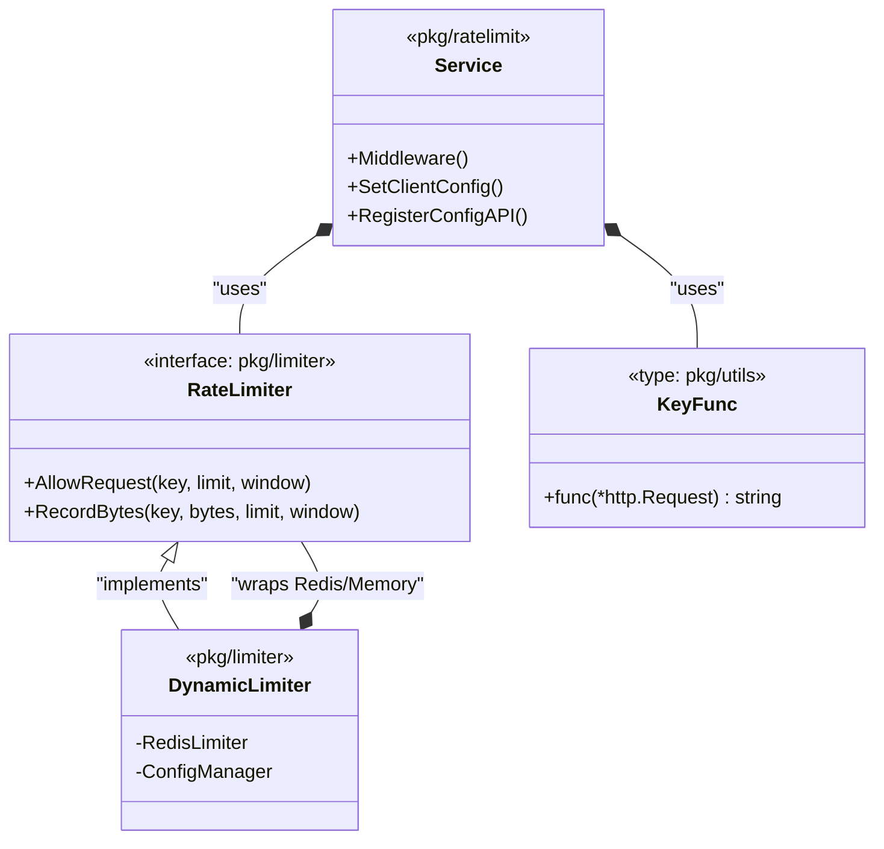

<!-- source: DeepWiki mcp.deepwiki.com · repo NVIDIA/go-ratelimit · page 1 Overview · fetched 2026-10-26 -->

# Overview

<details>
<summary>Relevant source files</summary>

The following files were used as context for generating this wiki page:

- [CHANGELOG.md](CHANGELOG.md)
- [LICENSE](LICENSE)
- [NOTICE](NOTICE)
- [README.md](README.md)

</details>


NVIDIA® `go-ratelimit` is a high-performance, distributed rate limiting library designed for Go HTTP services. It facilitates resource protection by limiting both the number of requests and the total bandwidth (bytes served) consumed by clients [README.md:1-4]().

By utilizing Redis as a central state store, it ensures consistent rate limiting across multiple server instances in a distributed environment [README.md:11-12](). The library implements a **Sliding Window Algorithm**, which provides higher accuracy than fixed windows by preventing traffic bursts at window boundaries [CHANGELOG.md:13]().

## Key Capabilities

*   **Dual Rate Limiting**: Monitors and restricts both request counts and response sizes (bytes) [README.md:10]().
*   **Distributed Architecture**: Built on Redis to synchronize limits across a cluster of service instances [README.md:12]().
*   **Resilience**: Automatically falls back to local in-memory limiting if the Redis connection is lost [README.md:13]().
*   **Dynamic Configuration**: Allows runtime updates to rate limits for specific clients via a REST API or programmatic interface [README.md:14]().
*   **Flexible Key Extraction**: Supports limiting by IP, Client ID, or complex HTTP header combinations with built-in sanitizers [README.md:16-19]().
*   **RFC Compliance**: Automatically injects standard rate limit headers into HTTP responses [README.md:15]().

## System Components

The library is organized into several distinct layers that handle request interception, limit evaluation, and state management.

### Conceptual Architecture
The following diagram illustrates how an incoming request flows through the system components.

**Request Flow and Component Relationship**
```mermaid
graph TD
    subgraph "HTTP Layer"
        "http.Request" --> "Middleware[pkg/middleware]"
        "Middleware[pkg/middleware]" -- "1. Extract Key" --> "KeyFunc[pkg/utils]"
        "Middleware[pkg/middleware]" -- "2. Check Limit" --> "Limiter[pkg/limiter]"
        "Middleware[pkg/middleware]" -- "3. Wrap Response" --> "ByteCounterWriter[pkg/middleware]"
    end

    subgraph "Logic Layer"
        "Limiter[pkg/limiter]" -- "Lookup Config" --> "ConfigManager[pkg/config]"
        "Limiter[pkg/limiter]" -- "Execute Lua" --> "Redis[External]"
        "Limiter[pkg/limiter]" -- "Fallback" --> "MemoryLimiter[pkg/limiter]"
    end

    subgraph "Admin Layer"
        "AdminHandler[pkg/config]" -- "Update" --> "ConfigManager[pkg/config]"
    end
```
Sources: [README.md:41-53](), [pkg/ratelimit/service.go:1-50](), [pkg/middleware/middleware.go:1-30]()

### Code Entity Mapping
This diagram maps high-level concepts to the specific Go types and interfaces used in the codebase.

**Code Entity Space Mapping**

Sources: [pkg/ratelimit/service.go:23-45](), [pkg/limiter/limiter.go:10-25](), [pkg/utils/keys.go:10-15]()

## Major Packages

| Package | Responsibility |
| :--- | :--- |
| `pkg/ratelimit` | The primary entry point. Provides the `Service` facade to simplify integration [pkg/ratelimit/service.go:23](). |
| `pkg/limiter` | The core engine. Contains the sliding window logic and Redis/In-Memory implementations [pkg/limiter/limiter.go:1](). |
| `pkg/middleware` | HTTP middleware that intercepts requests, checks limits, and tracks response bytes [pkg/middleware/middleware.go:1](). |
| `pkg/config` | Manages runtime configuration and the Admin API for per-client overrides [pkg/config/config.go:1](). |
| `pkg/utils` | Provides utilities for key extraction from headers, IPs, and sanitization [pkg/utils/keys.go:1](). |

## Next Steps

To dive deeper into specific areas of `go-ratelimit`, refer to the following child pages:

*   **[Getting Started](#1.1)**: Prerequisites and a step-by-step guide to your first integration.
*   **[Design & Architecture](#1.2)**: A technical deep dive into the sliding window algorithm, Redis data structures, and the request lifecycle.

Sources: [README.md:20-25](), [README.md:56-71](), [CHANGELOG.md:12-23]()

---

