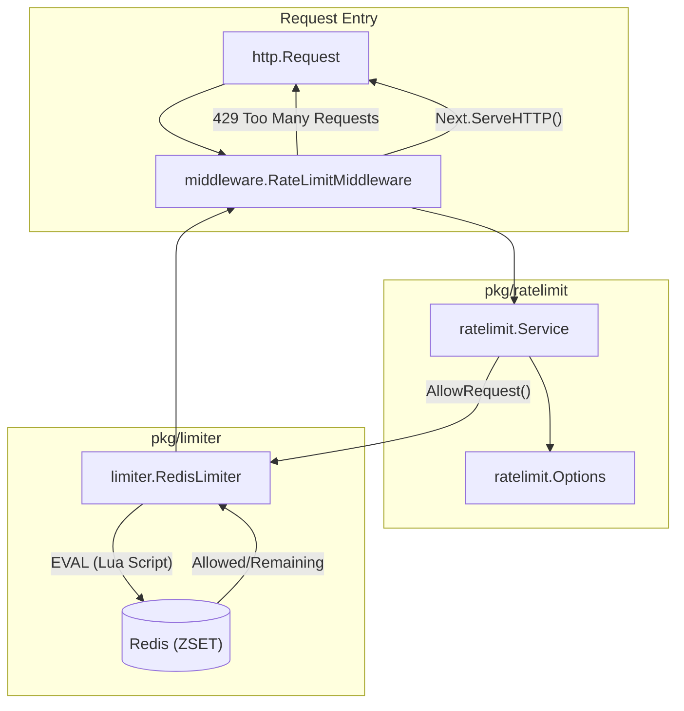
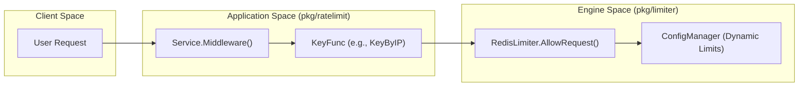

<!-- source: DeepWiki mcp.deepwiki.com · repo NVIDIA/go-ratelimit · page 1.1 Getting Started · fetched 2026-10-26 -->

# Getting Started

<details>
<summary>Relevant source files</summary>

The following files were used as context for generating this wiki page:

- [CONTRIBUTING.md](CONTRIBUTING.md)
- [Makefile](Makefile)
- [SETUP_GUIDE.md](SETUP_GUIDE.md)
- [go.mod](go.mod)
- [go.sum](go.sum)

</details>


This page provides a step-by-step guide for developers to integrate `go-ratelimit` into their Go applications. It covers environmental requirements, installation, and basic implementation patterns.

## Prerequisites

Before installing the library, ensure your environment meets the following minimum requirements:

*   **Go**: Version 1.21 or higher [go.mod:3-3](), [CONTRIBUTING.md:69-69]().
*   **Redis**: Version 5.0 or higher (required for distributed rate limiting) [CONTRIBUTING.md:73-73]().
*   **Operating System**: Linux (Ubuntu LTS recommended), macOS, or Windows [CONTRIBUTING.md:75-78]().
*   **Architecture**: x86_64 or aarch64 [CONTRIBUTING.md:79-82]().

### Setting up Redis

The library uses Redis to store sliding-window request counts and byte usage [SETUP_GUIDE.md:7-7](). You can run Redis via Docker for local development:

```bash
docker run -d -p 6379:6379 --name redis redis:latest
```
[CONTRIBUTING.md:140-140](), [SETUP_GUIDE.md:21-21]()

**Sources:** [CONTRIBUTING.md:65-82](), [SETUP_GUIDE.md:3-51](), [go.mod:1-4]()

---

## Installation

Add `go-ratelimit` to your project using `go get`:

```bash
go get github.com/NVIDIA/go-ratelimit
```
[SETUP_GUIDE.md:86-88]()

To build from source or run tests within the repository:

```bash
git clone https://github.com/NVIDIA/go-ratelimit.git
cd go-ratelimit
go mod download
make build
```
[CONTRIBUTING.md:89-101](), [Makefile:31-34]()

**Sources:** [CONTRIBUTING.md:84-101](), [Makefile:1-35](), [SETUP_GUIDE.md:83-88]()

---

## Minimal Integration

The primary entry point for the library is the `ratelimit.Service` facade [SETUP_GUIDE.md:104-104](). Below is a minimal example of integrating the rate limiter as an HTTP middleware.

### Code Snippet

```go
import (
    "github.com/NVIDIA/go-ratelimit/pkg/ratelimit"
    "github.com/redis/go-redis/v9"
)

func main() {
    // 1. Initialize Redis Client
    rdb := redis.NewClient(&redis.Options{
        Addr: "localhost:6379",
    })

    // 2. Configure Limiter Options
    // DefaultOptions provides a 1-minute window, 100 req/min, 10MB/min
    options := ratelimit.DefaultOptions(rdb)
    
    // 3. Instantiate the Service
    service := ratelimit.New(options)

    // 4. Wrap your HTTP handler/mux with Middleware
    mux := http.NewServeMux()
    mux.HandleFunc("/api/hello", helloHandler)
    
    protectedHandler := service.Middleware()(mux)
    http.ListenAndServe(":8080", protectedHandler)
}
```
[SETUP_GUIDE.md:91-108]()

### Integration Data Flow

The following diagram illustrates how the `ratelimit.Service` interacts with the `pkg/middleware` and `pkg/limiter` components during a request.

**Request Lifecycle via Service Facade**

**Sources:** [SETUP_GUIDE.md:90-120](), [Makefile:118-121]()

---

## Running the Example Server

The repository includes a reference implementation that demonstrates request-count and byte-based limiting.

### 1. Start the Server
```bash
make run-server
```
[Makefile:118-121](), [SETUP_GUIDE.md:61-61]()

The server listens on port `8082` [SETUP_GUIDE.md:64-64]().

### 2. Verify Rate Limiting
You can test the default limits (typically 10 requests per window in examples) using a loop:

```bash
for i in {1..11}; do 
    curl -w "\nStatus: %{http_code}\n" "http://localhost:8082/v1/thing?client_id=user123"
done
```
[SETUP_GUIDE.md:126-132]()

### 3. Verify Byte Limiting
The example server provides a "heavy" endpoint to test throughput limits:

```bash
curl -s -w "Status: %{http_code}, Size: %{size_download} bytes\n" \
     "http://localhost:8082/v1/heavy?client_id=user123"
```
[SETUP_GUIDE.md:66-66](), [SETUP_GUIDE.md:142-146]()

**Sources:** [Makefile:118-121](), [SETUP_GUIDE.md:55-81](), [SETUP_GUIDE.md:124-150]()

---

## Component Mapping

This table maps the conceptual "Getting Started" steps to the specific code entities involved.

| Step | Code Entity | File Path |
| :--- | :--- | :--- |
| **Configuration** | `ratelimit.Options` | [pkg/ratelimit/service.go]() (inferred) |
| **Initialization** | `ratelimit.New()` | [pkg/ratelimit/service.go]() (inferred) |
| **Key Extraction** | `ratelimit.KeyByClientIDAndRoute` | [pkg/utils/keys.go]() (inferred) |
| **Middleware** | `service.Middleware()` | [pkg/ratelimit/service.go]() (inferred) |
| **Data Storage** | `redis.Client` | [go.mod:6-6]() |

**Architecture Mapping**

**Sources:** [SETUP_GUIDE.md:91-120](), [SETUP_GUIDE.md:163-201](), [go.mod:5-11]()

---

