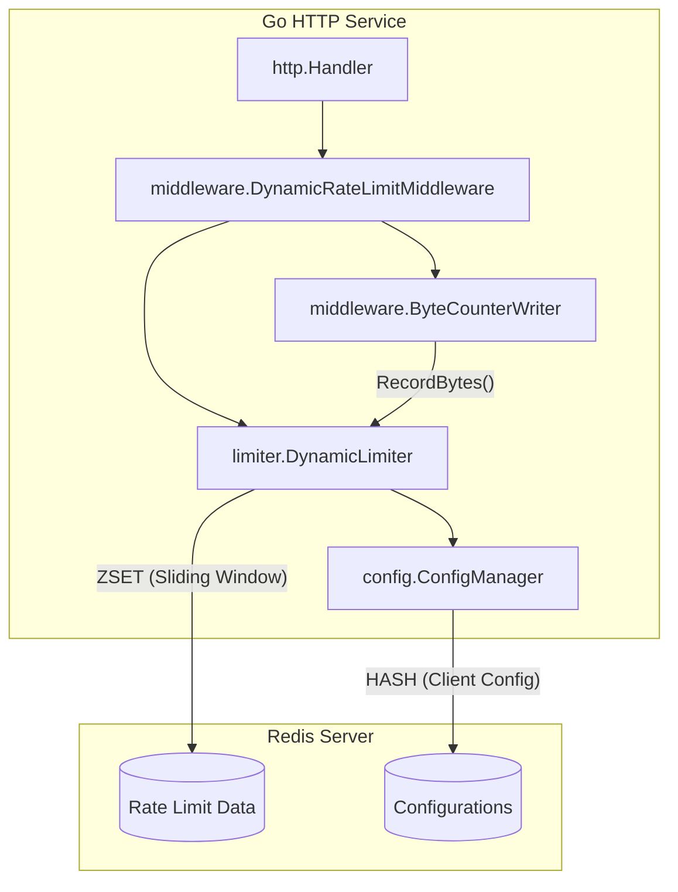
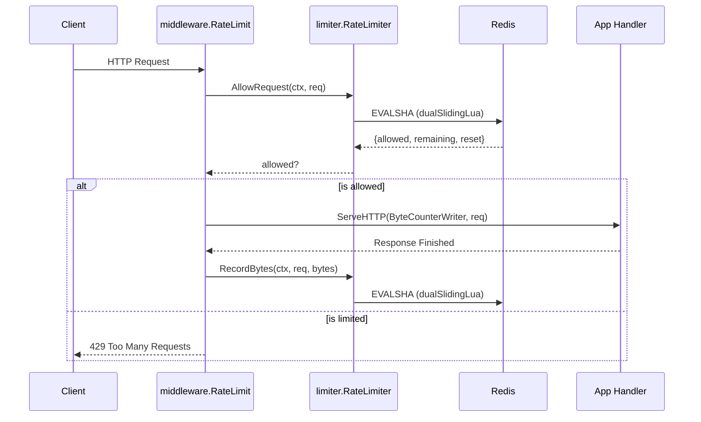

<!-- source: DeepWiki mcp.deepwiki.com · repo NVIDIA/go-ratelimit · page 1.2 Design & Architecture · fetched 2026-10-26 -->

# Design & Architecture

<details>
<summary>Relevant source files</summary>

The following files were used as context for generating this wiki page:

- [DESIGN.md](DESIGN.md)
- [pkg/limiter/dual_limiter.go](pkg/limiter/dual_limiter.go)
- [pkg/limiter/limiter_interface.go](pkg/limiter/limiter_interface.go)
- [pkg/limiter/redis.go](pkg/limiter/redis.go)
- [pkg/ratelimit/ratelimit.go](pkg/ratelimit/ratelimit.go)

</details>


This page provides a detailed walkthrough of the `go-ratelimit` system design. It covers the modular package layout, the end-to-end request lifecycle, the sliding window algorithm implementation in Redis, and the dual-limiting mechanism for requests and data throughput.

## System Overview

The library is structured into modular components that separate rate-limiting logic, HTTP middleware, and configuration management [DESIGN.md:19-30]().

### Package Layout
*   `pkg/ratelimit`: The high-level facade providing the `Service` type for easy integration [pkg/ratelimit/ratelimit.go:16-18]().
*   `pkg/limiter`: The core engine containing various `RateLimiter` implementations [pkg/limiter/limiter_interface.go:14-29]().
*   `pkg/middleware`: HTTP interceptors that handle the request/response lifecycle [DESIGN.md:89-99]().
*   `pkg/config`: Logic for managing per-client configuration overrides [DESIGN.md:107-118]().
*   `pkg/api`: REST handlers for administrative configuration tasks [DESIGN.md:119-131]().
*   `pkg/utils`: Key generation and request parsing utilities [DESIGN.md:132-145]().

### Architecture Diagram
The following diagram illustrates the relationship between the application middleware, the core limiter, and the Redis backend.

**System Component Interaction**

Sources: [DESIGN.md:32-50](), [pkg/ratelimit/ratelimit.go:70-76](), [pkg/limiter/dual_limiter.go:27-35]()

---

## Request Lifecycle

The system processes every incoming request through a specific sequence to ensure limits are enforced before and after the application logic executes.

1.  **Key Extraction**: The `middleware` uses a `KeyFunc` (e.g., `utils.KeyByIP`) to identify the client [pkg/ratelimit/ratelimit.go:50-51](), [DESIGN.md:148-152]().
2.  **Pre-check (Request Limit)**: The middleware calls `limiter.AllowRequest`. This executes a Lua script in Redis to check the request count against the sliding window [pkg/limiter/dual_limiter.go:71-85]().
3.  **Instrumentation**: If allowed, the `http.ResponseWriter` is wrapped in a `ByteCounterWriter` [DESIGN.md:156-157]().
4.  **Application Logic**: The next handler in the chain is called.
5.  **Post-check (Byte Limit)**: Once the response is sent, the `ByteCounterWriter` provides the total bytes written. The middleware then calls `limiter.RecordBytes` to update the byte-based sliding window [pkg/limiter/dual_limiter.go:88-102](), [DESIGN.md:157-158]().

**Request Flow Sequence**

Sources: [DESIGN.md:148-158](), [pkg/limiter/dual_limiter.go:71-102](), [pkg/limiter/limiter_interface.go:14-29]()

---

## Rate Limiting Algorithm

The library implements a **Sliding Window** algorithm using Redis Sorted Sets (`ZSET`). Unlike a fixed window, this approach prevents traffic bursts at window boundaries [DESIGN.md:169-184]().

### Redis Data Structures
The system uses two `ZSET` keys per client-key to track usage independently:
1.  **Request Key**: `prefix:req:<key>` [pkg/limiter/dual_limiter.go:57]()
2.  **Byte Key**: `prefix:byte:<key>` [pkg/limiter/dual_limiter.go:58]()

### Lua Script Implementation
To ensure atomicity, all sliding window operations (pruning, counting, and adding) are performed within a single Lua script (`dualSlidingLua`) [pkg/limiter/dual_limiter.go:111-192]().

| Step | Operation | Description |
| :--- | :--- | :--- |
| **1. Prune** | `ZREMRANGEBYSCORE` | Removes all members with timestamps older than `now - window_ms` [pkg/limiter/dual_limiter.go:126-127](). |
| **2. Count** | `ZCARD` / `ZRANGE` | Gets current request count and iterates over byte entries to sum total bytes [pkg/limiter/dual_limiter.go:129-140](). |
| **3. Check** | Logic | Compares counts against `req_limit` and `byte_limit` [pkg/limiter/dual_limiter.go:147-169](). |
| **4. Record** | `ZADD` | If allowed, adds a new entry with format `bytes-timestamp-random` to ensure uniqueness [pkg/limiter/dual_limiter.go:161-162](). |
| **5. TTL** | `PEXPIRE` | Sets the key to expire shortly after the window ends to clean up inactive clients [pkg/limiter/dual_limiter.go:188-189](). |

Sources: [pkg/limiter/dual_limiter.go:111-192](), [pkg/limiter/redis.go:74-118]()

---

## Dual Rate Limiting

The `DualLimiter` (and its dynamic counterpart) provides simultaneous protection for both request frequency and data volume [pkg/limiter/dual_limiter.go:27-35]().

### Request Limiting
Tracks the number of discrete HTTP requests. This is useful for protecting CPU-bound resources or downstream APIs with per-call costs [DESIGN.md:10]().

### Byte Limiting
Tracks the total payload size (usually response size). This is critical for protecting egress bandwidth and preventing "Large Response" attacks [DESIGN.md:10]().

**Limiter Configuration Structure**
```go
type DualLimiter struct {
	rdb          *redis.Client
	prefix       string
	requestLimit int           // Max requests per window
	byteLimit    int64         // Max bytes per window
	window       time.Duration // Sliding window size
	lua          *redis.Script
	keyBuilder   func(*http.Request) string
}
```
Sources: [pkg/limiter/dual_limiter.go:27-35](), [pkg/ratelimit/ratelimit.go:34-55]()

---

