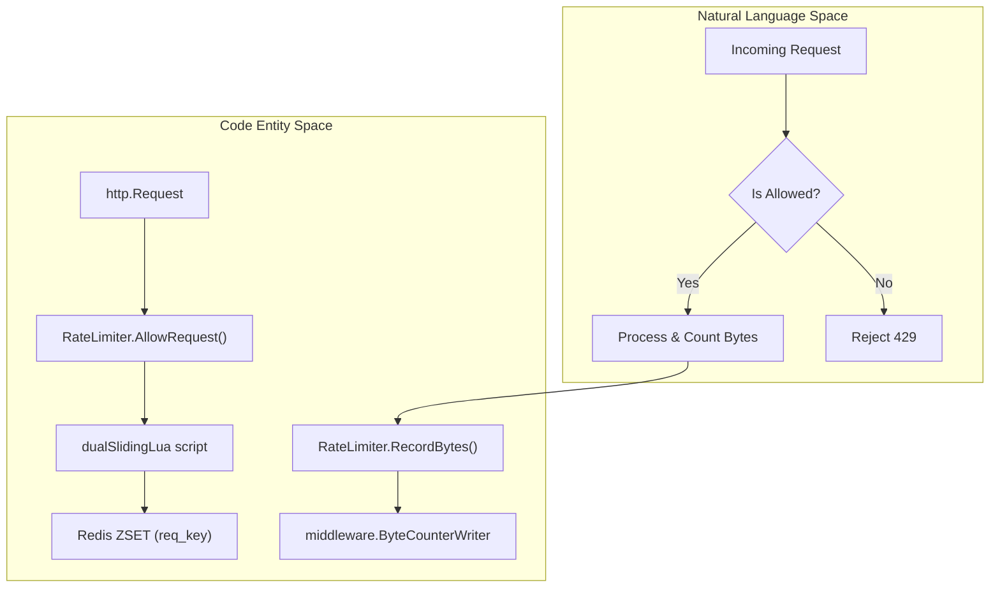
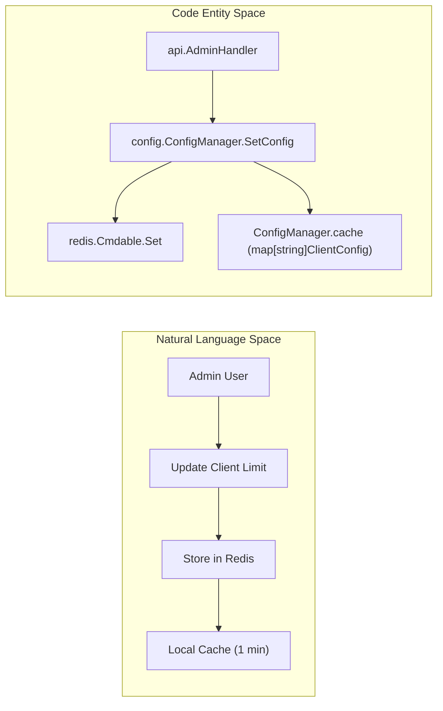

<!-- source: DeepWiki mcp.deepwiki.com · repo NVIDIA/go-ratelimit · page 10 Glossary · fetched 2026-10-26 -->

# Glossary

Relevant source files

The following files were used as context for generating this wiki page:

- [CHANGELOG.md](CHANGELOG.md)
- [DESIGN.md](DESIGN.md)
- [README.md](README.md)
- [pkg/api/admin_handler.go](pkg/api/admin_handler.go)
- [pkg/config/manager.go](pkg/config/manager.go)
- [pkg/limiter/dual_limiter.go](pkg/limiter/dual_limiter.go)
- [pkg/limiter/dynamic_limiter.go](pkg/limiter/dynamic_limiter.go)
- [pkg/limiter/limiter_interface.go](pkg/limiter/limiter_interface.go)
- [pkg/limiter/memory.go](pkg/limiter/memory.go)
- [pkg/limiter/redis.go](pkg/limiter/redis.go)
- [pkg/limiter/resilient_limiter.go](pkg/limiter/resilient_limiter.go)
- [pkg/middleware/bytecounter.go](pkg/middleware/bytecounter.go)
- [pkg/middleware/selective_ratelimit.go](pkg/middleware/selective_ratelimit.go)
- [pkg/ratelimit/ratelimit.go](pkg/ratelimit/ratelimit.go)
- [pkg/utils/header_keys.go](pkg/utils/header_keys.go)

This page provides technical definitions for codebase-specific terms, architectural concepts, and domain entities used within the `go-ratelimit` library.

## Purpose and Scope

The glossary serves as a reference for onboarding engineers to understand the mapping between abstract rate-limiting concepts (e.g., "Sliding Window") and their concrete implementation in Go (e.g., `pkg/limiter/dual_limiter.go`). It covers the core engine, the middleware instrumentation, and the configuration management system.

## Domain Concepts & Code Entities

### Rate Limiting Engine

The engine is built around the `RateLimiter` interface, which defines how requests are evaluated and how resource consumption is tracked.

| Term | Definition | Implementation |
|:---|:---|:---|
| **Sliding Window** | An algorithm that tracks request timestamps in a moving time frame to prevent traffic spikes at boundary transitions. | [pkg/limiter/dual_limiter.go:111-192]() |
| **Dual Limiting** | The capability to simultaneously enforce limits on both the number of requests and the total bandwidth (bytes) consumed. | [pkg/limiter/dual_limiter.go:27-35]() |
| **Resilient Fallback** | A mechanism where the system automatically switches to an in-memory limiter if the primary Redis instance becomes unavailable. | [pkg/limiter/resilient_limiter.go:30-40]() |
| **Key Builder** | A function (`KeyFunc`) that extracts a unique identifier from an `http.Request` to group rate limits (e.g., by IP, API Key, or Tenant). | [pkg/ratelimit/ratelimit.go:66-66]() |

**Diagram: Request Evaluation Data Flow**

Sources: [pkg/limiter/limiter_interface.go:14-29](), [pkg/limiter/dual_limiter.go:111-192](), [pkg/middleware/bytecounter.go:25-29]()

### Implementation Types

#### 1. DualLimiter
A Redis-backed implementation that uses two distinct keys per client: one for request counts (`prefix:req:key`) and one for byte counts (`prefix:byte:key`) [pkg/limiter/dual_limiter.go:57-58](). It leverages a Lua script to ensure atomicity of the sliding window logic [pkg/limiter/dual_limiter.go:111-192]().

#### 2. DynamicLimiter
An extension of the rate limiting logic that integrates with a `ConfigManager` [pkg/limiter/dynamic_limiter.go:31-37](). It allows per-client overrides for `RequestLimit`, `ByteLimit`, and `WindowSecs` stored in Redis [pkg/config/manager.go:29-33]().

#### 3. ResilientLimiter
A wrapper that manages a `DynamicLimiter` (Redis) and a `MemoryLimiter` (In-Memory) [pkg/limiter/resilient_limiter.go:30-40](). It performs periodic health checks via `Ping()` to determine the active backend [pkg/limiter/resilient_limiter.go:89-111]().

#### 4. ByteCounterWriter
A decorator for `http.ResponseWriter` that intercepts the `Write` and `WriteHeader` methods [pkg/middleware/bytecounter.go:25-29](). It allows the middleware to capture the actual response size after the application handler has executed [pkg/middleware/bytecounter.go:40-44]().

### Configuration & Administration

**Diagram: Configuration Management Bridge**

Sources: [pkg/api/admin_handler.go:49-52](), [pkg/config/manager.go:36-44](), [pkg/config/manager.go:102-132]()

| Term | Definition | Implementation |
|:---|:---|:---|
| **ConfigManager** | Handles the lifecycle of `ClientConfig` objects, providing a local memory cache with a 1-minute TTL to reduce Redis load. | [pkg/config/manager.go:36-44]() |
| **AdminHandler** | A set of HTTP endpoints providing a RESTful interface for managing tenant and client rate limits at runtime. | [pkg/api/admin_handler.go:49-52]() |
| **Sanitizer** | A utility function used during key extraction to clean header values, preventing Redis injection or key-space pollution. | [pkg/utils/header_keys.go:109-109]() |
| **Selective Middleware** | A middleware variant that uses `PathMatcher` logic to apply rate limits only to specific URI patterns. | [pkg/middleware/selective_ratelimit.go:30-35]() |

## Abbreviations

*   **ZSET**: Redis Sorted Set, used to store timestamps (scores) and unique request identifiers (members) [pkg/limiter/dual_limiter.go:187-189]().
*   **TTL**: Time To Live, applied to Redis keys to ensure they expire slightly after the sliding window duration to prevent data accumulation [pkg/limiter/dual_limiter.go:188-189]().
*   **BCW**: `ByteCounterWriter`, the struct responsible for response instrumentation [pkg/middleware/bytecounter.go:25-29]().

Sources: [pkg/limiter/dual_limiter.go:111-192](), [pkg/config/manager.go:54-54](), [pkg/middleware/bytecounter.go:25-29]()