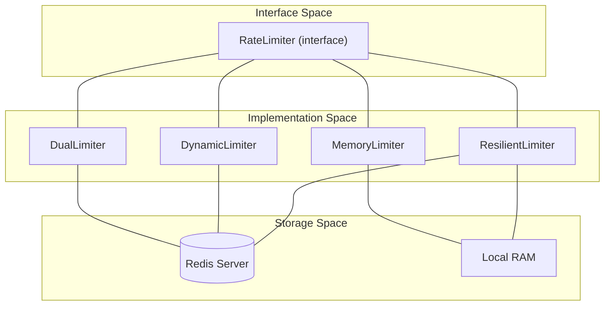
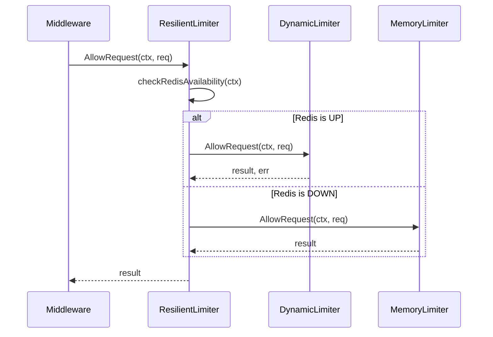

<!-- source: DeepWiki mcp.deepwiki.com · repo NVIDIA/go-ratelimit · page 2 Core Limiter Package · fetched 2026-10-26 -->

# Core Limiter Package

Relevant source files

The following files were used as context for generating this wiki page:

- [pkg/limiter/dual_limiter.go](pkg/limiter/dual_limiter.go)
- [pkg/limiter/dynamic_limiter.go](pkg/limiter/dynamic_limiter.go)
- [pkg/limiter/limiter_interface.go](pkg/limiter/limiter_interface.go)
- [pkg/limiter/memory.go](pkg/limiter/memory.go)
- [pkg/limiter/resilient_limiter.go](pkg/limiter/resilient_limiter.go)

The `pkg/limiter` package is the core engine of `go-ratelimit`. It provides the sliding-window logic required to track and enforce both request-count and byte-throughput limits. The package is designed around a central interface, allowing for different storage backends and resiliency strategies.

### The RateLimiter Interface

All limiters in this package implement the `RateLimiter` interface [pkg/limiter/limiter_interface.go:14-29](). This interface ensures that regardless of the underlying storage (Redis or In-Memory), the middleware can interact with the engine using a consistent set of methods:

| Method | Description |
| :--- | :--- |
| `AllowRequest` | Validates if a new request can proceed based on count limits. |
| `RecordBytes` | Updates the sliding window with a specific byte count and checks byte limits. |
| `GetClientConfig` | Retrieves the `ClientConfig` (limits and window) for a specific ID. |
| `GetCurrentUsage` | Returns the current byte usage within the active window. |
| `GetLastKey` | Returns the generated Redis/Memory key for the request. |

**Sources:**
- [pkg/limiter/limiter_interface.go:14-29]()

---

### Implementation Architecture

The package provides three primary concrete implementations that cater to different deployment needs, ranging from distributed production environments to local development or fallback scenarios.

#### Limiter Type Association
The following diagram maps the high-level system concepts to the specific Go types found in the `pkg/limiter` package.

**Diagram: Limiter Entity Mapping**

**Sources:**
- [pkg/limiter/dual_limiter.go:27-35]()
- [pkg/limiter/dynamic_limiter.go:31-37]()
- [pkg/limiter/memory.go:28-42]()
- [pkg/limiter/resilient_limiter.go:30-40]()

---

### Redis-backed Limiters

These limiters utilize Redis Sorted Sets (ZSETs) and Lua scripting to provide atomic, distributed rate limiting across multiple application instances.

*   **`DualLimiter`**: A basic implementation that applies a single set of global limits (request count and byte count) across all keys [pkg/limiter/dual_limiter.go:27-35]().
*   **`DynamicLimiter`**: An advanced version that integrates with a `ConfigManager` to allow per-client limit overrides stored in Redis [pkg/limiter/dynamic_limiter.go:31-37]().

For implementation details on Lua scripts and Redis key structures, see **[Redis-backed Limiters](#2.1)**.

**Sources:**
- [pkg/limiter/dual_limiter.go:38-55]()
- [pkg/limiter/dynamic_limiter.go:40-65]()

---

### Resilient & In-Memory Limiters

For environments where Redis availability cannot be guaranteed or for standalone local use, the package provides memory-based alternatives.

*   **`MemoryLimiter`**: Tracks sliding windows using local Go maps and slices. It is ideal for testing or single-instance applications [pkg/limiter/memory.go:28-42]().
*   **`ResilientLimiter`**: A wrapper that treats a `DynamicLimiter` as the primary engine but automatically falls back to a `MemoryLimiter` if Redis pings fail or return errors [pkg/limiter/resilient_limiter.go:30-40]().

The following diagram illustrates the fallback logic within the `ResilientLimiter`.

**Diagram: ResilientLimiter Request Flow**

For details on the health-check loop and memory management, see **[Resilient & In-Memory Limiters](#2.2)**.

**Sources:**
- [pkg/limiter/resilient_limiter.go:118-129]()
- [pkg/limiter/resilient_limiter.go:89-111]()
- [pkg/limiter/memory.go:159-226]()

---

### Limiter Testing

The `pkg/limiter` package includes a robust testing suite that utilizes a `MockRedisClient` to simulate various Redis failure modes, ensuring the `ResilientLimiter` behaves correctly during network partitions.

For information on unit tests and integration patterns, see **[Limiter Testing](#2.3)**.

---

