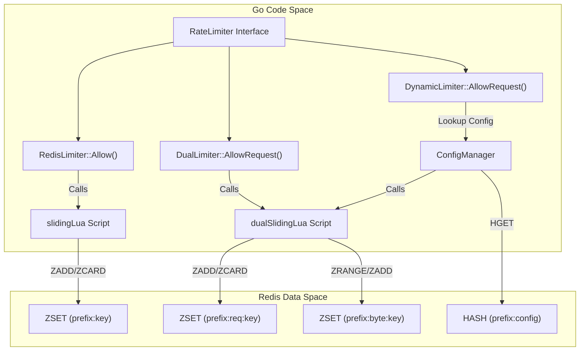
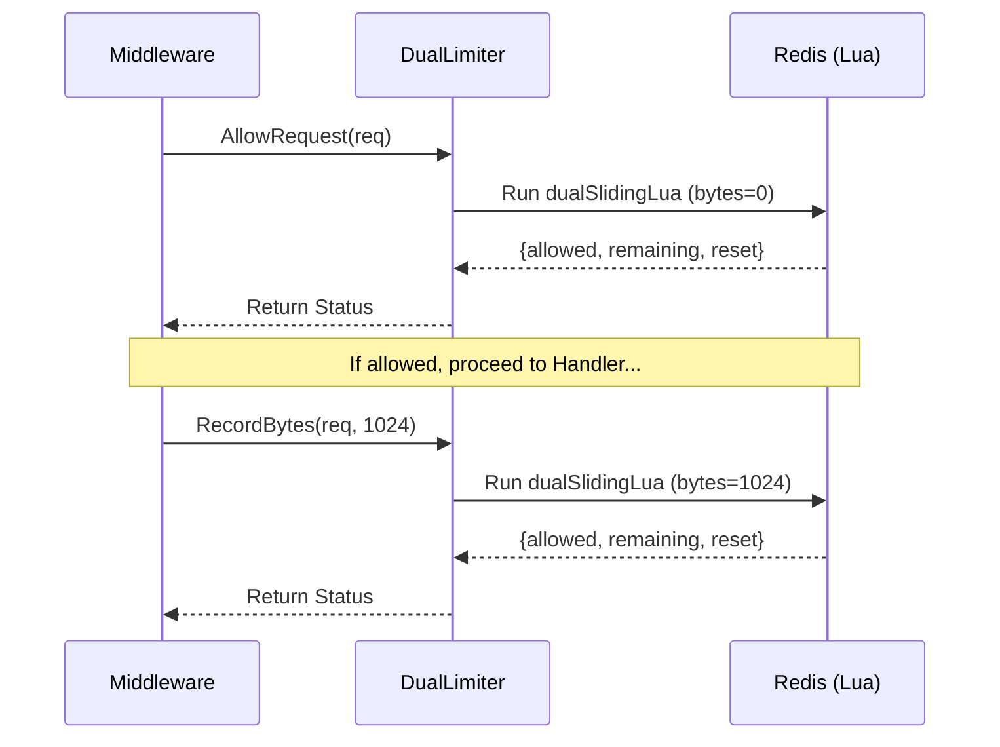

<!-- source: DeepWiki mcp.deepwiki.com · repo NVIDIA/go-ratelimit · page 2.1 Redis-backed Limiters · fetched 2026-10-26 -->

# Redis-backed Limiters

Relevant source files

The following files were used as context for generating this wiki page:

- [pkg/limiter/dual_limiter.go](pkg/limiter/dual_limiter.go)
- [pkg/limiter/dynamic_limiter.go](pkg/limiter/dynamic_limiter.go)
- [pkg/limiter/mock_redis.go](pkg/limiter/mock_redis.go)
- [pkg/limiter/redis.go](pkg/limiter/redis.go)

This page provides a deep dive into the Redis-based implementations of the `RateLimiter` interface. These limiters utilize Redis sorted sets (ZSETs) and Lua scripting to provide atomic, distributed sliding-window rate limiting.

## Overview of Redis Limiters

The `pkg/limiter` package provides three primary Redis-backed implementations:

1.  **`RedisLimiter`**: A standard sliding-window limiter tracking request counts [pkg/limiter/redis.go:27-34]().
2.  **`DualLimiter`**: An advanced limiter that tracks both request counts and total bytes transferred within the window [pkg/limiter/dual_limiter.go:27-35]().
3.  **`DynamicLimiter`**: A wrapper around the dual-limiting logic that supports per-client configuration overrides via a `ConfigManager` [pkg/limiter/dynamic_limiter.go:31-37]().

### Data Flow: Request to Redis

The following diagram illustrates how a request flows from the code entities into the Redis data structures.

**Entity Mapping: Code to Redis**

Sources: [pkg/limiter/redis.go:51-63](), [pkg/limiter/dual_limiter.go:71-85](), [pkg/limiter/dynamic_limiter.go:88-116]()

---

## Sliding Window Implementation

All Redis limiters use a sliding window algorithm implemented via Lua scripts to ensure atomicity. Unlike a fixed-window counter, the sliding window tracks the timestamp of every individual event, providing smoother enforcement.

### Key Naming Conventions
Keys are namespaced using a prefix and specific type identifiers:
*   **Request Keys**: `prefix:req:key` [pkg/limiter/dual_limiter.go:57]().
*   **Byte Keys**: `prefix:byte:key` [pkg/limiter/dual_limiter.go:58]().

### The Lua Logic
The scripts (`slidingLua` and `dualSlidingLua`) perform the following steps in a single atomic transaction:
1.  **Time Sync**: Fetch the current time from Redis using `TIME` to ensure consistency across distributed nodes [pkg/limiter/redis.go:80-81]().
2.  **Pruning**: Remove all entries with scores (timestamps) older than `now - window_ms` using `ZREMRANGEBYSCORE` [pkg/limiter/redis.go:86]().
3.  **Counting**: Calculate the current usage using `ZCARD` (for requests) or by iterating through `ZRANGE` (for bytes) [pkg/limiter/dual_limiter.go:129-140]().
4.  **Verification**: Compare current usage against limits.
5.  **Recording**: If allowed, add a new entry to the ZSET with the current timestamp as the score. Members are unique strings formatted as `timestamp-random` to allow multiple entries at the same millisecond [pkg/limiter/redis.go:95-96]().
6.  **TTL Management**: Set a `PEXPIRE` on the key for `window_ms + 1000` to ensure cleanup if the client stops sending requests [pkg/limiter/redis.go:115]().

Sources: [pkg/limiter/redis.go:74-118](), [pkg/limiter/dual_limiter.go:111-192]()

---

## DualLimiter: Request & Byte Tracking

The `DualLimiter` tracks two distinct metrics. While requests are tracked as simple counts in a ZSET, bytes require summing the values stored within the ZSET members.

### Byte Member Format
Because Redis ZSETs only store scores (floats) and members (strings), byte counts are encoded directly into the member string:
`"{bytes}-{timestamp}-{random}"` [pkg/limiter/dual_limiter.go:161]().

When calculating total usage, the Lua script iterates over the set and extracts the prefix of each member string [pkg/limiter/dual_limiter.go:133-140]().

**DualLimiter Interaction**

Sources: [pkg/limiter/dual_limiter.go:71-102](), [pkg/limiter/dual_limiter.go:147-169]()

---

## DynamicLimiter & ConfigManager

`DynamicLimiter` provides the most flexibility by allowing different limits for different clients (e.g., Tier 1 vs Tier 2 users).

### Client Identification
The limiter uses an `extractClientID` helper to parse the key generated by the `keyBuilder`. It specifically looks for `apikey:` prefixes to identify the tenant for configuration lookups [pkg/limiter/dynamic_limiter.go:76-85]().

### Configuration Lookup
Before executing the Lua script, the `DynamicLimiter` queries the `ConfigManager`.
1.  **Cache Check**: `ConfigManager` first checks an internal in-memory cache.
2.  **Redis Fetch**: If not in cache, it fetches the `ClientConfig` (JSON) from a Redis Hash.
3.  **Fallback**: If no client-specific config exists, it returns the `defaultCfg` provided at construction [pkg/limiter/dynamic_limiter.go:49-56]().

| Function | Role |
| :--- | :--- |
| `AllowRequest` | Looks up config, then checks request count limit [pkg/limiter/dynamic_limiter.go:88](). |
| `RecordBytes` | Looks up config, then adds bytes to the byte ZSET [pkg/limiter/dynamic_limiter.go:124](). |
| `SetClientConfig` | Persists a new `ClientConfig` to Redis for a specific ID [pkg/limiter/dynamic_limiter.go:159](). |
| `GetCurrentUsage` | Sums existing byte entries in Redis without adding a new one [pkg/limiter/dynamic_limiter.go:169](). |

Sources: [pkg/limiter/dynamic_limiter.go:31-65](), [pkg/limiter/dynamic_limiter.go:154-166]()

---

## Testing with Mock Redis

To facilitate unit testing without a live Redis instance, the package includes `RedisMockClient`. This mock implements the `redis.Cmdable` interface and simulates the behavior of ZSETs and TTLs in-memory.

*   **State Tracking**: Uses `map[string][]zsetEntry` to simulate Redis ZSETs [pkg/limiter/mock_redis.go:34]().
*   **Failure Simulation**: The `failNext` flag allows developers to test "fail-open" or "fail-closed" logic by forcing the next Redis command to return an error [pkg/limiter/mock_redis.go:37]().

Sources: [pkg/limiter/mock_redis.go:31-53]()

---

