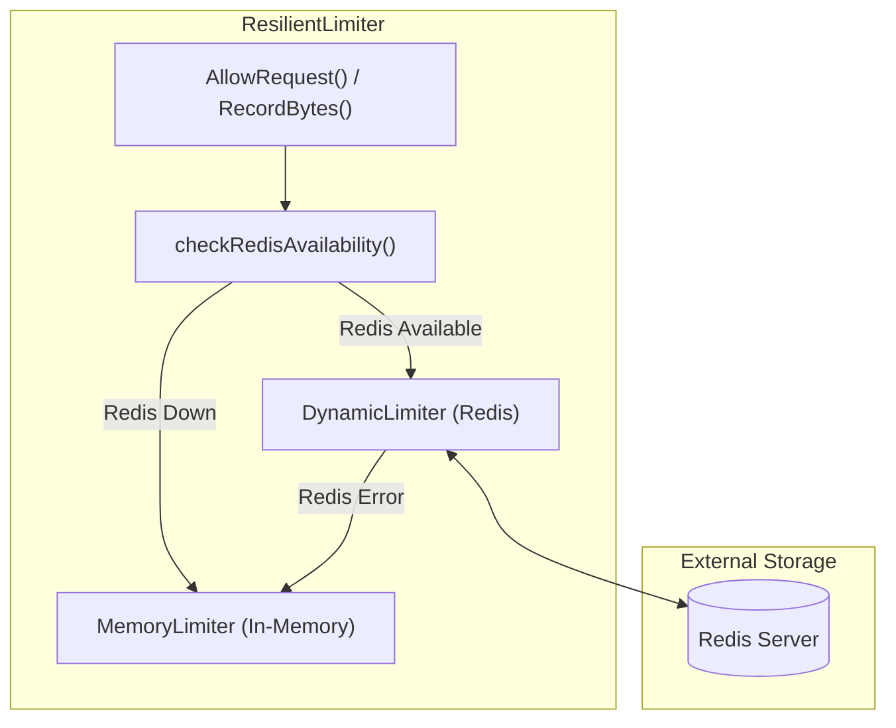
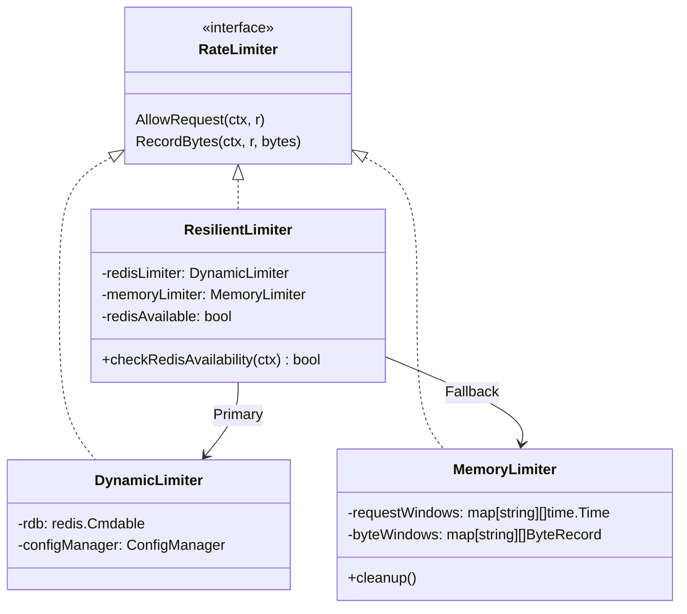

<!-- source: DeepWiki mcp.deepwiki.com · repo NVIDIA/go-ratelimit · page 2.2 Resilient & In-Memory Limiters · fetched 2026-10-26 -->

# Resilient & In-Memory Limiters

Relevant source files

The following files were used as context for generating this wiki page:

- [pkg/limiter/memory.go](pkg/limiter/memory.go)
- [pkg/limiter/resilient_limiter.go](pkg/limiter/resilient_limiter.go)
- [pkg/limiter/resilient_limiter_test.go](pkg/limiter/resilient_limiter_test.go)

This page details the implementation of local and fault-tolerant rate limiting in `go-ratelimit`. It covers the `MemoryLimiter`, which tracks usage in the application's heap, and the `ResilientLimiter`, which provides a high-availability wrapper that automatically switches between Redis and local memory based on backend health.

## MemoryLimiter

The `MemoryLimiter` provides a standalone, thread-safe implementation of the sliding-window algorithm without external dependencies [pkg/limiter/memory.go:28-42](). It is used both as a lightweight local limiter and as the fallback mechanism for the `ResilientLimiter`.

### Data Structures
`MemoryLimiter` uses Go maps and slices to track timestamps and byte usage:
*   **`requestWindows`**: A map of keys to slices of `time.Time`, representing individual request timestamps [pkg/limiter/memory.go:36]().
*   **`byteWindows`**: A map of keys to slices of `ByteRecord`, which pair a byte count with a timestamp [pkg/limiter/memory.go:37,45-48]().
*   **`clientConfigs`**: Stores per-client overrides in-memory [pkg/limiter/memory.go:38]().

### Implementation Logic
1.  **Sliding Window**: When `AllowRequest` or `RecordBytes` is called, the limiter filters out timestamps older than the current window duration (`now - window`) [pkg/limiter/memory.go:176-192]().
2.  **Cleanup Loop**: To prevent memory leaks from inactive keys, the limiter performs a `cleanup()` operation [pkg/limiter/memory.go:80-122](). This runs at most once per `cleanupInterval` (default 1 minute) and removes expired entries and empty keys from the maps [pkg/limiter/memory.go:75,88-91]().
3.  **Concurrency**: Access to internal maps is protected by a `sync.RWMutex` (`mu`) [pkg/limiter/memory.go:35]().

**Sources:** [pkg/limiter/memory.go:28-42](), [pkg/limiter/memory.go:80-122](), [pkg/limiter/memory.go:176-192]()

---

## ResilientLimiter

The `ResilientLimiter` implements a "Redis-primary, Memory-fallback" strategy. It ensures that rate limiting continues to function even if the Redis cluster becomes unreachable or returns errors.

### Component Relationship
The following diagram illustrates how the `ResilientLimiter` orchestrates the flow between the primary `DynamicLimiter` (Redis-backed) and the secondary `MemoryLimiter`.

**ResilientLimiter Internal Routing**

**Sources:** [pkg/limiter/resilient_limiter.go:30-40](), [pkg/limiter/resilient_limiter.go:118-129]()

### Health-Check Ping Loop
The limiter does not ping Redis on every request. Instead, it uses a throttled health check:
*   **Interval**: Availability is cached for `redisCheckInterval` (default 5 seconds) [pkg/limiter/resilient_limiter.go:84,90]().
*   **Mechanism**: It executes a `Ping()` against the `redis.Cmdable` with a 500ms timeout [pkg/limiter/resilient_limiter.go:97-102]().
*   **Promotion/Demotion**: If a Redis operation fails during a request, the limiter immediately logs the error and falls back to memory for that specific call [pkg/limiter/resilient_limiter.go:125,138]().

### Configuration Synchronization
To maintain consistency during failover, the `ResilientLimiter` attempts to keep both backends in sync:
*   **`GetClientConfig`**: When fetching config from Redis, it successfully updates the local `MemoryLimiter` cache with the retrieved values [pkg/limiter/resilient_limiter.go:144-156]().
*   **`SetClientConfig`**: Updates are applied to the `MemoryLimiter` first, then propagated to Redis if available [pkg/limiter/resilient_limiter.go:158-168]().

**Sources:** [pkg/limiter/resilient_limiter.go:89-111](), [pkg/limiter/resilient_limiter.go:144-168]()

---

## Code Entity Mapping

This diagram maps the natural language concepts of "Resilience" to the specific Go types and methods in the codebase.

**Limiter Interface to Implementation Map**

**Sources:** [pkg/limiter/memory.go:28-42](), [pkg/limiter/resilient_limiter.go:30-40](), [pkg/limiter/resilient_limiter.go:118-129]()

## Usage Summary

| Feature | MemoryLimiter | ResilientLimiter |
| :--- | :--- | :--- |
| **Primary Storage** | RAM (Go Maps) | Redis (ZSETs) |
| **Failover** | N/A | Automatic to Memory |
| **Distributed** | No (Per-instance) | Yes (Shared via Redis) |
| **Performance** | Extremely High (Local) | High (Network Latency) |
| **Best For** | Local testing, Sidecars | Production APIs |

**Sources:** [pkg/limiter/memory.go:51-77](), [pkg/limiter/resilient_limiter.go:43-86]()

---

