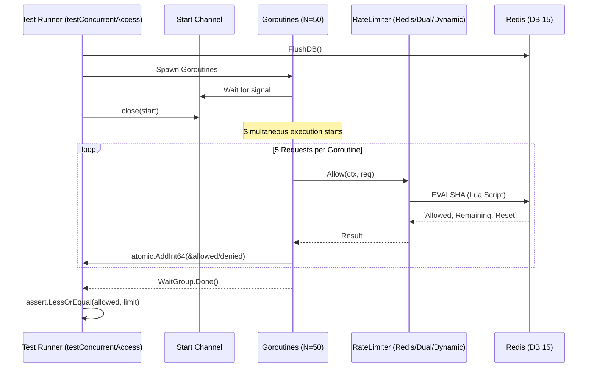

<!-- source: DeepWiki mcp.deepwiki.com · repo NVIDIA/go-ratelimit · page 2.3 Limiter Testing · fetched 2026-10-26 -->

# Limiter Testing

<details>
<summary>Relevant source files</summary>

The following files were used as context for generating this wiki page:

- [pkg/limiter/dual_limiter_test.go](pkg/limiter/dual_limiter_test.go)
- [pkg/limiter/dynamic_limiter_test.go](pkg/limiter/dynamic_limiter_test.go)
- [pkg/limiter/limiter_test.go](pkg/limiter/limiter_test.go)
- [pkg/limiter/mock_redis.go](pkg/limiter/mock_redis.go)
- [pkg/limiter/mock_test.go](pkg/limiter/mock_test.go)
- [pkg/limiter/redis_test.go](pkg/limiter/redis_test.go)

</details>


The `limiter` package employs a multi-tiered testing strategy to ensure the correctness of rate-limiting logic across different implementations. This includes unit tests for individual limiter types, a custom mock Redis implementation for isolated logic verification, and integration patterns for testing against live Redis instances.

## Test Strategy Overview

The testing framework is designed to validate the sliding window algorithm, atomicity of operations, and the resilience of the system under various conditions.

| Test Level | Scope | Key Components |
|:---|:---|:---|
| **Unit Tests** | Individual limiter logic and configuration | `RedisLimiter`, `DualLimiter`, `DynamicLimiter` |
| **Mocking** | Redis protocol simulation without external dependencies | `RedisMockClient`, `MockRedisClient` |
| **Concurrency Tests** | Thread-safety and race condition detection | `TestConcurrentRateLimiting` |
| **Integration** | Real-world behavior against a live Redis instance | `testConcurrentAccess`, `testConcurrentDualAccess` |

**Sources:** [pkg/limiter/limiter_test.go:52-57](), [pkg/limiter/mock_redis.go:31-38]()

---

## Mocking Redis

To facilitate fast and reliable unit testing without requiring a running Redis server, the package provides two mock implementations.

### RedisMockClient
The `RedisMockClient` implements a subset of the `go-redis` interface using in-memory maps and mutexes. It simulates standard Redis commands such as `GET`, `SET`, `ZADD`, and `ZREMRANGEBYSCORE` to validate the sliding window Lua script logic.

*   **State Management:** Uses `map[string]interface{}` for simple keys and `map[string][]zsetEntry` for sorted sets [pkg/limiter/mock_redis.go:31-35]().
*   **Failure Simulation:** The `failNext` flag and `SimulateFailure()` method allow tests to verify how limiters handle Redis connectivity issues [pkg/limiter/mock_redis.go:307-313]().

### Mock Lua Execution
While the actual limiters use `redis.Script` [pkg/limiter/redis_test.go:226-237](), tests often use `InMemoryLimiter` or `InMemoryDualLimiter` to verify the mathematical correctness of the windowing logic before it is translated into Lua [pkg/limiter/mock_test.go:163-196]().

**Sources:** [pkg/limiter/mock_redis.go:31-53](), [pkg/limiter/mock_test.go:163-174]()

---

## Unit Testing Limiter Types

Each concrete implementation of the `RateLimiter` interface has a corresponding test suite.

### RedisLimiter Tests
Tests focus on key generation and basic allowance logic.
*   **Key Generation:** Validates that keys are correctly namespaced using the prefix and `KeyFunc` [pkg/limiter/redis_test.go:62-73]().
*   **Lua Initialization:** Ensures the `slidingLua` script contains necessary Redis commands like `ZREMRANGEBYSCORE` and `ZCARD` [pkg/limiter/redis_test.go:226-237]().

### DualLimiter Tests
Focuses on the interplay between request counts and byte counts.
*   **Limit Priority:** Tests verify scenarios where the request limit is hit before the byte limit, and vice versa [pkg/limiter/dual_limiter_test.go:147-177]().
*   **Key Separation:** Ensures `api:req:ID` and `api:byte:ID` keys are generated distinctly [pkg/limiter/dual_limiter_test.go:64-79]().

### DynamicLimiter Tests
Validates the integration with `ConfigManager`.
*   **Config Overrides:** Tests the transition from default limits to client-specific overrides stored in Redis [pkg/limiter/dynamic_limiter_test.go:177-212]().
*   **Client ID Extraction:** Validates the `extractClientID` helper used to parse keys for configuration lookups [pkg/limiter/dynamic_limiter_test.go:75-109]().

**Sources:** [pkg/limiter/redis_test.go:31-49](), [pkg/limiter/dual_limiter_test.go:31-50](), [pkg/limiter/dynamic_limiter_test.go:33-61]()

---

## Integration and Concurrency Testing

The `TestConcurrentRateLimiting` function provides a framework for high-load testing. These tests are skipped in "short" mode (`go test -short`) and require a local Redis instance on port `6379` [pkg/limiter/limiter_test.go:53-68]().

### Concurrency Data Flow

The diagram below illustrates how `testConcurrentAccess` coordinates multiple goroutines to stress a `RateLimiter` implementation.

**Diagram: Concurrent Test Execution Flow**

**Sources:** [pkg/limiter/limiter_test.go:101-153]()

---

## Code Entity Mapping

The following diagram bridges the test helper structures to the actual limiter implementations being tested.

**Diagram: Test Entity Relationships**
```mermaid
classDiagram
    class TestHelpers {
        +CreateTestRequest()
    }
    class RedisMockClient {
        +data: map
        +zsets: map
        +SimulateFailure()
    }
    class RateLimiterTests {
        +testConcurrentAccess(RedisLimiter)
        +testConcurrentDualAccess(DualLimiter)
        +testConcurrentDynamicAccess(DynamicLimiter)
    }

    TestHelpers ..> RateLimiterTests : provides requests
    RedisMockClient ..|> "go-redis Client" : mocks
    RateLimiterTests --> "pkg/limiter": tests
```

### Key Test Functions
| Function | File | Purpose |
|:---|:---|:---|
| `testConcurrentAccess` | [pkg/limiter/limiter_test.go:101]() | Stress tests `RedisLimiter` with atomic counters for allowed/denied requests. |
| `testConcurrentDualAccess` | [pkg/limiter/limiter_test.go:156]() | Validates `DualLimiter` by alternating between `AllowRequest` and `RecordBytes` calls across goroutines. |
| `extractClientID` | [pkg/limiter/dynamic_limiter_test.go:105]() | Internal helper tested to ensure correct mapping of Redis keys to `ConfigManager` client IDs. |

**Sources:** [pkg/limiter/limiter_test.go:101-230](), [pkg/limiter/dynamic_limiter_test.go:75-109]()

---

