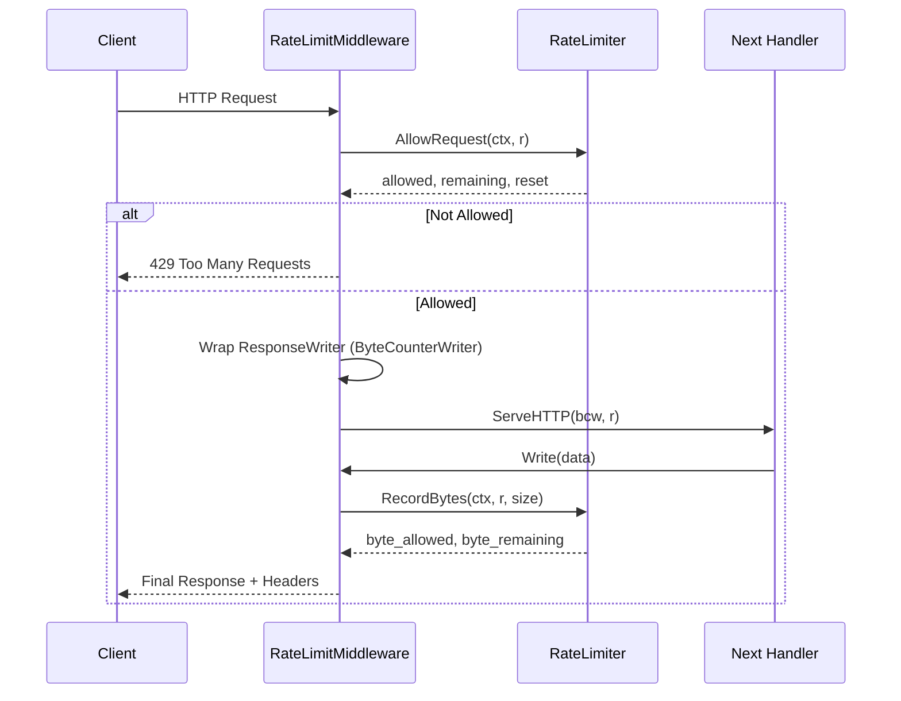
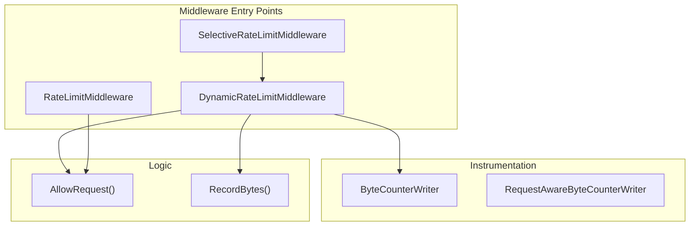

<!-- source: DeepWiki mcp.deepwiki.com · repo NVIDIA/go-ratelimit · page 3 Middleware Layer · fetched 2026-10-26 -->

# Middleware Layer

Relevant source files

The following files were used as context for generating this wiki page:

- [pkg/middleware/dynamic_ratelimit.go](pkg/middleware/dynamic_ratelimit.go)
- [pkg/middleware/middleware_test.go](pkg/middleware/middleware_test.go)
- [pkg/middleware/ratelimit.go](pkg/middleware/ratelimit.go)

The `pkg/middleware` package provides the glue between the HTTP request lifecycle and the core rate limiting engines. It implements standard Go `func(http.Handler) http.Handler` middleware that handles key extraction, policy enforcement, and response instrumentation for byte-based tracking.

### Request Lifecycle

When a request enters the middleware, it follows a structured lifecycle to ensure both request-count and byte-throughput limits are respected.

#### 1. Key Extraction & Policy Check
The middleware first identifies the client using a `KeyFunc` or the internal `extractClientID` helper [pkg/middleware/dynamic_ratelimit.go:121-174](). It then calls `AllowRequest` on the `RateLimiter` interface [pkg/middleware/dynamic_ratelimit.go:41](). If the request count exceeds the limit, the middleware terminates the chain with an `http.StatusTooManyRequests` (429) and sets the `Retry-After` header [pkg/middleware/dynamic_ratelimit.go:78-83]().

#### 2. Response Wrapping
If the request is allowed, the middleware wraps the original `http.ResponseWriter` in a `ByteCounterWriter` [pkg/middleware/dynamic_ratelimit.go:86](). This wrapper intercepts all `Write` calls to calculate the total payload size delivered to the client.

#### 3. Post-Handler Recording
After the downstream handler completes, the middleware inspects the HTTP status code. If the response was successful (status < 400), it calls `RecordBytes` to update the sliding window for byte throughput [pkg/middleware/dynamic_ratelimit.go:92-94]().

### Middleware Flow Architecture

The following diagram illustrates the interaction between the middleware components and the `RateLimiter` interface.

**Middleware Sequence Diagram**

Sources: [pkg/middleware/dynamic_ratelimit.go:39-115](), [pkg/middleware/ratelimit.go:29-56]()

### Middleware Components

The package is built around several core entities that manage the transition from HTTP metadata to rate limit logic.

| Entity | Role | Location |
| :--- | :--- | :--- |
| `RateLimitMiddleware` | Simple middleware for global Redis-backed request limiting. | [pkg/middleware/ratelimit.go:29]() |
| `DynamicRateLimitMiddleware` | Advanced middleware supporting per-client config and byte limiting. | [pkg/middleware/dynamic_ratelimit.go:27]() |
| `ByteCounterWriter` | A wrapper that tracks the number of bytes written to the response. | [pkg/middleware/byte_counter.go]() |
| `extractClientID` | Helper to find client identity in headers (e.g., `X-Client-ID`, `X-Scope-OrgID`). | [pkg/middleware/dynamic_ratelimit.go:121]() |

**Code Entity Mapping**

Sources: [pkg/middleware/dynamic_ratelimit.go:27-117](), [pkg/middleware/ratelimit.go:29-56](), [pkg/middleware/selective_ratelimit.go:27-45]()

### Response Headers

The middleware injects standard and custom headers to inform clients of their current quota status.

*   **Request Quota**: `RateLimit-Request-Limit`, `RateLimit-Request-Remaining`, `RateLimit-Request-Reset` [pkg/middleware/dynamic_ratelimit.go:56-64]().
*   **Byte Quota**: `RateLimit-Bytes-Limit`, `RateLimit-Bytes-Remaining`, `RateLimit-Bytes-Reset` [pkg/middleware/dynamic_ratelimit.go:105-107]().

---

### Sub-Pages

For detailed implementation details on specific middleware features, refer to the following child pages:

*   [Middleware Variants](#3.1)
    Detailed reference for all middleware constructors, including `SelectiveRateLimitMiddleware` and `PathMatcher` logic for targeting specific URL patterns.
*   [ByteCounterWriter & Response Instrumentation](#3.2)
    Deep dive into how the middleware intercepts response data, handles `http.Flusher`/`http.Hijacker` interfaces, and calculates throughput accurately.

---

