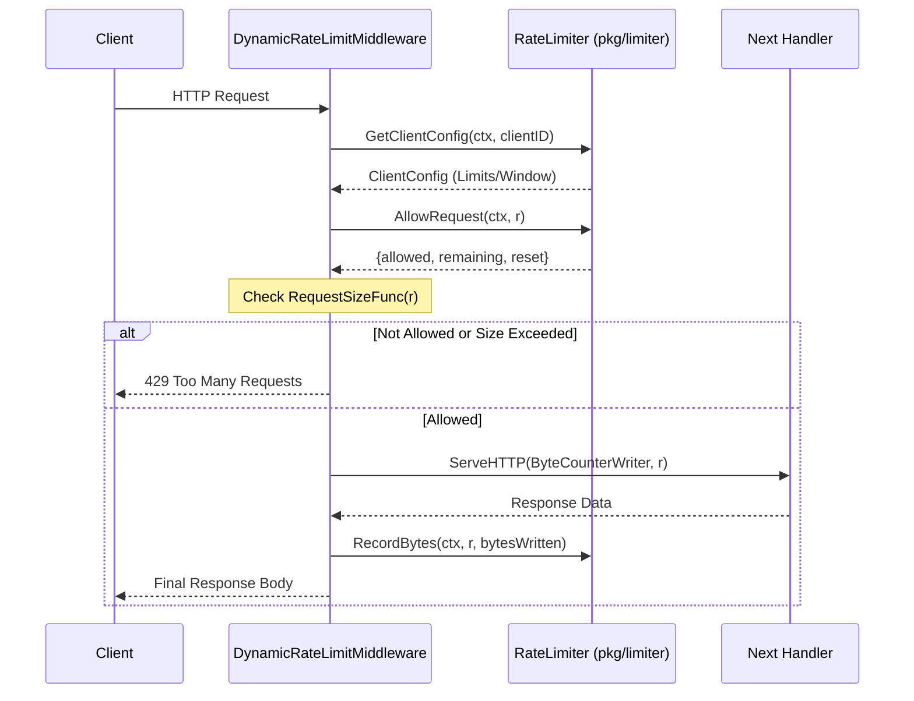
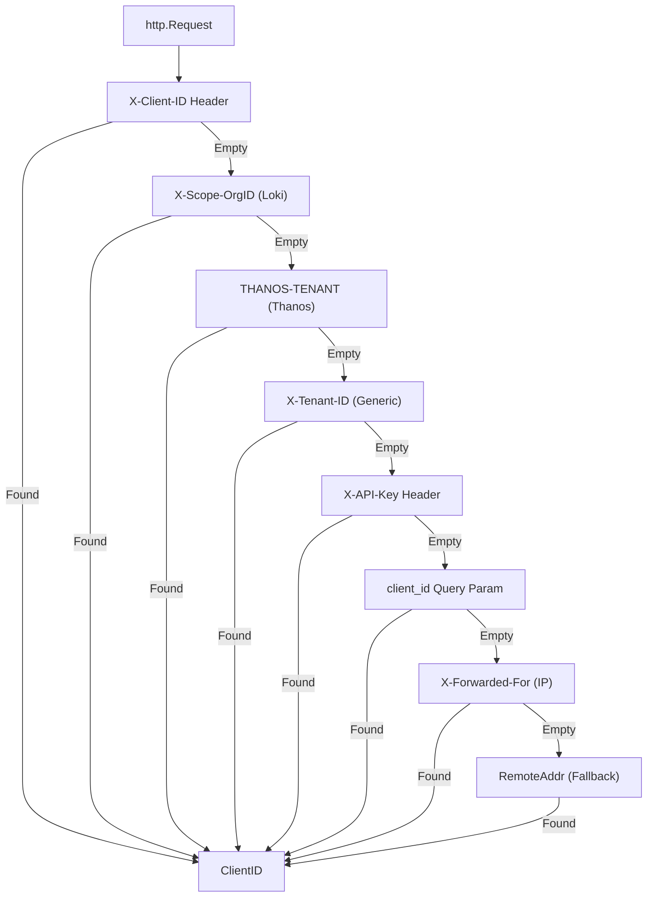

<!-- source: DeepWiki mcp.deepwiki.com · repo NVIDIA/go-ratelimit · page 3.1 Middleware Variants · fetched 2026-10-26 -->

# Middleware Variants

Relevant source files

The following files were used as context for generating this wiki page:

- [pkg/middleware/dual_ratelimit.go](pkg/middleware/dual_ratelimit.go)
- [pkg/middleware/dynamic_ratelimit.go](pkg/middleware/dynamic_ratelimit.go)
- [pkg/middleware/dynamic_ratelimit_request_aware.go](pkg/middleware/dynamic_ratelimit_request_aware.go)
- [pkg/middleware/ratelimit.go](pkg/middleware/ratelimit.go)
- [pkg/middleware/selective_ratelimit.go](pkg/middleware/selective_ratelimit.go)

The `pkg/middleware` package provides several HTTP middleware constructors designed to wrap standard `http.Handler` objects. These variants allow developers to choose between simple global policies, dynamic per-client configurations, and selective path-based enforcement. All variants handle the extraction of rate limit keys, interaction with the underlying `limiter` package, and the injection of standard RFC-compliant rate limit headers into the response.

## Core Middleware Variants

### RateLimitMiddleware (Simple)
The `RateLimitMiddleware` is the most basic implementation, designed for enforcing a single global policy using a `RedisLimiter` [pkg/middleware/ratelimit.go:29-29](). It tracks request counts but does not support byte-based limiting or dynamic configuration overrides.

*   **Implementation**: It calls `rl.Allow(r.Context(), r)` to check quota [pkg/middleware/ratelimit.go:32-32]().
*   **Headers**: Sets `RateLimit-Limit`, `RateLimit-Remaining`, and `RateLimit-Reset` [pkg/middleware/ratelimit.go:43-45]().
*   **Fail-safe**: Returns an `http.StatusInternalServerError` if the limiter encounters a Redis error [pkg/middleware/ratelimit.go:35-35]().

### DynamicRateLimitMiddleware
The `DynamicRateLimitMiddleware` is the primary variant for multi-tenant systems. It accepts any implementation of the `RateLimiter` interface (typically a `DynamicLimiter`) [pkg/middleware/dynamic_ratelimit.go:27-27]().

*   **Dual Enforcement**: It checks request counts before the handler runs and records byte usage after the handler completes [pkg/middleware/dynamic_ratelimit.go:41-94]().
*   **Config Lookup**: It uses `extractClientID` to identify the tenant and fetches their specific `ClientConfig` [pkg/middleware/dynamic_ratelimit.go:51-52]().
*   **Post-facto Recording**: Byte usage is recorded only for successful responses (Status < 400) [pkg/middleware/dynamic_ratelimit.go:92-94]().

### DynamicRateLimitMiddlewareWithLogger
A variant of the dynamic middleware that accepts a custom `Logger` interface [pkg/middleware/dynamic_ratelimit.go:32-32](). If no logger is provided, it defaults to a `NoOpLogger` [pkg/middleware/dynamic_ratelimit.go:35-35](). It provides detailed logs for header injection, quota exhaustion, and byte recording [pkg/middleware/dynamic_ratelimit.go:55-113]().

### DynamicRateLimitMiddlewareWithRequestSize
This variant introduces a "pre-flight" byte check. It uses a `RequestSizeFunc` to estimate the size of an incoming request (e.g., from a `Content-Length` header) before executing the downstream handler [pkg/middleware/dynamic_ratelimit_request_aware.go:26-26]().

*   **Pre-flight Logic**: If the `expectedSize` exceeds the `bytesRemaining`, the request is rejected immediately with a `429 Too Many Requests` [pkg/middleware/dynamic_ratelimit_request_aware.go:83-95]().
*   **Data Flow**: Uses `NewRequestAwareByteCounterWriter` to wrap the response [pkg/middleware/dynamic_ratelimit_request_aware.go:100-100]().

### SelectiveRateLimitMiddleware
This variant allows for conditional rate limiting based on the request path [pkg/middleware/selective_ratelimit.go:30-30](). It takes a `PathMatcher` function; if the matcher returns `false`, the rate limiter is bypassed entirely [pkg/middleware/selective_ratelimit.go:34-38]().

**Sources:**
[pkg/middleware/ratelimit.go:28-56](), [pkg/middleware/dynamic_ratelimit.go:26-117](), [pkg/middleware/dynamic_ratelimit_request_aware.go:25-131](), [pkg/middleware/selective_ratelimit.go:29-45]()

---

## Request Lifecycle and Data Flow

The following diagram illustrates the execution flow within `DynamicRateLimitMiddlewareWithRequestSize`, showing how it bridges the HTTP request to the internal limiter logic.

**Middleware Execution Sequence**

**Sources:**
[pkg/middleware/dynamic_ratelimit_request_aware.go:33-129](), [pkg/middleware/dynamic_ratelimit.go:39-115]()

---

## Path Matcher Combinators

The `SelectiveRateLimitMiddleware` relies on `PathMatcher` functions [pkg/middleware/selective_ratelimit.go:27-27](). The package provides several built-in combinators to build complex matching logic.

| Function | Description | Implementation |
| :--- | :--- | :--- |
| `MatchPathPrefix` | Matches if the path starts with the string. | `strings.HasPrefix` [pkg/middleware/selective_ratelimit.go:48-52]() |
| `MatchPathExact` | Matches the path string exactly. | `path == exactPath` [pkg/middleware/selective_ratelimit.go:55-59]() |
| `MatchPathRegex` | Matches the path against a regular expression. | `regexp.MatchString` [pkg/middleware/selective_ratelimit.go:62-67]() |
| `MatchAny` | Logical OR: returns true if any matcher matches. | Loop through matchers [pkg/middleware/selective_ratelimit.go:70-79]() |
| `MatchNone` | Logical NOT: returns true if no matchers match. | Loop through matchers [pkg/middleware/selective_ratelimit.go:82-91]() |

**Sources:**
[pkg/middleware/selective_ratelimit.go:47-91]()

---

## Client ID Extraction Logic

The `extractClientID` function is used by dynamic middleware variants to determine which `ClientConfig` to apply. It scans the request in a specific order of priority:

**Client Identification Hierarchy**

**Sources:**
[pkg/middleware/dynamic_ratelimit.go:121-174]()

## Summary of Constructors

| Constructor | Limiter Type | Key Features |
| :--- | :--- | :--- |
| `RateLimitMiddleware` | `*limiter.RedisLimiter` | Simple, global request-count limiting. |
| `DynamicRateLimitMiddleware` | `limiter.RateLimiter` | Per-client dynamic config, dual (request/byte) limiting. |
| `DynamicRateLimitMiddlewareWithLogger` | `limiter.RateLimiter` | Adds structured logging for limit enforcement. |
| `DynamicRateLimitMiddlewareWithRequestSize` | `limiter.RateLimiter` | Pre-flight byte checks via `RequestSizeFunc`. |
| `SelectiveRateLimitMiddleware` | `*limiter.DynamicLimiter` | Path-based exclusion/inclusion logic. |

**Sources:**
[pkg/middleware/ratelimit.go:29](), [pkg/middleware/dynamic_ratelimit.go:27](), [pkg/middleware/dynamic_ratelimit.go:32](), [pkg/middleware/dynamic_ratelimit_request_aware.go:26](), [pkg/middleware/selective_ratelimit.go:30]()

---

