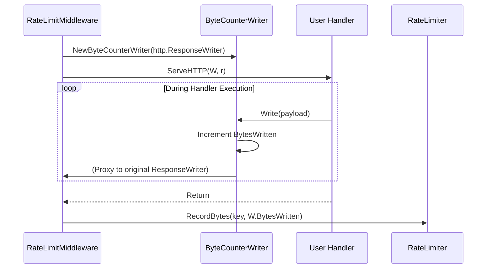
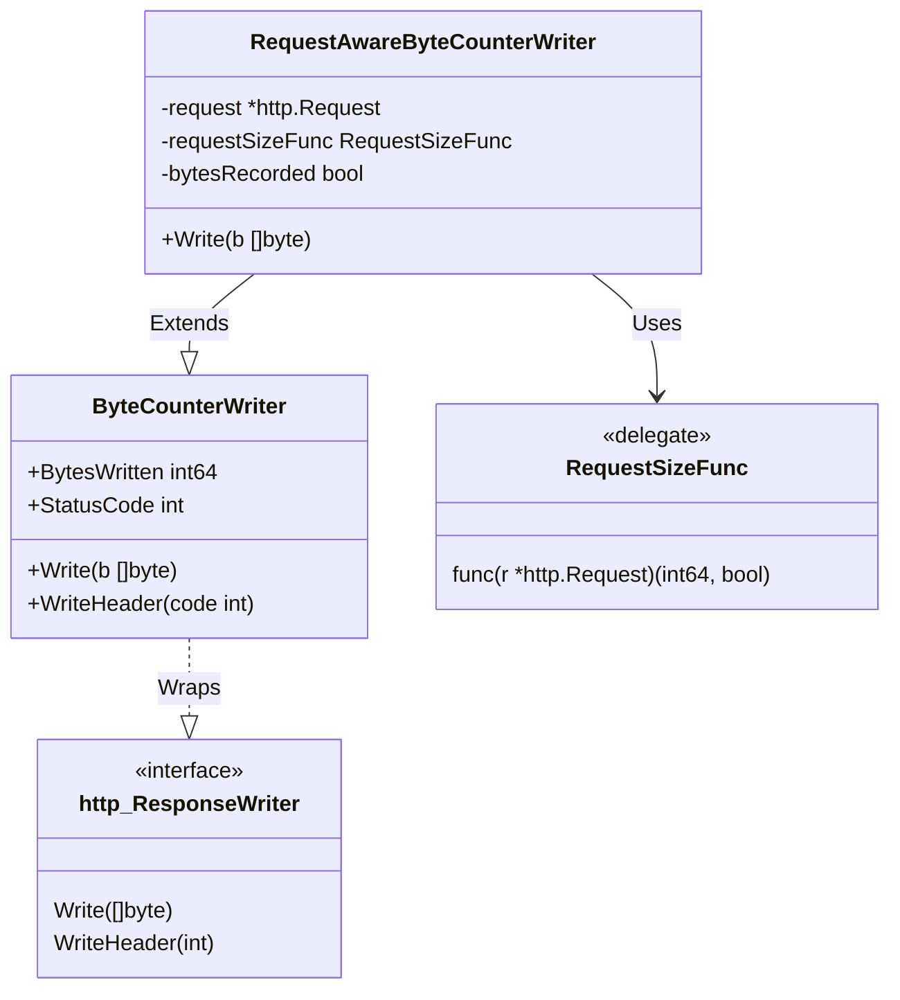

<!-- source: DeepWiki mcp.deepwiki.com · repo NVIDIA/go-ratelimit · page 3.2 ByteCounterWriter & Response Instrumentation · fetched 2026-10-26 -->

# ByteCounterWriter & Response Instrumentation

Relevant source files

The following files were used as context for generating this wiki page:

- [pkg/middleware/bytecounter.go](pkg/middleware/bytecounter.go)
- [pkg/middleware/logger.go](pkg/middleware/logger.go)
- [pkg/middleware/request_aware_bytecounter.go](pkg/middleware/request_aware_bytecounter.go)

The `go-ratelimit` library provides sophisticated response instrumentation to support byte-based rate limiting. Since HTTP handlers write to an `http.ResponseWriter` during execution, the system must intercept these calls to accurately measure the data volume processed before reporting it back to the rate limiter. This is achieved through two primary wrapper types: `ByteCounterWriter` and `RequestAwareByteCounterWriter`.

## ByteCounterWriter

The `ByteCounterWriter` is a specialized wrapper for `http.ResponseWriter` designed to capture metadata about the HTTP response that is otherwise lost once the handler finishes execution. It tracks the total number of bytes written to the client and the HTTP status code returned by the handler.

### Key Capabilities
- **Byte Tracking**: Intercepts `Write` calls to increment an internal counter [pkg/middleware/bytecounter.go:40-44]().
- **Status Code Capture**: Overrides `WriteHeader` to store the status code for later logging or analysis [pkg/middleware/bytecounter.go:47-50]().
- **Interface Satisfaction**: Implements `http.Flusher` and `http.Hijacker` by delegating to the underlying writer if supported, ensuring compatibility with WebSockets and streaming responses [pkg/middleware/bytecounter.go:53-65]().

### Implementation Details
The struct embeds the original `http.ResponseWriter`, allowing it to act as a transparent proxy.

| Field | Type | Description |
| :--- | :--- | :--- |
| `ResponseWriter` | `http.ResponseWriter` | The original writer being wrapped [pkg/middleware/bytecounter.go:26](). |
| `BytesWritten` | `int64` | Cumulative count of bytes sent via `Write` [pkg/middleware/bytecounter.go:27](). |
| `StatusCode` | `int` | The HTTP status code (defaults to 200 OK) [pkg/middleware/bytecounter.go:28,35](). |

**Sources:** [pkg/middleware/bytecounter.go:24-37]()

## RequestAwareByteCounterWriter

In some scenarios, rate limiting should be based on the size of the incoming request (e.g., file uploads) rather than the outgoing response. The `RequestAwareByteCounterWriter` extends the basic byte counter to prioritize request-side metrics when provided.

### Data Flow Logic
1. Upon the first call to `Write`, the writer executes a `RequestSizeFunc` [pkg/middleware/request_aware_bytecounter.go:43-45]().
2. If the function successfully retrieves a request size, that value is assigned to `BytesWritten`, and the writer enters a `bytesRecorded` state [pkg/middleware/request_aware_bytecounter.go:46-50]().
3. If no request size is available, it falls back to counting response bytes as they are written, identical to the standard `ByteCounterWriter` [pkg/middleware/request_aware_bytecounter.go:57-60]().

**Sources:** [pkg/middleware/request_aware_bytecounter.go:22-62]()

## Instrumentation Lifecycle

The following diagram illustrates how the middleware utilizes these writers to bridge the gap between the HTTP handler and the `RateLimiter` recording logic.

### Response Interception Flow

**Sources:** [pkg/middleware/bytecounter.go:32-44](), [pkg/middleware/request_aware_bytecounter.go:43-62]()

## Code Entity Mapping

The following diagram maps the logical instrumentation components to their specific code entities and interfaces.

### Instrumentation Entity Map

**Sources:** [pkg/middleware/bytecounter.go:25-30](), [pkg/middleware/request_aware_bytecounter.go:23-31]()

## Interface Support (Flusher & Hijacker)

To ensure that the middleware does not break standard HTTP features, the `ByteCounterWriter` explicitly checks the capabilities of the underlying `http.ResponseWriter`.

- **Flushing**: If the wrapped writer implements `http.Flusher`, the `Flush()` method is exposed and delegated [pkg/middleware/bytecounter.go:53-57]().
- **Hijacking**: If the wrapped writer implements `http.Hijacker`, the `Hijack()` method allows the caller to take over the connection (essential for protocols like WebSockets) [pkg/middleware/bytecounter.go:60-65]().

**Sources:** [pkg/middleware/bytecounter.go:52-65]()

---

