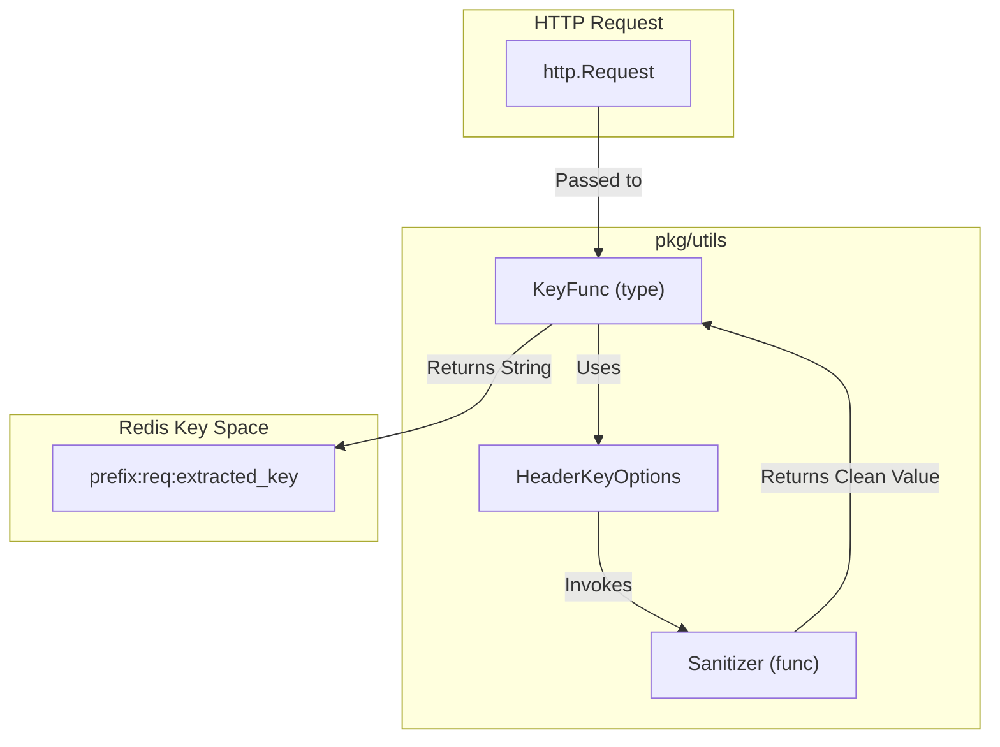
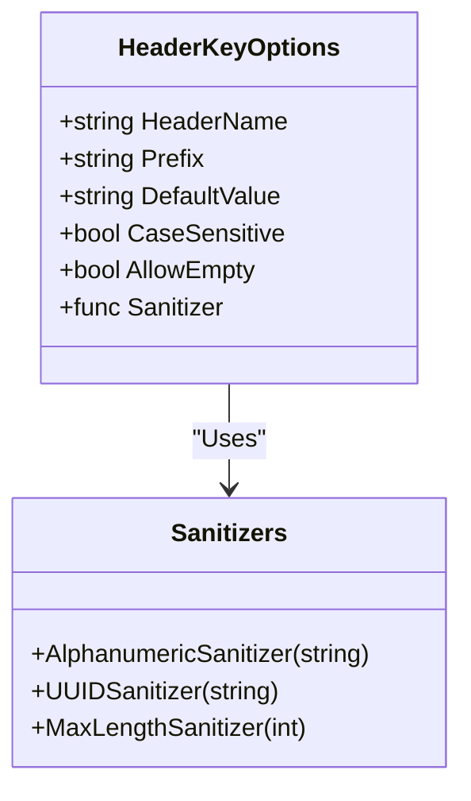

<!-- source: DeepWiki mcp.deepwiki.com · repo NVIDIA/go-ratelimit · page 4 Key Extraction & Utilities · fetched 2026-10-26 -->

# Key Extraction & Utilities

Relevant source files

The following files were used as context for generating this wiki page:

- [pkg/utils/header_keys.go](pkg/utils/header_keys.go)
- [pkg/utils/request.go](pkg/utils/request.go)

The `pkg/utils` package provides the logic for mapping incoming HTTP requests to unique rate-limit keys. This process is central to the library's ability to differentiate between clients, tenants, or specific API routes. The package defines a standard `KeyFunc` signature and offers a variety of factory functions to generate these keys based on IP addresses, headers, or composite request data.

### The Key Extraction Process

Rate limiting relies on identifying the "subject" of the limit. The `go-ratelimit` library uses a functional approach where a `KeyFunc` examines an `*http.Request` and returns a string that acts as the unique identifier in the Redis backend.

The following diagram illustrates how the `middleware` uses `utils` to derive a key before interacting with the `limiter`.

**Request to Key Mapping Flow**

Sources: [pkg/utils/header_keys.go:25-48](), [pkg/utils/header_keys.go:70-109](), [pkg/utils/request.go:25-48]()

---

### Key Generation Functions

The library provides several built-in strategies for key generation. These range from simple IP-based identification to complex multi-header fallback logic.

| Strategy | Function / Type | Description |
|:---|:---|:---|
| **IP-Based** | `KeyByIP` | Uses `ClientIP(r)` to identify the client. [pkg/utils/request.go:25-27]() |
| **Client ID** | `KeyByClientID` | Uses a provided ID, falling back to IP if the ID is empty. [pkg/utils/request.go:29-37]() |
| **Route-Aware** | `KeyByClientIDAndRoute` | Combines a client ID with a normalized URL path bucket. [pkg/utils/request.go:39-48]() |
| **Header-Based** | `KeyByHeader` | Extracts a key from a specific HTTP header (e.g., `X-API-Key`). [pkg/utils/header_keys.go:63-67]() |
| **Composite** | `KeyByMultipleHeaders` | Joins multiple header values into a single delimited key. [pkg/utils/header_keys.go:118-148]() |
| **Fallback** | `KeyByHeaderWithFallback` | Tries a list of headers in order until a value is found. [pkg/utils/header_keys.go:157-175]() |

For a detailed reference on implementing these strategies and how they namespace keys in Redis, see **[Key Generation Functions](#4.1)**.

---

### Advanced Configuration & Sanitization

When extracting keys from user-provided headers, it is critical to prevent "key-space pollution" or injection attacks in Redis. The `HeaderKeyOptions` struct allows for fine-grained control over how header values are processed.

**Key Extraction Entities**

Sources: [pkg/utils/header_keys.go:25-48](), [pkg/utils/header_keys.go:179-217]()

#### Sanitizers
Sanitizers are functions with the signature `func(string) string`. They are executed during key extraction to normalize the input. Built-in options include:
*   **`AlphanumericSanitizer`**: Strips all non-alphanumeric characters. [pkg/utils/header_keys.go:180-188]()
*   **`UUIDSanitizer`**: Validates and normalizes 32-character hex strings. [pkg/utils/header_keys.go:191-207]()
*   **`MaxLengthSanitizer`**: Truncates values to prevent excessively long keys. [pkg/utils/header_keys.go:210-217]()

For details on configuring these options and preventing Redis injection, see **[Header Sanitizers](#4.2)**.

---

### Request Utilities

The package also includes helper functions for common request inspection tasks:
*   **`ClientIP`**: Extracts the IP, honoring the `X-Forwarded-For` header if present. [pkg/utils/request.go:65-76]()
*   **`RouteBucket`**: Normalizes URL paths (e.g., `/v1/users/123` becomes `/v1/users`) to allow for aggregate rate limiting across resource endpoints. [pkg/utils/request.go:51-62]()

Sources: [pkg/utils/request.go:51-76]()

---

