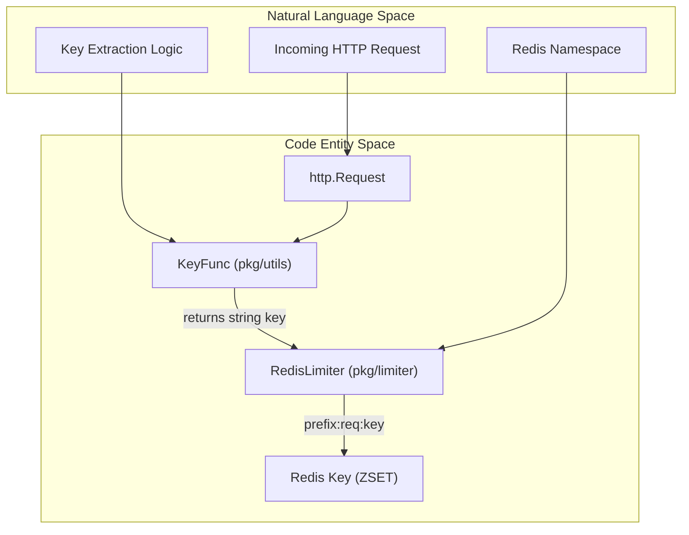
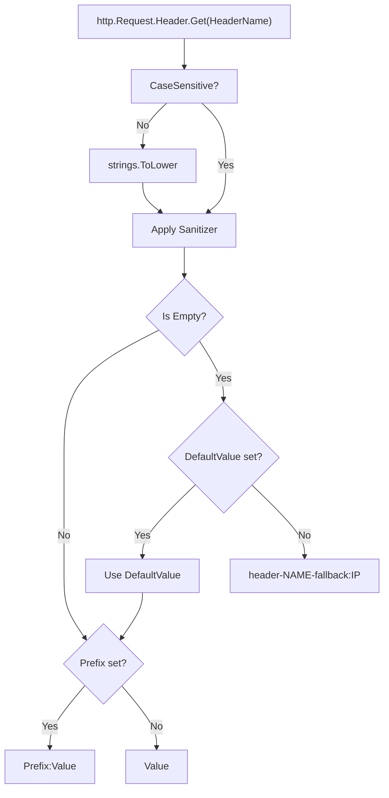

<!-- source: DeepWiki mcp.deepwiki.com · repo NVIDIA/go-ratelimit · page 4.1 Key Generation Functions · fetched 2026-10-26 -->

# Key Generation Functions

Relevant source files

The following files were used as context for generating this wiki page:

- [docs/HEADER_BASED_RATE_LIMITING.md](docs/HEADER_BASED_RATE_LIMITING.md)
- [pkg/utils/header_keys.go](pkg/utils/header_keys.go)
- [pkg/utils/header_keys_test.go](pkg/utils/header_keys_test.go)
- [pkg/utils/request.go](pkg/utils/request.go)
- [pkg/utils/request_test.go](pkg/utils/request_test.go)

The `go-ratelimit` library uses key generation functions to map incoming HTTP requests to unique identifiers used for tracking rate limits in Redis. These functions determine the granularity of the rate limiting—whether it is applied per IP address, per authenticated user, or per specific request header.

## Overview

A `KeyFunc` is a functional type that accepts an `*http.Request` and returns a `string`. This string serves as the unique identifier for the client in the rate limiting engine. When used with Redis-backed limiters, these keys are namespaced and used to build the final Redis keys (e.g., `prefix:req:<generated_key>`).

### Key Flow and Redis Namespacing

The following diagram illustrates how a request flows through a `KeyFunc` to become a Redis key:

**Request to Redis Key Mapping**

Sources: [pkg/utils/header_keys.go:50-63](), [pkg/utils/request.go:24-27]()

---

## Standard Key Functions

The library provides several built-in functions for common identification strategies.

### KeyByIP
`KeyByIP` extracts the client's IP address. It honors the `X-Forwarded-For` header if present, taking the first entry in the comma-separated list. If the header is missing, it falls back to `r.RemoteAddr`.

*   **Format**: `ip:<ip_address>`
*   **Implementation**: [pkg/utils/request.go:25-27]()
*   **IP Extraction**: [pkg/utils/request.go:65-76]()

### KeyByClientID
`KeyByClientID` is intended for use after a request has been authenticated. If the `clientID` provided is empty, it falls back to `KeyByIP`.

*   **Format**: `client:<clientID>` or `ip:<ip_address>`
*   **Implementation**: [pkg/utils/request.go:31-37]()

### KeyByClientIDAndRoute
This function combines a client identifier with a normalized URL path (route bucket). This allows for per-route rate limiting for specific users.

*   **Format**: `client:<clientID>|route:<bucket>`
*   **Route Normalization**: The `RouteBucket` function normalizes paths to the first two segments (e.g., `/v1/users/123` becomes `/v1/users`).
*   **Implementation**: [pkg/utils/request.go:41-48](), [pkg/utils/request.go:51-62]()

---

## Header-Based Key Functions

Header-based functions allow for flexible limiting based on custom metadata, such as API keys or Tenant IDs.

### KeyByHeader
A convenience wrapper around `KeyByHeaderWithOptions` that extracts a single header value.

*   **Source**: [pkg/utils/header_keys.go:63-67]()

### KeyByHeaderWithOptions
Provides fine-grained control over header extraction via the `HeaderKeyOptions` struct.

| Option | Type | Description |
| :--- | :--- | :--- |
| `HeaderName` | `string` | The HTTP header to inspect. |
| `Prefix` | `string` | Optional prefix for the resulting key (e.g., `tenant:`). |
| `DefaultValue` | `string` | Value used if header is missing. If empty, falls back to IP. |
| `CaseSensitive`| `bool` | Whether to preserve case (default `false` / lowercase). |
| `Sanitizer` | `func` | Function to clean/validate the header value. |

**Header Extraction Logic**

Sources: [pkg/utils/header_keys.go:25-48](), [pkg/utils/header_keys.go:70-109]()

### KeyByMultipleHeaders
Creates a composite key by joining multiple header values with a separator. If all specified headers are missing, it falls back to an IP-based key.

*   **Example**: `X-Tenant-ID: "t1"`, `X-Region: "us"` with separator `:` results in `t1:us`.
*   **Implementation**: [pkg/utils/header_keys.go:118-148]()

### KeyByHeaderWithFallback
Tries a list of headers in order. The first non-empty header found is used to generate the key.

*   **Format**: `header:<header_name>:<value>`
*   **Implementation**: [pkg/utils/header_keys.go:157-175]()

---

## Fallback Chain Logic

Many key functions implement a fallback mechanism to ensure a request is always identified, even if preferred metadata (like a Client ID or Header) is missing.

1.  **Direct Value**: The function attempts to extract the primary identifier (e.g., `r.Header.Get("X-API-Key")`).
2.  **Default Value**: If the primary value is empty and `DefaultValue` is configured in `HeaderKeyOptions`, that value is used. [pkg/utils/header_keys.go:92-93]()
3.  **IP Fallback**: If no value is found and no default is set, the system generates a fallback key using the client's IP. [pkg/utils/header_keys.go:96-99]()

| Function | Fallback Format |
| :--- | :--- |
| `KeyByHeader` | `header-<name>-fallback:<IP>` |
| `KeyByMultipleHeaders` | `multi-header-fallback:<IP>` |
| `KeyByHeaderWithFallback` | `header-fallback:<IP>` |
| `KeyByClientID` | `ip:<IP>` |

Sources: [pkg/utils/header_keys.go:91-100](), [pkg/utils/header_keys.go:142-144](), [pkg/utils/request.go:32-35]()

---

## Sanitizers

Sanitizers are functions applied to header values before they are used as keys. This prevents "key-space pollution" or potential injection attacks in Redis.

*   **`AlphanumericSanitizer`**: Removes all characters except `a-z`, `A-Z`, and `0-9`. [pkg/utils/header_keys.go:180-188]()
*   **`UUIDSanitizer`**: Validates the value is a 32-character hex string (normalizes by removing hyphens and lowercasing). [pkg/utils/header_keys.go:191-207]()
*   **`MaxLengthSanitizer(n)`**: Truncates the string to the first `n` characters. [pkg/utils/header_keys.go:210-217]()

Sources: [pkg/utils/header_keys.go:177-217]()

---

