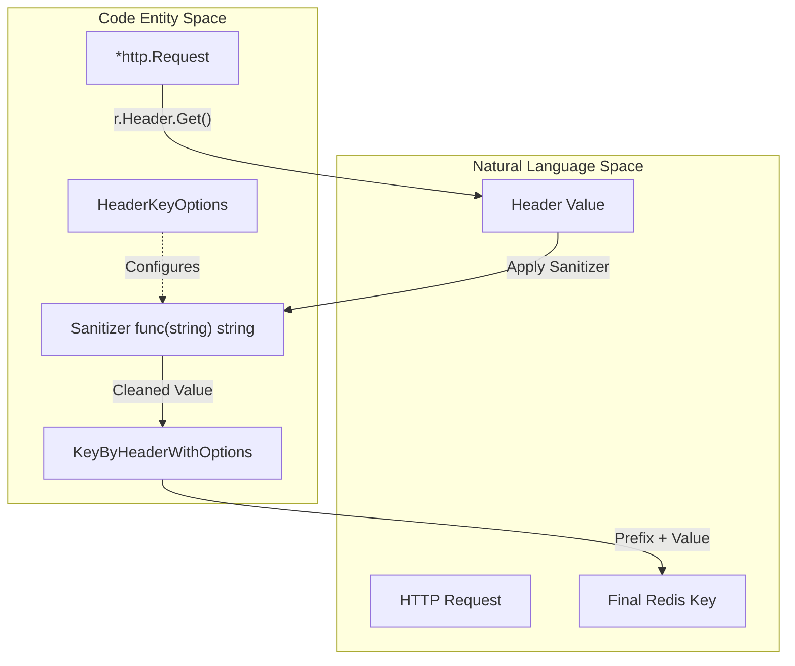
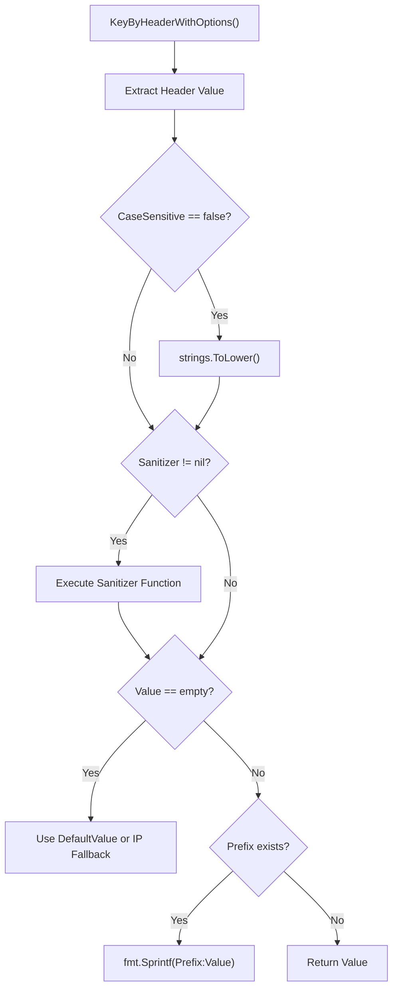

<!-- source: DeepWiki mcp.deepwiki.com · repo NVIDIA/go-ratelimit · page 4.2 Header Sanitizers · fetched 2026-10-26 -->

# Header Sanitizers

<details>
<summary>Relevant source files</summary>

The following files were used as context for generating this wiki page:

- [pkg/utils/header_keys.go](pkg/utils/header_keys.go)
- [pkg/utils/header_keys_test.go](pkg/utils/header_keys_test.go)

</details>


Header Sanitizers are utility functions used within the `pkg/utils` package to clean, validate, and normalize values extracted from HTTP headers before they are used as rate-limiting keys. These sanitizers are critical for preventing key-space pollution in Redis and protecting against injection attacks or unexpected character encoding issues.

## Overview and Purpose

When rate limiting based on client-provided headers (e.g., `X-Tenant-ID` or `X-API-Key`), the extracted value is used to construct a Redis key. Without sanitization, a malicious client could provide headers containing special characters (like `:` or spaces) that might interfere with Redis key namespacing or cause memory exhaustion by generating an infinite number of unique, malformed keys.

Sanitizers are integrated into the key extraction pipeline via the `HeaderKeyOptions` struct [pkg/utils/header_keys.go:25-48]().

### Data Flow: Header to Key

The following diagram illustrates how a raw HTTP header value is processed through a sanitizer to produce a safe Redis key.

**Header Sanitization Process**

Sources: [pkg/utils/header_keys.go:70-109]()

## Built-in Sanitizers

The library provides several pre-defined sanitizers for common use cases.

### AlphanumericSanitizer
The `AlphanumericSanitizer` iterates through the input string and retains only characters in the ranges `[a-z]`, `[A-Z]`, and `[0-9]` [pkg/utils/header_keys.go:180-188](). This is the safest option for general IDs and names.

### UUIDSanitizer
The `UUIDSanitizer` is designed for headers containing UUIDs. It performs the following steps:
1. Converts the value to lowercase [pkg/utils/header_keys.go:193]().
2. Removes all hyphens [pkg/utils/header_keys.go:193]().
3. Validates that the resulting string is exactly 32 characters long [pkg/utils/header_keys.go:196-198]().
4. Verifies that all characters are hexadecimal (`0-9`, `a-f`) [pkg/utils/header_keys.go:200-204]().
If validation fails, it returns an empty string, which typically triggers a fallback to IP-based limiting [pkg/utils/header_keys.go:91-100]().

### MaxLengthSanitizer
The `MaxLengthSanitizer` is a higher-order function that returns a sanitizer function. It truncates any input string that exceeds the specified `maxLength` [pkg/utils/header_keys.go:210-217](). This prevents "long-key" attacks that could consume excessive Redis memory.

| Sanitizer | Implementation Logic | Primary Use Case |
| :--- | :--- | :--- |
| `AlphanumericSanitizer` | Filters `[a-zA-Z0-9]` | Generic Tenant IDs, API Keys |
| `UUIDSanitizer` | Hex-only, 32-char length check | System-generated UUIDs |
| `MaxLengthSanitizer(n)` | `value[:n]` truncation | Preventing memory exhaustion |

Sources: [pkg/utils/header_keys.go:177-217]()

## Integration with HeaderKeyOptions

Sanitizers are plugged into the key generation logic by assigning them to the `Sanitizer` field of `HeaderKeyOptions`.

**Key Extraction Logic with Sanitizers**

Sources: [pkg/utils/header_keys.go:76-108]()

### Example: Custom Sanitizer
Users can implement the `func(string) string` signature to provide custom logic, such as stripping specific suffixes or performing checksum validation.

```go
// Example of a custom sanitizer used in HeaderKeyOptions
opts := utils.HeaderKeyOptions{
    HeaderName: "X-Custom-ID",
    Sanitizer: func(val string) string {
        // Custom logic: only allow lowercase and underscores
        return strings.Map(func(r rune) rune {
            if (r >= 'a' && r <= 'z') || r == '_' {
                return r
            }
            return -1
        }, val)
    },
}
keyFunc := utils.KeyByHeaderWithOptions(opts)
```
Sources: [pkg/utils/header_keys.go:45-47](), [pkg/utils/header_keys.go:86-89]()

## Testing Sanitizers

The robustness of these sanitizers is verified in `pkg/utils/header_keys_test.go`. The tests ensure that:
1. `AlphanumericSanitizer` correctly strips special characters like `!@#` [pkg/utils/header_keys_test.go:123-127]().
2. `MaxLengthSanitizer` truncates strings accurately while preserving prefixes [pkg/utils/header_keys_test.go:130-137]().
3. Sanitizers integrate correctly with the `CaseSensitive` and `Prefix` options within the `KeyByHeaderWithOptions` factory [pkg/utils/header_keys_test.go:76-157]().

Sources: [pkg/utils/header_keys_test.go:120-137](), [pkg/utils/header_keys_test.go:262-263]()

---

